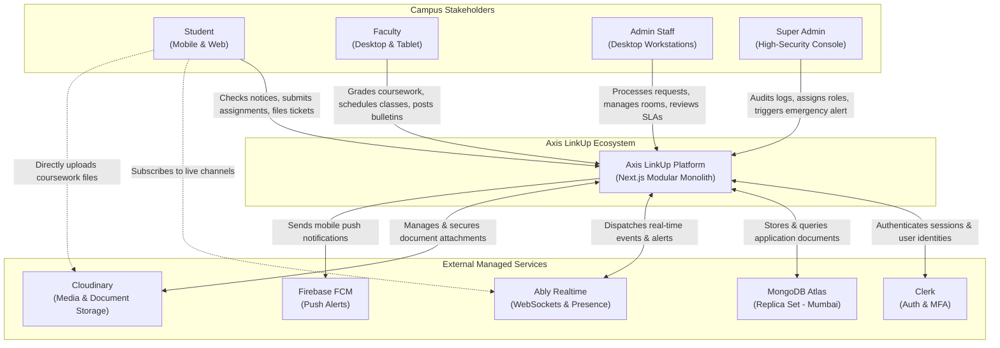
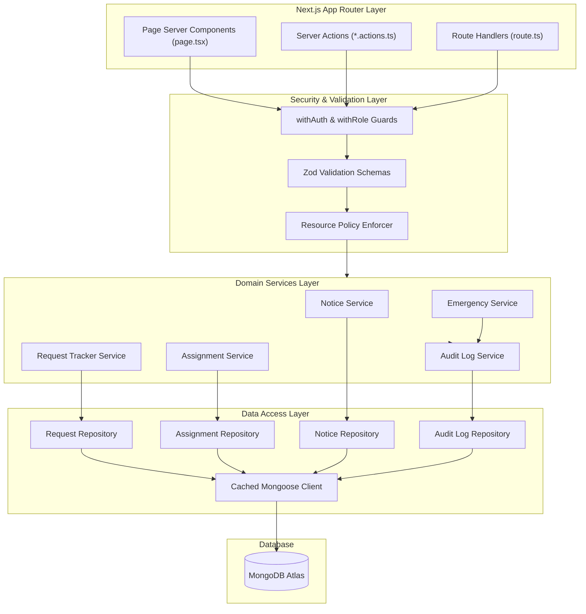
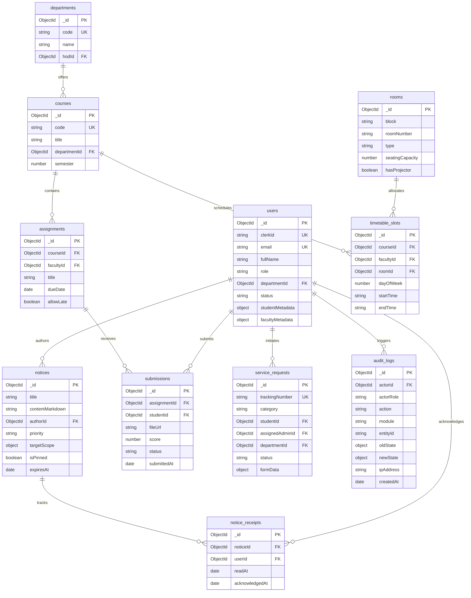
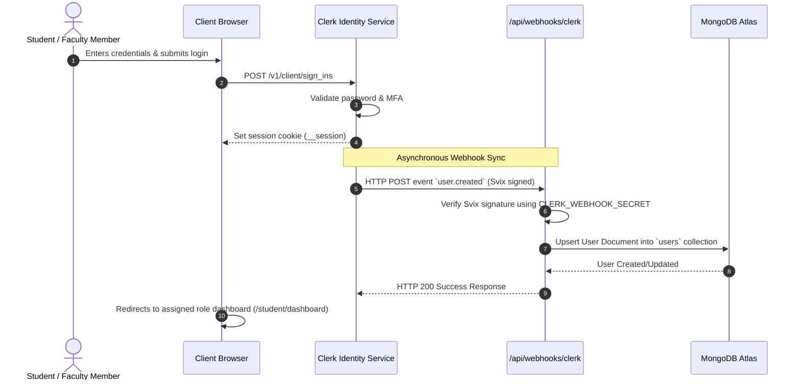
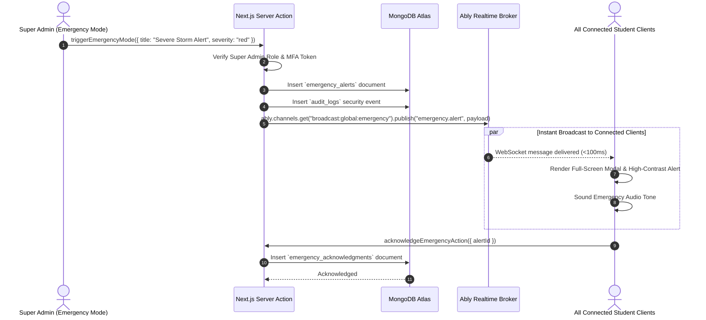
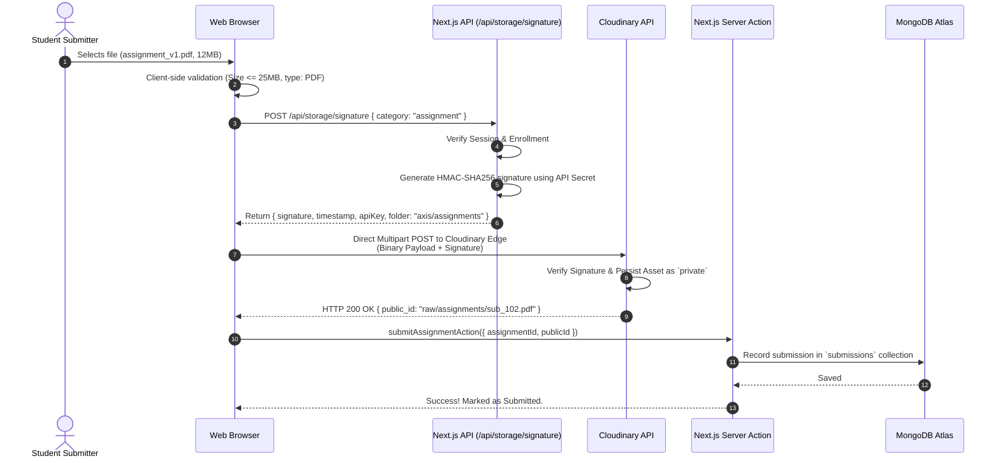
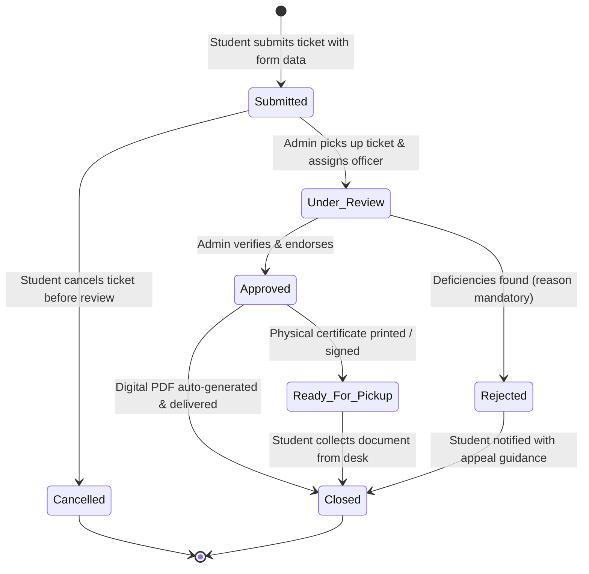

# System Architecture Diagrams Specification

> **Document ID:** DOC-ARCH-009  
> **Status:** Draft for Review (Phase 1, Part 1.2)  
> **Standard:** C4 Model & UML Sequence Standards  
> **Diagramming Format:** Mermaid.js  
> **Last Updated:** November 2026  

---

## 1. System Context Diagram (C4 Level 1)

Visualizes how different user roles and external services interact with the Axis LinkUp platform.



---

## 2. Container Diagram (C4 Level 2)

Details the software containers, hosting boundaries, and protocols in use.

```mermaid
graph TD
    subgraph ClientTier [Client Applications]
        Browser["Responsive Web Browser / PWA<br/>(React 19 / TypeScript)"]
    end

    subgraph EdgeTier [Vercel Edge Network]
        EdgeProxy["Vercel CDN / Reverse Proxy<br/>(TLS 1.3 Termination)"]
        Middleware["Next.js Edge Middleware<br/>(JWT Decryption & RBAC Guard)"]
    end

    subgraph ServerlessTier [Next.js Application Core]
        RSC["React Server Components<br/>(Server HTML Streaming)"]
        ServerActions["Next.js Server Actions<br/>(Mutations & Business Logic)"]
        RouteHandlers["API Route Handlers<br/>(Webhooks & Token Minting)"]
    end

    subgraph PersistenceTier [Data & Persistence Engine]
        MongoDB[("MongoDB Atlas M10+<br/>(AWS Mumbai - ap-south-1)")]
    end

    subgraph CloudServices [Managed Cloud Integrations]
        Clerk["Clerk Identity Service"]
        Ably["Ably Realtime Broker"]
        Cloudinary["Cloudinary Media Engine"]
        FCM["Firebase Cloud Messaging"]
    end

    Browser -->|HTTPS / WSS| EdgeProxy
    EdgeProxy --> Middleware
    Middleware --> RSC
    Middleware --> ServerActions
    Middleware --> RouteHandlers

    RSC -->|Mongoose DAL (TCP)| MongoDB
    ServerActions -->|Mongoose DAL (TCP)| MongoDB
    ServerActions -->|REST API (HTTPS)| Ably
    ServerActions -->|REST API (HTTPS)| Cloudinary
    ServerActions -->|REST API (HTTPS)| FCM
    RouteHandlers <-->|Signed Webhooks (HTTPS)| Clerk

    Browser <-->|WebSocket (WSS)| Ably
    Browser -->|Direct Multipart Upload (HTTPS)| Cloudinary
```

---

## 3. Component Diagram (C4 Level 3 — Next.js Modular Monolith)

Breaks down the internal code structure inside the Next.js application container.



---

## 4. Entity Relationship Diagram (MongoDB Collections)

Illustrates the document collections, primary identifiers, and referenced ObjectIds.



---

## 5. Authentication & Webhook Sync Sequence Diagram



---

## 6. Real-Time Chat & Emergency Broadcast Flow



---

## 7. Secure Direct-to-Cloudinary File Upload Flow



---

## 8. Student Request Tracker State Machine (MOD-13)



