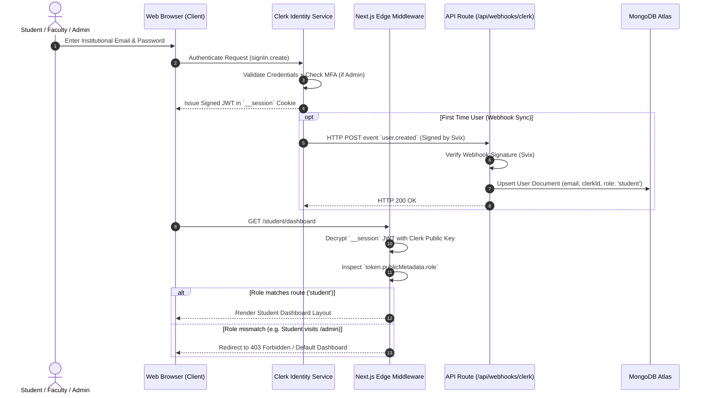

# Authentication & Authorization Architecture

> **Document ID:** DOC-ARCH-005  
> **Status:** Draft for Review (Phase 1, Part 1.2)  
> **Identity Provider:** Clerk (Proposed Evaluation)  
> **Pattern:** Dual-Store Identity & Fine-Grained RBAC / ABAC  
> **Last Updated:** November 2026  

---

## 1. Evaluation of Clerk for Axis LinkUp

### 1.1 Overview & Key Capabilities
Clerk is an enterprise identity and user management platform engineered specifically for modern Next.js applications. It provides pre-built, customizable UI components (`<SignIn />`, `<UserProfile />`), multi-session management, passwordless and TOTP Multi-Factor Authentication (MFA), email verification, and cryptographic session cookies.

### 1.2 Advantages for Axis LinkUp
- **Edge Middleware Native:** Clerk provides zero-latency JWT session verification at the edge via `@clerk/nextjs`, protecting routes before serverless function execution.
- **Built-in MFA & Security:** Out-of-the-box TOTP multi-factor authentication satisfies the mandatory MFA requirement for Admin and Super Admin roles (NFR-SEC-01).
- **Session Cookie Security:** Automatically issues cryptographically signed, `HttpOnly`, `SameSite=Strict`, `Secure` session cookies, mitigating XSS and CSRF risks without custom refresh-token rotation code.
- **Developer Velocity:** Eliminates hundreds of hours of custom authentication boilerplate, password hashing maintenance, and email verification token management.

### 1.3 Trade-offs & Institutional Considerations
- **Third-Party Dependency:** If Clerk suffers an outage, user authentication is interrupted (mitigated by Clerk's 99.99% historical uptime and status monitoring).
- **Data Residence & DPDP Act:** Clerk's core user identity database is cloud-hosted. To comply with Indian data residency (DPDP Act), only basic authentication attributes (email, name, hashed credentials) reside in Clerk. All academic records, grades, PII phone numbers, and departmental data reside strictly within MongoDB Atlas in AWS Mumbai (`ap-south-1`).
- **Cost Scaling:** Clerk offers a generous free tier (up to 10,000 monthly active users), which fully accommodates Axis Institute's student and faculty body (3,000–5,000 MAUs) during initial deployment.

---

## 2. End-to-End Authentication & Login Flow



---

## 3. User Provisioning & Webhook Synchronization

To ensure complete decoupling, the system maintains a **Dual-Store Identity Model**:
1. **Clerk:** Handles authentication credentials, password verification, active sessions, and MFA state.
2. **MongoDB (`users` collection):** Primary source of truth for institutional metadata, department associations, student roll numbers, and academic records.

### 3.1 Provisioning Channels
- **Bulk CSV Onboarding (Admin/Super Admin):** The IT Admin uploads a student roster CSV. A server action calls `@clerk/backend` SDK to provision users in bulk and assign their initial role in `publicMetadata`. Clerk dispatches invitation emails.
- **Webhook Synchronization:**
  - An endpoint at `/api/webhooks/clerk` listens for Clerk events (`user.created`, `user.updated`, `user.deleted`).
  - Webhook payloads are verified using cryptographic signatures via `svix`.
  - When a `user.created` event arrives, the webhook handler creates or updates the corresponding MongoDB `User` document.

---

## 4. How to Prevent Users from Changing Their Own Roles

> [!CAUTION]
> In client-accessible identity systems, improper metadata handling can lead to critical privilege escalation vulnerabilities where malicious students modify their account metadata to become Admins.

Clerk provides three distinct metadata partitions with strictly segregated access privileges:

| Metadata Type | Client Read | Client Write | Backend / Server Read | Backend / Server Write | Security Application in Axis LinkUp |
| :--- | :---: | :---: | :---: | :---: | :--- |
| `unsafeMetadata` | **Yes** | **Yes** | Yes | Yes | **STRICTLY PROHIBITED FOR SECURITY:** Only used for non-sensitive client preferences (e.g., UI color theme). |
| `publicMetadata` | **Yes** | **NO** | Yes | **Yes (Backend Secret Only)** | **Used for Role & Routing:** Stores `{ role: "student" }`. Readable by Edge Middleware for fast routing; cannot be modified by the client. |
| `privateMetadata` | **NO** | **NO** | Yes | **Yes (Backend Secret Only)** | **Used for Internal Flags:** Stores sensitive institutional flags (e.g., disciplinary hold status). Completely invisible to client. |

### 4.1 Multi-Layered Role Escalation Prevention Strategy

1. **Client Immutability:** The Clerk frontend SDK does not expose any API to write to `publicMetadata`. Attempts to send JSON payloads modifying `publicMetadata` from client-side scripts are rejected by Clerk's edge API.
2. **Server-Side Secret Key Protection:** `publicMetadata` can only be updated using `@clerk/backend` SDK initialized with the server-only `CLERK_SECRET_KEY`. This secret key is never shipped to client bundles.
3. **Super Admin Authorization Gate:** The Server Action responsible for changing user roles (`updateUserRoleAction`) executes two strict checks before calling Clerk:
   - Verifies the caller has active role `super_admin` in both the session JWT and MongoDB.
   - Verifies the caller is not demoting the last remaining active Super Admin.
4. **Immediate Audit Logging:** Any invocation of role modification immediately writes an immutable record to MongoDB `audit_logs` detailing the actor, target user, previous role, and new role.

```typescript
// Example: Secure Role Mutation in Server Action
export async function updateUserRoleAction(targetUserId: string, newRole: Role) {
  // 1. Verify caller session and Super Admin authority
  const caller = await requireSuperAdmin();

  // 2. Prevent self-demotion lockout
  if (caller.id === targetUserId && newRole !== 'super_admin') {
    throw new ForbiddenError('Super Admins cannot revoke their own privileges.');
  }

  // 3. Update Clerk publicMetadata via Server Secret Key
  const clerk = await clerkClient();
  await clerk.users.updateUserMetadata(targetUserId, {
    publicMetadata: { role: newRole }
  });

  // 4. Update MongoDB Source of Truth
  const oldUser = await UserRepository.findByIdAndUpdate(targetUserId, { role: newRole });

  // 5. Immutably log the action
  await AuditService.log({
    actorId: caller.id,
    actorRole: caller.role,
    action: 'ROLE_MODIFIED',
    module: 'MOD-02',
    entityId: targetUserId,
    oldState: { role: oldUser.role },
    newState: { role: newRole },
  });

  return { success: true };
}
```

---

## 5. Role-Based Access Control (RBAC) & Route Protection

### 5.1 Route Protection Matrix (Next.js Edge Middleware)
Next.js Edge Middleware (`middleware.ts`) intercepts all incoming requests and enforces role-based path boundaries:

| Path Prefix | Permitted Roles | Unauthorized Action |
| :--- | :--- | :--- |
| `/` (Root) | Public | None |
| `/sign-in/*`, `/sign-up/*` | Public (Unauthenticated) | Redirect to role dashboard if already signed in |
| `/student/*` | `student` | Redirect to user's assigned dashboard or 403 |
| `/faculty/*` | `faculty` | Redirect to user's assigned dashboard or 403 |
| `/admin/*` | `admin`, `super_admin` | Redirect to 403 Forbidden |
| `/super-admin/*` | `super_admin` | Redirect to 403 Forbidden |
| `/api/webhooks/*` | Public (Cryptographically verified) | Reject if signature invalid (Svix) |

### 5.2 Next.js Middleware Implementation Blueprint

```typescript
// src/middleware.ts
import { clerkMiddleware, createRouteMatcher } from '@clerk/nextjs/server';
import { NextResponse } from 'next/server';

const isPublicRoute = createRouteMatcher(['/', '/sign-in(.*)', '/sign-up(.*)', '/api/webhooks(.*)']);
const isStudentRoute = createRouteMatcher(['/student(.*)']);
const isFacultyRoute = createRouteMatcher(['/faculty(.*)']);
const isAdminRoute = createRouteMatcher(['/admin(.*)']);
const isSuperAdminRoute = createRouteMatcher(['/super-admin(.*)']);

export default clerkMiddleware(async (auth, req) => {
  if (isPublicRoute(req)) return NextResponse.next();

  const { userId, sessionClaims } = await auth();
  if (!userId) {
    const signInUrl = new URL('/sign-in', req.url);
    signInUrl.searchParams.set('redirect_url', req.url);
    return NextResponse.redirect(signInUrl);
  }

  const userRole = (sessionClaims?.publicMetadata as { role?: string })?.role;

  if (isStudentRoute(req) && userRole !== 'student') {
    return NextResponse.redirect(new URL('/unauthorized', req.url));
  }
  if (isFacultyRoute(req) && userRole !== 'faculty') {
    return NextResponse.redirect(new URL('/unauthorized', req.url));
  }
  if (isAdminRoute(req) && userRole !== 'admin' && userRole !== 'super_admin') {
    return NextResponse.redirect(new URL('/unauthorized', req.url));
  }
  if (isSuperAdminRoute(req) && userRole !== 'super_admin') {
    return NextResponse.redirect(new URL('/unauthorized', req.url));
  }

  return NextResponse.next();
});

export const config = {
  matcher: ['/((?!.*\\..*|_next).*)', '/', '/(api|trpc)(.*)'],
};
```

---

## 6. Resource-Level Authorization (ABAC)

While RBAC controls high-level page access, **Attribute-Based Access Control (ABAC)** controls entity-level permissions inside Server Actions and Services:

```typescript
// Policy Example: Can a user grade an assignment submission?
export function canGradeSubmission(user: UserSession, submission: SubmissionDoc, assignment: AssignmentDoc): boolean {
  if (user.role === 'super_admin') return true;
  if (user.role === 'faculty') {
    // Only the faculty assigned to this specific course can grade
    return assignment.facultyId.equals(user.id);
  }
  return false;
}

// Policy Example: Can a user view a service request?
export function canViewRequest(user: UserSession, request: ServiceRequestDoc): boolean {
  if (user.role === 'super_admin') return true;
  if (user.role === 'admin') {
    // Admin must belong to the department handling this request
    return request.departmentId.equals(user.departmentId);
  }
  if (user.role === 'student') {
    // Student can ONLY view their own tickets
    return request.studentId.equals(user.id);
  }
  return false;
}
```

