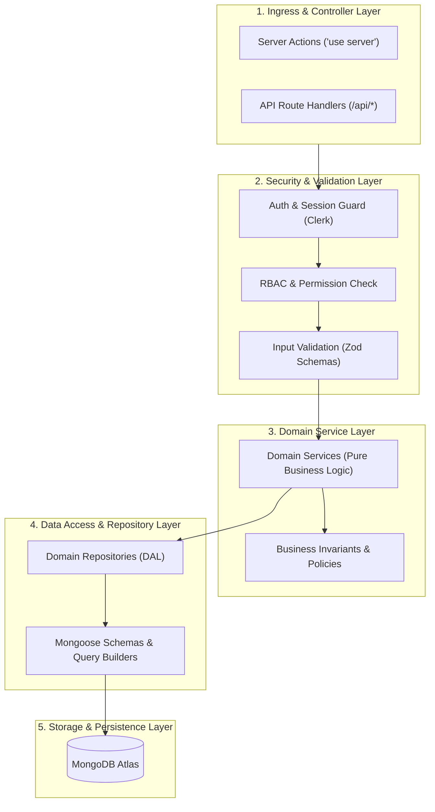

# Backend Architecture Specification

> **Document ID:** DOC-ARCH-003  
> **Status:** Draft for Review (Phase 1, Part 1.2)  
> **Architecture:** Clean Layered Service-Repository Pattern  
> **Runtime:** Node.js (Vercel Serverless Functions)  
> **Language:** TypeScript (Strict Mode)  
> **Last Updated:** November 2026  

---

## 1. Architectural Layers & Separation of Concerns

The backend of Axis LinkUp adheres to a strict multi-layer architectural pattern within the Next.js runtime. Each layer has a single, unambiguous responsibility, ensuring maintainability, testability, and enterprise-grade security.



---

## 2. Detailed Responsibility of Each Backend Layer

### 2.1 Controller / Ingress Layer (`Server Actions` & `Route Handlers`)
- **Location:** `src/app/actions/` and `src/app/api/`
- **Responsibilities:**
  - Acts as the entry gate for HTTP requests and client-side form submissions.
  - Extracts request headers, cookies, and payloads.
  - Delegates input validation to the Validation Layer.
  - Invokes the appropriate Domain Service method.
  - Catches domain exceptions and formats the standard JSON response envelope.
- **Strict Boundary:** Controllers **never** interact directly with Mongoose models and **never** contain domain business logic.

### 2.2 Validation Layer (`Zod Schemas`)
- **Location:** `src/lib/validations/`
- **Responsibilities:**
  - Enforces strict input validation on all request bodies, query parameters, and route parameters.
  - Performs sanitization, trimming, type casting, and regex validations.
  - Generates type-safe TypeScript types inferred directly from Zod schemas (`z.infer<typeof Schema>`).
  - Rejects malformed requests with granular validation error arrays before any business logic executes.

### 2.3 Authentication & Authorization Guard Layer
- **Location:** `src/lib/auth/`
- **Responsibilities:**
  - Extracts the verified Clerk session token from incoming cookies.
  - Resolves the caller's identity (`userId`), assigned role (`role`), and department (`departmentId`).
  - Enforces Role-Based Access Control (RBAC): verifies whether the caller's role satisfies the required permissions.
  - Enforces Resource-Level Authorization (ABAC): verifies that a student can only modify their own submissions or tickets, and faculty can only modify courses assigned to them.

### 2.4 Domain Service Layer
- **Location:** `src/lib/services/`
- **Responsibilities:**
  - Houses 100% of the institutional business logic and workflow orchestration.
  - Enforces business invariants (e.g., verifying submission deadlines, checking duplicate active tickets, validating room reservation overlaps).
  - Coordinates multi-repository interactions within database transactions.
  - Dispatches side effects: emits audit log events, triggers real-time Ably notifications, and schedules background jobs.
- **Decoupled Design:** Services are pure TypeScript classes or module functions. They have zero dependency on Next.js `NextRequest`, `NextResponse`, or browser APIs.

### 2.5 Repository / Data Access Layer (DAL)
- **Location:** `src/lib/db/repositories/`
- **Responsibilities:**
  - Encapsulates all database operations (Mongoose queries, aggregations, projections, updates, deletes).
  - Maps between raw MongoDB documents and domain entities.
  - Applies mandatory tenancy/department scoping filters to ensure data isolation.
  - Isolates the application from direct database implementation details.

---

## 3. Directory Structure

```
src/
├── app/
│   ├── actions/                    # Server Actions (Mutations)
│   │   ├── auth.actions.ts
│   │   ├── notices.actions.ts
│   │   ├── requests.actions.ts
│   │   ├── assignments.actions.ts
│   │   ├── facilities.actions.ts
│   │   └── emergency.actions.ts
│   └── api/                        # Route Handlers (Webhooks & External Integrations)
│       ├── webhooks/
│       │   ├── clerk/route.ts
│       │   └── cloudinary/route.ts
│       ├── realtime/
│       │   └── token/route.ts
│       └── storage/
│           └── signature/route.ts
│
├── lib/
│   ├── auth/                       # Auth & RBAC Guards
│   │   ├── session.ts              # Session extraction & verification
│   │   ├── rbac.ts                 # Role & permission checkers
│   │   └── guards.ts               # Higher-order action guards (withAuth, withRole)
│   │
│   ├── validations/                # Zod Input Schemas
│   │   ├── notice.schema.ts
│   │   ├── request.schema.ts
│   │   ├── assignment.schema.ts
│   │   └── user.schema.ts
│   │
│   ├── services/                   # Pure Domain Services
│   │   ├── notice.service.ts
│   │   ├── request.service.ts
│   │   ├── assignment.service.ts
│   │   ├── facility.service.ts
│   │   ├── emergency.service.ts
│   │   ├── realtime.service.ts
│   │   └── audit.service.ts
│   │
│   ├── db/
│   │   ├── client.ts               # Cached Mongoose singleton connection
│   │   ├── models/                 # Mongoose Schema Definitions
│   │   │   ├── user.model.ts
│   │   │   ├── notice.model.ts
│   │   │   ├── request.model.ts
│   │   │   ├── assignment.model.ts
│   │   │   ├── submission.model.ts
│   │   │   ├── room.model.ts
│   │   │   └── audit-log.model.ts
│   │   └── repositories/           # Data Access Layer
│   │       ├── user.repository.ts
│   │       ├── notice.repository.ts
│   │       ├── request.repository.ts
│   │       └── audit.repository.ts
│   │
│   └── errors/                     # Centralized Error Hierarchy
│       ├── app-error.ts
│       └── error-handler.ts
```

---

## 4. Centralized Error Handling & Response Envelope

### 4.1 Custom Domain Exception Hierarchy
A structured hierarchy of custom errors ensures consistent HTTP status code mapping and machine-readable error codes:

```typescript
// src/lib/errors/app-error.ts
export abstract class AppError extends Error {
  abstract readonly statusCode: number;
  abstract readonly errorCode: string;

  constructor(message: string, public readonly details?: unknown) {
    super(message);
    Object.setPrototypeOf(this, new.target.prototype);
  }
}

export class ValidationError extends AppError {
  readonly statusCode = 400;
  readonly errorCode = 'VALIDATION_ERROR';
}

export class UnauthorizedError extends AppError {
  readonly statusCode = 401;
  readonly errorCode = 'UNAUTHORIZED';
}

export class ForbiddenError extends AppError {
  readonly statusCode = 403;
  readonly errorCode = 'FORBIDDEN';
}

export class NotFoundError extends AppError {
  readonly statusCode = 404;
  readonly errorCode = 'NOT_FOUND';
}

export class ConflictError extends AppError {
  readonly statusCode = 409;
  readonly errorCode = 'CONFLICT';
}

export class BusinessRuleError extends AppError {
  readonly statusCode = 422;
  readonly errorCode = 'BUSINESS_RULE_VIOLATION';
}
```

### 4.2 Standard API Response Envelope
All Server Actions and Route Handlers return a deterministic response structure:

```typescript
// Success Envelope
{
  "success": true,
  "data": { ... },
  "error": null,
  "timestamp": "2026-11-09T14:30:00.000Z"
}

// Error Envelope
{
  "success": false,
  "data": null,
  "error": {
    "code": "VALIDATION_ERROR",
    "message": "Invalid submission payload",
    "details": [
      { "field": "dueDate", "issue": "Due date must be in the future" }
    ]
  },
  "timestamp": "2026-11-09T14:30:00.000Z"
}
```

---

## 5. Serverless Database Connection Pooling (Mongoose Singleton)

Next.js operates in a serverless environment (Vercel Functions). To avoid creating hundreds of unpooled database connections during cold starts, Mongoose must be initialized as a cached global singleton:

```typescript
// src/lib/db/client.ts
import mongoose from 'mongoose';

interface MongooseCache {
  conn: typeof mongoose | null;
  promise: Promise<typeof mongoose> | null;
}

declare global {
  var mongooseCache: MongooseCache | undefined;
}

const cached: MongooseCache = global.mongooseCache || { conn: null, promise: null };

if (!global.mongooseCache) {
  global.mongooseCache = cached;
}

export async function connectToDatabase(): Promise<typeof mongoose> {
  if (cached.conn) {
    return cached.conn;
  }

  if (!cached.promise) {
    const uri = process.env.MONGODB_URI;
    if (!uri) throw new Error('MONGODB_URI environment variable is missing.');

    const opts: mongoose.ConnectOptions = {
      bufferCommands: false,
      maxPoolSize: 10, // Maintain lean pool per serverless container
      serverSelectionTimeoutMS: 5000,
      socketTimeoutMS: 45000,
    };

    cached.promise = mongoose.connect(uri, opts).then((mongooseInstance) => mongooseInstance);
  }

  try {
    cached.conn = await cached.promise;
  } catch (error) {
    cached.promise = null;
    throw error;
  }

  return cached.conn;
}
```

---

## 6. Multi-Document Transactions & Concurrency

Certain business operations require atomic execution across multiple collections. When MongoDB Atlas replica sets are active, the backend executes these operations inside a Mongoose transaction session:

### Example Transactional Flow: Approving a Service Request (MOD-13)
1. **Begin Session:** Open `await mongoose.startSession()`.
2. **Execute inside Transaction:**
   - Update `ServiceRequest` document status to `Approved` with timestamp.
   - Insert new `AuditLog` entry detailing the approving admin ID and IP.
   - Insert new `Notification` entry for the student.
3. **Commit Transaction:** If all succeed, commit atomically.
4. **Rollback on Error:** If any step fails, roll back completely, ensuring no orphaned audit records or mismatched request states.

