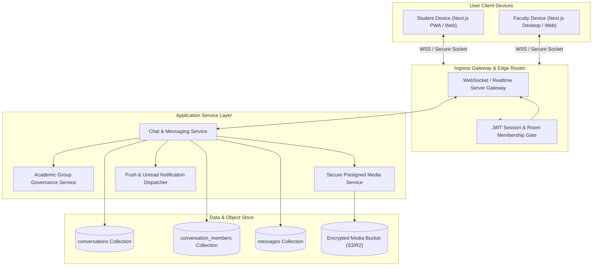
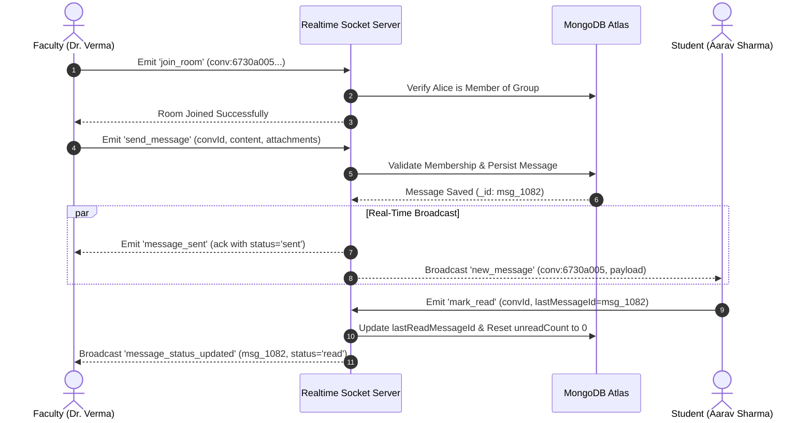

# AXIS LINKUP — REAL-TIME COMMUNICATION ARCHITECTURE
**Document ID:** DOC-ARCH-008-REV2  
**Status:** Approved for Architecture Specification (Phase 4.8.2)  
**Institution:** Axis Institute of Technology & Management (AITM), Kanpur  
**Last Updated:** November 13, 2026  

---

## 1. System Topology & Transport Protocol

The Axis LinkUp real-time communication engine is designed as an internal collegiate messaging system supporting **1:1 Peer Direct Chat** and **Faculty-Created Academic Groups**.



---

## 2. Comprehensive Database Schemas

### 2.1 Conversations Schema (`conversations`)
```typescript
import { Schema, type Model, Types } from 'mongoose';

const ConversationSchema = new Schema(
  {
    type: {
      type: String,
      enum: ['direct', 'group'],
      required: true,
      index: true,
    },
    title: {
      type: String,
      trim: true,
      maxlength: 100,
      default: null, // Populated for 'group'
    },
    description: {
      type: String,
      trim: true,
      maxlength: 250,
      default: null,
    },
    avatarUrl: {
      type: String,
      default: null,
    },
    creatorId: {
      type: Schema.Types.ObjectId,
      ref: 'User',
      required: true,
    },
    departmentId: {
      type: Schema.Types.ObjectId,
      ref: 'Department',
      default: null,
    },
    courseCode: {
      type: String,
      trim: true,
      uppercase: true,
      default: null, // e.g. "KCS-501"
    },
    isArchived: {
      type: Boolean,
      default: false,
      index: true,
    },
    lastMessageAt: {
      type: Date,
      default: Date.now,
      index: true,
    },
    lastMessageSnippet: {
      type: String,
      maxlength: 100,
      default: null,
    },
  },
  { timestamps: true }
);

ConversationSchema.index({ type: 1, departmentId: 1 });
```

### 2.2 Conversation Members Schema (`conversation_members`)
```typescript
const ConversationMemberSchema = new Schema(
  {
    conversationId: {
      type: Schema.Types.ObjectId,
      ref: 'Conversation',
      required: true,
      index: true,
    },
    userId: {
      type: Schema.Types.ObjectId,
      ref: 'User',
      required: true,
      index: true,
    },
    username: {
      type: String,
      required: true,
      lowercase: true,
      index: true,
    },
    role: {
      type: String,
      enum: ['owner', 'moderator', 'member'],
      default: 'member',
    },
    joinedAt: {
      type: Date,
      default: Date.now,
    },
    lastReadMessageId: {
      type: Schema.Types.ObjectId,
      ref: 'Message',
      default: null,
    },
    unreadCount: {
      type: Number,
      default: 0,
      min: 0,
    },
    isMuted: {
      type: Boolean,
      default: false,
    },
  },
  { timestamps: true }
);

// Compound index guaranteeing a user cannot be added twice to the same group
ConversationMemberSchema.index({ conversationId: 1, userId: 1 }, { unique: true });
ConversationMemberSchema.index({ userId: 1, unreadCount: 1 });
```

### 2.3 Messages Schema (`messages`)
```typescript
const MessageSchema = new Schema(
  {
    conversationId: {
      type: Schema.Types.ObjectId,
      ref: 'Conversation',
      required: true,
      index: true,
    },
    senderId: {
      type: Schema.Types.ObjectId,
      ref: 'User',
      required: true,
      index: true,
    },
    senderUsername: {
      type: String,
      required: true,
    },
    senderFullName: {
      type: String,
      required: true,
    },
    senderRole: {
      type: String,
      required: true,
    },
    content: {
      type: String,
      trim: true,
      maxlength: 4000,
      default: '',
    },
    attachments: [
      {
        fileUrl: { type: String, required: true },
        fileName: { type: String, required: true },
        fileSize: { type: Number, required: true },
        mimeType: { type: String, required: true },
      },
    ],
    status: {
      type: String,
      enum: ['sent', 'delivered', 'read'],
      default: 'sent',
      index: true,
    },
    isDeleted: {
      type: Boolean,
      default: false,
    },
    deletedAt: {
      type: Date,
      default: null,
    },
  },
  { timestamps: true }
);

// Efficient pagination index: queries messages by conversation ordered newest-first
MessageSchema.index({ conversationId: 1, _id: -1 });
```

---

## 3. Real-Time Transport Architecture

### 3.1 Socket Event Protocol
Every client establishes an authenticated WebSocket session using their Clerk JWT. The server binds the socket to:
1. `user:<userId>` (Personal notification and direct messaging channel)
2. `conv:<conversationId>` (One room socket for every group the user is an active member of)



---

## 4. API Endpoint Specifications

| Method | Endpoint | Authorization | Description |
| :--- | :--- | :--- | :--- |
| `GET` | `/api/chat/conversations` | `requireAuth()` | Lists all 1:1 and group conversations for caller |
| `POST` | `/api/chat/direct` | `requireAuth()` | Initiates or returns existing 1:1 chat with `@username` |
| `POST` | `/api/chat/groups` | `requireRole(['faculty', 'admin'])` | Creates a new faculty-moderated academic group |
| `POST` | `/api/chat/groups/:id/members` | `requireResourceOwnership(creator)` | Adds student members via `@username` array |
| `DELETE` | `/api/chat/groups/:id/members/:uid` | `requireResourceOwnership(creator)` | Removes a student member from the group |
| `GET` | `/api/chat/conversations/:id/messages`| `requireMembership(id)` | Fetches paginated message history (`cursor`, `limit=30`)|
| `POST` | `/api/chat/conversations/:id/messages`| `requireMembership(id)` | Submits message with optional media attachments |
| `POST` | `/api/chat/upload-url` | `requireAuth()` | Generates presigned S3 URL for file attachment |

---

## 5. Security & Isolation Safeguards

1. **Anti-Spam Rate Limiting:** Outgoing messages are throttled to a maximum of **10 messages per 10 seconds** per user socket to eliminate bot spam.
2. **Strict Attachment Validation:** Attachments are passed through magic-number MIME type inspection and presigned storage upload buffers. Executable code (`.exe`, `.bat`, `.cmd`, `.sh`) is strictly rejected.
3. **Faculty Office Hours Safeguard:** Direct messages sent to faculty outside working hours display an automated availability status.

