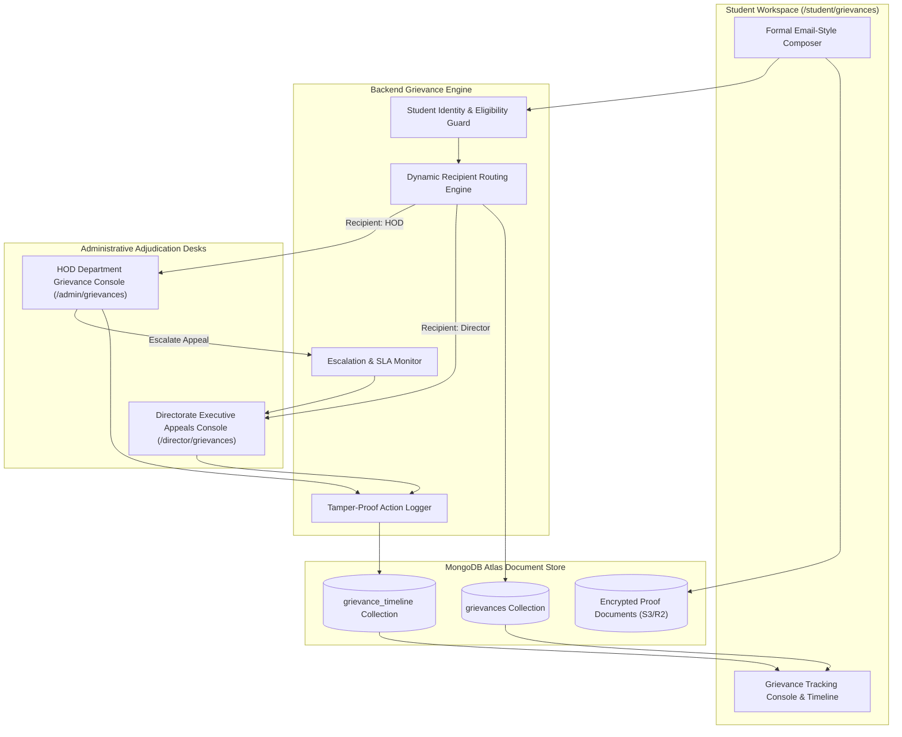
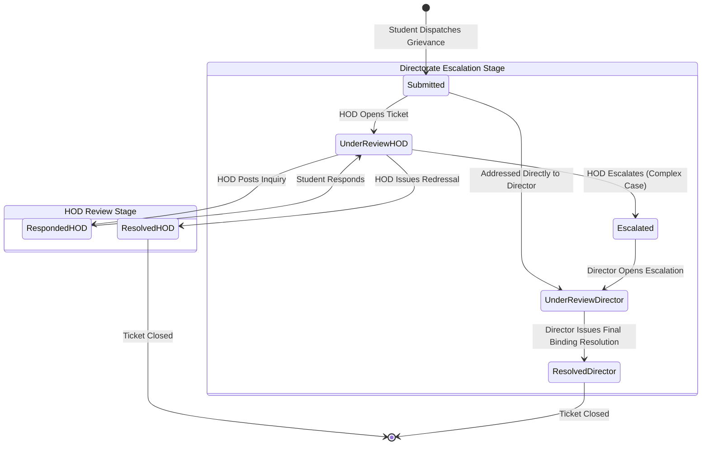

# AXIS LINKUP — STUDENT GRIEVANCE SYSTEM ARCHITECTURE
**Document ID:** DOC-ARCH-013-REV2  
**Status:** Approved for Architecture Specification (Phase 4.8.2)  
**Institution:** Axis Institute of Technology & Management (AITM), Kanpur  
**Last Updated:** November 13, 2026  

---

## 1. System Topology & Adjudication Pipeline

The Student Grievance System provides an auditable, multi-tier escalation channel enabling students to communicate formal complaints directly to their **Department Head (HOD)** or the **Executive Director**.



---

## 2. Comprehensive Database Schemas

### 2.1 Grievances Schema (`grievances`)
```typescript
import { Schema, type Model, Types } from 'mongoose';

const GrievanceSchema = new Schema(
  {
    ticketNumber: {
      type: String,
      required: true,
      unique: true,
      uppercase: true,
      index: true, // e.g. "GRV-2026-0042"
    },
    studentId: {
      type: Schema.Types.ObjectId,
      ref: 'User',
      required: true,
      index: true,
    },
    studentUsername: {
      type: String,
      required: true,
    },
    studentFullName: {
      type: String,
      required: true,
    },
    studentEmail: {
      type: String,
      required: true,
    },
    studentRollNumber: {
      type: String,
      required: true,
    },
    departmentId: {
      type: Schema.Types.ObjectId,
      ref: 'Department',
      required: true,
      index: true,
    },
    recipientTarget: {
      type: String,
      enum: ['hod', 'director'],
      required: true,
      index: true,
    },
    category: {
      type: String,
      enum: [
        'academic_delivery',
        'examination_evaluation',
        'laboratory_equipment',
        'harassment_conduct',
        'infrastructure_hostel',
        'fee_administration',
        'other',
      ],
      required: true,
      index: true,
    },
    subject: {
      type: String,
      required: true,
      trim: true,
      minlength: 10,
      maxlength: 150,
    },
    body: {
      type: String,
      required: true,
      trim: true,
      minlength: 50,
      maxlength: 5000,
    },
    attachments: [
      {
        fileUrl: { type: String, required: true },
        fileName: { type: String, required: true },
        fileSize: { type: Number, required: true },
        mimeType: { type: String, required: true },
      },
    ],
    status: {
      type: String,
      enum: ['submitted', 'under_review', 'responded', 'escalated', 'resolved'],
      default: 'submitted',
      index: true,
    },
    assignedReviewerId: {
      type: Schema.Types.ObjectId,
      ref: 'User',
      default: null, // HOD or Director user ID
    },
    resolutionSummary: {
      type: String,
      default: null,
      maxlength: 2000,
    },
    resolvedAt: {
      type: Date,
      default: null,
    },
    isEscalated: {
      type: Boolean,
      default: false,
      index: true,
    },
    escalatedAt: {
      type: Date,
      default: null,
    },
    escalationReason: {
      type: String,
      default: null,
    },
  },
  { timestamps: true }
);

// Compound indexes for optimal dashboard filtering
GrievanceSchema.index({ departmentId: 1, recipientTarget: 1, status: 1 });
GrievanceSchema.index({ studentId: 1, createdAt: -1 });
```

### 2.2 Grievance Timeline & Response Schema (`grievance_timeline`)
```typescript
const GrievanceTimelineSchema = new Schema(
  {
    grievanceId: {
      type: Schema.Types.ObjectId,
      ref: 'Grievance',
      required: true,
      index: true,
    },
    actorId: {
      type: Schema.Types.ObjectId,
      ref: 'User',
      required: true,
    },
    actorRole: {
      type: String,
      enum: ['student', 'admin', 'super_admin'],
      required: true,
    },
    actorName: {
      type: String,
      required: true,
    },
    eventType: {
      type: String,
      enum: [
        'SUBMITTED',
        'OPENED_REVIEW',
        'OFFICIAL_RESPONSE',
        'STUDENT_REPLY',
        'INTERNAL_NOTE',
        'ESCALATED_TO_DIRECTOR',
        'RESOLVED',
      ],
      required: true,
    },
    content: {
      type: String,
      required: true,
      maxlength: 3000,
    },
    isInternalOnly: {
      type: Boolean,
      default: false, // Internal notes hidden from student
      index: true,
    },
  },
  { timestamps: true }
);

GrievanceTimelineSchema.index({ grievanceId: 1, createdAt: 1 });
```

---

## 3. Adjudication & Escalation Workflow



---

## 4. API Endpoints Specification

| Method | Endpoint | Authorization | Description |
| :--- | :--- | :--- | :--- |
| `POST` | `/api/grievances` | `requireRole('student')` | Submits a new formal grievance with attachments |
| `GET` | `/api/grievances` | `requireAuth()` | Lists tickets (Students: own; HOD: dept; Director: all/escalated)|
| `GET` | `/api/grievances/:id` | `requireGrievanceAccess(id)` | Fetches complete grievance history and visible timeline |
| `POST` | `/api/grievances/:id/respond` | `requireGrievanceReviewer(id)`| Posts official response visible to student |
| `POST` | `/api/grievances/:id/notes` | `requireGrievanceReviewer(id)`| Adds private internal note (`isInternalOnly: true`) |
| `POST` | `/api/grievances/:id/escalate` | `requireRole('admin')` (HOD) | Escalates ticket from HOD to Executive Director |
| `POST` | `/api/grievances/:id/resolve` | `requireGrievanceReviewer(id)`| Closes ticket with final resolution summary |

---

## 5. Security & Isolation Matrix

1. **Student Confidentiality:**
   ```typescript
   if (session.role === 'student' && grievance.studentId.toString() !== session.userId) {
     throw new ForbiddenError('Access Denied: You cannot view grievances filed by other students.');
   }
   ```
2. **HOD Department Boundary:**
   ```typescript
   if (session.role === 'admin' && grievance.departmentId.toString() !== session.departmentId) {
     throw new ForbiddenError('Access Denied: Grievance belongs to a different academic department.');
   }
   ```
3. **Internal Note Redaction:**
   When serializing timeline events for student callers, all events with `isInternalOnly: true` are filtered out before sending JSON response.

