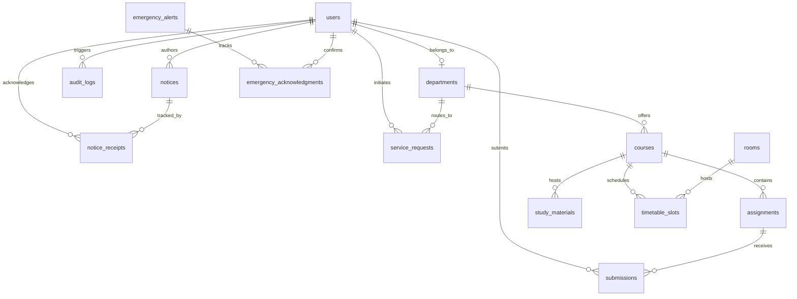

# Database Architecture Specification (MongoDB Atlas & Mongoose)

> **Document ID:** DOC-ARCH-004  
> **Status:** Draft for Review (Phase 1, Part 1.2)  
> **Database Engine:** MongoDB Atlas (Replica Set)  
> **ODM:** Mongoose 8+  
> **Region:** AWS Mumbai (`ap-south-1`) — Compliance with Indian DPDP Act  
> **Last Updated:** November 2026  

---

## 1. Data Modeling Philosophy: Document Database Paradigm

Axis LinkUp leverages MongoDB Atlas for flexible, high-performance document persistence. In contrast to a traditional rigid relational database, document data modeling requires deliberate choices regarding **embedding** (denormalization) versus **referencing** (normalization).

### 1.1 When to Embed (Denormalize)
- **1-to-Few Relationships:** Entities that are always loaded and rendered together with the parent (e.g., notice attachments, service request comments, poll options).
- **Point-in-Time Snapshots:** Data that must not change even if the original record updates (e.g., author name and avatar snapshot on historic notices, user snapshot on audit logs).
- **Bounded Growth:** Child arrays that have a strict, predictable upper bound (e.g., max 10 attachments per assignment).

### 1.2 When to Reference (`ObjectId` with `ref`)
- **1-to-Many / 1-to-Squillions:** Relationships where the child collection grows unbounded (e.g., a Course has hundreds of Submissions; a Notice has thousands of Read Receipts).
- **Independent Life Cycles:** Entities that are queried, updated, and managed independently (e.g., Users, Courses, Rooms, Service Requests).
- **Frequent Mutations:** Entities updated concurrently by multiple actors to avoid document-level lock contention and write conflicts.

---

## 2. Proposed Collections & Schema Specifications

> [!NOTE]
> Items marked **[Confirmed Requirement]** reflect approved baseline data fields from Phase 1, Part 1.1. Items marked **[Proposed Recommendation]** reflect architectural designs submitted for technical review in Phase 1, Part 1.2.

### 2.1 Identity & Core Academic Entities

#### Collection: `users`
- **Purpose:** Primary user profile and role record, synchronized with Clerk.
- **Fields:**
  - `_id`: `ObjectId` (Primary Key)
  - `clerkId`: `String` [Confirmed] — Unique Clerk user ID (e.g., `user_2...`).
  - `email`: `String` [Confirmed] — Institutional or personal email.
  - `fullName`: `String` [Confirmed] — User's display name.
  - `role`: `String` [Confirmed] — Enum: `'student' | 'faculty' | 'admin' | 'super_admin'`.
  - `departmentId`: `ObjectId -> departments` [Confirmed] — Associated academic department.
  - `phone`: `String` [Confirmed] — Mobile number (private, concealed from public profiles).
  - `avatarUrl`: `String` [Confirmed] — Cloudinary secure image URL.
  - `status`: `String` [Confirmed] — Enum: `'invited' | 'active' | 'suspended' | 'archived'`.
  - `studentMetadata`: `Object` [Proposed Recommendation] — Only present if `role === 'student'`:
    - `rollNumber`: `String` (Unique institutional roll number)
    - `batchYear`: `Number` (e.g., 2024)
    - `currentSemester`: `Number` (1 to 8)
    - `section`: `String` (e.g., "A", "B")
  - `facultyMetadata`: `Object` [Proposed Recommendation] — Only present if `role === 'faculty'`:
    - `designation`: `String` (e.g., "Associate Professor")
    - `cabinRoom`: `String` (e.g., "Block B - Room 204")
    - `officeHours`: `{ start: String, end: String, days: [String], isAcceptingDMs: Boolean }`
  - `createdAt`, `updatedAt`: `Date`

#### Collection: `departments`
- **Purpose:** Academic branches within Axis Institute (e.g., CSE, ECE, ME, CE, Applied Sciences).
- **Fields:**
  - `_id`: `ObjectId`
  - `code`: `String` [Confirmed] — Unique code (e.g., `"CSE"`, `"ECE"`).
  - `name`: `String` [Confirmed] — Full department title.
  - `hodId`: `ObjectId -> users` [Proposed Recommendation] — Reference to active Head of Department.
  - `isActive`: `Boolean`

#### Collection: `courses`
- **Purpose:** Catalog of academic subjects offered.
- **Fields:**
  - `_id`: `ObjectId`
  - `code`: `String` [Confirmed] — Course code (e.g., `"CS301"`).
  - `title`: `String` [Confirmed] — Course name (e.g., `"Data Structures & Algorithms"`).
  - `departmentId`: `ObjectId -> departments` [Confirmed]
  - `semester`: `Number` [Confirmed]
  - `credits`: `Number` [Proposed Recommendation]

#### Collection: `course_enrollments` [Proposed Recommendation]
- **Purpose:** Mappings linking instructors, students, and academic terms to a course offering.
- **Fields:**
  - `_id`: `ObjectId`
  - `courseId`: `ObjectId -> courses`
  - `academicYear`: `String` (e.g., `"2026-2027"`)
  - `semester`: `Number`
  - `section`: `String` (e.g., `"A"`)
  - `primaryFacultyId`: `ObjectId -> users`
  - `coFacultyIds`: `[ObjectId -> users]`
  - `studentIds`: `[ObjectId -> users]`

---

### 2.2 Communication & Governance Entities

#### Collection: `notices`
- **Purpose:** Official bulletins and targeted announcements (MOD-07).
- **Fields:**
  - `_id`: `ObjectId`
  - `title`: `String` [Confirmed]
  - `contentMarkdown`: `String` [Confirmed]
  - `authorId`: `ObjectId -> users` [Confirmed]
  - `authorSnapshot`: `{ name: String, role: String, departmentCode: String }` [Proposed Recommendation]
  - `priority`: `String` [Confirmed] — Enum: `'normal' | 'important' | 'urgent'`.
  - `targetScope`: `Object` [Confirmed]:
    - `scopeType`: `String` — Enum: `'all' | 'department' | 'year' | 'section'`.
    - `departmentId`: `ObjectId -> departments` (optional)
    - `batchYear`: `Number` (optional)
    - `section`: `String` (optional)
  - `attachments`: `[ { name: String, url: String, sizeBytes: Number, mimeType: String } ]` [Confirmed]
  - `isPinned`: `Boolean` [Confirmed]
  - `requiresAcknowledgment`: `Boolean` [Proposed Recommendation]
  - `expiresAt`: `Date` [Confirmed]
  - `createdAt`, `updatedAt`: `Date`

#### Collection: `notice_receipts`
- **Purpose:** Tracking which students have viewed and confirmed notices.
- **Fields:**
  - `_id`: `ObjectId`
  - `noticeId`: `ObjectId -> notices` [Confirmed]
  - `userId`: `ObjectId -> users` [Confirmed]
  - `readAt`: `Date` [Confirmed]
  - `acknowledgedAt`: `Date` [Confirmed]

#### Collection: `emergency_alerts`
- **Purpose:** Master campus safety override broadcasts (MOD-16).
- **Fields:**
  - `_id`: `ObjectId`
  - `title`: `String` [Confirmed]
  - `message`: `String` [Confirmed]
  - `severity`: `String` [Confirmed] — Enum: `'amber' | 'red'`.
  - `isActive`: `Boolean` [Confirmed]
  - `triggeredById`: `ObjectId -> users` [Confirmed]
  - `triggeredAt`: `Date` [Confirmed]
  - `deactivatedAt`: `Date` [Confirmed]
  - `deactivatedById`: `ObjectId -> users` [Confirmed]

#### Collection: `emergency_acknowledgments`
- **Purpose:** Receipt confirmation during campus emergencies.
- **Fields:**
  - `_id`: `ObjectId`
  - `alertId`: `ObjectId -> emergency_alerts` [Confirmed]
  - `userId`: `ObjectId -> users` [Confirmed]
  - `ipAddress`: `String` [Confirmed]
  - `acknowledgedAt`: `Date` [Confirmed]

---

### 2.3 Academic Delivery & Productivity Entities

#### Collection: `assignments`
- **Purpose:** Coursework briefs and deadlines (MOD-11).
- **Fields:**
  - `_id`: `ObjectId`
  - `courseId`: `ObjectId -> courses` [Confirmed]
  - `facultyId`: `ObjectId -> users` [Confirmed]
  - `title`: `String` [Confirmed]
  - `description`: `String` [Confirmed]
  - `maxMarks`: `Number` [Confirmed]
  - `dueDate`: `Date` [Confirmed]
  - `allowLate`: `Boolean` [Confirmed]
  - `lateCutoffDate`: `Date` [Proposed Recommendation]
  - `attachments`: `[ { name: String, url: String, sizeBytes: Number } ]`
  - `createdAt`, `updatedAt`: `Date`

#### Collection: `submissions`
- **Purpose:** Student submitted coursework and evaluation records.
- **Fields:**
  - `_id`: `ObjectId`
  - `assignmentId`: `ObjectId -> assignments` [Confirmed]
  - `studentId`: `ObjectId -> users` [Confirmed]
  - `fileUrl`: `String` [Confirmed] — Cloudinary authenticated URL.
  - `fileName`: `String` [Confirmed]
  - `fileSizeBytes`: `Number` [Confirmed]
  - `submittedAt`: `Date` [Confirmed]
  - `isLate`: `Boolean` [Confirmed]
  - `status`: `String` [Confirmed] — Enum: `'submitted' | 'graded' | 'resubmission_requested'`.
  - `score`: `Number` [Confirmed]
  - `feedback`: `String` [Confirmed]
  - `gradedById`: `ObjectId -> users` [Confirmed]
  - `gradedAt`: `Date` [Confirmed]

#### Collection: `study_materials`
- **Purpose:** Syllabus, lecture notes, and lab manuals (MOD-12).
- **Fields:**
  - `_id`: `ObjectId`
  - `courseId`: `ObjectId -> courses` [Confirmed]
  - `facultyId`: `ObjectId -> users` [Confirmed]
  - `unitNumber`: `Number` [Confirmed]
  - `title`: `String` [Confirmed]
  - `description`: `String` [Confirmed]
  - `fileUrl`: `String` [Confirmed]
  - `fileType`: `String` [Confirmed]
  - `fileSizeBytes`: `Number` [Confirmed]
  - `downloadCount`: `Number` [Confirmed]
  - `tags`: `[String]` [Proposed Recommendation]
  - `createdAt`: `Date`

---

### 2.4 Administrative Services & Logistics Entities

#### Collection: `service_requests`
- **Purpose:** Student desk requisitions and certificates (MOD-13).
- **Fields:**
  - `_id`: `ObjectId`
  - `trackingNumber`: `String` [Confirmed] — Formatted ticket ID (e.g., `"REQ-2026-1042"`).
  - `category`: `String` [Confirmed] — Enum: `'bonafide' | 'leave' | 'lab_access' | 'id_card' | 'grievance'`.
  - `studentId`: `ObjectId -> users` [Confirmed]
  - `assignedAdminId`: `ObjectId -> users` [Confirmed]
  - `departmentId`: `ObjectId -> departments` [Confirmed]
  - `status`: `String` [Confirmed] — Enum: `'submitted' | 'under_review' | 'approved' | 'rejected' | 'closed'`.
  - `formData`: `Object` [Confirmed] — Dynamic JSON payload conforming to the category schema.
  - `proofAttachments`: `[ { name: String, url: String } ]` [Confirmed]
  - `issuedDocumentUrl`: `String` [Proposed Recommendation] — Generated certificate PDF with QR code.
  - `resolutionNotes`: `String` [Confirmed]
  - `comments`: `[ { authorId: ObjectId, body: String, isInternal: Boolean, createdAt: Date } ]` [Proposed Recommendation]
  - `slaDueDate`: `Date` [Proposed Recommendation]
  - `createdAt`, `updatedAt`, `resolvedAt`: `Date`

#### Collection: `rooms`
- **Purpose:** Classrooms, lecture halls, and laboratories (MOD-14).
- **Fields:**
  - `_id`: `ObjectId`
  - `block`: `String` [Confirmed] — e.g., `"Block A"`, `"Block B"`.
  - `roomNumber`: `String` [Confirmed] — e.g., `"Lab 402"`, `"LH-101"`.
  - `type`: `String` [Confirmed] — Enum: `'classroom' | 'computer_lab' | 'mech_lab' | 'seminar_hall'`.
  - `seatingCapacity`: `Number` [Confirmed]
  - `hasProjector`: `Boolean` [Confirmed]
  - `pcCount`: `Number` [Confirmed]
  - `isAirConditioned`: `Boolean` [Proposed Recommendation]

#### Collection: `timetable_slots`
- **Purpose:** Master weekly lecture and lab schedule (MOD-10).
- **Fields:**
  - `_id`: `ObjectId`
  - `courseId`: `ObjectId -> courses` [Confirmed]
  - `facultyId`: `ObjectId -> users` [Confirmed]
  - `roomId`: `ObjectId -> rooms` [Confirmed]
  - `dayOfWeek`: `Number` [Confirmed] — `1` (Monday) to `6` (Saturday).
  - `startTime`: `String` [Confirmed] — `"09:00"`.
  - `endTime`: `String` [Confirmed] — `"10:00"`.
  - `section`: `String` [Confirmed]
  - `academicYear`: `String` [Confirmed]

---

### 2.5 Security & Audit Entities

#### Collection: `audit_logs`
- **Purpose:** Immutable compliance and security ledger (MOD-19).
- **Fields:**
  - `_id`: `ObjectId`
  - `actorId`: `ObjectId -> users` [Confirmed]
  - `actorRole`: `String` [Confirmed]
  - `action`: `String` [Confirmed] — e.g., `"ROLE_CHANGE"`, `"APPROVE_REQUEST"`, `"EMERGENCY_TRIGGER"`.
  - `module`: `String` [Confirmed] — e.g., `"MOD-01"`, `"MOD-13"`, `"MOD-16"`.
  - `entityId`: `String` [Confirmed] — Target document ID.
  - `oldState`: `Object` [Confirmed] — Previous document state (diff).
  - `newState`: `Object` [Confirmed] — Updated document state (diff).
  - `ipAddress`: `String` [Confirmed]
  - `userAgent`: `String` [Confirmed]
  - `createdAt`: `Date` [Confirmed]

---

## 3. Entity Relationship Diagram (ER-Style)



---

## 4. Comprehensive Indexing Strategy

Indexing is critical to meet the non-functional requirement of **`<50ms` query latency** (NFR-PERF-04).

| Collection | Indexed Field(s) | Index Type | Query Optimization Rationale |
| :--- | :--- | :--- | :--- |
| `users` | `{ clerkId: 1 }` | Unique | Instant user lookup during session resolution in middleware. |
| `users` | `{ email: 1 }` | Unique | Login credential resolution and duplicate prevention. |
| `users` | `{ departmentId: 1, role: 1 }` | Compound | Fast retrieval of department faculty or student rosters. |
| `notices` | `{ "targetScope.departmentId": 1, priority: 1, createdAt: -1 }` | Compound | Student and faculty personalized notice feed retrieval. |
| `notices` | `{ expiresAt: 1 }` | TTL Index | Automatically clean up or archive expired notices. |
| `notice_receipts` | `{ noticeId: 1, userId: 1 }` | Compound Unique | Enforces single receipt per user and instant acknowledgment check. |
| `service_requests` | `{ departmentId: 1, status: 1, createdAt: -1 }` | Compound | Admin desk Kanban board queue filtering. |
| `service_requests` | `{ studentId: 1, createdAt: -1 }` | Compound | Student tracking dashboard history. |
| `submissions` | `{ assignmentId: 1, studentId: 1 }` | Compound Unique | Prevents duplicate submissions and accelerates grade lookup. |
| `timetable_slots` | `{ roomId: 1, dayOfWeek: 1, startTime: 1 }` | Compound Unique | Eliminates double-booking of physical rooms/labs. |
| `timetable_slots` | `{ facultyId: 1, dayOfWeek: 1, startTime: 1 }` | Compound Unique | Eliminates faculty teaching schedule clashes. |
| `study_materials` | `{ courseId: 1, unitNumber: 1 }` | Compound | Rapid lecture note unit browsing. |
| `study_materials` | `{ title: "text", description: "text", tags: "text" }` | Text Search | Keyword search across academic notes library. |
| `audit_logs` | `{ actorId: 1, createdAt: -1 }` | Compound | Security audits by administrative actor. |
| `audit_logs` | `{ module: 1, createdAt: -1 }` | Compound | Module-specific compliance reporting. |

---

## 5. Data Ownership & Multi-Departmental Data Isolation

Axis LinkUp enforces strict logical data isolation between departments (CSE, ECE, ME, etc.) to prevent data leakage and cross-department unauthorized access:

### 5.1 Enforced Repository-Level Scoping
Every query originating from a departmental user (Student, Faculty, Admin) is scoped automatically at the repository layer:

```typescript
// Example: Scoped Notice Query in NoticeRepository
async function findNoticesForStudent(student: UserSession): Promise<NoticeDoc[]> {
  return NoticeModel.find({
    $or: [
      { "targetScope.scopeType": "all" },
      { 
        "targetScope.scopeType": "department",
        "targetScope.departmentId": student.departmentId,
        $or: [
          { "targetScope.batchYear": { $exists: false } },
          { "targetScope.batchYear": student.batchYear }
        ]
      }
    ],
    expiresAt: { $gt: new Date() }
  }).sort({ isPinned: -1, createdAt: -1 });
}
```

### 5.2 Ownership Guardrails
1. **Student Isolation:** Students cannot supply arbitrary `studentId` query parameters. Queries always bind `studentId = session.userId`.
2. **Faculty Isolation:** Faculty members can only query or grade submissions for courses where their `userId` exists in `course_enrollments.primaryFacultyId` or `coFacultyIds`.
3. **Department Admin Isolation:** Admins can only view and transition service requests where `departmentId === session.departmentId`, unless granted global institutional privileges by Super Admin.

