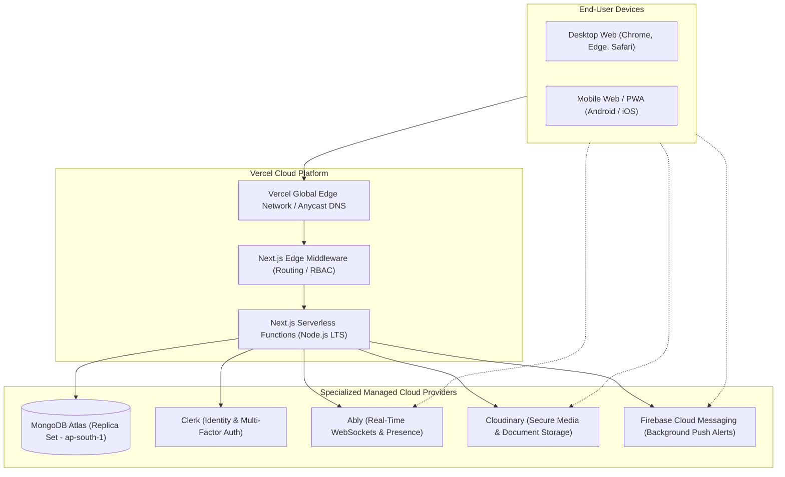
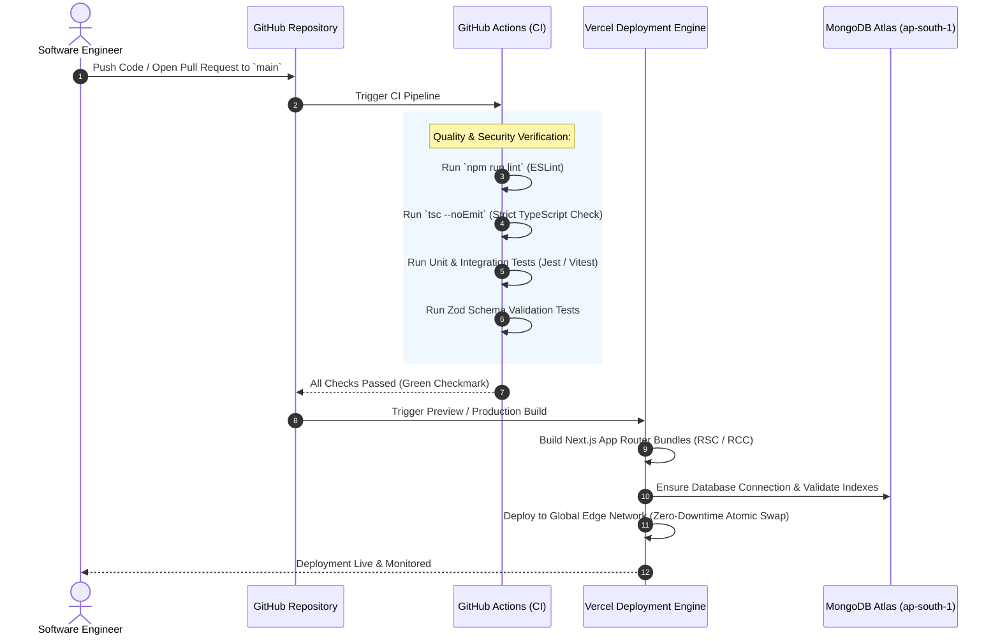

# Deployment & Infrastructure Architecture

> **Document ID:** DOC-ARCH-008  
> **Status:** Draft for Review (Phase 1, Part 1.2)  
> **Hosting & Cloud Ecosystem:** Vercel + MongoDB Atlas + Cloudinary + Clerk + Ably + FCM  
> **Target Region:** AWS Mumbai (`ap-south-1`) for Data Residency  
> **Last Updated:** November 2026  

---

## 1. Cloud Ecosystem & Managed Services Evaluation

Axis LinkUp adopts a **Modern Cloud-Native Managed Services Strategy**. By combining specialized enterprise platform-as-a-service (PaaS) providers, the institution eliminates server maintenance overhead, reduces operational expenses, and ensures enterprise-grade reliability and scalability.



### 1.1 Detailed Evaluation of Cloud Providers

| Service | Architectural Role | Evaluation & Suitability | Production Sizing / Tier |
| :--- | :--- | :--- | :--- |
| **Vercel** | Application Hosting, Edge CDN, Serverless Compute | Native runtime for Next.js App Router. Automatic branch previews, zero-downtime atomic rollouts, built-in SSL/TLS, and edge caching. | Vercel Pro Plan (Sufficient for campus load, includes team access and analytics). |
| **MongoDB Atlas** | Primary Document Database | Managed MongoDB replica set located in AWS Mumbai (`ap-south-1`) to satisfy Indian DPDP Act data residency. Includes automated backups and continuous monitoring. | Atlas M10 or M20 Cluster (Provides dedicated RAM, burstable CPU, and point-in-time recovery). |
| **Clerk** | Authentication & User Directory | Eliminates authentication boilerplate, handles password encryption, TOTP MFA, session tokens, and edge token verification. | Standard / Business Plan (Covers 3,000–5,000 campus MAUs with custom institutional domain). |
| **Ably** | Real-Time Pub/Sub & WebSockets | High-availability real-time messaging broker. Solves the serverless WebSocket persistence challenge. Guaranteed 99.999% uptime SLA. | Pay-as-you-go or Standard Plan (Accommodates campus concurrent connections). |
| **Cloudinary** | File Storage & Asset Pipeline | Direct client-to-cloud file uploads, automatic image optimization, private/authenticated document asset security with signed delivery URLs. | Plus / Advanced Plan (Ample storage and bandwidth for assignment PDFs and study materials). |
| **Firebase Cloud Messaging (FCM)** | Background Mobile & Web Push | Industry standard for mobile and desktop browser background push alerts when the user has closed the application tab. Zero cost. | Free Tier (Google Firebase standard tier includes unlimited FCM push dispatches). |

---

## 2. Environment Separation Strategy

To ensure zero risk to live college operations, Axis LinkUp maintains three strictly isolated environments:

```
[Local Development] ──PR──> [Staging / Preview] ──Merge──> [Production]
```

### 2.1 Local Development (`local`)
- **Host:** Developer workstation (`localhost:3000`).
- **Database:** Dedicated developer sandbox cluster on MongoDB Atlas or local Docker container.
- **Clerk:** Clerk Development Instance (with test phone/email bypass).
- **Ably / Cloudinary:** Sandbox API keys with separate testing folders (`/test/...`).

### 2.2 Staging / Preview (`staging`)
- **Trigger:** Automated on every Pull Request via Vercel GitHub integration.
- **URL:** Unique immutable preview URL (e.g., `axis-linkup-git-feat-notices.vercel.app`).
- **Database:** Dedicated Staging MongoDB Atlas cluster populated with anonymized seed data.
- **Purpose:** Full integration testing, security regression testing, and administrative UAT.

### 2.3 Production (`production`)
- **Trigger:** Automated upon merge to `main` branch following review and passing CI checks.
- **URL:** Canonical institutional domain: `linkup.axiscolleges.in`.
- **Database:** High-availability Production MongoDB Atlas M10+ Cluster (AWS Mumbai).
- **Clerk:** Production instance configured with college domain and custom email branding.
- **Monitoring:** Live Vercel Speed Insights, Error Logs, and MongoDB Atlas performance alerts.

---

## 3. Secrets Management & Environment Variable Registry

> [!CAUTION]
> Zero secrets, API keys, or database connection strings are permitted in Git repositories. All variables are injected securely via the Vercel Project Settings dashboard.

### 3.1 Public Client-Side Variables (Exposed to Browser)
*Prefix: `NEXT_PUBLIC_*`*

| Variable Name | Description |
| :--- | :--- |
| `NEXT_PUBLIC_APP_URL` | Canonical URL of the application (`https://linkup.axiscolleges.in`). |
| `NEXT_PUBLIC_CLERK_PUBLISHABLE_KEY` | Clerk public key used by frontend authentication components. |
| `NEXT_PUBLIC_CLOUDINARY_CLOUD_NAME` | Cloudinary public cloud name for direct asset uploading. |
| `NEXT_PUBLIC_ABLY_CLIENT_KEY` | Optional public client identifier for Ably client setup. |
| `NEXT_PUBLIC_FCM_VAPID_KEY` | Web Push VAPID public key for browser push notification registration. |

### 3.2 Server-Only Sensitive Secrets (Never Shipped to Client)

| Secret Name | Description |
| :--- | :--- |
| `CLERK_SECRET_KEY` | Master server secret key used to update user roles and metadata. |
| `CLERK_WEBHOOK_SECRET` | Cryptographic secret used by Svix to verify webhook payloads. |
| `MONGODB_URI` | MongoDB Atlas SRV connection string with authentication credentials. |
| `CLOUDINARY_API_KEY` | Cloudinary backend API key. |
| `CLOUDINARY_API_SECRET` | Secret key used to sign client upload presets and generate private URLs. |
| `ABLY_API_KEY` | Master Ably API key used for minting client capability tokens and REST publishing. |
| `FCM_SERVER_KEY` / `FIREBASE_SERVICE_ACCOUNT` | Firebase admin service account credentials for push dispatch. |

---

## 4. Production CI/CD Pipeline & Deployment Workflow



---

## 5. High Availability, Backups & Disaster Recovery

- **Database Backups:** MongoDB Atlas automated continuous backups with a Recovery Point Objective (RPO) of `<= 1 hour` and 30-day point-in-time recovery (PITR).
- **Cold-Start Optimization:** Mongoose singleton connection caching and lightweight route bundles guarantee cold start latency `<= 800ms` on Vercel Serverless.
- **Failover SLA:** MongoDB Atlas automated 3-node replica set provides automatic primary node failover in under 30 seconds with zero data loss.

