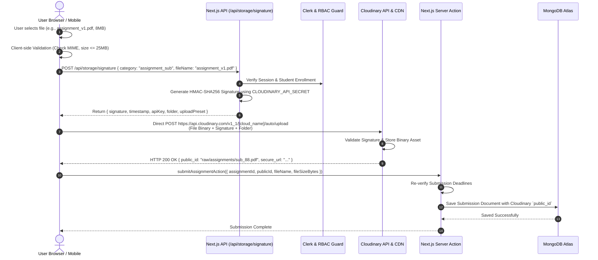
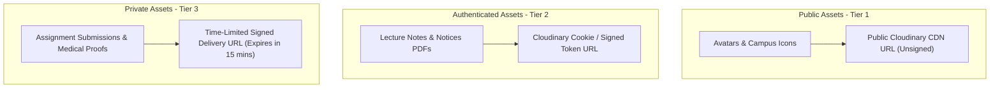

# File Storage Architecture Specification

> **Document ID:** DOC-ARCH-007  
> **Status:** Draft for Review (Phase 1, Part 1.2)  
> **Service Provider:** Cloudinary (Proposed Evaluation)  
> **Pattern:** Direct Client-to-Cloud Storage via Signed Upload Presets  
> **Last Updated:** November 2026  

---

## 1. Evaluation of Cloudinary for Axis LinkUp

### 1.1 Overview & Architectural Fit
Axis LinkUp handles diverse media and document types across academic, administrative, and social workflows: user avatars, lecture slide decks, syllabus PDFs, student assignment submissions, chat attachments, and proof documents for service requests.

Routing multi-megabyte binary payloads through Vercel serverless functions is an architectural anti-pattern:
- Serverless functions have strict payload limits (4.5MB request body limit on Vercel Serverless).
- Running large file streams through serverless functions incurs high execution time and memory costs, leading to function timeout errors.

**Cloudinary solves this via Direct Client-to-Cloud Uploads:**
Clients upload binaries directly to Cloudinary’s global edge nodes using **cryptographically signed upload presets** generated by the Next.js server, completely bypassing the application server's memory.

### 1.2 Evaluation Across Axis LinkUp File Categories

| File Category | Asset Type | Typical Formats | Max Size | Storage & Delivery Strategy |
| :--- | :--- | :--- | :--- | :--- |
| **Profile Pictures (Avatars)** | `upload` (Public) | JPG, PNG, WEBP | 5 MB | Public CDN delivery with on-the-fly thumbnail transformation (`c_fill,g_face,w_200,h_200,q_auto,f_auto`). |
| **Assignment Briefs (Faculty)** | `authenticated` | PDF, DOCX, ZIP | 25 MB | Restricted delivery accessible only to enrolled students in that course. |
| **Assignment Submissions (Student)**| `private` | PDF, ZIP, DOCX | 25 MB | Strictly private asset type. Delivery exclusively via time-limited HMAC-signed URLs generated for the grading faculty or submitting student. |
| **Study Materials & Notes** | `authenticated` | PDF, PPT, PPTX | 50 MB | Cloudinary raw/image delivery with edge caching; accessible to enrolled course members. |
| **Chat Attachments** | `authenticated` | JPG, PNG, PDF | 10 MB | Media optimization with authenticated delivery; inline previews for images. |
| **Service Request Proofs** | `private` | PDF, JPG, PNG | 15 MB | Strictly private. Only accessible to student owner and reviewing Admin. |

---

## 2. Direct-to-Cloudinary Signed Upload Flow



---

## 3. Strict File Validation Pipeline

To protect the platform from malicious uploads, script injection, and storage exhaustion, file uploads pass through a multi-stage validation pipeline:

### 3.1 Client-Side Pre-Validation
Before initiating any network request, the client-side dropzone validates:
- **File Size:** Explicit thresholds per category (rejects files exceeding configured megabytes).
- **Extension Whitelist:** Only permitted extensions (e.g., `.pdf`, `.docx`, `.zip`, `.png`, `.jpg`).
- **MIME Type Matching:** Compares file metadata against accepted browser MIME types (`application/pdf`, `image/jpeg`).

### 3.2 Server-Side Signature Constraints
When minting the upload signature in `/api/storage/signature`, the server locks down the upload parameters:
- `folder`: Scoped to the domain and entity (e.g., `axis/assignments/course_301/`).
- `allowed_formats`: Restricted to specific extensions.
- `access_mode`: Explicitly sets `private` or `authenticated` for non-public assets.
- `max_file_size`: Locked down at the Cloudinary account level.

### 3.3 Executable Blocking (Zero Executables Allowed)
- The platform strictly prohibits executable files (`.exe`, `.bat`, `.sh`, `.php`, `.js`, `.py`, `.vbs`).
- Cloudinary automatically segregates `raw` non-image files from `image` assets, preventing arbitrary script execution within the web context.

---

## 4. Permissions & Access-Control Architecture

> [!IMPORTANT]
> Student assignment submissions and administrative request proofs contain sensitive academic and personal data. Under the Indian DPDP Act, these documents must **never** be exposed via predictable public URLs.

### 4.1 Asset Protection Tiers in Cloudinary



### 4.2 Time-Limited Signed Delivery URLs for Private Assets
When a faculty member requests to download a student's submission, the application **does not** return a permanent URL. Instead, the server generates a time-limited HMAC-signed URL valid for **15 minutes**:

```typescript
import { v2 as cloudinary } from 'cloudinary';

export function generateSecureDownloadUrl(publicId: string, format: string): string {
  const expiresAt = Math.floor(Date.now() / 1000) + 15 * 60; // 15 minutes validity

  return cloudinary.utils.private_download_url(publicId, format, {
    expires_at: expiresAt,
    attachment: true, // Forces download dialog rather than browser execution
  });
}
```

### 4.3 Preventing Unauthorized Access Between Students
1. The client never supplies the `public_id` directly to download documents.
2. The student or faculty member requests the document by entity ID (e.g., `GET /api/submissions/sub_401/download`).
3. The server checks authorization:
   - Is caller the student who created `sub_401`?
   - OR is caller the faculty assigned to grade `sub_401`?
   - OR is caller a Super Admin?
4. If unauthorized, returns `403 Forbidden`. If authorized, redirects to the newly minted 15-minute signed Cloudinary URL.

