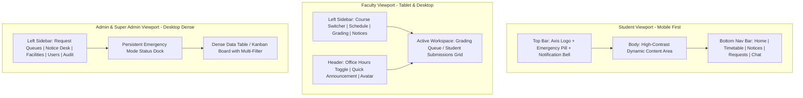
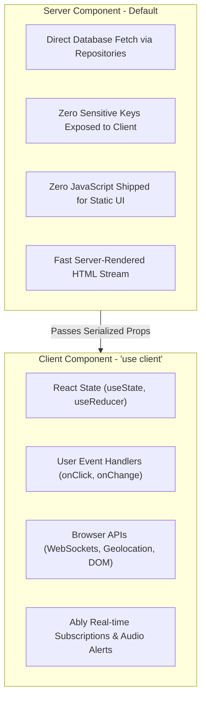
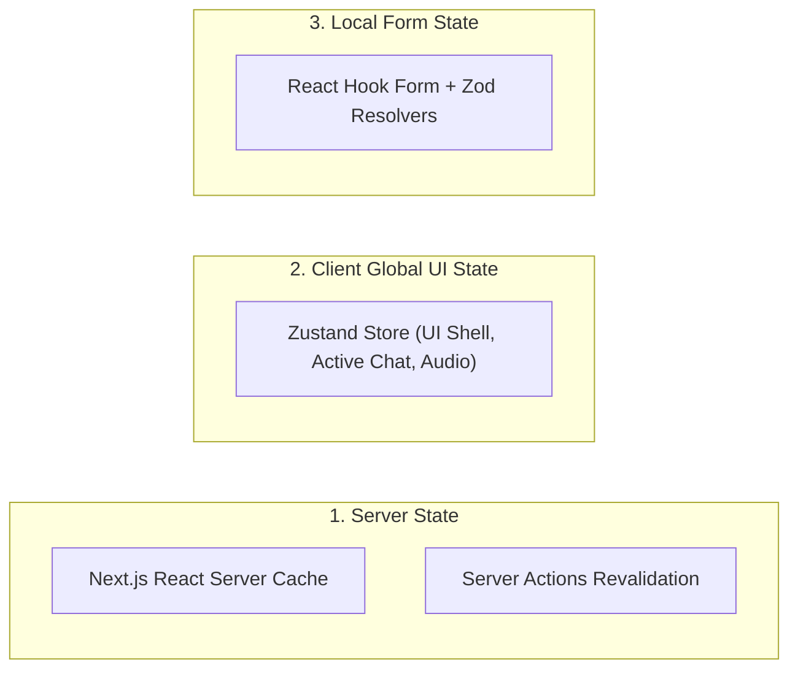

# Frontend Architecture Specification

> **Document ID:** DOC-ARCH-002  
> **Status:** Draft for Review (Phase 1, Part 1.2)  
> **Framework:** Next.js 15+ (App Router) with React 19  
> **Language:** TypeScript 5+ (Strict Mode)  
> **Styling:** Tailwind CSS + Radix UI Primitives (shadcn/ui Pattern)  
> **Last Updated:** November 2026  

---

## 1. Next.js App Router Structure & Route Groups

The frontend leverages Next.js App Router **Route Groups** (folders wrapped in parentheses). Route groups allow the application to partition layout hierarchies, error boundaries, and middleware access rules without impacting the clean public URL structure.

```
src/app/
├── (auth)/                         # Public Authentication Route Group
│   ├── layout.tsx                  # Minimalist, distraction-free centered card layout
│   ├── sign-in/[[...sign-in]]/     # Clerk embedded / customized login
│   ├── sign-up/[[...sign-up]]/     # Invitation acceptance / onboarding
│   └── forgot-password/            # Password recovery workflow
│
├── (student)/                      # Student Workspace Route Group (Mobile-First)
│   ├── layout.tsx                  # Bottom navigation + mobile top bar + emergency banner
│   ├── dashboard/                  # MOD-03: Student Dashboard
│   ├── notices/                    # MOD-07: Targeted student notice feed
│   ├── timetable/                  # MOD-10: Student daily timetable & exams
│   ├── assignments/                # MOD-11: Assignment list & submission view
│   ├── notes/                      # MOD-12: Unit-wise lecture notes repository
│   ├── requests/                   # MOD-13: Student Request Tracker
│   ├── chat/                       # MOD-08: Enrolled course channels & peer chats
│   └── passport/                   # MOD-15: Skill & Achievement Passport
│
├── (faculty)/                      # Faculty Workspace Route Group (Productivity-First)
│   ├── layout.tsx                  # Side-nav layout + course switcher + office hours indicator
│   ├── dashboard/                  # MOD-04: Faculty Dashboard & grading summary
│   ├── classes/                    # Course-wise student roster & attendance links
│   ├── assignments/                # Assignment creator & grading queue
│   ├── notes/                      # Upload & manage course study materials
│   ├── notices/                    # Course & departmental announcement composer
│   └── verification/               # MOD-15: Student passport claims endorsement queue
│
├── (admin)/                        # Campus / Departmental Administrator Route Group
│   ├── layout.tsx                  # Dense desktop sidebar + pending ticket counter
│   ├── dashboard/                  # MOD-05: Operational overview & SLA warnings
│   ├── requests/                   # MOD-13: Kanban / Table queue for bonafide, leaves, etc.
│   ├── notices/                    # MOD-07: Notice publishing & approval desk
│   ├── facilities/                 # MOD-14: Classroom & lab occupancy manager
│   ├── calendar/                   # MOD-10: Term calendar & event scheduler
│   └── reports/                    # MOD-18: Departmental SLA & space utilization reports
│
├── (super-admin)/                  # Executive & IT Director Route Group
│   ├── layout.tsx                  # High-security layout + emergency override dock
│   ├── dashboard/                  # MOD-06: Executive telemetry & active sessions
│   ├── users/                      # MOD-01: User directory & bulk CSV importer
│   ├── roles/                      # MOD-02: RBAC permissions matrix
│   ├── emergency/                  # MOD-16: Campus-wide Emergency Mode command center
│   └── audit-logs/                 # MOD-19: Immutable security & operational audit viewer
│
├── (shared)/                       # Cross-Role Shared Views
│   ├── profile/                    # User profile, notification preferences, avatar
│   └── emergency/view/             # Public read-only emergency broadcast alert view
│
├── api/                            # API Route Handlers (Reserved for webhooks & integrations)
│   ├── webhooks/
│   │   ├── clerk/route.ts          # Clerk user sync webhook (Svix verified)
│   │   └── cloudinary/route.ts     # Upload completion webhook
│   ├── realtime/
│   │   └── token/route.ts          # Ably token auth capability minting
│   └── storage/
│       └── signature/route.ts      # Cloudinary signed upload signature generator
│
├── layout.tsx                      # Root HTML layout (Fonts, Providers, Global Toaster)
├── not-found.tsx                   # Accessible 404 page
└── error.tsx                       # Global React Error Boundary
```

---

## 2. Role-Specific Layout Architectures



### 2.1 Student Layout (`(student)/layout.tsx`)
- **Primary Viewport:** Mobile phone viewports (360px – 480px) and tablets.
- **Top Bar:** Fixed header with Axis Institute emblem, quick unread notification bell with badge counter, and Emergency Alert banner (when triggered).
- **Navigation Model:** Fixed ergonomic bottom navigation bar with 5 primary icons:
  1. *Dashboard (Home)*
  2. *Schedule (Timetable & Exams)*
  3. *Notices (Targeted Bulletins)*
  4. *Requests (Service Ticket Tracker)*
  5. *Chat (Course & Group Channels)*
- **Touch Ergonomics:** All buttons, touch cards, and form inputs maintain minimum touch dimensions of `48px x 48px`.

### 2.2 Faculty Layout (`(faculty)/layout.tsx`)
- **Primary Viewport:** Laptops (1280px+) and tablets (iPad/Android landscape).
- **Navigation Model:** Collapsible left-hand navigation sidebar paired with a top utility bar:
  - Course Context Switcher (allows fast switching between assigned subjects, e.g., "CS301 - Data Structures" to "CS502 - DBMS").
  - "Office Hours" Status Indicator (one-click toggle to open/silence incoming student direct messages).
  - Quick-Create Action Button (instantly launch Notice Composer or Assignment Creator).

### 2.3 Admin & Super Admin Layout (`(admin)/layout.tsx` & `(super-admin)/layout.tsx`)
- **Primary Viewport:** High-density desktop displays (1440px+).
- **Navigation Model:** Fixed persistent high-density sidebar with grouped navigation categories:
  - *Operational Queues* (Pending Requests, Escalations, Approvals).
  - *Academic Logistics* (Master Timetable, Room Schedules, Notice Desk).
  - *Security & Governance* (User Provisioning, Audit Stream, Emergency Override).
- **Emergency Override Bar (Super Admin):** A dedicated, prominent status dock on the Super Admin screen showing live campus status with a single-click Emergency Broadcast Trigger.

---

## 3. Shared Component Architecture

Component architecture follows a strict atomic and domain-driven design pattern located in `src/components/`:

```
src/components/
├── ui/                             # Base Primitive UI Components (shadcn/ui / Radix)
│   ├── button.tsx
│   ├── input.tsx
│   ├── dialog.tsx
│   ├── select.tsx
│   ├── table.tsx
│   ├── badge.tsx
│   ├── card.tsx
│   └── toast.tsx
│
├── shared/                         # Cross-Module Composite Components
│   ├── emergency-banner.tsx        # High-contrast, pulsating campus alert banner
│   ├── notification-center.tsx     # In-app notification bell with popover drawer
│   ├── file-upload-dropzone.tsx    # Drag-and-drop file uploader with size validation
│   ├── data-table.tsx              # Generic sortable, paginated, filterable table
│   ├── user-avatar.tsx             # Optimized avatar with Cloudinary fallback
│   └── status-badge.tsx            # Standardized status chips (Pending, Approved, etc.)
│
└── modules/                        # Domain-Specific Feature Components
    ├── notices/
    │   ├── notice-card.tsx
    │   ├── notice-composer-modal.tsx
    │   └── read-receipt-progress.tsx
    ├── requests/
    │   ├── request-kanban-board.tsx
    │   ├── request-timeline.tsx
    │   └── request-form-builder.tsx
    ├── timetable/
    │   ├── daily-agenda-view.tsx
    │   └── timetable-grid.tsx
    └── chat/
        ├── chat-thread-view.tsx
        ├── message-bubble.tsx
        └── presence-indicator.tsx
```

---

## 4. Server Components vs. Client Components Strategy

Next.js Server Components (RSC) and Client Components (RCC) are strictly divided based on responsibility:



### 4.1 Server Components (Default)
- **Used For:** 
  - Layout wrappers, page roots (`page.tsx`), and initial data-fetching containers.
  - Direct database queries via repository methods (bypassing internal HTTP hops).
  - Heavy Markdown rendering, static document previews, and security checks.
- **Rule:** Every component is an RSC by default unless client interactivity is explicitly required.

### 4.2 Client Components (`"use client"`)
- **Used For:**
  - Interactive forms with client-side Zod validation and optimistic state.
  - Real-time components: Ably WebSocket chat subscribers, notification bell badges, and live room occupancy cards.
  - UI state toggles: Modals, dropdown menus, slide-over panels, tab switchers.
- **Optimization Rule:** Push `"use client"` as far down the component tree as possible (Leaf Component Pattern). A page remains a Server Component; only the interactive button or input form within it is marked `"use client"`.

---

## 5. State Management Strategy

Axis LinkUp classifies application state into three distinct layers:



### 5.1 Server State (Primary)
- **Mechanism:** Next.js Server Components, React `cache()`, and `revalidatePath()` / `revalidateTag()`.
- **Philosophy:** Avoid duplicating database entities into client-side Redux/Zustand caches. When a Server Action mutates data (e.g., ticket approved), `revalidatePath('/admin/requests')` forces Next.js to re-render the Server Component with fresh database data automatically.

### 5.2 Client Global UI State (Zustand)
- **Mechanism:** Lightweight Zustand stores located in `src/lib/stores/`.
- **Scope:** Purely ephemeral client-side UI state that does not belong in the database:
  - `useUIStore`: Mobile navigation drawer open/closed state, active theme preference (light/dark).
  - `useChatStore`: Currently active channel ID, unread message indicator counters.
  - `useNotificationStore`: In-app notification bell drawer open state, active audio alert toggle.

### 5.3 Local Form State (React Hook Form + Zod)
- **Mechanism:** `react-hook-form` paired with `@hookform/resolvers/zod`.
- **Behavior:** Instant client-side validation as the user types; on submit, the validated DTO is dispatched directly to a Next.js Server Action.

---

## 6. API Communication Strategy

The frontend communicates with the backend through three structured channels:

| Pattern | Mechanism | Use Case | Benefits |
| :--- | :--- | :--- | :--- |
| **Server Actions** | Next.js Server Actions (`"use server"`) | Form submissions, data mutations, approvals, file metadata records. | Strict TypeScript types, no manual fetch endpoints needed, built-in CSRF protection, seamless cache revalidation. |
| **Server Component Direct Read** | Direct call to Repository Layer in RSC | Page initial load, dashboard metrics, master notices feed, timetable. | Zero network latency between frontend and backend, no exposed API surface, instant SSR HTML. |
| **Route Handlers (`/api/*`)** | REST-style Next.js Route Handlers | Webhooks (Clerk, Cloudinary), token minting (Ably), external integrations. | Standard HTTP JSON interface with custom headers and external service verification. |
| **Real-Time WebSockets** | Ably Client SDK | Live chat messages, typing indicators, emergency alerts, presence. | Low-latency bi-directional push without polling. |

