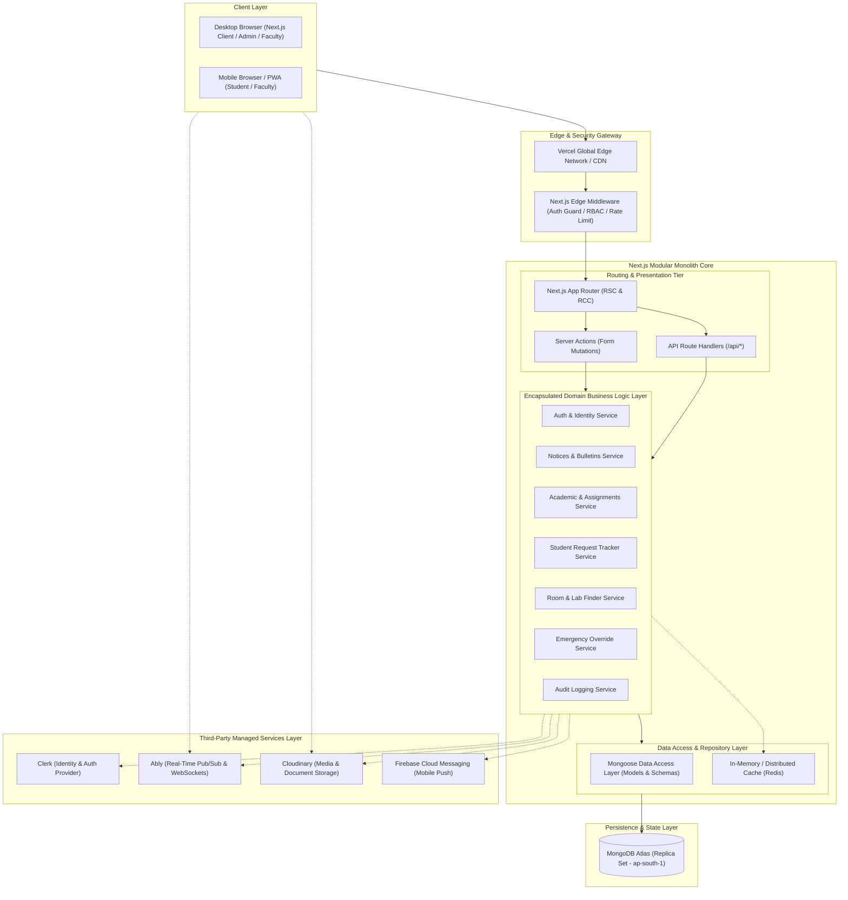
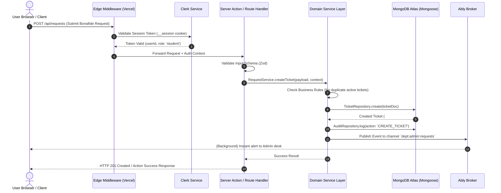

# High-Level System Architecture

> **Document ID:** DOC-ARCH-001  
> **Status:** Draft for Review (Phase 1, Part 1.2)  
> **Institution:** Axis Institute of Technology & Management  
> **Architectural Pattern:** Modular Monolith on Next.js  
> **Last Updated:** November 2026  

---

## 1. Architectural Philosophy: The Modular Monolith

Axis LinkUp is designed using a **Modular Monolith** architectural pattern. 

In a higher-education institutional environment with 3,000 to 5,000 active users, a microservices architecture would introduce severe operational overhead: distributed transaction management, network latency between services, complex container orchestration, and high infrastructure costs. 

Conversely, an unorganized monolithic application quickly degrades into a "spaghetti" codebase where domain boundaries are blurred.

The **Modular Monolith** pattern offers the ideal balance:
- **Single Deployable Unit:** Zero cross-service network latency, atomic deployments, unified continuous integration/continuous deployment (CI/CD), and simplified local development.
- **Strict Domain Boundaries:** Code is partitioned into isolated business domains (e.g., `auth`, `academics`, `notices`, `requests`, `chat`, `facilities`, `audit`). Modules interact only through well-defined public service contracts.
- **Future Extensibility:** Clean domain decoupling ensures that if a specific module (such as Real-Time Chat or File Processing) ever requires independent horizontal scaling, it can be extracted into an independent microservice with minimal refactoring.



---

## 2. Layer-by-Layer Architectural Decomposition

### 2.1 Client Layer
- **Target Environments:** Evergreen modern desktop browsers (Chrome, Edge, Firefox, Safari) and mobile viewports (iOS Safari, Android Chrome).
- **Technology:** React 19 / Next.js Client Components (RCC) utilizing Tailwind CSS for styling and Radix UI / shadcn/ui for accessible, unstyled primitives.
- **Rendering Model:** Hybrid rendering. Server Components render initial markup and data directly on the server for sub-second First Contentful Paint (FCP), while interactive islands (chat feeds, submission drawers, voting widgets) hydrate as Client Components.
- **Mobile Experience:** Built with a Mobile-First responsive paradigm, complete with viewport-aware layouts, touch targets (`>= 44px`), and a Progressive Web App (PWA) manifest for home-screen installation.

### 2.2 Edge & Ingress Layer
- **Vercel Edge Network:** Acts as the reverse proxy, SSL/TLS termination point, and edge cache.
- **Next.js Edge Middleware (`middleware.ts`):** 
  - Intercepts all incoming HTTP requests prior to application execution.
  - Verifies session tokens using Clerk Edge SDK.
  - Evaluates Route Groups against the user's role (`student`, `faculty`, `admin`, `super_admin`).
  - Redirects unauthorized requests with zero serverless function execution overhead.
  - Injects security headers (Content Security Policy, X-Frame-Options, Strict-Transport-Security).

### 2.3 Application & Routing Layer (Next.js App Router)
- **Route Groups:** Segregates application layouts cleanly without altering URL structures:
  - `(auth)`: Public login, password reset, invitation acceptance views.
  - `(student)`: Mobile-optimized student dashboard, courses, assignments, notices, requests.
  - `(faculty)`: Desktop/tablet-optimized grading queues, timetable, course announcements.
  - `(admin)`: Desk queues, departmental notice publishing, facility manager.
  - `(super-admin)`: System-wide audit log browser, role manager, emergency override desk.
  - `(shared)`: Shared profile views, settings, and general info.
- **Server Actions:** Primary mechanism for data mutations (e.g., submitting an assignment, filing a service ticket, casting a poll vote). Guarantees type-safe, RPC-like invocation with built-in CSRF protection and progressive enhancement.
- **API Route Handlers (`/api/*`):** Reserved for external webhooks (Clerk user sync, Cloudinary upload signatures, Ably token requests, FCM dispatch).

### 2.4 Business Logic / Service Layer
- **Encapsulation:** Pure TypeScript service classes and domain functions located in `lib/services/`.
- **Decoupled from HTTP:** Services receive clean TypeScript DTOs (Data Transfer Objects) and context objects (containing authenticated `userId`, `role`, and `departmentId`). They have no awareness of `NextRequest` or `NextResponse`.
- **Domain Responsibilities:**
  - Enforce business invariants (e.g., "Cannot submit assignment if deadline passed and `allowLate` is false").
  - Enforce entity-level authorization (e.g., "Can this faculty member modify this specific notice?").
  - Orchestrate side effects (e.g., creating a service ticket triggers an audit log record and an Ably real-time alert).

### 2.5 Repository & Data Access Layer (DAL)
- **Technology:** Mongoose 8+ connecting to MongoDB Atlas.
- **Pattern:** Centralized repository modules in `lib/db/repositories/` that encapsulate all Mongoose model queries (`find`, `findOneAndUpdate`, aggregation pipelines).
- **Abstraction:** Prevents raw database queries from leaking into business services.
- **Connection Management:** Cached Mongoose singleton connection optimized for Vercel serverless execution, avoiding connection pool exhaustion across lambda cold starts.

### 2.6 Persistence Layer (Database)
- **Primary Database:** MongoDB Atlas (Replica Set hosted in AWS Mumbai `ap-south-1` for Indian data residency compliance under the DPDP Act).
- **Storage Characteristics:** Highly flexible document model suited for dynamic forms (Student Request Tracker), polymorphic notice attachments, and rich course metadata.
- **Departmental Isolation:** Logical data partitioning enforced through mandatory `departmentId` indices and repository-level scoping filters.

### 2.7 External Services Layer
- **Clerk:** Identity provider managing user authentication, session lifecycles, TOTP-based Multi-Factor Authentication (MFA), and password hashing.
- **Ably:** Managed real-time service delivering sub-100ms pub/sub messaging, WebSocket connections, channel-level token authorization, and online presence tracking.
- **Cloudinary:** Cloud-based binary storage managing images, PDFs, assignment documents, and avatars via secure, signed upload presets and authenticated URLs.
- **Firebase Cloud Messaging (FCM):** Push notification gateway delivering background alerts to mobile and desktop devices when the web application is inactive.

---

## 3. End-to-End Request Lifecycle



---

## 4. Cross-Cutting Concerns

### 4.1 Error Handling & Standard API Envelope
Every API response and Server Action output follows a uniform envelope structure:

```typescript
type ApiResponse<T> = 
  | { success: true; data: T; error: null; timestamp: string }
  | { success: false; data: null; error: { code: string; message: string; details?: unknown }; timestamp: string };
```

A centralized error handler captures custom domain exceptions (`ValidationError`, `NotFoundError`, `UnauthorizedError`, `ForbiddenError`, `ConflictError`) and maps them to standard HTTP status codes.

### 4.2 Security & Defensive Architecture
- **Zero-Trust Backend:** Edge middleware provides route-level protection, but every Server Action and service method re-verifies the user's role and departmental scope at runtime.
- **Input Sanitization:** All incoming inputs are validated via Zod schemas. Markdown and user HTML are sanitized via DOMPurify before storage and rendering to prevent Cross-Site Scripting (XSS).
- **Secrets Management:** Zero secrets stored in source control. Environment variables injected via Vercel dashboard with strict staging/production separation.

### 4.3 Observability & Auditability
- **Audit Logging (MOD-19):** Critical state changes (role modifications, emergency mode triggers, request approvals, notice deletions) execute an append-only write to the `audit_logs` collection within the same execution path.
- **System Telemetry:** Real-time health metrics, query latency, and error rates tracked via Vercel Analytics and MongoDB Atlas monitoring dashboards.

