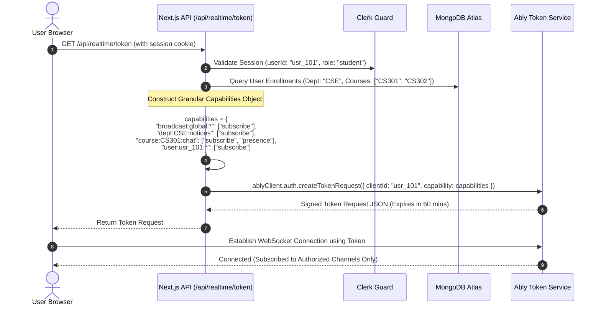
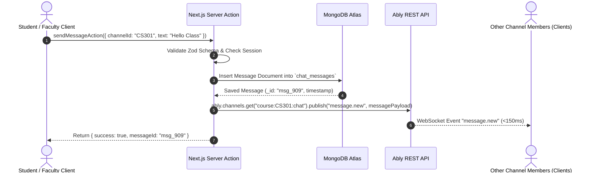

# Real-Time Architecture Specification

> **Document ID:** DOC-ARCH-006  
> **Status:** Draft for Review (Phase 1, Part 1.2)  
> **Service Provider:** Ably Realtime (Proposed Evaluation)  
> **Protocol:** WebSockets with HTTP Fallback  
> **Target Latency:** Sub-150ms Delivery (NFR-PERF-03)  
> **Last Updated:** November 2026  

---

## 1. Evaluation of Ably for Axis LinkUp

### 1.1 Overview & Architectural Fit
Ably is an enterprise-grade, globally distributed real-time data delivery platform operating over WebSockets. In a serverless environment like Next.js on Vercel, maintaining long-lived persistent WebSocket connections directly on the serverless compute layer is fundamentally anti-pattern (serverless functions spin down after execution, terminating open sockets).

Ably solves this architectural challenge by serving as an **external stateful connection broker**:
- Browser clients maintain persistent WebSocket connections directly to Ably's global edge network.
- Next.js serverless functions interact with Ably statelessly via Ably’s REST SDK, publishing events that Ably fans out to thousands of connected clients instantly.

### 1.2 Comparison: Ably vs. Self-Hosted Socket.io / Redis
- **Self-Hosted Socket.io + Redis:** Requires deploying, clustering, and monitoring dedicated virtual machines (EC2/Droplets) 24/7 with load balancers configured for sticky sessions. Introduces high DevOps complexity and infrastructure maintenance.
- **Ably Managed Broker:** Zero server management, built-in message queuing, connection recovery, automatic fallback to HTTP polling if campus firewalls block WebSockets, and a guaranteed 99.999% uptime SLA.
- **Cost Scaling:** Free tier provides 3 million monthly messages and 200 peak concurrent connections. For full campus rollout (up to 5,000 students), an upgraded plan or hybrid token-minting strategy is required.

---

## 2. Real-Time Capabilities Mapping

| Capability | Module Ref | Ably Mechanism | Latency Target | Description |
| :--- | :--- | :--- | :--- | :--- |
| **Group Course Channels** | MOD-08 | Pub/Sub Channels | `<150ms` | Real-time chat messages and typing indicators in academic course spaces. |
| **Direct Peer/Faculty Chat** | MOD-08 | Dedicated 1:1 Channels | `<150ms` | Private conversations respecting faculty office hours. |
| **In-App Notifications** | MOD-17 | User Personal Channel | `<200ms` | Live incrementing badge counters and popover toast alerts. |
| **Faculty Presence** | MOD-08 | Ably Presence API | `<500ms` | Indicates whether faculty members are online/available for inquiries. |
| **Live Request Updates** | MOD-13 | User / Dept Channel | `<200ms` | Instant ticket status updates (e.g., "Under Review" &rarr; "Approved"). |
| **Campus Emergency Mode** | MOD-16 | Global Broadcast Channel | `<100ms` | Master alert that commands client screens and triggers emergency modals. |

---

## 3. Channel Naming Conventions & Hierarchy

To prevent unauthorized cross-channel eavesdropping and maintain strict scoping, Ably channels follow a deterministic, namespaced naming convention:

```
[scope]:[entity_type]:[identifier]:[subtopic]
```

### 3.1 Standard Channel Registry

| Channel Name Pattern | Intended Audience | Typical Events |
| :--- | :--- | :--- |
| `broadcast:global:emergency` | All connected clients campus-wide | `emergency.alert.triggered`, `emergency.alert.deactivated` |
| `broadcast:global:notices` | All campus users | `notice.published.global` |
| `dept:[deptId]:notices` | Students & faculty belonging to `deptId` | `notice.published.department` |
| `dept:[deptId]:admin:requests` | Administrative staff of `deptId` | `request.created`, `request.escalated` |
| `course:[courseId]:chat` | Enrolled students & assigned faculty | `chat.message.new`, `chat.typing` |
| `chat:direct:[userA]_[userB]` | Exactly two participants (sorted IDs) | `chat.direct.message`, `chat.direct.read` |
| `user:[userId]:notifications` | Single authenticated user | `notification.received`, `badge.updated` |
| `user:[userId]:requests` | Student request submitter | `request.status.updated` |

---

## 4. Token Authentication & Capability Minting

To ensure zero trust, **clients never possess Ably API keys**. Instead, the client requests an ephemeral, signed **Ably Token Request** from a Next.js Route Handler (`/api/realtime/token`).

The server verifies the caller's Clerk session, queries their enrolled courses and department from MongoDB, and mints an Ably Token with **strictly restricted capabilities** (limiting exactly which channels the client may subscribe to or publish on):



---

## 5. Event Flow Architecture

### 5.1 Chat Message Flow (Server-Mediated Pattern)
To ensure data integrity, auditability, and moderation, clients **do not publish messages directly to chat channels**. All mutations pass through the server first:



### 5.2 Campus Emergency Mode Broadcast Flow (MOD-16)
1. **Trigger:** Super Admin activates Emergency Broadcast with verified MFA.
2. **Persistence:** `EmergencyAlert` document inserted in MongoDB and immutable audit log created.
3. **High-Priority Blast:** Next.js dispatches high-priority event to `broadcast:global:emergency` via Ably REST API.
4. **Client UI Takeover:** All active client sessions receive the message over open WebSockets, immediately rendering a full-width high-contrast red modal and audio alert, requiring explicit click acknowledgment.
5. **Confirmation:** User acknowledgment is recorded back to MongoDB via a lightweight Server Action.

---

## 6. Offline Presence & Resilience

### 6.1 Online Presence Tracking
- The Ably Presence API tracks user enter/leave/update events on course and departmental channels.
- Faculty members emit presence status (`"online" | "in_lecture" | "offline"`). When toggled to `"in_lecture"`, direct message notifications are temporarily muted.

### 6.2 Campus Network Flakiness & Recovery
- College Wi-Fi networks often experience signal drops when students transit between campus blocks.
- The Ably client library provides automatic reconnection buffering: if a student's Wi-Fi drops for up to two minutes, Ably seamlessly reconnects upon network restoration and replays any missed messages without message loss or page reloads.

