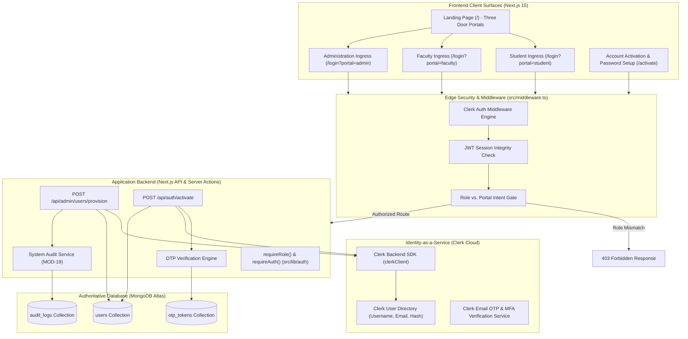
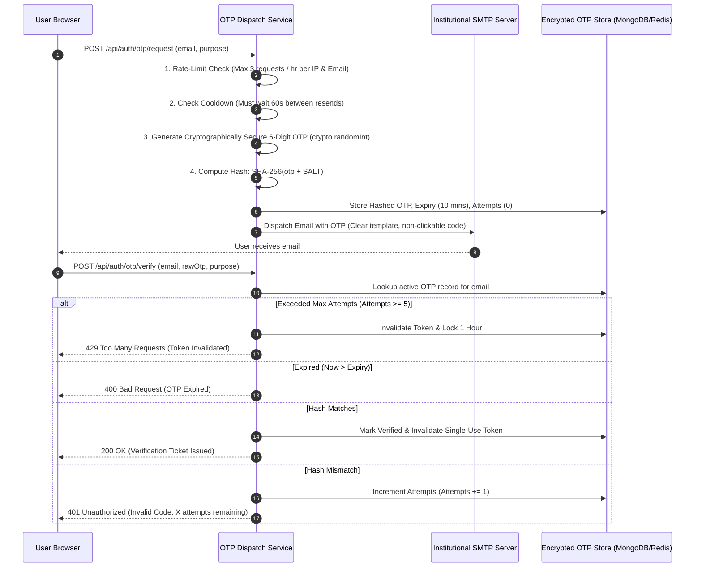

# AXIS LINKUP — UPDATED IDENTITY & ACCESS ARCHITECTURE
**Document ID:** DOC-ARCH-002-REV2  
**Status:** Approved for Architecture Specification (Phase 4.8.2)  
**Institution:** Axis Institute of Technology & Management (AITM), Kanpur  
**Last Updated:** November 13, 2026  

---

## 1. Architectural Overview & Identity Paradigm

Axis LinkUp employs a **hybrid identity architecture** combining a hardened, external Identity-as-a-Service provider (**Clerk**) with an authoritative collegiate profile database (**MongoDB Atlas**).

The updated architecture enforces two primary tenets:
1. **Closed Administrative Provisioning:** Zero self-service public registration; all accounts originate from verified System Administrator commands.
2. **Three-Door Ingress with Centralized Verification:** The public landing page offers distinct entry doors for Students, Faculty, and Administrators, all validated against a unified identity store.



---

## 2. Updated MongoDB User Schema Design

To support unique usernames, administrative provisioning, and the separate administrative roles (HOD, Director, System Administrator), the Mongoose `UserSchema` is expanded as follows:

```typescript
/**
 * Master User Document Schema (DOC-DATA-005 Evolution).
 */
const UserSchema = new Schema<IUser>(
  {
    authProviderId: {
      type: String,
      trim: true,
      unique: true,
      sparse: true,
    },
    username: {
      type: String,
      required: [true, 'Unique username is required'],
      unique: true,
      lowercase: true,
      trim: true,
      minlength: 3,
      maxlength: 30,
      match: [/^[a-z0-9._]+$/, 'Username must be lowercase alphanumeric with dots or underscores'],
    },
    email: {
      type: String,
      required: [true, 'Institutional email is required'],
      unique: true,
      lowercase: true,
      trim: true,
      match: [/@axiscolleges\.in$/, 'Must be an @axiscolleges.in email address'],
    },
    fullName: {
      type: String,
      required: [true, 'Full name is required'],
      trim: true,
      maxlength: 100,
    },
    role: {
      type: String,
      enum: ['student', 'faculty', 'admin', 'super_admin'],
      required: true,
    },
    adminSubRole: {
      type: String,
      enum: ['sys_admin', 'hod', 'director', null],
      default: null, // Populated for 'admin' and 'super_admin'
    },
    status: {
      type: String,
      enum: [
        'pending_verification',
        'active',
        'suspended',
        'deactivated',
        'archived',
      ],
      default: 'pending_verification',
    },
    isEmailVerified: {
      type: Boolean,
      default: false,
    },
    isProfileComplete: {
      type: Boolean,
      default: false,
    },
    departmentId: {
      type: Schema.Types.ObjectId,
      ref: 'Department',
      default: null,
    },
    phoneNumber: {
      type: String,
      trim: true,
      default: null,
    },
    avatarUrl: {
      type: String,
      trim: true,
      default: null,
    },
    studentProfile: {
      type: StudentProfileSchema,
      default: null,
    },
    facultyProfile: {
      type: FacultyProfileSchema,
      default: null,
    },
    adminProfile: {
      type: AdminProfileSchema,
      default: null,
    },
    provisionedBy: {
      type: Schema.Types.ObjectId,
      ref: 'User',
      default: null, // Tracks the System Administrator who provisioned the account
    },
    activatedAt: {
      type: Date,
      default: null,
    },
  },
  { timestamps: true }
);
```

---

## 3. High-Assurance OTP Specification

To support email verification, first-time account activation, and sensitive credential recovery without compromising security:



### 3.1 OTP Parameters & Security Constraints
- **Digit Length:** Exactly 6 numerical digits (`100000` to `999999`) generated via `crypto.randomInt(100000, 1000000)`.
- **Validity Window:** Exactly **10 minutes** (600 seconds).
- **Maximum Verification Attempts:** Exactly **5 attempts** per issued token. Upon the 5th failed attempt, the token is permanently destroyed.
- **Resend Cooldown:** Exactly **60 seconds** enforced on both server and client.
- **Storage Security:** The raw OTP is **never** stored in plaintext. The database holds:
  `tokenHash = crypto.createHmac('sha256', process.env.OTP_SECRET).update(rawOtp + email).digest('hex')`.
- **Production Logging Rule:** Raw OTP values are **strictly redacted** from all log outputs, error dumps, and server console buffers.

---

## 4. Clerk Provider Ingress & Compatibility

### 4.1 Native Username and Email Support
In Clerk's settings, both `username` and `email_address` are enabled as login identifiers. The Next.js frontend utilizes Clerk's sign-in flow:
```typescript
import { useSignIn } from '@clerk/nextjs';

const { isLoaded, signIn, setActive } = useSignIn();

// Initiates login with either username or institutional email
const result = await signIn.create({
  identifier: formValues.usernameOrEmail, // Accepts 'aarav.sharma' OR 'aarav.sharma@axiscolleges.in'
  password: formValues.password,
});
```

### 4.2 Handling Email OTP Challenge
If the account has multi-factor or activation verification enabled:
```typescript
if (result.status === 'needs_second_factor' || result.status === 'needs_first_factor') {
  // Dispatches email code
  await signIn.prepareFirstFactor({ strategy: 'email_code' });
  // Renders 6-digit OTP input step
}
```

---

## 5. Middleware Ingress & Zero-Trust Verification

In [src/middleware.ts](file:///c:/Users/prash/Desktop/Axis%20LinkUp/src/middleware.ts), when a session is established, the edge runtime validates the session claim against the requested route:

```typescript
// Edge Ingress Gate
const targetPortal = req.nextUrl.searchParams.get('portal');
const role = sessionClaims?.publicMetadata?.role;

if (targetPortal === 'admin' && role !== 'admin' && role !== 'super_admin') {
  return NextResponse.redirect(new URL('/unauthorized?reason=role_mismatch', req.url));
}
if (targetPortal === 'faculty' && role !== 'faculty' && role !== 'super_admin') {
  return NextResponse.redirect(new URL('/unauthorized?reason=role_mismatch', req.url));
}
if (targetPortal === 'student' && role !== 'student' && role !== 'super_admin') {
  return NextResponse.redirect(new URL('/unauthorized?reason=role_mismatch', req.url));
}
```
This guarantees that selecting an entry door does not permit cross-role access.

