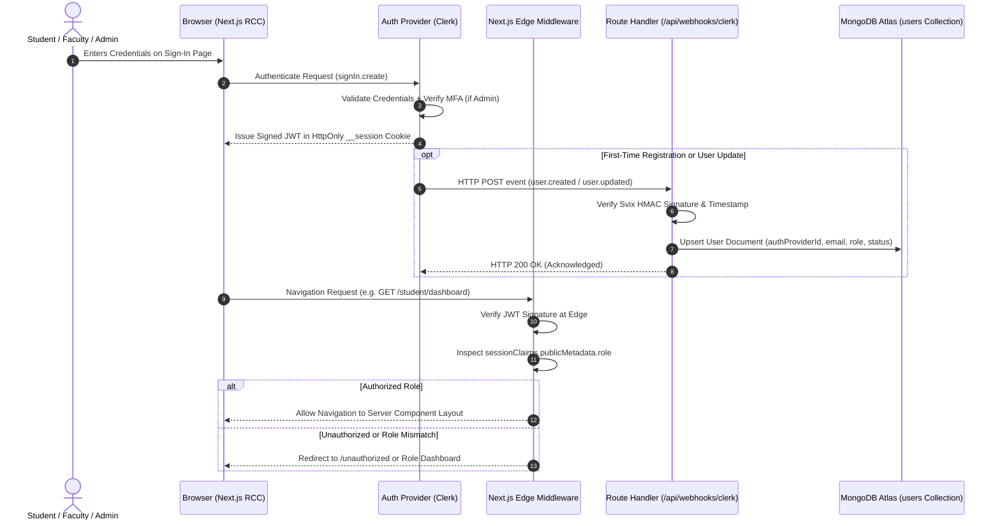

# Axis LinkUp — Master Authentication & Authorization Architecture

> **Document ID:** DOC-AUTH-002  
> **Status:** Architecture Baseline (Pending Provider Sign-off)  
> **Institution:** Axis Institute of Technology & Management  
> **Identity Pattern:** Dual-Store Identity with Server-Enforced RBAC  
> **Target Framework:** Next.js 15+ App Router • MongoDB Atlas  
> **Last Updated:** November 2026  

---

## 1. Architectural Philosophy & Core Principles

Authentication in Axis LinkUp is governed by four strict security principles:

1. **Dual-Store Identity Decoupling:** Authentication credentials (passwords, TOTP seeds, active sessions) are completely decoupled from application-specific institutional records (roll numbers, department IDs, attendance, grades).
2. **Defense-in-Depth (Multi-Tier Ingress Gates):** Authorization is never delegated to a single gate. Security boundaries are validated at Edge Middleware, Server Component Layouts, Server Actions, and the Data Access Layer (DAL).
3. **Zero-Trust Client Boundary:** Client claims, cookies, and local state are completely untrusted. All role and permission checks are re-verified on the server side prior to executing any mutation or sensitive query.
4. **Data Sovereignty & DPDP Compliance:** All institutional records, student personal identifiers, phone numbers, and academic documents reside exclusively within Indian borders (MongoDB Atlas in AWS Mumbai `ap-south-1`).

---

## 2. Dual-Store Identity Architecture

To combine enterprise-grade credential security with high-performance institutional querying, Axis LinkUp implements a **Dual-Store Identity Pattern**:

```mermaid
graph LR
    subgraph IdentityStore [Identity & Credential Store (Auth Provider)]
        AuthCreds["Email & Password Hash"]
        AuthSessions["Active Sessions & Tokens"]
        AuthMFA["TOTP MFA Secrets (Admin)"]
        AuthMeta["publicMetadata: { role: 'student' }"]
    end

    subgraph InstitutionalStore [Institutional Store (MongoDB Atlas ap-south-1)]
        UserDoc["users Collection"]
        UserProfile["Student / Faculty / Admin Profile"]
        DeptAssoc["Department & Section Enrolment"]
        AcademicRec["Academic Records & History"]
    end

    IdentityStore <-->|Bi-Directional Webhook Sync (Svix)| InstitutionalStore
```

### Store Responsibilities:
- **Identity Provider (Clerk / Candidate Provider):**
  - Manages password hashing, credential stuffing mitigations, and brute-force lockouts.
  - Generates cryptographically signed, short-lived JWT session tokens.
  - Enforces mandatory TOTP multi-factor authentication for administrative users.
  - Stores high-level routing metadata in server-only `publicMetadata`.
- **MongoDB Atlas (`users` collection):**
  - Acts as the institutional source of truth for all collegiate operations.
  - Stores student roll numbers, batch years, section assignments, and department IDs.
  - Maintains account lifecycle status (`pending_verification`, `active`, `suspended`, `graduated`).
  - Contains fine-grained permissions and departmental access scopes.

---

## 3. End-to-End Authentication & Webhook Sync Sequence



---

## 4. Multi-Layer Defense-in-Depth Pipeline

Axis LinkUp enforces security through four independent verification tiers:

```
Tier 1: Edge Middleware (Fast Ingress Gate & Route Boundary)
   │
   ▼
Tier 2: Server Component & Layout Gate (Session Assertion & Profile Sync)
   │
   ▼
Tier 3: Server Action & Route Handler Ingress (Input Validation & Role Guard)
   │
   ▼
Tier 4: Data Access Layer (DAL) Repository (Tenant & Departmental Scoping)
```

1. **Tier 1 — Next.js Edge Middleware:**
   - Evaluates incoming request paths against public vs. protected route patterns.
   - Decodes cryptographic JWT session token with zero database lookups (<10ms).
   - Validates that `token.publicMetadata.role` matches the route group prefix (`/student/*`, `/faculty/*`, `/admin/*`, `/super-admin/*`).
2. **Tier 2 — Server Component & Layout Gates:**
   - Every route group layout (`(student)/layout.tsx`, `(admin)/layout.tsx`) invokes `requireAuth()` and `requireRole()`.
   - Fetches the active institutional profile from MongoDB Atlas to ensure the account is not under disciplinary suspension (`status === 'active'`).
3. **Tier 3 — Server Action & Route Handler Ingress:**
   - Mutations executed via Server Actions parse raw inputs using Zod.
   - Calls domain-level authorization assertions before delegating to services.
4. **Tier 4 — Data Access Layer (DAL) Repository Scoping:**
   - Repositories automatically inject tenant and departmental filters (e.g. `{ departmentId: session.departmentId }`) into queries.
   - Prevents Horizontal Privilege Escalation (IDOR) even if an upper-tier check is bypassed.

---

## 5. Prevention of Client-Side Privilege Escalation

> [!CAUTION]
> In client-accessible identity architectures, improper metadata access allows students to escalate privileges to faculty or administrator roles.

### Prevention Architecture:
- **Server-Only Metadata (`publicMetadata`):**
  - Roles are written strictly via the server-side backend SDK using `CLERK_SECRET_KEY`.
  - Client-side browser SDKs have **zero write access** to `publicMetadata`.
  - Attempts by clients to submit modified role payloads are rejected at the provider API boundary.
- **Role Modification Gate:**
  - Role modifications can only be triggered by an authenticated Super Admin through `updateUserRoleAction`.
  - The Server Action executes self-demotion lockout checks and immutably records the modification in `audit_logs`.

---

## 6. Architecture Status & Decision Classification

- **Approved Decisions (Firm):**
  - Dual-store identity pattern separating authentication credentials from collegiate profiles.
  - Multi-tier defense-in-depth pipeline (Edge -> Layout -> Action -> DAL).
  - Storage of student roll numbers, departments, and academic records exclusively in MongoDB Atlas (AWS Mumbai `ap-south-1`).
  - Mandatory TOTP MFA for Admin and Super Admin accounts.
- **Proposed Decisions (Recommended Baseline):**
  - Webhook synchronization handled via Svix cryptographic signature validation.
  - Role claims encoded into session JWTs for zero-latency edge routing.
- **Pending Human Approval:**
  - Final provider sign-off on Clerk vs. Better Auth (DOC-AUTH-001).

