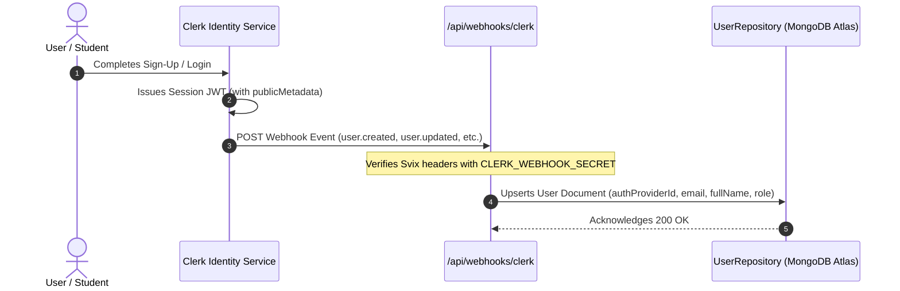

# Axis LinkUp — Authentication Provider Setup & Integration Guide

> **Document ID:** DOC-AUTH-010  
> **Status:** Approved Baseline (Phase 3, Part 3.2)  
> **Institution:** Axis Institute of Technology & Management  
> **Approved Provider:** Clerk (`@clerk/nextjs` v7) with `svix` Cryptographic Webhooks  
> **Decision Reference:** DEC-AUTH-01 (Approved)  
> **Last Updated:** November 2026  

---

## 1. Provider Selection Summary

Following comprehensive architectural evaluation in [AUTHENTICATION_PROVIDER_COMPARISON.md](file:///c:/Users/prash/Desktop/Axis%20LinkUp/docs/authentication/AUTHENTICATION_PROVIDER_COMPARISON.md) and formal stakeholder approval recorded in [AUTHENTICATION_PENDING_DECISIONS.md](file:///c:/Users/prash/Desktop/Axis%20LinkUp/docs/authentication/AUTHENTICATION_PENDING_DECISIONS.md#L21-L37), **Clerk** is the designated Identity & Session Management Provider for Axis LinkUp.

### Key Capabilities Utilized:
- **Zero-Password Storage in MongoDB:** Password hashing, salting, credential lifecycle, and brute-force defenses are delegated entirely to Clerk's SOC-2 Type II certified cloud.
- **Sub-10ms Edge JWT Decoding:** Sessions are validated at the Next.js Edge Middleware boundary using Clerk's public JWKS without hitting the primary database on every asset request.
- **Role Tamper Resistance:** User roles (`student`, `faculty`, `admin`, `super_admin`) and account status are stored in Clerk's server-only `publicMetadata`, which cannot be mutated from client-side tokens.
- **Mandatory TOTP MFA:** Built-in hardware/software TOTP authenticator enrollment for administrative tiers (`admin`, `super_admin`).
- **Cryptographic Event Streaming:** Changes to identities (creation, updates, deactivations) are securely streamed to `/api/webhooks/clerk` signed with `svix` HMAC-SHA256 headers.

---

## 2. Environment Variables & Secret Management

Clerk requires the following environment variables, defined and validated in `src/config/env.ts`:

| Variable Name | Environment Scope | Exposure Boundary | Description |
| :--- | :--- | :--- | :--- |
| `NEXT_PUBLIC_CLERK_PUBLISHABLE_KEY` | Public / Browser | Safe for client bundle | Identifies the collegiate Clerk application instance (`pk_test_...` or `pk_live_...`). |
| `CLERK_SECRET_KEY` | Server-Only | Strict backend / Node.js only | Authorizes administrative user mutation, role metadata updates, and invitation creation. |
| `CLERK_WEBHOOK_SECRET` | Server-Only | Strict backend / Node.js only | Cryptographic secret (`whsec_...`) used by `svix` to verify incoming webhook authenticity. |
| `NEXT_PUBLIC_CLERK_SIGN_IN_URL` | Public / Browser | Default: `/sign-in` | Canonical path for the application sign-in portal. |
| `NEXT_PUBLIC_CLERK_SIGN_UP_URL` | Public / Browser | Default: `/sign-up` | Canonical path for student self-registration portal. |
| `NEXT_PUBLIC_CLERK_AFTER_SIGN_IN_URL` | Public / Browser | Default: `/` | Routing target post sign-in (intercepted by middleware for role redirection). |
| `NEXT_PUBLIC_CLERK_AFTER_SIGN_UP_URL` | Public / Browser | Default: `/` | Routing target post registration. |

> [!WARNING]
> Never commit actual secret keys (`CLERK_SECRET_KEY`, `CLERK_WEBHOOK_SECRET`) to version control. They must be managed via local `.env` or deployment environment secret managers.

---

## 3. Package Architecture & Dependencies

Axis LinkUp integrates:
```json
{
  "dependencies": {
    "@clerk/nextjs": "^7.9.26",
    "svix": "^2.10.0"
  }
}
```

- `@clerk/nextjs` powers `<ClerkProvider>`, `clerkMiddleware`, `<SignIn />`, `<SignUp />`, `auth()`, and `currentUser()`.
- `svix` handles HMAC-SHA256 signature verification for inbound webhook requests (`svix-id`, `svix-timestamp`, `svix-signature`).

---

## 4. Dual-Store Synchronization Architecture



1. **Identity Authority:** Clerk is the authority for credentials, session validity, and MFA enrollment.
2. **Profile & Academic Authority:** MongoDB Atlas (`users` collection) is the authority for academic data, roll numbers, department associations, permissions, and institutional state.
3. **Bridge:** The `/api/webhooks/clerk` endpoint synchronizes user events in near real-time, enforcing schema validation via Zod before persisting to MongoDB.

---

## 5. Defense-in-Depth Pipeline

1. **Edge Middleware (`src/middleware.ts`):** Evaluates public vs protected routes, checks authentication, and routes unauthenticated users to `/sign-in`.
2. **Layout Ingress Gates (`src/app/(role)/layout.tsx`):** Confirms user status (`active`) in MongoDB; redirects suspended accounts to `/account-suspended`.
3. **Server Action Ingress Guards (`src/app/actions/*`):** Performs fine-grained RBAC permission checks before domain mutations.
4. **Data Access Layer (`src/lib/db/repositories/*`):** Enforces tenant and department scoping at the query level.

