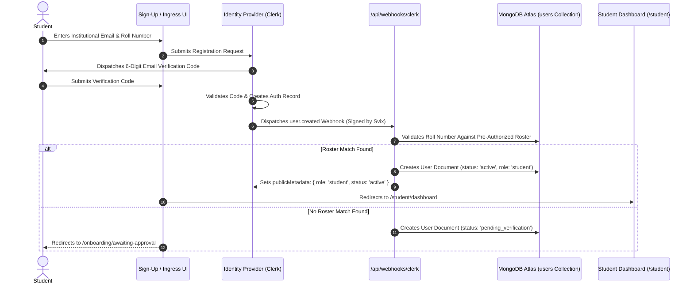
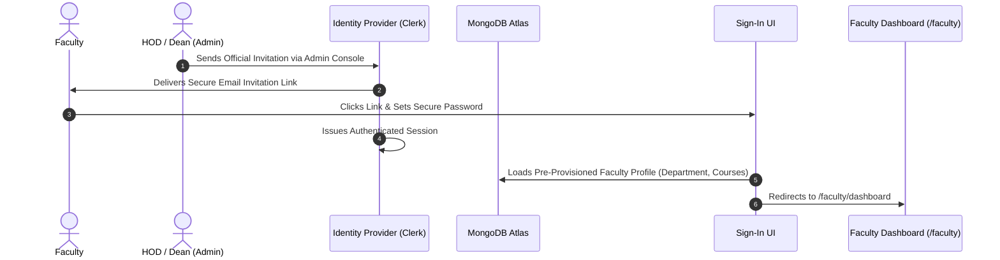
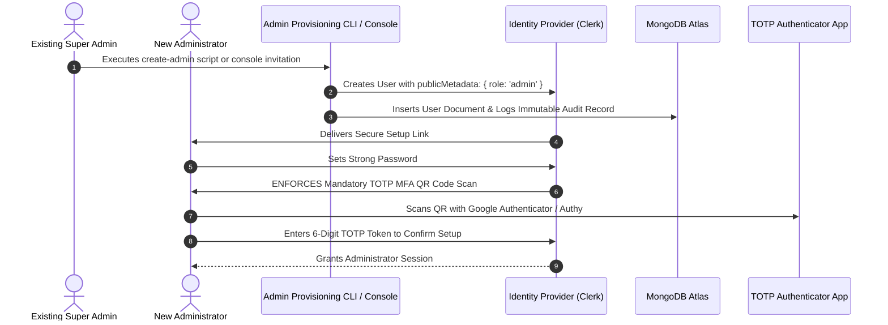

# Axis LinkUp — Login & Registration Flows Specification

> **Document ID:** DOC-AUTH-004  
> **Status:** Architecture Specification (Phase 3, Part 3.1)  
> **Institution:** Axis Institute of Technology & Management  
> **Coverage:** Student, Faculty, and Administrator Authentication Journeys  
> **Last Updated:** November 2026  

---

## 1. Overview & General Ingress Principles

All user authentication journeys in Axis LinkUp adhere to strict institutional identity rules:

1. **No Public Administrative Registration:** Self-registration for Administrator and Super Administrator accounts is **strictly prohibited**. Public registration is disabled; administrative accounts are provisioned exclusively through authorized channels.
2. **Institutional Domain Enforcement:** All user emails must adhere to official domain formats (e.g. `@axiscolleges.in` or approved institutional aliases).
3. **Pre-Authorized Roster Verification:** User registration is tied directly to the registrar's verified admission rosters. Unrecognized emails cannot register.

---

## 2. Student Authentication & Registration Journey

### 2.1 Student Registration Steps:
1. **Entry Gate:** Student navigates to `/sign-up` and provides their legal full name, institutional email (`name.roll@axiscolleges.in`), university roll number, and password.
2. **Email Verification:** Identity provider delivers a one-time 6-digit cryptographic verification code to the student's email.
3. **Roster Match Assertion:** Webhook handler catches `user.created` and performs an atomic lookup against the pre-seeded student admission list.
4. **First-Time Profile Onboarding:** If first sign-in, the student confirms their departmental section (e.g. CSE Section A) and uploads an optional avatar.
5. **Dashboard Access:** Redirects directly to `/student/dashboard`.

---

## 3. Faculty Authentication & Onboarding Journey

### 3.1 Faculty Onboarding Steps:
1. **Dean / HOD Invitation:** Department heads or IT administrators pre-provision the faculty member by entering their institutional email, employee ID (`FAC-XXX-000`), and department assignment.
2. **Invitation Link Delivery:** Identity provider emails a cryptographically signed, single-use invitation link valid for 48 hours.
3. **Password Configuration:** Faculty member clicks the invitation link, sets a strong password, and configures optional MFA.
4. **Departmental Binding:** Webhook matches the faculty's employee ID with their department record and sets `publicMetadata.role = 'faculty'`.
5. **Dashboard Access:** Redirects to `/faculty/dashboard`.

---

## 4. Administrator Provisioning Journey (High-Security)

> [!CAUTION]
> Public administrator registration is permanently disabled. Any attempt to register an admin account via public routes will be rejected.

### 4.1 Administrator Security Requirements:
1. **Closed Provisioning:** Admin accounts are created strictly by an active Super Admin via the secure internal management console or via the direct terminal CLI utility (`scripts/create-super-admin.ts`).
2. **Mandatory Multi-Factor Authentication (MFA):** On first login, administrators **must** enroll a TOTP authenticator application (Google Authenticator, Microsoft Authenticator) before accessing the admin dashboard.
3. **Immutable Audit Trail:** Provisioning, role escalation, and permission assignments are permanently recorded in `audit_logs` with the authorizing Super Admin's ID and timestamp.

---

## 5. Decision Classification

- **Approved Decisions (Firm):**
  - Public registration for `admin` and `super_admin` is permanently prohibited.
  - Faculty accounts are provisioned via administrative invitation links only.
  - Mandatory TOTP MFA enforced for all administrative logins.
- **Proposed Decisions (Recommended Baseline):**
  - Student registration verifies university roll number against pre-seeded admission rosters.
  - Automatic routing based on `publicMetadata.role` immediately upon successful sign-in.
- **Pending Human Approval:**
  - Whether students whose roll numbers are not pre-seeded can submit a manual verification request to the registrar desk.

