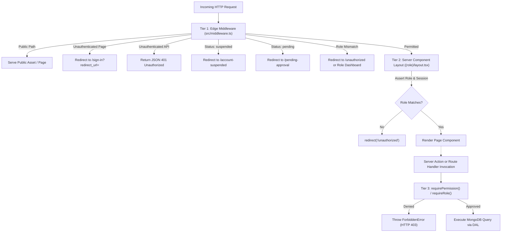

# Axis LinkUp — Protected Routes & Middleware Implementation Report

> **Document ID:** DOC-AUTH-013  
> **Status:** Implemented & Verified (Phase 3, Part 3.6)  
> **Institution:** Axis Institute of Technology & Management  
> **Engine:** Next.js 15+ App Router • Edge Middleware • Defense-in-Depth Pipeline  
> **Last Updated:** November 2026  

---

## 1. Executive Summary

Phase 3, Part 3.6 establishes the multi-tiered route protection, edge middleware, and layout authorization boundaries for Axis LinkUp.

In strict alignment with [DOC-AUTH-007](file:///c:/Users/prash/Desktop/Axis%20LinkUp/docs/authentication/ROUTE_PROTECTION_STRATEGY.md), route protection does not rely solely on edge middleware. Instead, it operates across an interlocking **Defense-in-Depth Model**:
1. **Tier 1 (Edge Middleware):** Global Next.js Edge Middleware evaluates public vs protected paths, extracts session claims via Clerk, intercepts unauthenticated traffic, blocks suspended accounts, and enforces high-level role perimeters.
2. **Tier 2 (Server Component Layout Gates):** Route group layouts (`(student)/layout.tsx`, `(faculty)/layout.tsx`, `(admin)/layout.tsx`, `(super-admin)/layout.tsx`, `(shared)/layout.tsx`) assert trusted session state and persona roles on the server, redirecting unauthorized navigators to `/unauthorized`.
3. **Tier 3 (Server Action & API Gates):** Fine-grained permission and ABAC resource ownership assertions (`requirePermission()`, `requireResourceOwnership()`) execute before any database query or domain mutation.

---

## 2. Route Classification & Access Map

| Category | Route Pattern | Target Persona | Access Policy | Unauthenticated Action | Unauthorized Action |
| :--- | :--- | :--- | :--- | :--- | :--- |
| **Public** | `/` | All / Guests | Unrestricted landing page | Allowed | None |
| **Public Auth** | `/sign-in(.*)` | Guests | Ingress login portal | Allowed | Redirect to user's assigned dashboard |
| | `/sign-up(.*)` | Enrolled Students | Self-registration portal | Allowed | Redirect to user's assigned dashboard |
| **Status Holds** | `/account-suspended` | Suspended Users | Administrative disciplinary hold | Allowed | Informative resolution instructions |
| | `/pending-approval` | Pending Students | Roster verification in progress | Allowed | Informs user of verification status |
| | `/unauthorized` | Any Authenticated | 403 Clearance Denied view | Allowed | Displays clearance denial reason |
| **Testing UI** | `/ui-preview(.*)` | Developers / QA | Visual component playground | Allowed | None |
| **Public API** | `/api/health(.*)` | Monitoring Systems | System & DB health telemetry | Allowed (No credentials leaked) | None |
| | `/api/webhooks(.*)` | Identity Providers | Cryptographically signed (Svix) | HMAC-SHA256 signature verification | HTTP 400 Bad Request |
| **Protected API** | `/api/auth/me` | Authenticated Users | Current user identity & profile | HTTP 401 Unauthorized | HTTP 403 Forbidden |
| **Student** | `/student/*` | Student | Enrolled students (`role: student`) | Redirect to `/sign-in?redirect_url=...` | Redirect to role dashboard |
| **Faculty** | `/faculty/*` | Faculty | Appointed instructors (`role: faculty`) | Redirect to `/sign-in?redirect_url=...` | Redirect to `/unauthorized` |
| **Admin** | `/admin/*` | Department Admin | Department staff (`admin`, `super_admin`)| Redirect to `/sign-in?redirect_url=...` | Redirect to `/unauthorized` |
| **Super Admin** | `/super-admin/*` | Super Admin | Central IT Leadership (`super_admin`) | Redirect to `/sign-in?redirect_url=...` | Redirect to `/unauthorized` |
| **Shared** | `/shared/*` | All Authenticated | Any active collegiate account | Redirect to `/sign-in?redirect_url=...` | Redirect to `/unauthorized` |

---

## 3. Defense-in-Depth Pipeline Architecture

---

## 4. Key Security Protections Implemented

### 4.1 Open-Redirect Vulnerability Defense
To prevent malicious attackers from exploiting login redirects (e.g., `/sign-in?redirect_url=https://evil.com`), `src/middleware.ts` applies strict sanitization:
- Only relative paths starting with a single forward slash (`/`) are accepted.
- Protocol-relative URLs (`//attacker.com`), backslash escapes (`/\attacker.com`), and absolute URIs are purged and defaulted to `/`.

### 4.2 Redirect Loop Prevention
- Navigating to `/sign-in` when unauthenticated is permitted immediately without attaching `redirect_url=/sign-in`.
- Navigating to `/account-suspended` when suspended never triggers a redirect to itself.
- Authenticated users attempting to visit guest routes (`/sign-in`, `/sign-up`) are redirected once to their authorized persona dashboard.

### 4.3 Downstream Context Injection
Edge Middleware injects verified identity headers into downstream requests:
- `x-user-id`: Caller's verified authProviderId.
- `x-user-role`: Server-verified collegiate role.

### 4.4 API Protection
- Unauthenticated API calls return structured `HTTP 401` JSON envelopes (`AUTH_REQUIRED`).
- Protected Route Handler `GET /api/auth/me` validates session active status via `requireAuth()`, retrieves the user document, and serializes a sanitized `UserDTO` without exposing internal Mongoose metadata.

---

## 5. Verification & Testing Audit

The automated testing suite verifies all route ingress, redirection, and authorization layers:

| Verification Stage | Command | Result | Details |
| :--- | :--- | :---: | :--- |
| **Unit Test Suite** | `npm test` | ✅ **PASS** | **82/82 tests passed** across 29 test suites (0 failures) |
| **TypeScript Check** | `npm run typecheck` | ✅ **PASS** | Zero type errors (`tsc --noEmit`) |
| **ESLint Quality** | `npm run lint` | ✅ **PASS** | Zero errors, zero warnings |
| **Prettier Format** | `npm run format:check` | ✅ **PASS** | 100% compliant with project styling rules |
| **Production Build** | `npm run build` | ✅ **PASS** | Next.js 15 production build generated in 4.9s |

---

## 6. Readiness Status

- **Prerequisites Verified:** Clerk identity provider, user profile database models, and Part 3.5 RBAC engine verified.
- **Implementation Status:** Fully implemented, verified, tested, and built.
- **Readiness:** **`READY`** for Phase 3, Part 3.7 (Session Management & Multi-Session Governance).

