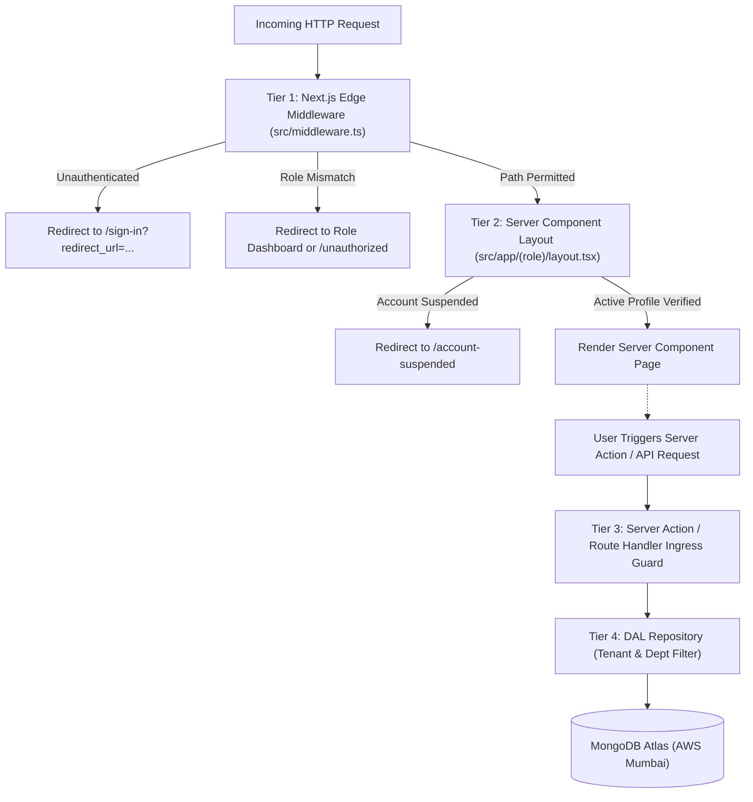

# Axis LinkUp — Route Protection & Ingress Security Strategy

> **Document ID:** DOC-AUTH-007  
> **Status:** Architecture Baseline (Phase 3, Part 3.1)  
> **Institution:** Axis Institute of Technology & Management  
> **Framework:** Next.js 15+ App Router • Defense-in-Depth Ingress Gates  
> **Last Updated:** November 2026  

---

## 1. The Multi-Tier Route Protection Model

> [!IMPORTANT]
> **Cardinal Security Rule:** Axis LinkUp **never relies exclusively on Next.js Edge Middleware** for security-sensitive authorization. Edge Middleware serves as a fast first-line routing boundary, backed by mandatory Server Component layout assertions, Server Action guards, and Data Access Layer (DAL) scoping.



---

## 2. Route Group Protection Specifications

| Route Pattern | Target Persona | Access Policy | Unauthenticated Action | Unauthorized / Mismatch Action |
| :--- | :--- | :--- | :--- | :--- |
| `/*` (Root) | Public | Unrestricted public landing page | None | None |
| `/sign-in/*`, `/sign-up/*` | Unauthenticated | Public ingress | Allow access | Redirect to user's assigned dashboard if already signed in |
| `/onboarding/*` | First-Time Users | Authenticated (`pending_verification`) | Redirect to `/sign-in` | Allow access until profile completed |
| `/student/*` | Student | Enrolled students (`role: 'student'`) | Redirect to `/sign-in` | Redirect to user's authorized role dashboard |
| `/faculty/*` | Faculty | Appointed instructors (`role: 'faculty'`) | Redirect to `/sign-in` | Redirect to `/unauthorized` |
| `/admin/*` | Administrator | Departmental staff (`admin`, `super_admin`) | Redirect to `/sign-in` | Return `HTTP 403 Forbidden` |
| `/super-admin/*` | Super Admin | Executive IT leadership (`super_admin`) | Redirect to `/sign-in` | Return `HTTP 403 Forbidden` |
| `/shared/*` | All Authenticated | Any active user role | Redirect to `/sign-in` | Filter view by user role |
| `/api/health/*` | Monitoring | Public health checks | None | None |
| `/api/webhooks/*` | Third-Party | Cryptographically signed (Svix) | Reject if signature invalid | Return `HTTP 401 / 403` |

---

## 3. Tier-by-Tier Implementation Specifications

### 3.1 Tier 1: Next.js Edge Middleware (`src/middleware.ts`)
- **Execution Target:** Vercel Global Edge Network.
- **Responsibilities:**
  - Evaluates route matchers (`createRouteMatcher`).
  - Verifies cryptographic session JWT using public JWKS.
  - Inspects `token.publicMetadata.role`.
  - Performs fast edge-level URL rewrites or redirects before serverless execution.
  - Injects authenticated user headers (`x-user-id`, `x-user-role`) for downstream handlers.

### 3.2 Tier 2: Server Component Layout Gates
- **Execution Target:** React Server Components (RSC) inside route group layouts:
  - `src/app/(student)/layout.tsx`
  - `src/app/(faculty)/layout.tsx`
  - `src/app/(admin)/layout.tsx`
  - `src/app/(super-admin)/layout.tsx`
- **Responsibilities:**
  - Invokes `requireAuth()` to verify session context.
  - Queries MongoDB Atlas to confirm that user `status === 'active'` (blocking suspended users who hold unexpired edge JWTs).
  - Populates tenant context for child Server Components.

### 3.3 Tier 3: Server Action & Route Handler Guards
- **Execution Target:** Every Server Action mutating data or Route Handler serving webhooks:
  ```typescript
  // Ingress guard template for Server Actions
  export async function publishNoticeAction(rawInput: unknown): Promise<ApiResponse<NoticeDTO>> {
    const session = await requireAuth();
    if (session.role !== 'faculty' && session.role !== 'admin' && session.role !== 'super_admin') {
      throw new ForbiddenError('Insufficient permissions to publish notices.');
    }
    // Execute validated domain service...
  }
  ```

### 3.4 Tier 4: Data Access Layer (DAL) Scoping
- **Execution Target:** Mongoose repositories (`src/lib/db/repositories/*`).
- **Responsibilities:**
  - Injects mandatory tenant filters: `{ departmentId: session.departmentId }`.
  - Enforces data isolation at the physical database query level.

---

## 4. Error & Edge Case Behaviors

1. **Unauthenticated Access:**
   - Client is redirected to `/sign-in?redirect_url=<encoded_current_path>`. Upon successful login, the user returns to their requested page.
2. **Role Mismatch on Page Navigation:**
   - If a student visits `/admin/dashboard`, they are redirected to `/student/dashboard` with a notification banner.
   - If a non-super-admin visits `/super-admin/*`, the server returns a hard `HTTP 403 Forbidden`.
3. **Disciplinary Suspension:**
   - Any navigation attempt by a suspended user immediately redirects to `/account-suspended` explaining the institutional hold and contact info for the Dean's office.

---

## 5. Decision Classification

- **Approved Decisions (Firm):**
  - Defense-in-depth pipeline (Edge Middleware -> Layout Gates -> Server Action Ingress -> DAL Scoping).
  - Multi-role route group partitioning (`(student)`, `(faculty)`, `(admin)`, `(super-admin)`).
  - Suspended account lockouts enforced in Server Component layouts.
- **Proposed Decisions:**
  - Redirect URL retention (`redirect_url`) for seamless post-login navigation.
- **Pending Human Approval:**
  - Whether students attempting to access administrative URLs should be logged as security violation attempts in `audit_logs`.

