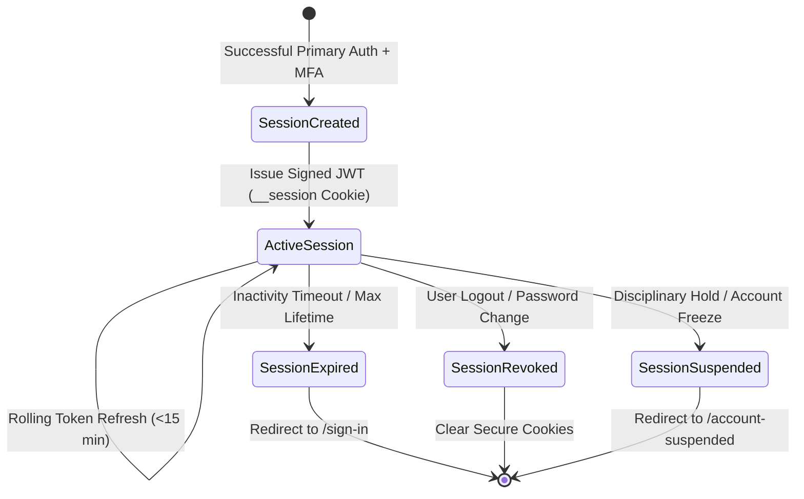

# Axis LinkUp — Session Management & Security Architecture

> **Document ID:** DOC-AUTH-006  
> **Status:** Architecture Baseline (Phase 3, Part 3.1)  
> **Institution:** Axis Institute of Technology & Management  
> **Security Standards:** NIST SP 800-63B • OWASP ASVS v4.0  
> **Last Updated:** November 2026  

---

## 1. Session Lifecycle Architecture

Axis LinkUp enforces a deterministic session lifecycle engineered to prevent token theft, session hijacking, and stale access:

---

## 2. Session Creation, Validation & Expiration Policies

### 2.1 Cryptographic Session Tokens
- **Token Format:** Short-lived JSON Web Tokens (JWT) cryptographically signed via RS256 asymmetric keys.
- **Token Lifespan:**
  - **Access Token (JWT):** Short-lived **15-minute expiration** window.
  - **Refresh Session:** Rolling **7-day inactivity timeout** (max 30 days total lifespan).
- **Edge Token Verification:**
  - Next.js Edge Middleware decodes and verifies the JWT signature locally using the public JSON Web Key Set (JWKS).
  - No database lookup is executed during routine navigation, keeping route interception latency under 10ms.

### 2.2 Secure Cookie Specifications
All session identifiers are stored in browser cookies configured with maximum defensive attributes:

| Cookie Attribute | Configuration | Security Objective |
| :--- | :---: | :--- |
| **`HttpOnly`** | `true` | Prevents Cross-Site Scripting (XSS) attacks by blocking JavaScript access via `document.cookie`. |
| **`Secure`** | `true` | Ensures cookies are transmitted exclusively over encrypted TLS 1.3 channels (enforced in production). |
| **`SameSite`** | `Strict` | Eliminates Cross-Site Request Forgery (CSRF) by preventing the browser from attaching cookies on cross-origin requests. |
| **`Path`** | `/` | Restricts cookie scope to the official collegiate domain. |

---

## 3. Session Revocation & Disciplinary Suspension

### 3.1 Global Logout
When a user clicks "Sign Out", the server executes a global session invalidation:
1. Deletes client session cookies.
2. Inactivates the active session record in the identity provider.
3. Broadcasts session revocation to all other active devices registered to the user.

### 3.2 Immediate Disciplinary Account Suspension
If a student or faculty member is suspended by the Dean or IT Admin:
1. The admin executes `suspendUserAction(userId)`.
2. The user document in MongoDB is updated to `status: 'suspended'`.
3. The server immediately invokes `@clerk/backend` SDK to revoke **all active sessions** (`sessions.revokeAll(userId)`).
4. Any active browser connection is terminated upon its next request, redirecting to `/account-suspended`.

---

## 4. Threat Mitigations: CSRF, Rate Limiting & Brute Force

### 4.1 Cross-Site Request Forgery (CSRF) Protection
- **App Router Native Protection:** Next.js Server Actions automatically verify the `Origin` and `Host` headers on incoming mutation requests, dropping any requests originating from foreign origins.
- **SameSite=Strict:** Combined with `SameSite=Strict` session cookies, cross-site malicious form triggers are physically blocked by modern browsers.

### 4.2 Rate Limiting & Brute-Force Safeguards
- **Sign-In Endpoint Protection:** Public authentication endpoints enforce IP-based and identifier-based rate limiting (maximum 5 failed attempts per 15-minute window).
- **Credential Stuffing Mitigation:** Identity provider automatically checks passwords against compromised breach databases (HaveIBeenPwned API) and blocks breached passwords.

---

## 5. Security Audit Logging

All authentication and session lifecycle events are immutably recorded in the `audit_logs` collection:

| Audit Event | Trigger | Logged Data Points |
| :--- | :--- | :--- |
| `AUTH_LOGIN_SUCCESS` | User completes sign-in | Actor ID, Role, IP Address, User Agent, Timestamp |
| `AUTH_LOGIN_FAILURE` | Invalid password or unknown email | Attempted Email, IP Address, Timestamp |
| `AUTH_MFA_CHALLENGE` | Admin enters TOTP token | Actor ID, MFA Method, Verification Result |
| `AUTH_LOGOUT` | User signs out | Actor ID, Session ID, Timestamp |
| `AUTH_SESSION_REVOKED` | Admin revokes user session | Actor ID, Target User ID, Reason, Timestamp |
| `AUTH_ROLE_MODIFIED` | Super Admin changes user role | Actor ID, Target User ID, Old Role, New Role |

---

## 6. Decision Classification

- **Approved Decisions (Firm):**
  - Session cookies configured strictly with `HttpOnly`, `Secure`, and `SameSite=Strict`.
  - Next.js Server Actions native CSRF origin verification.
  - Immediate revocation of all active sessions upon account suspension.
  - Immutable audit logging for all authentication events.
- **Proposed Decisions:**
  - 15-minute access token lifespan with 7-day rolling refresh session.
- **Pending Human Approval:**
  - Whether administrative users (Admin / Super Admin) should be subjected to an aggressive 30-minute idle session timeout.

