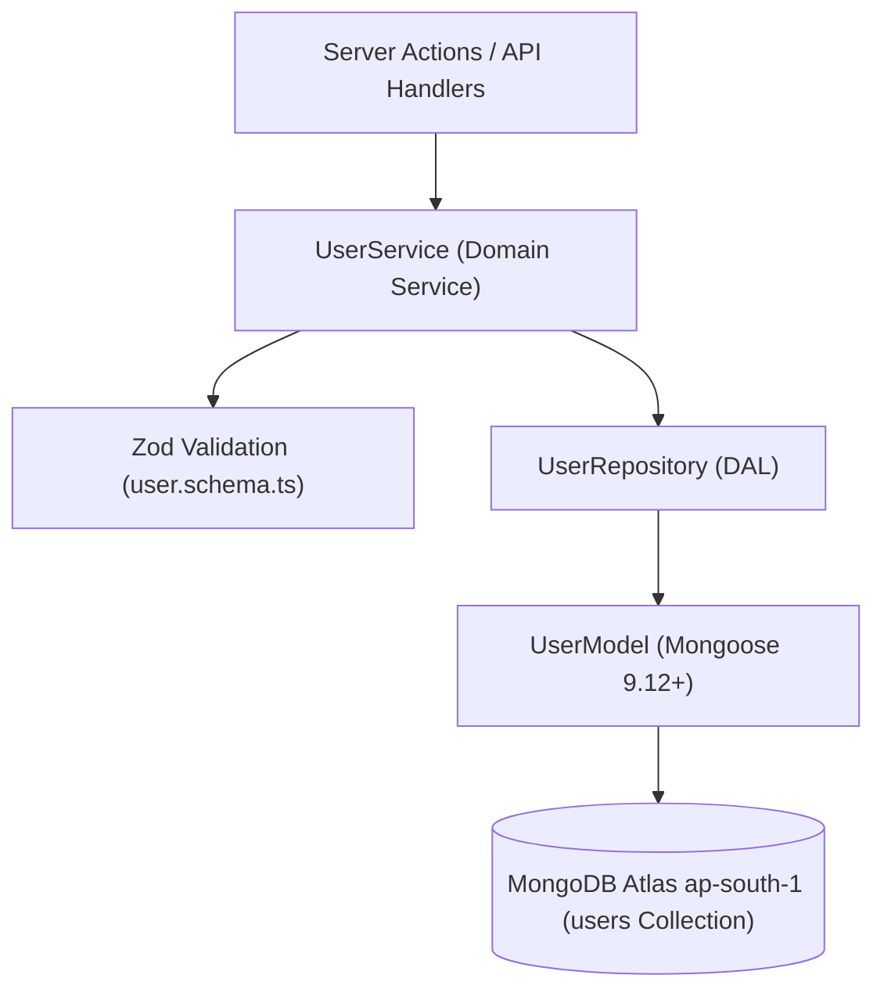
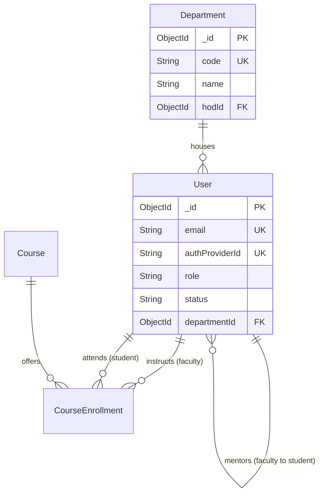

# User Database Model & Profile Integration

> **Document ID:** DOC-AUTH-010  
> **Status:** Implemented Baseline (Phase 3, Part 3.3)  
> **Institution:** Axis Institute of Technology & Management  
> **Collection:** MongoDB Atlas `users` Collection  
> **Mongoose Model:** `src/lib/db/models/user.model.ts`  
> **Repository:** `src/lib/db/repositories/user.repository.ts`  
> **Service:** `src/lib/services/user.service.ts`  
> **Last Updated:** November 2026  

---

## 1. Architectural Overview & Provider Decoupling

Following the instructions of **Phase 3, Part 3.3**, the application-level user identity and profile system has been implemented strictly decoupled from any external authentication provider.

Because the final authentication provider selection (**DEC-AUTH-01**) remains **PENDING HUMAN APPROVAL**:
- The model includes an optional, sparse `authProviderId` field capable of storing external IDs (such as Clerk user IDs or Better Auth IDs) once approved.
- Zero provider-specific webhooks, SDKs, or callbacks were created.
- The user profile, departmental associations, and academic lifecycles operate completely independently within MongoDB Atlas.



---

## 2. Master User Model Structure (`users` Collection)

The `users` collection in MongoDB represents the core identity entity for all campus roles using single-table inheritance:

### 2.1 Base User Fields

| Field Name | Type | Constraints | Default | Description |
| :--- | :---: | :---: | :---: | :--- |
| `_id` | `ObjectId` | Auto Primary Key | Auto | Immutable internal MongoDB identifier. |
| `authProviderId` | `String` | Sparse, Unique | `null` | External provider identifier (pending provider integration). |
| `email` | `String` | Required, Unique | None | Normalized lowercase institutional email address. |
| `fullName` | `String` | Required, Trimmed | None | Legal full name (2–100 characters). |
| `role` | `String` | Required, Enum | None | `'student'`, `'faculty'`, `'admin'`, `'super_admin'`. |
| `status` | `String` | Required, Enum | `'pending_verification'` | `'pending_verification'`, `'active'`, `'suspended'`, `'deactivated'`, `'graduated'`, `'invited'`, `'archived'`. |
| `isProfileComplete`| `Boolean` | Required | `false` | First-time onboarding completion flag. |
| `departmentId` | `ObjectId` | Ref `'Department'` | `null` | Reference to academic department (e.g. CSE, ECE). |
| `phoneNumber` | `String` | Optional | `null` | E.164 phone number (`^\+?[1-9]\d{9,14}$`). |
| `avatarUrl` | `String` | Optional | `null` | Cloudinary CDN media asset URL. |
| `createdAt` | `Date` | Timestamp | Auto | Creation timestamp. |
| `updatedAt` | `Date` | Timestamp | Auto | Last modification timestamp. |

---

## 3. Role-Specific Profile Subdocuments

### 3.1 Student Profile (`studentProfile`)
Embedded subdocument populated for users with `role: 'student'`:
- `rollNumber`: String (Required for students, uppercase, trimmed, sparse unique).
- `enrollmentNumber`: String (University AKTU registration number, optional).
- `batchYear`: Number (Range: 2020 to 2035).
- `currentSemester`: Number (Range: 1 to 8).
- `section`: String (e.g. `"A"`, `"B"`, max 5 chars).
- `academicMentorId`: ObjectId (Reference to assigned faculty mentor in `users`).
- `admissionType`: Enum (`'regular'`, `'lateral_entry'`, default `'regular'`).

### 3.2 Faculty Profile (`facultyProfile`)
Embedded subdocument populated for users with `role: 'faculty'`:
- `employeeId`: String (Required for faculty, uppercase, trimmed, sparse unique).
- `designation`: String (e.g. `"Assistant Professor"`, `"Professor"`, `"HOD"`).
- `qualifications`: Array of Strings (e.g. `["Ph.D. CSE", "M.Tech"]`).
- `cabinRoom`: String (Campus office location, max 50 chars).
- `assignedCourses`: Array of ObjectIds (References to `courses` collection).
- `officeHours`: Subdocument with `start` (`"10:00"`), `end` (`"12:00"`), and `isAcceptingDMs` (`boolean`).

### 3.3 Administrator Profile (`adminProfile`)
Embedded subdocument populated for users with `role: 'admin'` or `'super_admin'`:
- `adminStaffId`: String (Required for admins, uppercase, trimmed, sparse unique).
- `administrativeDomain`: String (e.g. `"Registrar Office"`, `"Exam Cell"`, `"Campus IT"`).
- `assignedQueueScopes`: Array of Strings (Permitted service request categories).
- `emergencyOverridePermitted`: Boolean (Flag granting emergency broadcast permissions).

---

## 4. Database Relationships



---

## 5. Mongoose Indexing Architecture

Adhering strictly to **DOC-DATA-007 (Indexing Strategy)** and the **Equality-Sort-Range (ESR) rule**:

```typescript
// 1. Unique Constraints
UserSchema.index({ email: 1 }, { unique: true });
UserSchema.index({ authProviderId: 1 }, { unique: true, sparse: true });
UserSchema.index({ 'studentProfile.rollNumber': 1 }, { unique: true, sparse: true });
UserSchema.index({ 'facultyProfile.employeeId': 1 }, { unique: true, sparse: true });
UserSchema.index({ 'adminProfile.adminStaffId': 1 }, { unique: true, sparse: true });

// 2. High-Velocity Compound Queries (ESR)
UserSchema.index({ departmentId: 1, role: 1, status: 1 });
UserSchema.index({ 'studentProfile.batchYear': 1, departmentId: 1, 'studentProfile.section': 1 });

// 3. Status Filtering
UserSchema.index({ status: 1 });
```

---

## 6. Service & Data Access Layer (DAL) Architecture

### 6.1 `UserRepository` (`src/lib/db/repositories/user.repository.ts`)
Encapsulates direct Mongoose database interactions:
- `findById(id)`
- `findByEmail(email)`
- `findByAuthProviderId(providerId)`
- `findByRollNumber(rollNumber)`
- `findByEmployeeId(employeeId)`
- `create(data)`
- `updateProfile(id, data)` (whitelisted fields only)
- `updateRole(id, role)`
- `updateStatus(id, status)`
- `findByDepartment(deptId, role)`
- `countByRole(role)`
- `deleteById(id)`

### 6.2 `UserService` (`src/lib/services/user.service.ts`)
Enforces institutional business invariants and security gates:
- `createUser(input)`: Validates payload with Zod, checks uniqueness of email, roll number, and employee ID.
- `updateUserProfile(userId, input, callerSession)`: Enforces caller ownership; prevents mass assignment by strictly stripping `role`, `status`, `authProviderId`, and `departmentId`.
- `updateUserRole(userId, newRole, callerSession)`: Requires `callerSession.role === 'super_admin'`; prevents self-demotion lockout if caller is the last Super Admin.
- `updateUserStatus(userId, newStatus, callerSession)`: Requires `admin` or `super_admin` authority.
- `checkAccountStatus(userId)`: Returns active and suspended status booleans.

---

## 7. Security Controls & Mass-Assignment Defense

1. **Privilege Escalation Immunity:**
   - The self-service schema `updateUserProfileSchema` strictly rejects/strips `role`, `status`, and `authProviderId`.
   - Even if a malicious student submits `{ role: 'admin' }`, the schema silently discards the field and the repository never updates it.
2. **Cross-User Tampering Defense:**
   - `UserService.updateUserProfile` asserts `callerSession.userId === targetUserId || callerSession.role === 'super_admin'`, throwing `ForbiddenError` on unauthorized attempts.
3. **Internal DTO Sanitization:**
   - `toUserDTO()` converts Mongoose documents to plain objects, converts `_id` to string `id`, and completely removes internal Mongoose version keys (`__v`).

---

## 8. Test Suite Verification Results

An automated unit test suite was implemented in [tests/unit/user-model.test.ts](file:///c:/Users/prash/Desktop/Axis%20LinkUp/tests/unit/user-model.test.ts):

```
TAP version 13
# Subtest: 1. User Creation Schema Validation
    ok 1 - validates a complete student user payload
    ok 2 - validates a complete faculty user payload
    ok 3 - validates a complete administrator user payload
    ok 4 - rejects malformed email addresses
    ok 5 - rejects unauthorized or arbitrary role values
    ok 6 - rejects out-of-range student academic values
ok 7 - 1. User Creation Schema Validation
# Subtest: 2. Security & Mass-Assignment Protection
    ok 1 - admin update schema permits role and status mutations
    ok 2 - self-service update schema strips role, status and internal identifiers
    ok 3 - rejects profile update attempts across different user IDs
    ok 4 - rejects role mutation attempts by non-super-admin users
ok 8 - 2. Security & Mass-Assignment Protection
# Subtest: 3. DTO Formatting & Serialization
    ok 1 - toUserDTO transforms document without leaking internal __v
ok 9 - 3. DTO Formatting & Serialization
1..9
# tests 27
# suites 9
# pass 27
# fail 0
```

---

## 9. Provider-Dependent Pending Work

The following integrations remain on standby until the project owner formally approves the primary identity provider (**DEC-AUTH-01**):
1. **Webhook Ingress Route (`/api/webhooks/auth`):** Handler to listen for user creation/update events from the approved provider and upsert MongoDB `User` documents.
2. **Provider Identifier Synchronization:** Binding `authProviderId` upon external registration.
3. **Session Middleware (`src/middleware.ts`):** Edge Middleware decoding provider session cookies.

