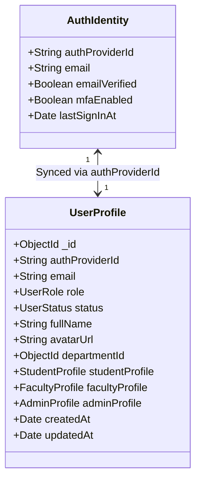
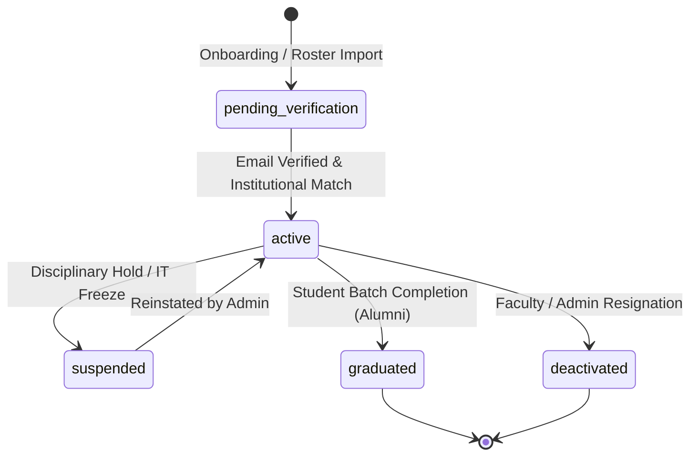

# User Identity Model & Lifecycle Architecture

> **Document ID:** DOC-AUTH-003  
> **Status:** Architecture Specification (Phase 3, Part 3.1)  
> **Institution:** Axis Institute of Technology & Management  
> **Target Collection:** MongoDB Atlas `users` Collection  
> **Last Updated:** November 2026  

---

## 1. Overview & Identity Segregation

Axis LinkUp enforces a clean separation between **Authentication Identity** (managed by the identity provider) and **Collegiate User Profile** (persisted in MongoDB Atlas).



---

## 2. Core User Identity Schema (`users` Collection)

The master `users` collection in MongoDB stores all application identities using single-table inheritance for role-specific attributes:

### 2.1 Universal Base Identity Fields

| Field Name | Type | Constraints | Description |
| :--- | :---: | :---: | :--- |
| `_id` | `ObjectId` | Primary Key | Immutable internal MongoDB identifier generated on creation. |
| `authProviderId` | `String` | Unique, Indexed | External provider identifier (e.g. Clerk `user_2...`). |
| `email` | `String` | Unique, Indexed | Institutional email address (normalized to lowercase). |
| `role` | `String` | Enum | System role: `'student'`, `'faculty'`, `'admin'`, `'super_admin'`. |
| `status` | `String` | Enum, Indexed | Account lifecycle status: `'pending_verification'`, `'active'`, `'suspended'`, `'graduated'`, `'deactivated'`. |
| `fullName` | `String` | Required, Trimmed| Legal student or employee name. |
| `phoneNumber` | `String` | Optional, Sparse | Contact mobile number for SMS/Emergency dispatch. |
| `avatarUrl` | `String` | Optional | Secure Cloudinary CDN URL for user profile picture. |
| `departmentId` | `ObjectId` | Indexed, Ref | Reference to `departments` collection (e.g., CSE, ECE, ME). |
| `createdAt` | `Date` | Timestamp | Timestamp when document was provisioned. |
| `updatedAt` | `Date` | Timestamp | Timestamp of last profile update. |

---

## 3. Role-Specific Profile Extensions

To avoid sparse, unstructured columns, role-specific attributes are embedded in dedicated sub-documents:

### 3.1 Student Identity Extension (`studentProfile`)

```typescript
interface StudentProfile {
  rollNumber: string;         // Unique institutional roll number (e.g. "22BCSE101")
  enrollmentNumber: string;   // University registration number (AKTU)
  batchYear: number;          // Graduation batch year (e.g. 2026)
  currentSemester: number;    // Current active semester (1 through 8)
  section: string;            // Section division (e.g. "A", "B")
  academicMentorId?: ObjectId;// Assigned faculty mentor reference
  admissionType: 'regular' | 'lateral_entry';
}
```

### 3.2 Faculty Identity Extension (`facultyProfile`)

```typescript
interface FacultyProfile {
  employeeId: string;         // Unique faculty payroll ID (e.g. "FAC-CSE-012")
  designation: string;        // "Professor", "Associate Professor", "Assistant Professor", "HOD"
  qualifications: string[];   // ["M.Tech CSE", "Ph.D."]
  assignedCourses: ObjectId[];// Active course references for current term
  officeLocation?: string;    // Room or cabin number (e.g. "Block B, Room 304")
}
```

### 3.3 Administrator Identity Extension (`adminProfile`)

```typescript
interface AdminProfile {
  adminStaffId: string;       // Unique institutional administrative ID
  administrativeDomain: string;// "Registrar", "Accounts", "Exam Cell", "Library", "Campus IT"
  assignedQueueScopes: string[];// Specific service request types managed by this admin
  emergencyOverridePermitted: boolean; // Flag permitting emergency broadcasts
}
```

---

## 4. Account Status & Lifecycle States



### Status Definitions:
1. **`pending_verification`:** Account provisioned via roster import or pre-registration. User has not yet completed initial email verification or first-time profile completion. Ingress is restricted to `/onboarding`.
2. **`active`:** Full operational standing. Can access assigned role dashboards and perform permitted operations.
3. **`suspended`:** Disciplinary, academic, or financial hold placed on account. Edge Middleware blocks all ingress and forces redirection to `/account-suspended`. All active session tokens are revoked.
4. **`graduated`:** Student has completed degree requirements. Access transitions to read-only archive mode (Skill Passport, transcripts); active notice broadcasting and course chat access are disabled.
5. **`deactivated`:** Faculty or administrative staff departure. All access revoked permanently; historical audit records and course materials preserved.

---

## 5. Account Creation, Verification & Lifecycle Protocols

### 5.1 Account Provisioning Channels
- **Bulk Institutional Import (Primary):** Administrative staff uploads an approved CSV roster of admitted students or hired faculty. Accounts are pre-provisioned in MongoDB with status `pending_verification`.
- **Self-Service Verification (Proposed):** Students register with their `@axiscolleges.in` email. System matches against pre-authorized admission roster and roll number.

### 5.2 Disciplinary Suspension Protocol
1. Super Admin or authorized Admin executes `suspendUserAction(userId, reason)`.
2. Target user's MongoDB `status` is transitioned to `'suspended'`.
3. Identity provider session is immediately invalidated via backend SDK (`sessions.revokeAll`).
4. An immutable audit record is logged with actor ID, target user ID, reason, and timestamp.

---

## 6. Decision Classification

- **Approved Decisions:**
  - Single `users` collection with embedded role-specific sub-documents (`studentProfile`, `facultyProfile`, `adminProfile`).
  - Account lifecycle states (`pending_verification`, `active`, `suspended`, `graduated`, `deactivated`).
  - Unique constraint on `rollNumber` for students and `employeeId` for faculty.
- **Proposed Decisions:**
  - Automated alumni transition to `graduated` status at end of academic tenure.
- **Pending Human Approval:**
  - Whether student registration requires manual administrator approval or automated admission roster matching.

