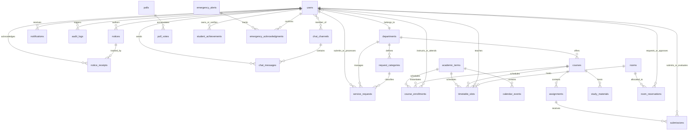
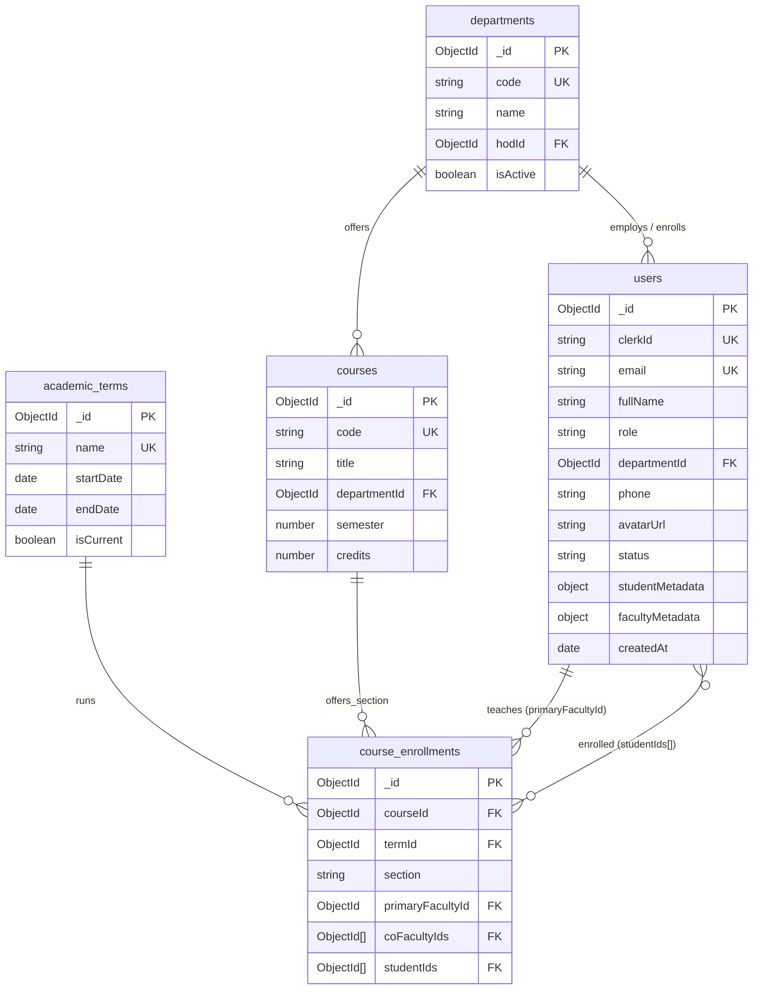
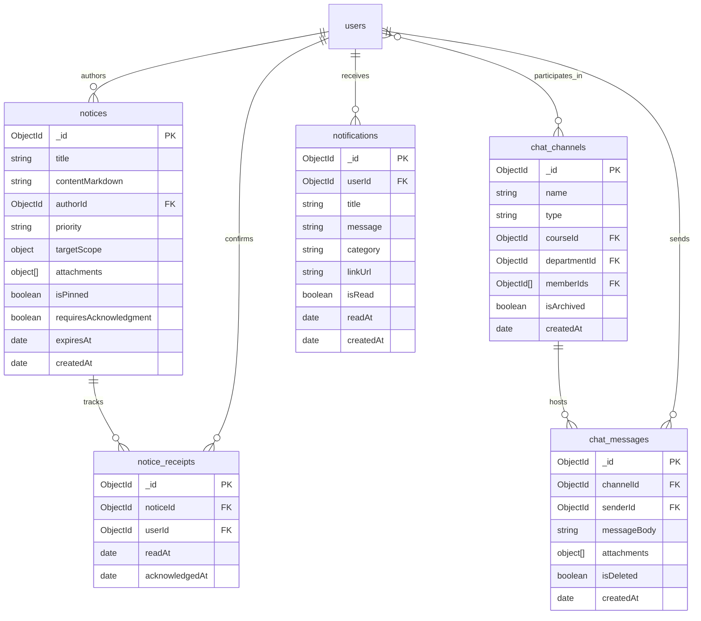
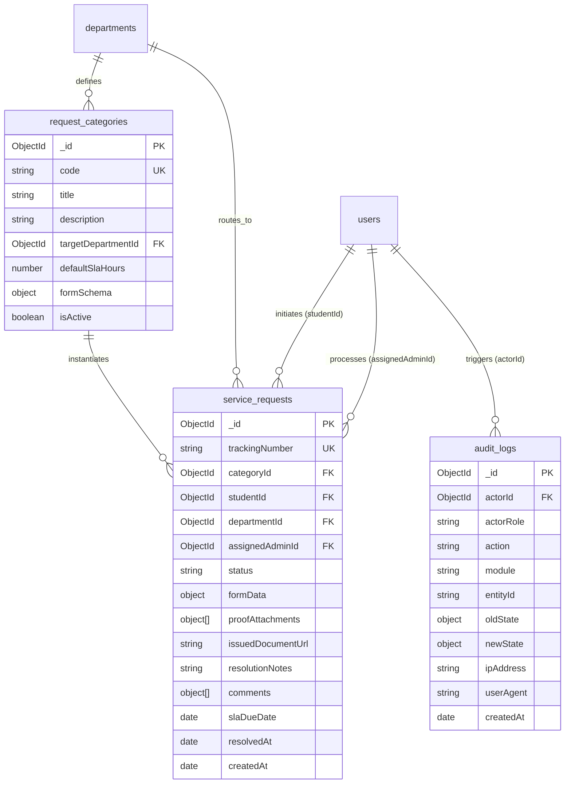
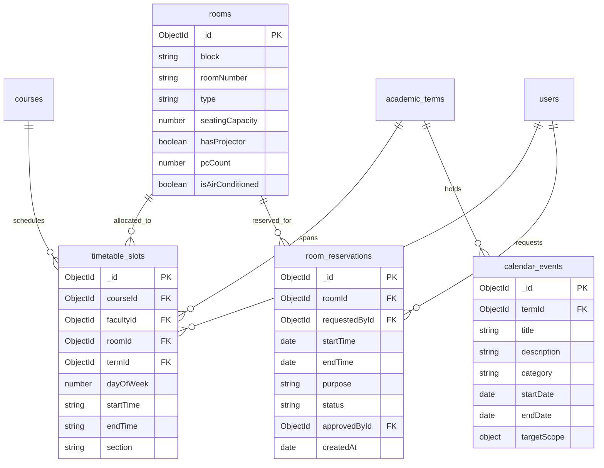
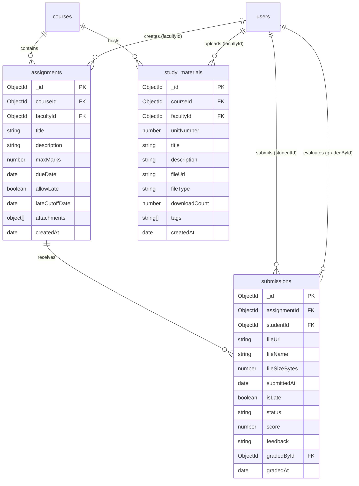

# Database Architecture Diagrams Specification

> **Document ID:** DOC-DATA-004  
> **Status:** Approved Baseline (Phase 1, Part 1.4)  
> **Institution:** Axis Institute of Technology & Management  
> **Format:** Mermaid ERD & Relationship Graphs  
> **Last Updated:** November 2026  

---

## 1. Master Institutional Entity-Relationship Diagram

Visualizes the holistic data model connecting all 25 collections across Axis LinkUp.

---

## 2. Identity, Role & Academic Enrollment Diagram

Focuses on user authentication links, departmental hierarchy, and student/faculty cohort mappings.

---

## 3. Communication, Notices & Real-Time Messaging Diagram

Focuses on targeted notice distribution, acknowledgment receipts, and chat channel isolation.

---

## 4. Administrative Services & Student Request Tracking Diagram

Focuses on the requisition lifecycle, form data validation, departmental queues, and SLA enforcement.

---

## 5. Academic Scheduling, Rooms & Timetables Diagram

Focuses on weekly recurring timetable allocation, facility specs, and ad-hoc room reservations.

---

## 6. Coursework, Submissions & Study Materials Diagram (Phase 2)

Focuses on assignment distribution, student file uploads, deadline tracking, and lecture notes.

