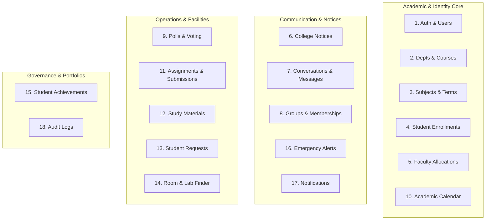

# Database Architecture & Planning Overview

> **Document ID:** DOC-DATA-001  
> **Status:** Approved Baseline (Phase 1, Part 1.4)  
> **Institution:** Axis Institute of Technology & Management  
> **Database Engine:** MongoDB Atlas (v7.0+ Enterprise Replica Set)  
> **ODM:** Mongoose 8+  
> **Cloud Provider & Region:** AWS Mumbai (`ap-south-1`) — DPDP Act Compliant  
> **Last Updated:** November 2026  

---

## 1. Executive Summary & Purpose

This document provides the foundational database planning, requirements analysis, and structural roadmap for **Axis LinkUp**, the unified digital college communication and productivity platform for Axis Institute of Technology & Management.

The persistence architecture is engineered using **MongoDB Atlas** and **Mongoose 8+** to support high-throughput, multi-role interactions across **Students**, **Faculty**, **Departmental Administrators**, and **Super Administrators**.

The database architecture is designed to satisfy the core non-functional requirements established in Phase 1, Part 1.1:
- **Sub-50ms Read Latency (NFR-PERF-04):** Accelerated via compound index optimization and strategic denormalization.
- **DPDP Act Compliance (NFR-PRIV-01):** Physical data residency within Indian territory (AWS Mumbai `ap-south-1`).
- **99.9% Uptime (NFR-REL-01):** Managed multi-zone replica set with automated failover and point-in-time recovery.
- **Strict Role & Departmental Isolation:** Logical multi-tenant scoping enforced at the repository query boundary.

---

## 2. Database Requirements Analysis (Task 1)

The institutional workflows of Axis Institute have been analyzed across 18 distinct functional domains to determine data structures, transaction requirements, and release milestones.



### 2.1 Detailed Domain Breakdown & Release Phasing

| # | Functional Domain | Core Data Entities | MVP Scope (Phase 1) | Later Release Scope (V2/V3) | Transaction Requirements |
| :-: | :--- | :--- | :--- | :--- | :--- |
| **01** | **Authentication & Users** | User profiles, Clerk links, role metadata, departmental links. | **Essential for MVP:** Profiles, role, dept, batch, section. | Future SSO directory sync, alumni status transition. | Low (Single document writes). |
| **02** | **Departments & Courses** | Department codes, titles, HODs, course listings. | **Essential for MVP:** Core catalog (CSE, ECE, ME, etc.). | Multi-campus curriculum branching. | Low (Static catalogs). |
| **03** | **Subjects & Semesters** | Academic terms, semester timelines, credits, syllabi. | **Essential for MVP:** Current term definitions, course links. | Historical curriculum archives. | Low. |
| **04** | **Student Enrollments** | Student-to-course and section allocations. | **Essential for MVP:** Section roster mappings. | Elective subject bidding engine. | Medium (Bulk CSV roster writes). |
| **05** | **Faculty Allocations** | Course instructors, mentors, timetable slots. | **Essential for MVP:** Instructor course assignments. | Workload balancing heuristics. | Medium. |
| **06** | **College Notices** | Bulletins, priority levels, attachments, target scopes. | **Essential for MVP:** Scoped publishing and feed retrieval. | Mandatory read receipts, scheduled future publishing. | Low to Medium. |
| **07** | **Conversations & Messages** | 1:1 DMs, message text, media links, timestamps. | **Essential for MVP:** Basic direct chat & course threads. | Rich reactions, message bookmarks, read receipts. | Low (Append-only messages). |
| **08** | **Groups & Memberships** | Course channels, batch channels, custom groups. | **Essential for MVP:** Auto-generated course & dept channels. | Student-created clubs, custom study circles. | Medium (Membership array ops). |
| **09** | **Polls & Voting** | Poll questions, options, anonymous voting hashes. | *Deferred to Phase 2 (V2.0)* | Single/Multi-choice polls, real-time vote aggregation. | **High:** Atomic vote increment (`$inc`) & voter duplicate check. |
| **10** | **Academic Calendar** | Institutional holidays, exams, lecture timetables. | **Essential for MVP:** Daily section timetable slots & holidays. | Automated timetable clash detection, .ICS export. | Medium (Unique slot constraint). |
| **11** | **Assignments & Submissions** | Assignment briefs, due dates, student file submissions, grades. | *Deferred to Phase 2 (V2.0)* | Complete assignment lifecycle, late submission penalties, rubrics. | Medium (Submissions state transitions). |
| **12** | **Study Materials** | Unit-wise lecture notes, PDFs, PPTs, download stats. | *Deferred to Phase 2 (V2.0)* | Categorized subject repositories, search tagging. | Low. |
| **13** | **Student Requests** | Desk tickets (bonafide, leaves), status pipeline, proofs. | **Essential for MVP:** Top 5 standardized request types. | Dynamic multi-stage approval workflow builder, QR code certs. | **High:** Multi-document ACID (status update + audit log). |
| **14** | **Room & Lab Bookings** | Rooms, capacities, AV specs, occupancy schedules. | *Deferred to Phase 2 (V2.0)* | Live vacancy finder, ad-hoc lab reservations. | **High:** Double-booking prevention via atomic locks. |
| **15** | **Student Achievements** | Co-curricular claims, certificates, faculty endorsements. | *Deferred to Phase 3 (V3.0)* | Skill Passport, faculty verification pipeline, placement links. | Medium. |
| **16** | **Emergency Alerts** | Override alerts, severity levels, confirmations. | *Deferred to Phase 3 (V3.0)* (Basic hook in MVP) | Instant broadcast alerts, mandatory student acknowledgment. | **High:** Broadcast dispatch + audit log. |
| **17** | **Notifications** | In-app alerts, category tags, unread flags. | **Essential for MVP:** In-app notification bell & badge count. | Mobile Web Push (FCM) integration. | Low (High-volume insert/update). |
| **18** | **Audit Logs** | Immutable administrative action ledger, diffs, IPs. | **Essential for MVP:** Auth, role change, ticket status logs. | Cryptographic tamper-chain verification. | **High:** Append-only transaction logging. |

---

## 3. High-Level Collection Classification

To enforce discipline and prevent scope creep during initial development, collections are divided into:
- **15 MVP Collections:** Minimum required for identity, communication, timetable, request tracking, and security auditing.
- **10 Later Release Collections:** Scheduled for Version 2.0 (Academic Productivity) and Version 3.0 (Campus Ecosystem).

```
Total Proposed Collections: 25
├── MVP Collections (Phase 1):        15 Collections
└── Later Release Collections (V2/V3): 10 Collections
```

---

## 4. Database Sizing & Scaling Projections

### 4.1 Campus Population & Transaction Sizing
- **Student Body:** 3,000 to 5,000 enrolled undergraduate and postgraduate students.
- **Faculty & Staff:** 150 to 250 teaching faculty, lab instructors, and HODs.
- **Administrative Personnel:** 20 to 40 central registrar and departmental officers.
- **Executive Leadership:** 2 to 5 Super Administrators.

### 4.2 Storage & Throughput Estimates (Year 1)

| Metric | Estimated Scale (Year 1) | Architectural Mitigation |
| :--- | :--- | :--- |
| **Total User Documents (`users`)** | ~5,500 documents (~10 MB) | Entire user collection fits easily in MongoDB RAM buffer. |
| **Active Notices (`notices`)** | ~1,200 notices/year (~15 MB) | Expired notices indexed via TTL or archived; feed queries `<10ms`. |
| **Chat Messages (`chat_messages`)** | ~500,000 messages/year (~250 MB) | Paginated using cursor-based pagination (`_id < cursor`); older threads archived. |
| **Service Requests (`service_requests`)**| ~15,000 requests/year (~60 MB) | Indexed by `departmentId` and `status` for rapid queue retrieval. |
| **Timetable Slots (`timetable_slots`)** | ~2,500 slots (~2 MB) | Highly static weekly recurring schedules; heavily cached in application memory. |
| **Audit Logs (`audit_logs`)** | ~200,000 log records/year (~150 MB)| Append-only; partitioned and indexed by timestamp for rapid compliance queries. |
| **Total Database Data Footprint** | **< 1.5 Gigabytes (Year 1)** | Fits comfortably within standard MongoDB Atlas M10 dedicated cluster (10GB storage / 2GB RAM). |
| **Binary File Assets (PDFs/Images)** | ~500 Gigabytes/year | **Zero binary data stored in MongoDB**. All PDFs and files stored directly in Cloudinary with metadata pointers in documents. |

