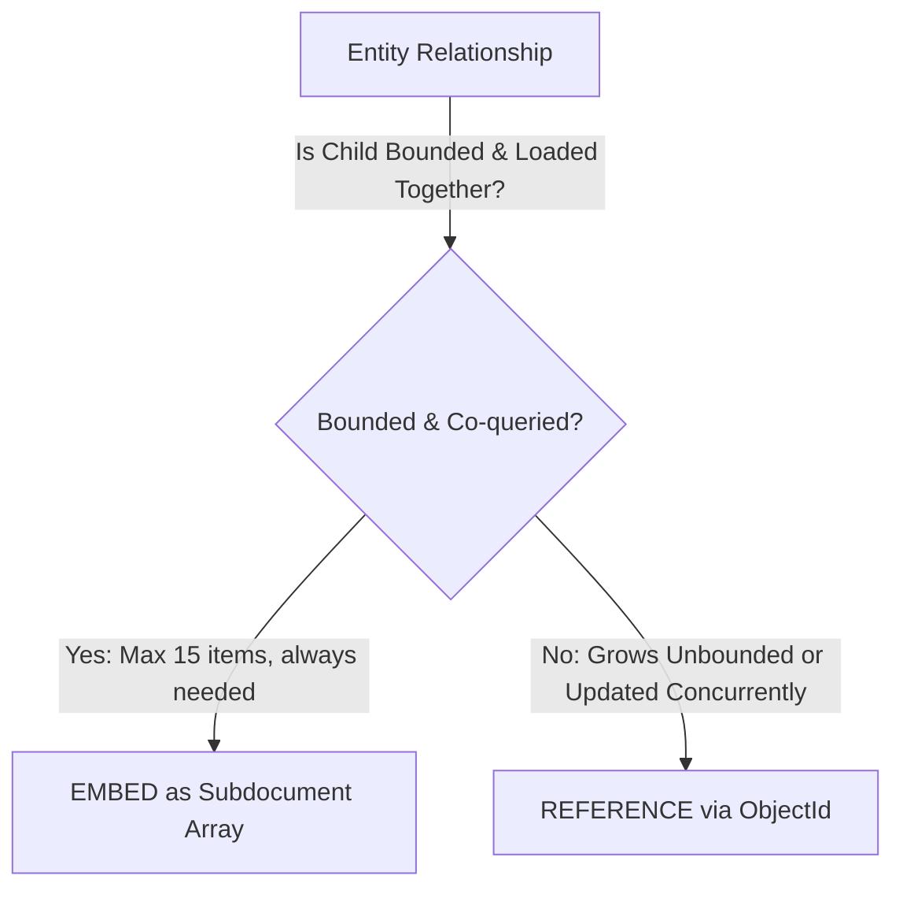

# Data Lifecycle, Concurrency & Architecture Strategy

> **Document ID:** DOC-DATA-010  
> **Status:** Approved Baseline (Phase 1, Part 1.4)  
> **Institution:** Axis Institute of Technology & Management  
> **Last Updated:** November 2026  

---

## 1. Reference vs. Embedding Strategy

MongoDB data modeling requires balancing read performance against document size limits (16MB BSON ceiling) and write contention. Axis LinkUp enforces a clear architectural rule:



### 1.1 Embedded Structures (Subdocuments)
- **Notice Attachments (`notices.attachments[]`):** Max 5 files per notice. Always rendered together with notice body.
- **Service Request Comments (`service_requests.comments[]`):** Ticket discussions rarely exceed 15 notes. Eliminates secondary queries when loading ticket details.
- **Poll Options (`polls.options[]`):** Bounded choices (2 to 10 options). Allows atomic `$inc` updates directly on the option subdocument.

### 1.2 Referenced Collections
- **Chat Messages (`chat_messages`):** Channels accumulate hundreds of thousands of messages. Embedding would breach the 16MB limit and cause severe document lock contention.
- **Notice Receipts (`notice_receipts`):** A college notice sent to 1,000 students generates 1,000 receipts. Stored in a separate collection with compound unique indexes.
- **Submissions (`submissions`):** Stored independently of Assignments to allow concurrent evaluation by faculty without document locking.

---

## 2. Bounded Data Duplication Strategy (Snapshotting)

In certain audit-sensitive contexts, referencing a live user document is problematic: if a professor changes their name or leaves the institution, historical notices and audit logs must preserve the exact state at the time of publication.

### 2.1 Applied Snapshot Patterns
- **Notice Author Snapshot:**
  `notice.authorSnapshot = { name: "Dr. Sunita Verma", role: "faculty", departmentCode: "CSE" }`
  Preserves historical accuracy even if the user document is later updated or archived.
- **Audit Log Snapshots:**
  `audit_log.oldState` and `audit_log.newState` store JSON delta snapshots of modified fields.

---

## 3. High-Performance Pagination Strategy

Axis LinkUp rejects traditional offset-based pagination (`skip(1000).limit(20)`) for high-volume collections because MongoDB must scan and discard all preceding documents in memory ($O(N)$ latency).

### 3.1 Cursor-Based Pagination (Used for Notices, Chat, Notifications)
- **Mechanism:** Queries filter by the last seen document's `_id` or timestamp using indexed comparisons:
  ```javascript
  db.chat_messages.find({
    channelId: channelId,
    _id: { $lt: lastSeenObjectId }
  })
  .sort({ _id: -1 })
  .limit(25);
  ```
- **Performance:** Constant $O(1)$ query execution time regardless of whether page 1 or page 1,000 is requested.

### 3.2 Keyset / Filtered Pagination (Used for Administrative Data Tables)
- Multi-filter queries on `service_requests` use compound indexes on `{ departmentId: 1, status: 1, createdAt: -1 }` with page tokens, preventing database memory exhaustion.

---

## 4. Soft Deletion Strategy

In an institutional environment, hard-deleting records is prohibited across academic and legal domains (grades, requests, chat moderation, audit records).

### 4.1 Soft Delete Implementation
- Collections with soft-deletion support include an `isDeleted: Boolean` and `deletedAt: Date` field.
- **Chat Messages:** When a message is deleted by a moderator or user, `isDeleted` is set to `true`, and the client renders: *"This message was removed by moderator"*, preserving conversation thread continuity.
- **Default Scoping:** All repository queries automatically append `{ isDeleted: false }` unless specifically querying administrative trash bins.

---

## 5. Data Retention & Archiving Policy

| Data Domain | Active Retention Period | Archival Strategy | Destruction Policy |
| :--- | :--- | :--- | :--- |
| **Notices** | 90 Days active | Automatically archived after `expiresAt` via TTL index. | Retained in archive for 3 years; purged after NAAC cycle. |
| **Chat Messages** | Current Academic Year | Cold storage dump to compressed S3 JSON lines after term ends. | Purged after 2 academic years. |
| **Service Requests** | 5 Years | Active in database for 1 year, moved to historical archive collection. | Retained for 5 years per institutional audit regulations. |
| **Student Submissions**| 2 Academic Semesters | Uploaded files in Cloudinary marked for deletion after grading dispute window. | File binary purged; grade record permanently preserved. |
| **Audit Logs** | 3 Years | Read-only partition. | Immutable; never modified; purged after 3 years. |

---

## 6. Multi-Document ACID Transactions

For business operations spanning multiple collections, Mongoose executes within atomic session transactions:

```typescript
// Transactional Pattern: Resolving a Student Service Request
const session = await mongoose.startSession();
session.startTransaction();

try {
  // 1. Update Request Status to 'approved'
  const updatedRequest = await ServiceRequestModel.findByIdAndUpdate(
    requestId,
    { status: 'approved', resolvedAt: new Date(), resolutionNotes },
    { session, new: true }
  );

  // 2. Insert Immutable Audit Log
  await AuditLogModel.create([{
    actorId: adminId,
    actorRole: 'admin',
    action: 'APPROVE_REQUEST',
    module: 'MOD-13',
    entityId: requestId,
    newState: { status: 'approved' },
    ipAddress,
  }], { session });

  // 3. Insert In-App Notification for Student
  await NotificationModel.create([{
    userId: updatedRequest.studentId,
    title: 'Request Approved',
    message: `Your request ${updatedRequest.trackingNumber} has been approved.`,
    category: 'request',
    linkUrl: `/student/requests?id=${requestId}`,
  }], { session });

  // Commit all mutations atomically
  await session.commitTransaction();
} catch (error) {
  await session.abortTransaction();
  throw error;
} finally {
  session.endSession();
}
```

