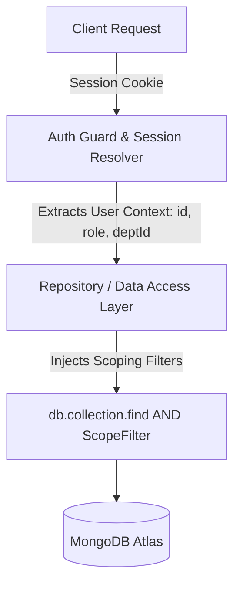
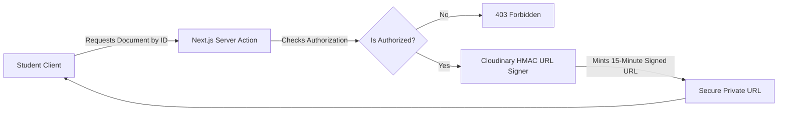

# Database Security, Isolation & Compliance Specification

> **Document ID:** DOC-DATA-009  
> **Status:** Approved Baseline (Phase 1, Part 1.4)  
> **Institution:** Axis Institute of Technology & Management  
> **Compliance:** Indian Digital Personal Data Protection (DPDP) Act, 2023  
> **Security Model:** Zero-Trust Data Access Layer  
> **Last Updated:** November 2026  

---

## 1. Zero-Trust Data Access Philosophy

Under no circumstances does Axis LinkUp rely on client-side routing or frontend UI disabling to restrict sensitive data. 

**Every database query executed by the application must incorporate the caller's verified identity, active role, and departmental scope.**

---

## 2. Role-Based Data Isolation Rules

### 2.1 Student Data Isolation
- **Academic Scoping:** Students can only read notices, timetables, and calendar events targeted to:
  1. `targetScope.scopeType === 'all'` OR
  2. `targetScope.departmentId === student.departmentId` AND `targetScope.batchYear === student.batchYear`.
- **Assignment Submissions:** A student's query for submissions is strictly bound to `studentId === session.userId`. Under no circumstances can a student query another student’s submission or grade.
- **Service Requests:** Students can only read or cancel tickets where `studentId === session.userId`.

### 2.2 Faculty Data Scoping
- **Course Scoping:** Faculty members can only create assignments, post lecture notes, or grade submissions for courses where their `userId` is in `course_enrollments.primaryFacultyId` or `coFacultyIds`.
- **Department Notices:** Faculty members can publish notices scoped to their own department, but cannot publish campus-wide bulletins without Admin authorization.
- **Office Hours & Privacy:** A faculty member’s personal phone number is never queried in public student views. Student direct messages can only query the chat channel if `officeHours.isAcceptingDMs === true`.

### 2.3 Departmental Administrator Scoping
- **Departmental Boundaries:** Departmental Admins can only query, review, or resolve service requests belonging to their department:
  `{ departmentId: session.departmentId }`.
- **Cross-Department Blocking:** A Mechanical Engineering Admin cannot view Computer Science student bonafide requisitions or disciplinary notes.

### 2.4 Super Admin Oversight & Immutability
- **Platform-Wide Visibility:** Super Admins can query all collections across all departments.
- **Audit Immutability:** Super Admins cannot delete, alter, or truncate documents in `audit_logs`. The database user role assigned to the application strictly denies `dropCollection`, `delete`, or `update` privileges on the `audit_logs` collection.

---

## 3. Communication & Privacy Protection

### 3.1 Private 1:1 Conversation Isolation
- A user can only fetch messages from a `ChatChannel` if their `userId` is present in the channel’s `memberIds` array:
  `db.chat_channels.findOne({ _id: channelId, memberIds: session.userId })`.
- If the caller is not in `memberIds`, the query returns `null`, and the repository throws an immediate `ForbiddenError(403)`.

### 3.2 Anonymous Ballot Secrecy (Cryptographic Anonymization)
- In democratic polls (`isAnonymous === true`), the voter’s identity is anonymized before insertion into `poll_votes`:
  $$\text{voterHash} = \text{HMAC-SHA256}(\text{userId}, \text{POLL\_SALT})$$
- The `userId` field is stored as `null`.
- This ensures that even a database administrator inspecting the raw BSON documents in MongoDB Atlas cannot correlate a vote to a student's real identity.

---

## 4. Binary Asset Security & Signed URLs

To protect student privacy and comply with the DPDP Act, private documents are never exposed via public URLs:

- **Assignment Submissions & Service Proofs:** Marked as `private` asset type in Cloudinary.
- **Access Rule:** Accessible **exclusively via time-limited (15-minute) HMAC-signed URLs** generated dynamically after the server verifies that the caller is either the document owner or an authorized evaluator.

---

## 5. Indian DPDP Act Compliance & Data Governance

### 5.1 Cloud Data Residency Mandate
- In accordance with the Digital Personal Data Protection Act (DPDP Act, 2023), all student and institutional records are persisted in a MongoDB Atlas dedicated cluster physically located in **AWS Mumbai (`ap-south-1`)**.

### 5.2 Encryption at Rest and in Transit
- **Data in Transit:** Enforced TLS 1.3 encryption across all MongoDB wire protocols and HTTPS REST endpoints.
- **Data at Rest:** Encrypted using AES-256 via MongoDB Atlas Encrypted Storage Engine.

### 5.3 Right to Erasure & Data Anonymization
- Upon graduation or official departure, student accounts can be transitioned to `status: 'archived'`.
- After the mandatory institutional retention window (typically 5 years for academic records), personal PII (phone number, avatar, address) is purged or anonymized, preserving only unlinked academic transcripts.

