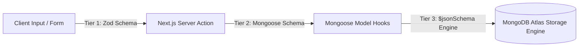
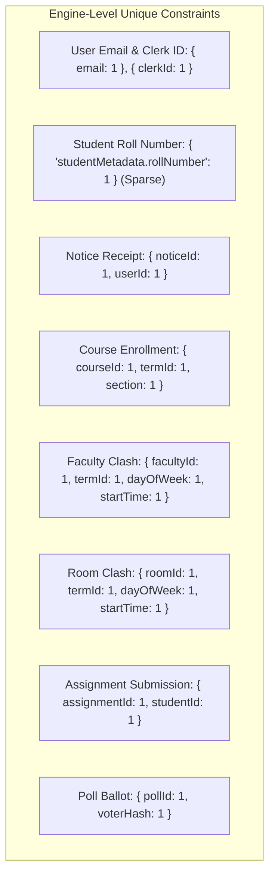

# Database Validation, Integrity & Consistency Rules

> **Document ID:** DOC-DATA-008  
> **Status:** Approved Baseline (Phase 1, Part 1.4)  
> **Institution:** Axis Institute of Technology & Management  
> **Validation Architecture:** Multi-Layer Defense (MongoDB `$jsonSchema` + Mongoose + Zod)  
> **Last Updated:** November 2026  

---

## 1. Multi-Tier Data Validation Defense

Data integrity in Axis LinkUp is enforced across three sequential boundaries:



1. **Tier 1 (Application Boundary - Zod):** Validates incoming HTTP payloads before invoking domain services. Rejects malformed types, missing required attributes, and invalid regexes at the server edge.
2. **Tier 2 (ODM Layer - Mongoose):** Enforces strict types (`strict: 'throw'`), enum constraints, pre-save hooks, custom cross-field validators, and immutable field definitions.
3. **Tier 3 (Database Engine - MongoDB `$jsonSchema`):** Enforces collection-level JSON Schema validators directly in the database engine, ensuring that even if application code is bypassed (e.g. direct administrative script), invalid documents are rejected by WiredTiger.

---

## 2. Managing MongoDB's Lack of Native Foreign-Key Constraints

Because MongoDB does not enforce relational foreign keys, referential integrity must be managed through strict architectural patterns:

### 2.1 Referential Dependency Policies

| Parent Entity | Child Entity | Reference Field | Deletion Dependency Policy | Application Handling |
| :--- | :--- | :--- | :--- | :--- |
| `Department` | `User` | `user.departmentId` | **RESTRICT** | Deleting a Department is blocked if active users are attached to it. |
| `Department` | `Course` | `course.departmentId` | **RESTRICT** | Cannot delete a Department containing active courses. |
| `Course` | `TimetableSlot` | `slot.courseId` | **CASCADE** | Deleting a Course removes its recurring timetable slots. |
| `Course` | `Assignment` | `assignment.courseId` | **RESTRICT** | Cannot delete a course with active assignments or graded coursework. |
| `Assignment` | `Submission` | `sub.assignmentId` | **RESTRICT** | Cannot delete an assignment once students have uploaded submissions. |
| `Notice` | `NoticeReceipt` | `receipt.noticeId` | **CASCADE** | Deleting a Notice cleans up all associated read receipts. |
| `ChatChannel` | `ChatMessage` | `message.channelId` | **SOFT DELETE** | Channels are marked `isArchived: true`; messages are never abruptly deleted. |
| `User` (Student) | `ServiceRequest` | `req.studentId` | **PRESERVE / RESTRICT** | Graduated/deleted students maintain request history for institutional audit. |

### 2.2 Pre-Save Reference Verification Pattern
Before persisting child records, repository methods perform an existence check on referenced ObjectIds:

```typescript
// Pattern: Validating Referenced Department before creating a Course
async function createCourse(data: CreateCourseDTO): Promise<CourseDoc> {
  const departmentExists = await DepartmentModel.exists({ _id: data.departmentId, isActive: true });
  if (!departmentExists) {
    throw new ValidationError('Invalid reference: Department does not exist or is inactive.');
  }
  return CourseModel.create(data);
}
```

---

## 3. Duplicate Prevention & Unique Constraints

Unique compound indexes prevent duplicate data insertion at the database level:



### 3.1 Handling Duplicate Key Errors (`E11000`)
When a duplicate key error is caught from MongoDB (`err.code === 11000`), the repository layer catches and transforms it into a descriptive `ConflictError`:

```typescript
try {
  await SubmissionsModel.create(submissionData);
} catch (error: any) {
  if (error.code === 11000) {
    throw new ConflictError('You have already submitted coursework for this assignment.');
  }
  throw error;
}
```

---

## 4. Concurrent Operation Handling & Race Condition Guards

### 4.1 Room Booking Race Condition Guard
When two faculty members attempt to reserve the same laboratory for the same hour simultaneously:
- **Solution:** Execute an atomic conditional update query (`findOneAndUpdate`) matching non-conflicting time slots:

```typescript
// Atomic Room Reservation
const existingConflict = await RoomReservationModel.findOne({
  roomId: targetRoomId,
  status: 'approved',
  $or: [
    { startTime: { $lt: requestedEndTime, $gte: requestedStartTime } },
    { endTime: { $gt: requestedStartTime, $lte: requestedEndTime } }
  ]
});

if (existingConflict) {
  throw new ConflictError('The selected room has already been reserved for this time window.');
}
```

### 4.2 Poll Voting Atomic Increments
To prevent race conditions during high-volume voting spikes:
- **Solution:** Wrap vote insertion and aggregate vote count increment in an atomic transaction:

```typescript
const session = await mongoose.startSession();
session.startTransaction();

try {
  // 1. Insert vote record (Unique index on { pollId, voterHash } blocks duplicate voter)
  await PollVoteModel.create([{ pollId, optionId, voterHash }], { session });

  // 2. Atomically increment option count in Poll document
  await PollModel.updateOne(
    { _id: pollId, 'options._id': optionId },
    { $inc: { 'options.$.voteCount': 1 } },
    { session }
  );

  await session.commitTransaction();
} catch (error) {
  await session.abortTransaction();
  throw error;
} finally {
  session.endSession();
}
```

---

## 5. Database-Level Schema Validation (`$jsonSchema`)

To ensure database engine enforcement, collections are configured with MongoDB `$jsonSchema` validators:

```javascript
// Database-Level Validation for `users` Collection
db.createCollection("users", {
  validator: {
    $jsonSchema: {
      bsonType: "object",
      required: ["clerkId", "email", "fullName", "role", "status", "createdAt"],
      properties: {
        clerkId: {
          bsonType: "string",
          pattern: "^user_[a-zA-Z0-9]+$",
          description: "Must be a valid Clerk user identifier string"
        },
        email: {
          bsonType: "string",
          pattern: "^[a-zA-Z0-9._%+-]+@[a-zA-Z0-9.-]+\\.[a-zA-Z]{2,}$",
          description: "Must be a valid email address"
        },
        role: {
          enum: ["student", "faculty", "admin", "super_admin"],
          description: "Role must be one of the four approved roles"
        },
        status: {
          enum: ["invited", "active", "suspended", "archived"],
          description: "Status must be a recognized account state"
        }
      }
    }
  },
  validationLevel: "strict",
  validationAction: "error"
});
```

