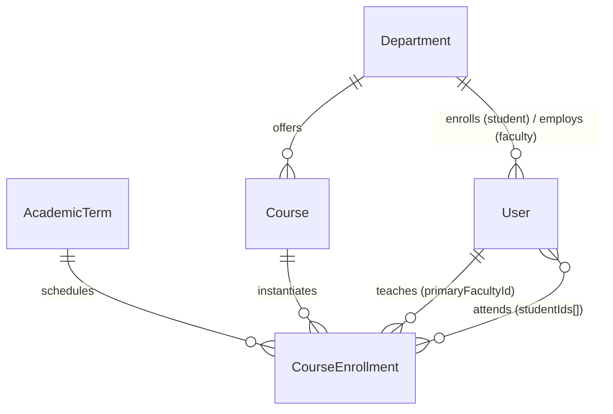
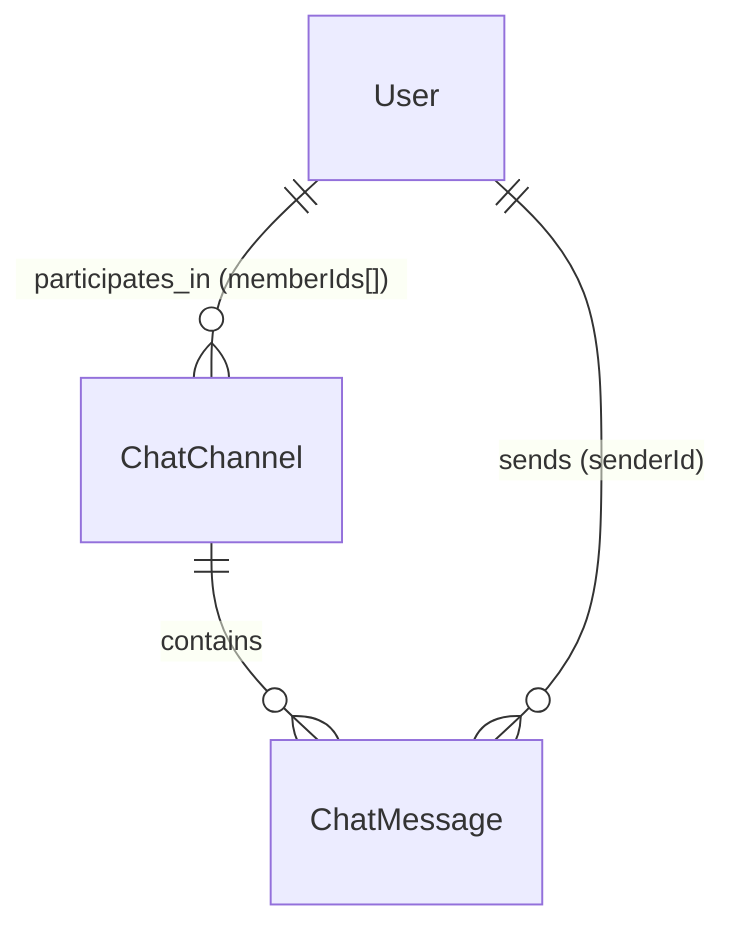
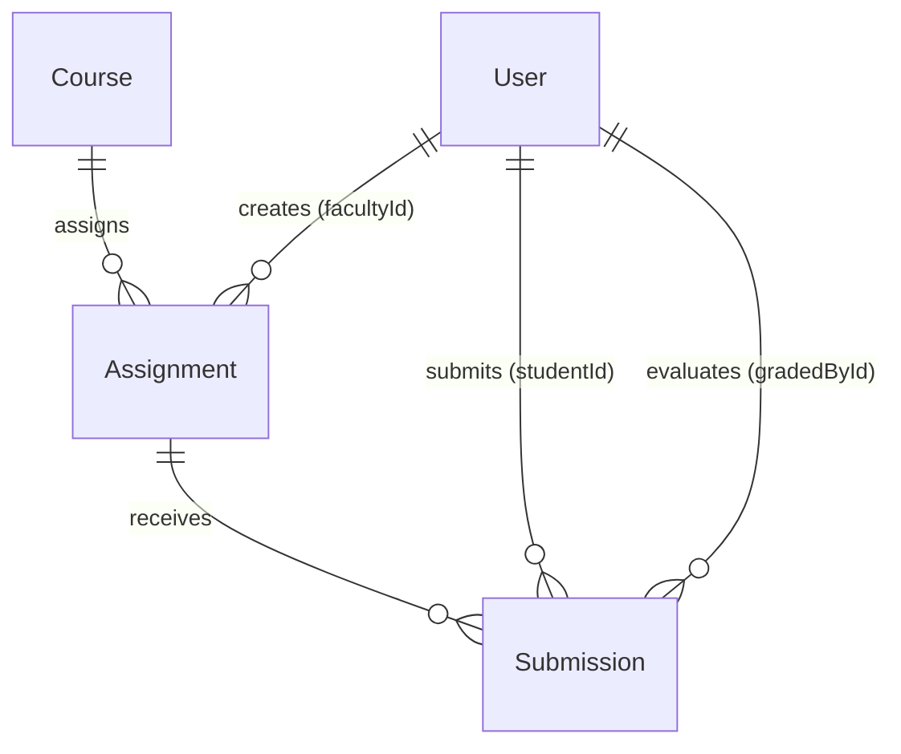
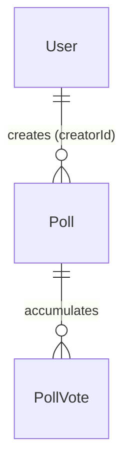
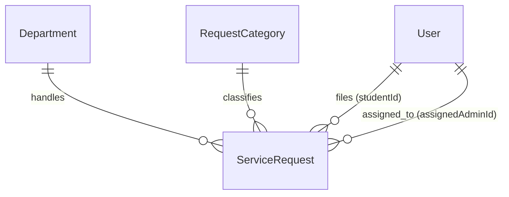
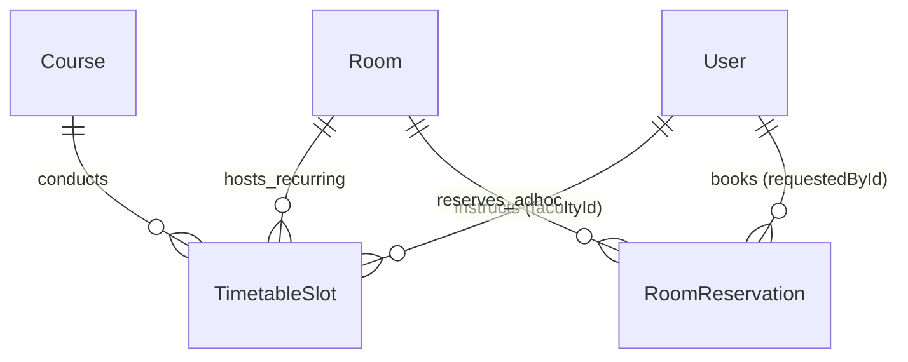

# Entity Relationship Mapping & Association Design

> **Document ID:** DOC-DATA-003  
> **Status:** Approved Baseline (Phase 1, Part 1.4)  
> **Institution:** Axis Institute of Technology & Management  
> **Last Updated:** November 2026  

---

## 1. Association Cardinality & Strategy Matrix

In MongoDB document modeling, relationships are represented either through **Referencing (`ObjectId` with `ref`)** or **Embedding (Subdocuments / Arrays)**. The decision matrix below governs every relationship across the 25 platform entities:

| Relationship Context | Primary Entity | Related Entity | Cardinality | Persistence Strategy | Architectural Justification |
| :--- | :--- | :--- | :---: | :--- | :--- |
| **Students & Departments** | `Department` | `User` (Student) | 1 : N | **Referencing** (`user.departmentId`) | Departments are fixed entities; student body scales dynamically. |
| **Students & Courses** | `Course` | `User` (Student) | N : M | **Referencing via Junction** (`CourseEnrollment`) | Avoids unbounded arrays inside User or Course documents; tracks term/section metadata. |
| **Faculty & Subjects** | `Course` | `User` (Faculty) | 1 : N / N : M | **Referencing** (`course_enrollments.primaryFacultyId`) | Maps course offerings to specific faculty members per academic term. |
| **Academic Groups** | `CourseEnrollment` | `User` (Student) | 1 : N | **Referencing Array** (`course_enrollments.studentIds`) | Course sections have a bounded number of students (~60 per section). |
| **Conversations & Participants**| `ChatChannel` | `User` | N : M | **Referencing Array** (`channel.memberIds`) | Direct chats have 2 members; group channels bounded to enrolled cohorts. |
| **Channels & Messages** | `ChatChannel` | `ChatMessage` | 1 : N | **Referencing** (`message.channelId`) | Messages grow indefinitely (unbounded 1-to-squillions); must never be embedded. |
| **Notices & Receipts** | `Notice` | `NoticeReceipt` | 1 : N | **Referencing** (`receipt.noticeId`) | A notice has thousands of student read receipts; embedding would exceed 16MB document limit. |
| **Notice & Attachments** | `Notice` | `Attachment` | 1 : Few | **Embedding** (`notice.attachments[]`) | Bounded array (max 5 attachments per notice); always loaded together. |
| **Assignments & Submissions** | `Assignment` | `Submission` | 1 : N | **Referencing** (`submission.assignmentId`) | Submissions contain large evaluation metadata and scores; evaluated independently. |
| **Polls & Votes** | `Poll` | `PollVote` | 1 : N | **Referencing** (`vote.pollId`) | Large voter counts; voter hashing for anonymity prevents embedding inside Poll. |
| **Poll & Options** | `Poll` | `PollOption` | 1 : Few | **Embedding** (`poll.options[]`) | Bounded options (typically 2 to 6 options per poll); aggregate vote counts cached directly. |
| **Requests & Approvals** | `ServiceRequest` | `RequestComment` | 1 : Few | **Embedding** (`request.comments[]`) | Request communication thread is strictly bounded (typically <15 entries per ticket). |
| **Rooms & Bookings** | `Room` | `RoomReservation`| 1 : N | **Referencing** (`reservation.roomId`) | Continuous reservation records over semesters; queried across time ranges. |
| **Timetable & Allocations** | `Room` / `Course` | `TimetableSlot` | 1 : N | **Referencing** (`slot.roomId`, `slot.courseId`) | Independent recurring schedule slots; indexed for clash detection. |

---

## 2. In-Depth Analysis of Critical Relationships

### 2.1 Students, Departments and Academic Courses

- **Challenge:** A student belongs to one Department (e.g., Computer Science), but takes multiple courses across semesters, some of which may be inter-departmental electives (e.g., Humanities or Open Electives).
- **Solution:** 
  - `User.departmentId` captures the student's primary institutional branch.
  - The `CourseEnrollment` collection acts as an explicit junction linking `Course`, `AcademicTerm`, `section`, `primaryFacultyId`, and `studentIds`.
  - **Query Pattern:** To retrieve all courses for a student in the current term:
    `CourseEnrollment.find({ termId: currentTermId, studentIds: studentId }).populate('courseId primaryFacultyId')`.

---

### 2.2 Conversations, Channels and Participants

- **Challenge:** Support both 1-on-1 private direct messaging (Student &harr; Faculty, Student &harr; Student) and multi-user group channels (e.g., Course Channels with 60 students).
- **Design Strategy:**
  - `ChatChannel.type`: Enum (`'direct' | 'course' | 'department' | 'custom'`).
  - For Direct Chats (`type === 'direct'`), `memberIds` contains exactly two sorted User ObjectIds (`[smallerId, largerId]`).
  - A unique compound index `{ type: 1, memberIds: 1 }` guarantees that two users can never have duplicate 1-on-1 direct channels.
  - Messages are stored in a separate `chat_messages` collection, referencing `channelId`. This guarantees the channel document never approaches the 16MB limit, while messages are retrieved with high-speed cursor pagination.

---

### 2.3 Assignments, Submissions and Grading Workflows

- **Challenge:** Prevent duplicate submissions, handle late submissions cleanly, and ensure that grading feedback is private between the faculty and the submitting student.
- **Design Strategy:**
  - `Submission` references `assignmentId` and `studentId`.
  - Unique compound index: `{ assignmentId: 1, studentId: 1 }`. A student can have only one active submission document per assignment (resubmissions update this existing document, incrementing a `version` counter).
  - Submissions are never embedded in the `Assignment` document because a course section of 60 students would lead to document fragmentation and lock contention during bulk grading.

---

### 2.4 Polls and Anonymous Democratic Voting

- **Challenge:** Guarantee one-person-one-vote while preserving complete ballot secrecy for sensitive student council or feedback polls.
- **Design Strategy:**
  - `Poll.options` is embedded as an array of subdocuments: `[ { _id: ObjectId, text: String, voteCount: Number } ]`.
  - When `poll.isAnonymous === true`:
    - The vote record stores a cryptographic hash: `voterHash = HMAC_SHA256(userId + pollSecretKey)`.
    - `PollVote.userId` is explicitly set to `null`.
    - Unique compound index on `PollVote`: `{ pollId: 1, voterHash: 1 }`.
    - This mathematically prevents duplicate voting while making it cryptographically impossible for anyone (including Super Admins) to trace which student selected which option.
  - The aggregate `voteCount` on the embedded option is incremented atomically using MongoDB `$inc`.

---

### 2.5 Student Service Requests & Administrative State Transitions

- **Challenge:** Student requisitions (bonafide, leaves, dues clearance) require an auditable trail of comments and status transitions, dynamic custom fields depending on the category, and SLA tracking.
- **Design Strategy:**
  - `ServiceRequest.formData` stores category-specific dynamic fields as a validated JSON subdocument.
  - `ServiceRequest.comments` is embedded directly inside the request document:
    `[ { authorId: ObjectId, body: String, isInternal: Boolean, createdAt: Date } ]`.
    Because ticket discussions are strictly bounded (almost always <10 notes), embedding guarantees that opening a ticket loads its entire communication history in a single read.
  - Status updates are wrapped in MongoDB ACID transactions to simultaneously insert an immutable entry into `audit_logs`.

---

### 2.6 Rooms, Labs and Timetable Clash Prevention

- **Challenge:** Prevent double-booking physical campus spaces across two competing systems: recurring weekly timetable classes (MOD-10) and ad-hoc room reservations (MOD-14).
- **Design Strategy:**
  - `TimetableSlot` enforces weekly uniqueness via compound index:
    `{ roomId: 1, termId: 1, dayOfWeek: 1, startTime: 1 }` (UNIQUE).
  - Before approving an ad-hoc `RoomReservation`, the application checks:
    1. Does a recurring `TimetableSlot` exist for that room at that day/time?
    2. Does an overlapping approved `RoomReservation` already exist?
  - Confirmed reservations are written with atomic conditional queries to prevent race conditions during simultaneous booking requests.

