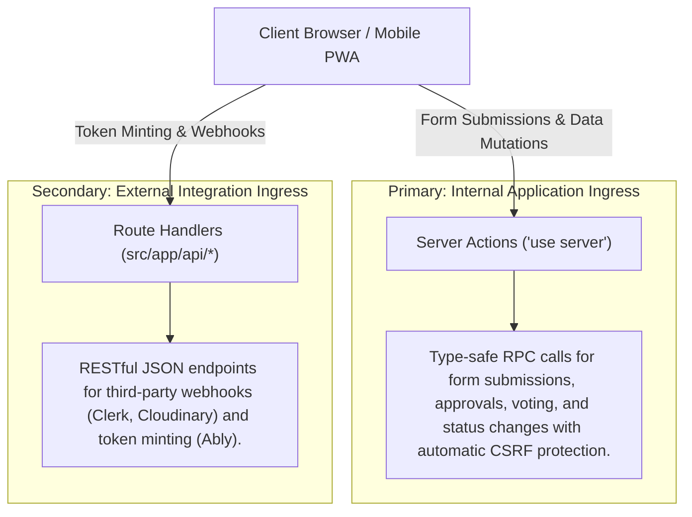

# API & Server Action Engineering Standards

> **Document ID:** DOC-ENG-004  
> **Status:** Approved Baseline (Phase 1, Part 1.6)  
> **Institution:** Axis Institute of Technology & Management  
> **Protocols:** Next.js Server Actions (Mutations) & Route Handlers (REST Webhooks)  
> **Format:** JSON BSON Envelope Standard  
> **Last Updated:** November 2026  

---

## 1. Dual Ingress Strategy: Server Actions vs. Route Handlers

Axis LinkUp uses a dual-channel ingress pattern:



---

## 2. Standard API Response Envelope

Every endpoint and Server Action returns a deterministic JSON structure conforming to `ApiResponse<T>`:

### 2.1 Success Response Envelope (`HTTP 200 / 201`)
```json
{
  "success": true,
  "data": {
    "id": "6730a005f8b1a2001a000050",
    "title": "Rescheduled Mid-Term Examination for CS301",
    "priority": "urgent",
    "createdAt": "2026-11-09T08:00:00.000Z"
  },
  "error": null,
  "timestamp": "2026-11-09T08:00:00.125Z"
}
```

### 2.2 Error Response Envelope (`HTTP 400 - 500`)
```json
{
  "success": false,
  "data": null,
  "error": {
    "code": "VALIDATION_ERROR",
    "message": "Invalid request payload. Please correct the highlighted errors.",
    "details": [
      {
        "field": "dueDate",
        "message": "Submission deadline must be a future date."
      },
      {
        "field": "maxMarks",
        "message": "Maximum marks must be a positive integer between 1 and 500."
      }
    ]
  },
  "timestamp": "2026-11-09T08:00:00.045Z"
}
```

---

## 3. Standard HTTP Status Code & Error Code Mappings

| HTTP Status | Custom Error Code | Semantics & Common Trigger |
| :---: | :--- | :--- |
| **`200 OK`** | *None* | Successful read query, update, or general retrieval. |
| **`201 Created`** | *None* | Successful creation of a resource (new notice, new ticket, new channel). |
| **`400 Bad Request`** | `VALIDATION_ERROR` | Zod schema validation failed on request body or parameters. |
| **`401 Unauthorized`** | `UNAUTHORIZED` | Missing, expired, or invalid Clerk session token. |
| **`403 Forbidden`** | `FORBIDDEN` | Authenticated caller lacks role permissions or departmental access rights. |
| **`404 Not Found`** | `NOT_FOUND` | Target resource does not exist (e.g. invalid notice ID or ticket ID). |
| **`409 Conflict`** | `CONFLICT` | Unique key violation (duplicate email, duplicate roll number, room double-booking). |
| **`422 Unprocessable`** | `BUSINESS_RULE_VIOLATION`| Semantic domain invariant violated (e.g., submitting assignment past hard deadline). |
| **`429 Too Many Req`** | `RATE_LIMIT_EXCEEDED` | Request rate limit exceeded on sensitive public endpoints. |
| **`500 Internal Error`** | `INTERNAL_ERROR` | Unhandled server exception or third-party service outage. |

---

## 4. Request Validation Standards (Zod)

Every incoming mutation or query must be validated at the entry gate using a Zod schema before invoking business logic:

```typescript
// src/lib/validations/notice.schema.ts
import { z } from 'zod';

export const createNoticeSchema = z.object({
  title: z
    .string()
    .trim()
    .min(5, 'Title must contain at least 5 characters')
    .max(150, 'Title cannot exceed 150 characters'),
  contentMarkdown: z
    .string()
    .trim()
    .min(10, 'Notice content must contain at least 10 characters')
    .max(10000, 'Content cannot exceed 10,000 characters'),
  priority: z.enum(['normal', 'important', 'urgent']),
  targetScope: z.object({
    scopeType: z.enum(['all', 'department', 'year', 'section']),
    departmentId: z.string().optional(),
    batchYear: z.number().int().min(2020).max(2035).optional(),
    section: z.string().max(5).optional(),
  }),
  isPinned: z.boolean().default(false),
  expiresAt: z.coerce.date().refine((date) => date > new Date(), {
    message: 'Expiration date must be in the future.',
  }),
});
```

---

## 5. Pagination, Filtering & Sorting Standards

To prevent out-of-memory errors and guarantee sub-50ms query times, the API supports two standardized pagination patterns:

### 5.1 Cursor-Based Pagination (Feeds & Chat)
- Used for high-velocity collections: `chat_messages`, `notices`, `notifications`.
- **Query Parameters:** `?cursor=6730a008f8b1a2001a000080&limit=25`
- **Response Format:**
  ```json
  {
    "items": [ ... ],
    "pagination": {
      "limit": 25,
      "nextCursor": "6730a008f8b1a2001a000055",
      "hasMore": true
    }
  }
  ```

### 5.2 Keyset / Offset Pagination (Administrative Tables)
- Used for structured tabular queues: `service_requests`, `users`, `audit_logs`.
- **Query Parameters:** `?page=1&pageSize=20&sortBy=createdAt&sortOrder=desc&status=under_review`
- **Response Format:**
  ```json
  {
    "items": [ ... ],
    "pagination": {
      "currentPage": 1,
      "pageSize": 20,
      "totalItems": 142,
      "totalPages": 8,
      "hasMore": true
    }
  }
  ```

---

## 6. Authentication & Authorization Enforcement Pattern

Every Server Action and Route Handler must invoke the security guard pipeline before executing domain services:

```typescript
// Standard Ingress Template
export async function approveServiceRequestAction(rawInput: unknown): Promise<ApiResponse<ServiceRequestDTO>> {
  try {
    // 1. Enforce Authentication & Admin Role
    const admin = await requireRole(['admin', 'super_admin']);

    // 2. Validate Input Payload
    const { requestId, resolutionNotes } = approveRequestSchema.parse(rawInput);

    // 3. Delegate to Domain Service (Service verifies departmental scope)
    const approvedRequest = await RequestService.approveRequest(requestId, resolutionNotes, admin);

    return {
      success: true,
      data: approvedRequest,
      error: null,
      timestamp: new Date().toISOString(),
    };
  } catch (error) {
    return handleActionError(error);
  }
}
```

