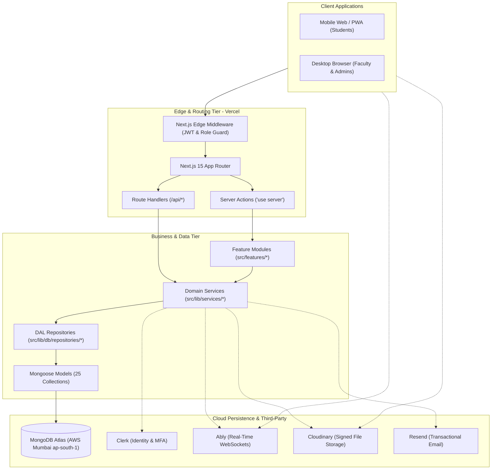

# Master Engineering Playbook

> **Document ID:** DOC-ENG-001  
> **Status:** Approved Baseline (Phase 1, Part 1.6)  
> **Institution:** Axis Institute of Technology & Management  
> **Target Audience:** All Full-Stack Developers, QA Engineers, and AI Coding Agents  
> **Architecture Pattern:** Modular Monolith on Next.js 15+ App Router  
> **Last Updated:** November 2026  

---

## 1. Engineering Philosophy & Core Principles

Axis LinkUp is the unified digital communication and productivity platform for **Axis Institute of Technology & Management**. Because the platform coordinates academic records, campus safety, communications, and administrative workflows across 3,000 to 5,000 students and faculty members, all software engineering work must strictly abide by five core principles:

1. **Simplicity Over Cleverness (KISS):** Prefer explicit, readable code over dense abstractions or premature meta-programming. If a standard Server Component with a simple repository query solves the problem, do not introduce complex client-side caching or state machines.
2. **Security by Default (Zero-Trust):** Never trust client input or frontend route guards alone. Every database query, Server Action, and Route Handler must re-verify authentication, role claims, and entity ownership on the server side before executing business logic.
3. **Strict Domain Boundaries (Modular Monolith):** Code is partitioned into feature modules (`src/features/*`) and core infrastructure (`src/lib/*`). Features communicate through public API contracts (`index.ts`); private feature internals are never directly imported across boundaries.
4. **Performance as a Feature (Sub-50ms / Sub-1.5s):** Fast initial mobile page loads via React Server Components (RSC); sub-50ms database reads via compound indexes adhering to the ESR (Equality, Sort, Range) rule; zero heavy binary streams routed through serverless lambdas.
5. **Data Integrity & Compliance (DPDP Act):** All institutional and student records must reside in Indian data centers (AWS Mumbai `ap-south-1`). Personal identifiable information (PII) must be protected, audit logs must remain immutable, and documents must use signed, time-limited access URLs.

---

## 2. System Architecture Reference Baseline

Every developer and AI coding agent must maintain full awareness of the approved system architecture:



---

## 3. Four-Tier Role Ecosystem & Scoping

The system connects four distinct user roles, each with strict operational boundaries:

| User Role | Primary Device | Primary Workspaces | Scope & Access Constraints |
| :--- | :--- | :--- | :--- |
| **Student** | Mobile (85%+) | `(student)/*`: Dashboard, Timetable, Notices, Requests, Chat, Assignments, Notes | Strictly restricted to enrolled department, batch year, and assigned course sections. Cannot view other students' private records or submissions. |
| **Faculty** | Desktop / Tablet | `(faculty)/*`: Dashboard, Classes, Grading Queue, Notes Upload, Course Notices | Scoped to assigned course sections and department. Can grade coursework and verify passport claims; cannot alter global college settings. |
| **Admin** | Desktop Workstation | `(admin)/*`: Dashboard, Request Queue, Notice Desk, Facility Manager, Reports | Scoped to departmental administrative queues (e.g., Registrar, Accounts, Exam Cell). Cannot modify academic grades or alter audit logs. |
| **Super Admin** | Desktop (MFA Locked) | `(super-admin)/*`: Executive Telemetry, User Directory, Emergency Override, Audit | Unrestricted platform-wide oversight. Master Emergency Mode trigger; can query audit logs, but **cannot edit or delete audit records**. |

---

## 4. Backend Engineering Standards

### 4.1 Strict Layered Service-Repository Pattern
1. **Controller / Ingress Layer (`src/app/actions/*`, `src/app/api/*`):**
   - Responsible strictly for extracting input, triggering Zod validation, calling the appropriate domain service, and wrapping the output in the standard `ApiResponse<T>` envelope.
   - **Zero business logic and zero direct database queries are permitted here.**
2. **Domain Service Layer (`src/lib/services/*`, `src/features/*/services/*`):**
   - Contains 100% of the institutional business logic, state transition rules, and side-effect coordination (e.g., publishing to Ably, logging an audit record).
   - Pure TypeScript classes or functions decoupled from HTTP request/response objects.
3. **Repository / Data Access Layer (`src/lib/db/repositories/*`):**
   - Encapsulates Mongoose queries (`find`, `findOneAndUpdate`, aggregations).
   - Injects mandatory tenant and departmental scoping filters on every read and mutation.
4. **Model Layer (`src/lib/db/models/*`):**
   - Defines Mongoose schemas with strict types, indexes, and `$jsonSchema` database constraints.

### 4.2 Multi-Document ACID Transactions
Operations requiring multi-collection consistency (e.g., approving a service request + inserting an audit log + creating an in-app notification) **must be executed within a Mongoose session transaction** (`await mongoose.startSession()`).

---

## 5. Frontend Engineering Standards

### 5.1 Server Components vs. Client Components Strategy
- **Server Components (RSC) by Default:** All layouts, page roots (`page.tsx`), and data-fetching containers must be Server Components. They stream server-rendered HTML directly to the browser with zero client JavaScript bundle overhead.
- **Client Components (`"use client"`):** Strictly reserved for interactive leaves: form inputs with live validation, modal toggles, Ably WebSocket listeners, and local state toggles.
- **The Leaf Component Pattern:** Never mark an entire page as `"use client"`. Keep the page a Server Component; push the `"use client"` directive down to the interactive button or input form.

### 5.2 Accessibility & Mobile-First Responsiveness
- All UI elements must adhere to **WCAG 2.1 AA** standards (minimum 4.5:1 text contrast ratio, keyboard focus indicators, descriptive ARIA attributes on icon buttons).
- Mobile touch targets must meet a minimum size of **48px x 48px** on student mobile views.

---

## 6. Engineering Documentation System Roadmap

This playbook is supported by seven specialized engineering standards documents:

```
docs/engineering/
├── ENGINEERING_PLAYBOOK.md       # (This Document) Master engineering standards & architecture
├── CODE_STYLE_GUIDE.md           # TypeScript strict mode, formatting & naming conventions
├── GIT_WORKFLOW.md               # GitHub Flow, branching, conventional commits & PR standards
├── API_STANDARDS.md              # REST & Server Actions conventions, error codes & envelopes
├── TESTING_STRATEGY.md           # Vitest, Playwright, mock fixtures & coverage standards
├── SECURITY_CHECKLIST.md         # Production security checklist & DPDP Act compliance
├── QUALITY_GATES.md              # Mandatory pre-commit, CI & pre-merge quality gates
└── ANTIGRAVITY_RULES.md          # 15 strict operational rules for AI coding assistants
```

