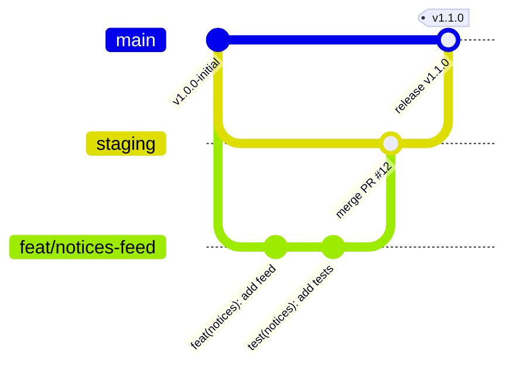

# Git Workflow & Release Engineering Standards

> **Document ID:** DOC-ENG-003  
> **Status:** Approved Baseline (Phase 1, Part 1.6)  
> **Institution:** Axis Institute of Technology & Management  
> **Workflow Pattern:** GitHub Flow with Staging & Semantic Releases  
> **Last Updated:** November 2026  

---

## 1. Branching Strategy & Lifecycle

Axis LinkUp adheres to a clean, trunk-based GitHub Flow model featuring two long-lived branches and short-lived feature/bugfix branches:



### 1.1 Long-Lived Branches
1. **`main` (Production):**
   - The authoritative production branch.
   - Code on `main` is automatically deployed to `https://linkup.axiscolleges.in`.
   - **Direct pushes to `main` are strictly locked.** All merges require an approved Pull Request and passing CI gates.
2. **`staging` (Integration & QA):**
   - The pre-release integration branch.
   - Connected to Vercel Staging environment and Staging MongoDB Atlas cluster.
   - All feature branches merge into `staging` for QA verification prior to production release.

### 1.2 Short-Lived Working Branches
Developers create ephemeral branches cut from `staging`:

| Branch Prefix | Purpose | Naming Pattern | Example |
| :--- | :--- | :--- | :--- |
| `feat/` | New functionality or user stories | `feat/<module>-<short-description>` | `feat/notices-priority-filter` |
| `fix/` | Bug fixes and defect remediation | `fix/<module>-<defect-description>` | `fix/auth-session-cookie-timeout` |
| `refactor/` | Code refactoring with zero behavior change | `refactor/<module>-<target>` | `refactor/requests-service-cleanup` |
| `test/` | Adding or updating unit/E2E test suites | `test/<module>-<scope>` | `test/timetable-clash-specs` |
| `docs/` | Documentation additions or updates | `docs/<topic>-<update>` | `docs/api-standards-update` |
| `chore/` | Tooling, dependency updates, build config | `chore/<tool>-<update>` | `chore/eslint-flat-config-bump` |

---

## 2. Commit Message Standards (Conventional Commits)

Commit messages must strictly follow the **Conventional Commits 1.0.0** specification.

### 2.1 Commit Message Format
```
<type>(<scope>): <imperative description>

[optional body explaining motivation and architectural context]

[optional footer: Closes #issue-number, BREAKING CHANGE: ...]
```

### 2.2 Allowed Commit Types
- **`feat`:** A new feature introduced to the user or application.
- **`fix`:** A bug fix.
- **`refactor`:** Code changes that neither fix a bug nor add a feature.
- **`perf`:** Performance optimizations (e.g. adding a compound index).
- **`test`:** Adding missing tests or correcting existing tests.
- **`docs`:** Documentation changes only.
- **`chore`:** Build tasks, dependency bumps, configuration tweaks.

### 2.3 Practical Examples
```bash
# Good commit messages:
git commit -m "feat(notices): add priority tag filtering for student feed"
git commit -m "fix(auth): prevent infinite redirect loop on expired Clerk session"
git commit -m "perf(database): add compound index for request queue queries"
git commit -m "test(requests): add unit tests for SLA calculation logic"
git commit -m "docs(engineering): codify git workflow and commit standards"

# BAD commit messages (Will be rejected by Git hooks):
# "fixed bug"
# "wip"
# "updates"
# "changed some files"
```

---

## 3. Pull Request (PR) Process & Review Checklist

### 3.1 PR Size Guidelines
To maintain high review quality and avoid reviewer fatigue, Pull Requests must remain **under 400 lines of modified code** (excluding auto-generated lockfiles or schema snapshots). Large epics must be broken down into stacked, reviewable PRs.

### 3.2 Standard Pull Request Template (`.github/PULL_REQUEST_TEMPLATE.md`)
```markdown
## 1. Summary of Changes
- Briefly describe the problem solved and technical approach taken.

## 2. Affected Modules & Roles
- [ ] Student
- [ ] Faculty
- [ ] Admin
- [ ] Super Admin
- Modules: (e.g., MOD-07 Notices, MOD-13 Requests)

## 3. Verification & Testing Performed
- [ ] Vitest unit/integration tests passing locally (`npm run test`)
- [ ] TypeScript strict compilation clean (`npm run type-check`)
- [ ] ESLint & Prettier checks clean (`npm run lint`)
- [ ] Manual testing steps performed:
  1. Logged in as Student (aarav.sharma@axiscolleges.in)
  2. Verified notice feed renders with priority tags

## 4. Security & Isolation Checklist
- [ ] Zero raw database queries inside presentation components
- [ ] Zero server-only secrets exposed in client bundles (`NEXT_PUBLIC_*`)
- [ ] Verified server-side role and tenant scoping filters applied
```

### 3.3 Merge Strategy
- **Squash and Merge:** All pull requests are merged into `staging` and `main` using **Squash and Merge**.
- **Rationale:** Keeps the commit history of `main` linear, clean, and easily bisectable, converting multi-commit feature iterations into a single descriptive release commit.

---

## 4. Practical Git Commands Reference

```bash
# 1. Starting a new feature branch
git checkout staging
git pull origin staging
git checkout -b feat/requests-sla-calculator

# 2. Staging and committing changes conforming to Conventional Commits
git add src/features/requests/services/request.service.ts
git commit -m "feat(requests): calculate SLA deadline based on category config"

# 3. Keeping feature branch updated with staging (Rebase preferred)
git fetch origin
git rebase origin/staging

# 4. Pushing branch and creating Pull Request
git push -u origin feat/requests-sla-calculator

# 5. Tagging a Production Release (Executed by Lead Architect on main)
git checkout main
git pull origin main
git tag -a v1.0.0-mvp -m "Release v1.0.0: Axis LinkUp MVP Core Release"
git push origin v1.0.0-mvp
```

