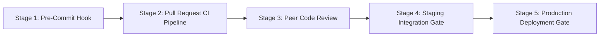

# Code Quality Gates & Deployment Readiness Standards

> **Document ID:** DOC-ENG-007  
> **Status:** Approved Baseline (Phase 1, Part 1.6)  
> **Institution:** Axis Institute of Technology & Management  
> **Enforcement Pipeline:** Git Hooks (Husky) & GitHub Actions CI  
> **Last Updated:** November 2026  

---

## 1. Quality Gates Architecture

To prevent software regressions, security vulnerabilities, and broken builds from reaching staging or production, Axis LinkUp enforces a five-stage quality gate pipeline:

---

## 2. Stage-by-Stage Quality Gate Specifications

### Stage 1: Developer Local Pre-Commit Gate (Husky + lint-staged)
- **Execution:** Runs automatically on developer workstation before `git commit` succeeds.
- **Mandatory Checks:**
  1. **Prettier Check:** Verifies formatting across staged files (`npx prettier --check`).
  2. **ESLint:** Lints staged files and fixes auto-fixable issues (`npx eslint --fix`).
  3. **Conventional Commit Message Linter:** Verifies commit message format (`commitlint`).

### Stage 2: Pull Request Automated CI Gate (GitHub Actions)
- **Execution:** Runs automatically on every Pull Request opened against `staging` or `main`.
- **Blocking Failures:** PR merge is physically blocked if any of the following checks fail:
  1. **Strict TypeScript Compilation:** `npx tsc --noEmit` must pass with **0 errors**.
  2. **Architectural Boundary Linting:** ESLint rules must verify zero forbidden cross-layer imports.
  3. **Unit & Integration Test Suite:** All Vitest tests must pass (`npm run test`).
  4. **Next.js Production Build:** `npm run build` must compile without bundling errors.

### Stage 3: Peer Code Review Gate
- **Execution:** Human review by at least one Senior Software Architect or Module Lead.
- **Mandatory Review Criteria:**
  - [ ] Code adheres to the Layered Service-Repository Pattern.
  - [ ] Zero raw database queries inside presentation components.
  - [ ] Proper error handling using the custom `AppError` hierarchy.
  - [ ] Role and tenant isolation filters verified.
  - [ ] Pull request size is under 400 lines of diff.

### Stage 4: Staging Integration & E2E Gate
- **Execution:** Runs on the deployed Vercel Staging preview environment.
- **Checks:**
  - Automated Playwright E2E suites execute against the staging database:
    * Critical Journey 1: Student Bonafide Request Lifecycle.
    * Critical Journey 2: Emergency Alert Takeover.
  - Synthetic health check: `GET /api/health` returns `200 OK`.

### Stage 5: Production Deployment Gate
- **Execution:** Atomic deployment to `linkup.axiscolleges.in`.
- **Checks:**
  - Post-deployment smoke test verifies database connectivity and Clerk session verification.
  - Automatic rollback triggered if error rate exceeds 1% during the first 5 minutes.

---

## 3. Phased Quality Gates Roadmap

To prevent premature operational overhead during early development, quality checks are phased appropriately:

| Quality Gate Check | Phase 1 (MVP Release) | Phase 2 (Version 2.0) | Phase 3 (Advanced) |
| :--- | :---: | :---: | :---: |
| **Strict TypeScript (`tsc --noEmit`)** | **Mandatory** | **Mandatory** | **Mandatory** |
| **ESLint & Prettier Format Verification** | **Mandatory** | **Mandatory** | **Mandatory** |
| **Vitest Unit Tests (Core Services)** | **Mandatory (80% coverage)** | **Mandatory (80% coverage)** | **Mandatory (85% coverage)** |
| **Playwright E2E (Core Journeys)** | **Mandatory (Top 3 Journeys)**| **Mandatory (Expanded Journeys)**| **Mandatory (Complete Suite)** |
| **Build Verification (`next build`)** | **Mandatory** | **Mandatory** | **Mandatory** |
| **Bundle Size Budget (<200KB initial JS)**| Advisory | **Mandatory** | **Mandatory** |
| **Automated Accessibility Testing (Axe-core)**| Advisory | **Mandatory** | **Mandatory** |
| **Load Testing (5,000 Virtual Users)** | Manual Verification | Advisory | **Automated Pre-Release Gate** |
| **Automated SAST / DAST Security Scan** | Advisory | **Mandatory** | **Mandatory** |

