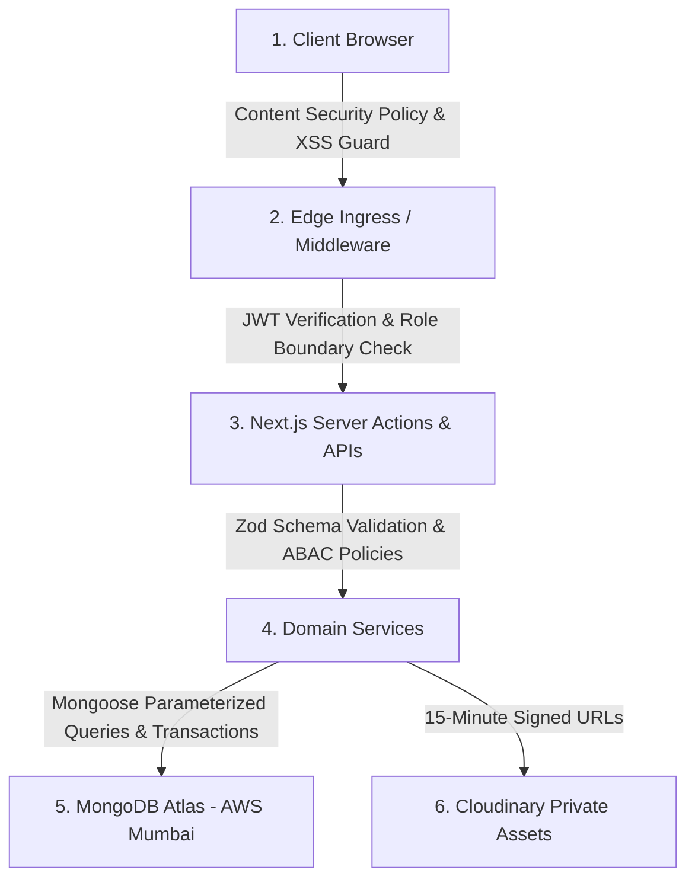

# Production Security Standards & Threat Mitigation Checklist

> **Document ID:** DOC-ENG-006  
> **Status:** Approved Baseline (Phase 1, Part 1.6)  
> **Institution:** Axis Institute of Technology & Management  
> **Compliance:** Indian Digital Personal Data Protection (DPDP) Act, 2023  
> **Audience:** All Developers, DevOps Engineers, and Security Reviewers  
> **Last Updated:** November 2026  

---

## 1. Security Architecture Overview

Axis LinkUp enforces a **Defense-in-Depth (DiD)** security model. Security verification is performed across every layer of the technology stack:

---

## 2. Production Security Checklist

### 2.1 Authentication & Session Integrity
- [ ] **Cookie Security:** Clerk authentication tokens must be stored exclusively in `HttpOnly`, `SameSite=Strict`, `Secure` cookies.
- [ ] **Mandatory Admin MFA:** All accounts with `role === 'admin'` or `role === 'super_admin'` must enforce TOTP Multi-Factor Authentication via an authenticator app.
- [ ] **Role Escalation Prevention:** User roles are stored in Clerk's server-only `publicMetadata` (write-only via backend secret key). Client components cannot alter their own roles.
- [ ] **Session Invalidation:** Deactivating or suspending a user account in MongoDB immediately terminates all active Clerk sessions via the Clerk Backend SDK.

### 2.2 Access Control & Route Authorization
- [ ] **Edge Middleware Guards:** Next.js Edge Middleware (`middleware.ts`) verifies session validity and redirects unauthorized users before serverless lambdas execute.
- [ ] **Resource-Level Authorization (ABAC):** Every Server Action and service method re-verifies entity ownership (e.g. A student can only view/cancel their own tickets; faculty can only grade courses they instruct).
- [ ] **Zero Public Direct ID Lookups:** Administrative endpoints must never accept arbitrary user IDs without verifying the caller's administrative role.

### 2.3 Input Validation, XSS & Injection Defense
- [ ] **100% Zod Input Validation:** Every incoming payload is validated against a strict Zod schema before invoking business logic.
- [ ] **NoSQL Injection Prevention:** Mongoose queries must never accept unvalidated query objects directly from client input. Prohibit the use of `$where` or dynamic JavaScript execution.
- [ ] **XSS Sanitization:** All user-submitted Markdown or rich text (Notice bodies, ticket comments) must be sanitized using `DOMPurify` before storage and rendering.
- [ ] **Clickjacking Defense:** HTTP header `X-Frame-Options: DENY` and `Content-Security-Policy: frame-ancestors 'none'` enforced on all responses.

### 2.4 File Storage & Upload Protection
- [ ] **Direct-to-Cloud Signed Uploads:** Binaries must be uploaded directly to Cloudinary using server-minted HMAC-SHA256 signatures, avoiding Vercel serverless memory bottlenecks.
- [ ] **Executable Blocking:** File extensions `.exe`, `.bat`, `.sh`, `.php`, `.js`, `.py`, `.vbs` are strictly blocked.
- [ ] **Private Asset Isolation:** Student assignment submissions, bonafide proofs, and medical certificates are stored as `private` assets.
- [ ] **Time-Limited Signed Delivery URLs:** Private files are delivered **exclusively via 15-minute HMAC-signed URLs** generated after server-side authorization checks.

### 2.5 Sensitive Data Protection & DPDP Act Compliance
- [ ] **Indian Data Residency:** MongoDB Atlas cluster is physically provisioned in AWS Mumbai (`ap-south-1`).
- [ ] **Phone Number Concealment:** Student and faculty mobile numbers are strictly concealed from public profiles and chat feeds.
- [ ] **Ballot Anonymity:** Democratic poll votes store `voterHash = HMAC_SHA256(userId + salt)`, with `userId` set to `null`, ensuring complete ballot secrecy.
- [ ] **Encryption Standards:** Data in transit encrypted via TLS 1.3; data at rest encrypted via AES-256.

### 2.6 Audit Logging & Immutability
- [ ] **Immutable Audit Ledger:** All sensitive actions (role grants, notice deletions, request approvals, emergency broadcasts) record an entry in `audit_logs`.
- [ ] **Database Lockout:** The application's MongoDB user role is configured to reject `update`, `delete`, and `dropCollection` on `audit_logs`.

### 2.7 Environment & Secret Management
- [ ] **Zero Secrets in Git:** `.env*` files are strictly excluded from Git repositories.
- [ ] **Prefix Discipline:** Only public client keys are prefixed with `NEXT_PUBLIC_`. Master API keys and database strings must never have this prefix.
- [ ] **Dependency Auditing:** Automated `npm audit` check in CI pipeline fails builds on High or Critical vulnerabilities.

