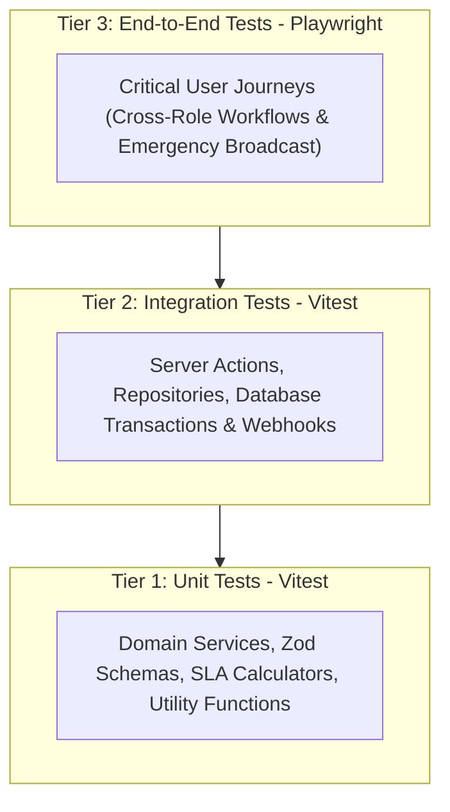
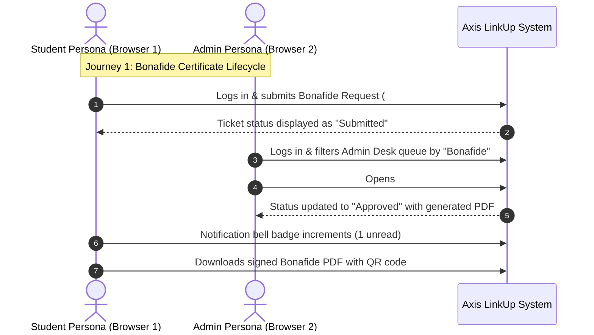

# Comprehensive Testing Strategy & Quality Assurance

> **Document ID:** DOC-ENG-005  
> **Status:** Approved Baseline (Phase 1, Part 1.6)  
> **Institution:** Axis Institute of Technology & Management  
> **Test Frameworks:** Vitest (Unit/Integration) & Playwright (End-to-End)  
> **Tooling Status:** Proposed & Evaluated (To be installed in Phase 2)  
> **Last Updated:** November 2026  

---

## 1. Multi-Tier Testing Philosophy

Axis LinkUp implements a pragmatic **Testing Pyramid** designed to maximize regression protection while minimizing test maintenance overhead:



- **Tier 1: Unit Tests (Fast & Isolated):** Tests pure domain services, Zod validation logic, date utilities, and permissions policies in memory without spinning up external servers. Execution target: `< 10ms` per test.
- **Tier 2: Integration Tests (Data & Actions):** Tests database repositories, Mongoose schema constraints, and Server Actions against an isolated MongoDB test database.
- **Tier 3: End-to-End Tests (Full System):** Drives multi-role browser contexts (Student, Faculty, Admin) through complete collegiate workflows using Playwright.

---

## 2. Unit Testing Strategy (Vitest)

### 2.1 Scope of Unit Testing
- **Domain Services (`src/lib/services/*`):** Business invariants (e.g., verifying submission deadlines, checking duplicate active tickets, calculating SLA breach dates).
- **Zod Validation Schemas (`src/lib/validations/*`):** Rejection of malformed payloads, regex enforcement, and enum verification.
- **ABAC Authorization Policies (`src/lib/auth/policies/*`):** Permission checks (e.g., `canGradeSubmission()`, `canViewRequest()`).

### 2.2 Domain Service Test Pattern
```typescript
// src/lib/services/__tests__/request.service.test.ts
import { describe, it, expect, vi, beforeEach } from 'vitest';
import { RequestService } from '../request.service';
import { RequestRepository } from '@/lib/db/repositories/request.repository';
import { BusinessRuleError } from '@/lib/errors/app-error';

vi.mock('@/lib/db/repositories/request.repository');

describe('RequestService.createRequest', () => {
  const mockStudent = {
    id: '6730a101f8b1a2001a000001',
    role: 'student' as const,
    departmentId: '6730a001f8b1a2001a000010',
    email: 'aarav.sharma@axiscolleges.in',
    fullName: 'Aarav Sharma',
    clerkId: 'user_101',
  };

  beforeEach(() => {
    vi.clearAllMocks();
  });

  it('should reject creation if student has an existing pending ticket for same category', async () => {
    // Arrange: Mock repository returning true for pending ticket
    vi.mocked(RequestRepository.hasPendingRequest).mockResolvedValue(true);

    // Act & Assert: Expect business rule violation
    await expect(
      RequestService.createRequest({ categoryId: 'cat_bonafide', formData: {} }, mockStudent)
    ).rejects.toThrow(BusinessRuleError);
  });
});
```

---

## 3. Database & Integration Testing

### 3.1 Scope of Integration Testing
- **Mongoose Schema Constraints:** Validating that unique compound indexes (e.g., room booking clash, duplicate voter hash) correctly reject invalid documents.
- **Multi-Document Transactions:** Verifying that ticket approvals atomically record audit logs and notifications, or roll back completely on failure.
- **Webhook Handlers (`/api/webhooks/*`):** Testing Svix cryptographic signature verification with mock Clerk payloads.

---

## 4. End-to-End (E2E) Testing Strategy (Playwright)

### 4.1 Critical Cross-Role User Journeys
Playwright test suites execute the three most mission-critical institutional workflows across isolated browser personas:



### 4.2 Emergency Mode Broadcast Test Journey
1. **Context 1 (Super Admin):** Logs in, navigates to `/super-admin/emergency`, enters test directive, and clicks "Trigger Red Alert".
2. **Context 2 (Student):** Active on `/student/timetable`. Within **3 seconds**, the screen locks with a pulsating red emergency banner and modal dialog.
3. **Receipt Action:** Student clicks "I Acknowledge & Understand". The dialog dismisses to a top persistent banner, and the acknowledgment is saved to MongoDB.

---

## 5. Test Data Management & Cleanup Strategy

1. **Dedicated Test Database:** All integration and E2E tests target an isolated test database (`axis_linkup_test`). Tests are strictly prohibited from pointing to production or staging databases.
2. **Deterministic Test Fixtures:** Seed data (departments, terms, sample faculty accounts) is loaded from deterministic fixture files in `tests/fixtures/`.
3. **Automated Teardown Hooks:** Vitest and Playwright test hooks (`afterEach`) purge created test documents, ensuring zero cross-test state leakage.
4. **Coverage Targets:** Core domain services (`src/lib/services/*`) must maintain a minimum of **80% unit test coverage** prior to production deployment sign-off.

