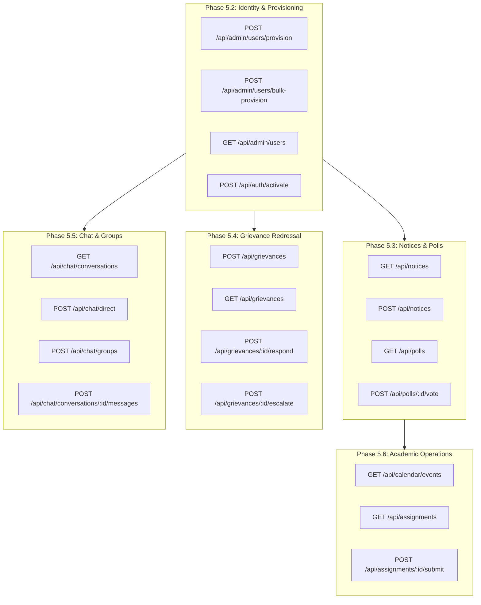

# AXIS LINKUP — API IMPLEMENTATION ROADMAP
**Master REST Endpoint Architecture, Contracts & Phased Delivery Schedule**  
*Document Version:* 1.0.0  
*Phase:* Phase 5.1 (Backend Readiness & Architecture Audit)  
*Date:* November 14, 2026  
*Status:* COMPLETE  

---

## 1. API Architecture & Standards

All Phase 5 API Route Handlers in Axis LinkUp adhere strictly to the following institutional engineering standards:

1. **Next.js App Router Route Handlers:** All endpoints reside under `src/app/api/` as explicit HTTP method exports (`GET`, `POST`, `PATCH`, `DELETE`).
2. **Standardized Response Envelope:** Every JSON response conforms to `ApiResponse<T>`:
   ```json
   {
     "success": true,
     "message": "Human-readable operational confirmation",
     "data": { ... },
     "timestamp": "2026-11-14T10:00:00.000Z"
   }
   ```
3. **Fail-Fast Request Validation:** All request bodies and query parameters are parsed through dedicated **Zod** schemas in `src/lib/validations/`.
4. **Zero-Trust Server Authorization:** Every protected route executes `requireAuth()`, `requireRole()`, or `requirePermission()` before touching the database layer.
5. **Standardized Error Handling:** Errors are handled via `handleApiError(error)` from `src/lib/api/api-error-handler.ts`, which catches `AppError`, `ZodError`, and `MongooseError` and returns structured HTTP 400/401/403/404/409/500 responses without leaking internal stack traces.

---

## 2. Complete Phase 5 Endpoint Catalog



---

### Milestone 5.2: Identity, Admin Provisioning & Account Lifecycle

| Method | Endpoint | Description | Auth Guard | Request Body / Query | Success Status |
| :--- | :--- | :--- | :--- | :--- | :---: |
| `POST` | `/api/admin/users/provision` | Single account creation by SysAdmin | `requireRole(['admin', 'super_admin'])` | `{ email, username, fullName, role, departmentId, studentProfile?, facultyProfile? }` | `201 Created` |
| `POST` | `/api/admin/users/bulk-provision` | CSV batch import of students/faculty | `requireRole(['admin', 'super_admin'])` | FormData with CSV file payload | `200 OK` |
| `GET` | `/api/admin/users` | Directory query with pagination & role filters | `requireRole(['admin', 'super_admin'])` | Query: `?page=1&limit=20&role=student&status=active` | `200 OK` |
| `PATCH`| `/api/admin/users/:id/status` | Disciplinary suspension or reactivation | `requireRole(['admin', 'super_admin'])` | `{ status: 'active' \| 'suspended' \| 'deactivated' }` | `200 OK` |
| `POST` | `/api/auth/activate` | First-time password set for provisioned account | Public (Token-bound) | `{ activationToken, password }` | `200 OK` |

---

### Milestone 5.3: Campus Notices & Polls Engine

| Method | Endpoint | Description | Auth Guard | Request Body / Query | Success Status |
| :--- | :--- | :--- | :--- | :--- | :---: |
| `GET` | `/api/notices` | Fetches active notices scoped to user persona | `requireAuth()` | Query: `?scope=all&category=academic&limit=10` | `200 OK` |
| `POST` | `/api/notices` | Publishes a college or department bulletin | `requireRole(['faculty', 'admin', 'super_admin'])` | `{ title, content, category, targetRoles, isUrgent, attachments? }` | `201 Created` |
| `DELETE`| `/api/notices/:id` | Archives or deletes a published notice | `requireRole(['admin', 'super_admin'])` | None | `200 OK` |
| `GET` | `/api/polls` | Fetches active campus polls and results | `requireAuth()` | Query: `?status=active` | `200 OK` |
| `POST` | `/api/polls` | Creates a new single/multi-choice poll | `requireRole(['faculty', 'admin', 'super_admin'])` | `{ question, options: string[], expiresAt, targetAudience }` | `201 Created` |
| `POST` | `/api/polls/:id/vote` | Casts a cryptographic single vote | `requireAuth()` | `{ selectedOptionIndex: number }` | `200 OK` |

---

### Milestone 5.4: Statutory Student Grievance Redressal (AICTE / UGC)

| Method | Endpoint | Description | Auth Guard | Request Body / Query | Success Status |
| :--- | :--- | :--- | :--- | :--- | :---: |
| `POST` | `/api/grievances` | Student submits formal grievance | `requireRole(['student'])` | `{ category, recipientRole: 'hod' \| 'director', subject, narrative, isAnonymous, attachments? }` | `201 Created` |
| `GET` | `/api/grievances` | Queries grievances based on caller role | `requireAuth()` | Student: Own tickets; HOD: Dept tickets; Director: Appeals | `200 OK` |
| `GET` | `/api/grievances/:id` | Fetches ticket details & response history | `requireAuth()` + ABAC | None | `200 OK` |
| `POST` | `/api/grievances/:id/respond` | HOD or Director submits official response | `requireRole(['admin', 'super_admin'])` | `{ message, actionTaken?, newStatus? }` | `200 OK` |
| `POST` | `/api/grievances/:id/escalate` | Escalates an unaddressed ticket to Director | `requireAuth()` + ABAC | `{ reason: string }` | `200 OK` |
| `POST` | `/api/grievances/:id/resolve` | Formally closes an adjudicated grievance | `requireRole(['admin', 'super_admin'])` | `{ closingRemarks: string }` | `200 OK` |

---

### Milestone 5.5: Real-Time Chat & Faculty Group Messaging

| Method | Endpoint | Description | Auth Guard | Request Body / Query | Success Status |
| :--- | :--- | :--- | :--- | :--- | :---: |
| `GET` | `/api/chat/conversations` | Lists caller's 1:1 chats and groups | `requireAuth()` | Query: `?limit=25` | `200 OK` |
| `POST` | `/api/chat/direct` | Initiates or retrieves 1:1 conversation | `requireAuth()` | `{ recipientUserId: string }` | `200 OK` |
| `POST` | `/api/chat/groups` | Faculty creates academic discussion group | `requireRole(['faculty', 'admin'])` | `{ name, description, groupPolicy: 'broadcast_only' \| 'open_discussion', memberUserIds: string[] }` | `201 Created` |
| `GET` | `/api/chat/conversations/:id/messages` | Cursor-paginated message history | `requireAuth()` + Member Check | Query: `?cursor=<messageId>&limit=50` | `200 OK` |
| `POST` | `/api/chat/conversations/:id/messages` | Sends message into conversation | `requireAuth()` + Policy Check | `{ content: string, attachments?: string[] }` | `201 Created` |
| `PATCH`| `/api/chat/conversations/:id/read` | Marks conversation as read (clears badge) | `requireAuth()` | None | `200 OK` |

---

### Milestone 5.6: Academic Operations (Calendar & Assignments)

| Method | Endpoint | Description | Auth Guard | Request Body / Query | Success Status |
| :--- | :--- | :--- | :--- | :--- | :---: |
| `GET` | `/api/calendar/events` | Fetches semester academic dates & exams | `requireAuth()` | Query: `?month=11&year=2026&type=exam` | `200 OK` |
| `POST` | `/api/calendar/events` | Creates calendar milestone or exam | `requireRole(['admin', 'super_admin'])` | `{ title, date, eventType, description, departmentId? }` | `201 Created` |
| `GET` | `/api/assignments` | Lists course assignments | `requireAuth()` | Query: `?status=pending \| graded` | `200 OK` |
| `POST` | `/api/assignments` | Faculty publishes assignment docket | `requireRole(['faculty', 'admin'])` | `{ title, courseCode, description, dueDate, maxMarks, attachments? }` | `201 Created` |
| `POST` | `/api/assignments/:id/submit` | Student submits coursework solution | `requireRole(['student'])` | `{ fileUrl: string, comment?: string }` | `201 Created` |
| `POST` | `/api/assignments/:id/grade` | Faculty records grade & rubric feedback | `requireRole(['faculty'])` | `{ submissionId, score, feedback }` | `200 OK` |

---

## 3. Phased Implementation Schedule

To ensure zero downtime, consistent automated test execution, and incremental stability, the endpoints will be delivered across sequential sub-phases:

```
Phase 5.2 ──► Phase 5.3 ──► Phase 5.4 ──► Phase 5.5 ──► Phase 5.6 ──► Phase 5.7 ──► Phase 5.8
(Identity)   (Notices)    (Grievance)   (Chat/Groups)(Academic)   (External)   (Sign-Off)
```

1. **Phase 5.2 (Identity & Provisioning):** Database user model expansion, username validation, admin provisioning endpoints, and invitation activation flows.
2. **Phase 5.3 (Campus Notices & Polls):** Notice models, single/multi-choice voting models with double-vote prevention, and dashboard feed wiring.
3. **Phase 5.4 (Statutory Grievance Redressal):** Grievance collection, ticket numbering, SLA calculation, HOD/Director response pipelines, and escalation logic.
4. **Phase 5.5 (Real-Time Chat & Academic Groups):** Conversation and message collections, member rosters, channel policy enforcement, and message status tracking.
5. **Phase 5.6 (Academic Operations):** Calendar event models, assignment publishing, student coursework submissions, and gradebook recordings.
6. **Phase 5.7 (External Integrations & Real-Time Transport):** Cloudinary signed file uploads, Ably real-time WebSocket messaging, and Resend transactional notifications.
7. **Phase 5.8 (End-to-End Testing & Verification):** Integration test suites, load verification, security penetration assessment, and final sign-off.

