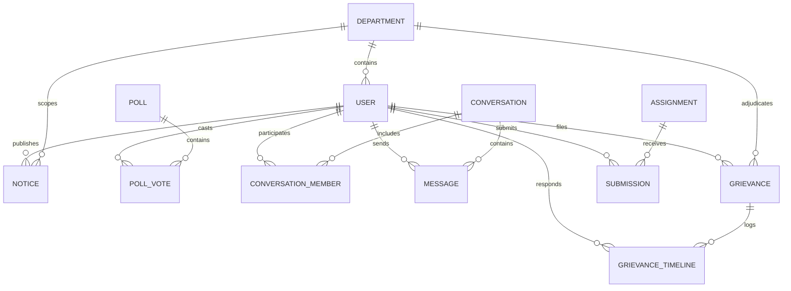

# AXIS LINKUP — DATABASE GAP ANALYSIS
**MongoDB Atlas Schema Inventory, Entity-Relationship Models & Indexing Strategy**  
*Document Version:* 1.0.0  
*Phase:* Phase 5.1 (Backend Readiness & Architecture Audit)  
*Date:* November 14, 2026  
*Status:* COMPLETE  

---

## 1. Executive Summary

A comprehensive inspection of the persistence layer in `src/lib/db/` reveals that while MongoDB Atlas connectivity is active, **only one single Mongoose model and collection (`users`) is currently implemented**. 

To support the core collegiate communication, administration, grievance redressal, and academic workflows specified in Phase 4.8.2 and the Phase 5 roadmap, **12 additional collections** must be designed, indexed, and integrated into MongoDB Atlas.

Furthermore, the existing `users` collection must undergo a schema evolution to support username-based authentication, administrative sub-roles (`sys_admin`, `hod`, `director`), and provisioning audit trails.

---

## 2. Complete Entity-Relationship Overview



---

## 3. Schema Evolution: `users` Collection Updates

The existing `UserModel` in [user.model.ts](file:///c:/Users/prash/Desktop/Axis%20LinkUp/src/lib/db/models/user.model.ts) requires the following additions:

| Field Name | Type | Constraints / Defaults | Purpose |
| :--- | :--- | :--- | :--- |
| `username` | `String` | Unique, lowercase, trim, min 3, max 30 | Direct username-based login without email |
| `adminSubRole` | `String` | Enum: `['sys_admin', 'hod', 'director']`, default: `null` | Disaggregates generic admin role into distinct authorities |
| `isEmailVerified`| `Boolean` | Default: `false` | Tracks email verification status from Clerk or OTP |
| `provisionedBy` | `ObjectId` | Ref: `'User'`, default: `null` | Audits which System Administrator provisioned the account |
| `activatedAt` | `Date` | Default: `null` | Records timestamp of first-time password setup |

### Required Indexes on `users`:
- `UserSchema.index({ username: 1 }, { unique: true, sparse: true })`
- `UserSchema.index({ role: 1, adminSubRole: 1, status: 1 })`
- `UserSchema.index({ departmentId: 1, role: 1, adminSubRole: 1 })`

---

## 4. New Collections Required for Phase 5

### 4.1 Collection 1: `departments`
Stores academic department metadata, course programs, and assigned HOD references:
```typescript
interface IDepartment extends Document {
  code: string;               // e.g. "CSE", "ECE", "ME", "CIVIL", "PHARMACY"
  name: string;               // e.g. "Computer Science & Engineering"
  hodId?: Types.ObjectId;     // Ref: 'User' (Current Head of Department)
  establishedYear: number;
  isActive: boolean;
  createdAt: Date;
  updatedAt: Date;
}
```
* **Indexes:** `{ code: 1 }` (unique), `{ hodId: 1 }`

---

### 4.2 Collection 2: `notices`
Stores campus-wide bulletins, departmental circulars, and emergency notices:
```typescript
interface INotice extends Document {
  title: string;
  content: string;
  category: 'academic' | 'examination' | 'event' | 'administrative' | 'emergency';
  targetAudience: 'all' | 'students' | 'faculty' | 'department';
  targetDepartmentId?: Types.ObjectId; // Ref: 'Department' (if department-scoped)
  isUrgent: boolean;
  authorId: Types.ObjectId;            // Ref: 'User'
  attachments: Array<{ name: string; url: string; size: number }>;
  expiresAt?: Date;
  status: 'published' | 'archived';
  createdAt: Date;
  updatedAt: Date;
}
```
* **Indexes:** `{ status: 1, targetAudience: 1, createdAt: -1 }`, `{ targetDepartmentId: 1, status: 1 }`

---

### 4.3 Collection 3 & 4: `polls` and `poll_votes`
Enables structured collegiate polling with cryptographic single-vote verification:
```typescript
interface IPoll extends Document {
  question: string;
  options: Array<{ id: string; text: string; voteCount: number }>;
  creatorId: Types.ObjectId;           // Ref: 'User'
  targetAudience: 'all' | 'students' | 'faculty';
  targetDepartmentId?: Types.ObjectId;
  expiresAt: Date;
  isClosed: boolean;
  createdAt: Date;
  updatedAt: Date;
}

interface IPollVote extends Document {
  pollId: Types.ObjectId;              // Ref: 'Poll'
  voterId: Types.ObjectId;             // Ref: 'User'
  selectedOptionId: string;
  votedAt: Date;
}
```
* **Critical Invariant Index (Double-Vote Prevention):**
  - `PollVoteSchema.index({ pollId: 1, voterId: 1 }, { unique: true })`

---

### 4.4 Collection 5 & 6: `conversations` and `conversation_members`
Implements WhatsApp-inspired 1:1 chat and faculty-moderated academic discussion groups:
```typescript
interface IConversation extends Document {
  type: 'direct' | 'group';
  name?: string;                       // Required for groups
  handle?: string;                     // e.g. "cse-2026-sec-a"
  description?: string;
  avatarUrl?: string;
  creatorId: Types.ObjectId;           // Ref: 'User'
  groupPolicy: 'broadcast_only' | 'open_discussion';
  lastMessageText?: string;
  lastMessageAt?: Date;
  createdAt: Date;
  updatedAt: Date;
}

interface IConversationMember extends Document {
  conversationId: Types.ObjectId;      // Ref: 'Conversation'
  userId: Types.ObjectId;              // Ref: 'User'
  role: 'member' | 'moderator' | 'admin';
  unreadCount: number;
  lastReadAt?: Date;
  joinedAt: Date;
}
```
* **Indexes:**
  - `ConversationMemberSchema.index({ conversationId: 1, userId: 1 }, { unique: true })`
  - `ConversationMemberSchema.index({ userId: 1, unreadCount: 1 })`
  - `ConversationSchema.index({ lastMessageAt: -1 })`

---

### 4.5 Collection 7: `messages`
Stores conversation messages with support for attachments and delivery statuses:
```typescript
interface IMessage extends Document {
  conversationId: Types.ObjectId;      // Ref: 'Conversation'
  senderId: Types.ObjectId;            // Ref: 'User'
  content: string;
  status: 'sent' | 'delivered' | 'read';
  attachments: Array<{
    name: string;
    url: string;
    size: number;
    mimeType: string;
  }>;
  createdAt: Date;
  updatedAt: Date;
}
```
* **Indexes (Cursor Pagination & Retrieval):**
  - `MessageSchema.index({ conversationId: 1, createdAt: -1 })`

---

### 4.6 Collection 8 & 9: `grievances` and `grievance_timeline`
Implements AICTE / UGC statutory grievance redressal dockets:
```typescript
interface IGrievance extends Document {
  ticketNumber: string;                // e.g. "GRV-2026-08192"
  studentId: Types.ObjectId;           // Ref: 'User'
  departmentId: Types.ObjectId;        // Ref: 'Department'
  category: 'academic' | 'lab_infrastructure' | 'harassment' | 'administrative' | 'fee_accounts';
  recipientRole: 'hod' | 'director';
  subject: string;
  narrative: string;
  isAnonymous: boolean;
  status: 'submitted' | 'under_review' | 'responded' | 'resolved' | 'escalated';
  slaDeadline: Date;                   // Exactly 48 hours from submission for HOD
  isEscalatedToDirector: boolean;
  escalatedAt?: Date;
  resolvedAt?: Date;
  attachments: string[];
  createdAt: Date;
  updatedAt: Date;
}

interface IGrievanceTimeline extends Document {
  grievanceId: Types.ObjectId;         // Ref: 'Grievance'
  authorId: Types.ObjectId;            // Ref: 'User'
  action: 'submitted' | 'reviewed' | 'responded' | 'escalated' | 'resolved';
  message: string;
  actionTaken?: string;
  isInternalNote: boolean;             // If true, visible strictly to HOD & Director
  createdAt: Date;
}
```
* **Indexes:**
  - `GrievanceSchema.index({ ticketNumber: 1 }, { unique: true })`
  - `GrievanceSchema.index({ studentId: 1, createdAt: -1 })`
  - `GrievanceSchema.index({ departmentId: 1, status: 1, slaDeadline: 1 })`
  - `GrievanceSchema.index({ recipientRole: 1, isEscalatedToDirector: 1 })`

---

### 4.7 Collection 10: `calendar_events`
Stores academic timetable, semester exams, and institutional holidays:
```typescript
interface ICalendarEvent extends Document {
  title: string;
  description?: string;
  eventType: 'lecture' | 'examination' | 'holiday' | 'assignment_deadline' | 'college_event';
  startDate: Date;
  endDate: Date;
  isAllDay: boolean;
  departmentId?: Types.ObjectId;       // Optional: for department-specific exams/lectures
  targetRoles: Array<'student' | 'faculty' | 'admin'>;
  location?: string;
  createdBy: Types.ObjectId;           // Ref: 'User'
  createdAt: Date;
  updatedAt: Date;
}
```
* **Indexes:** `{ startDate: 1, endDate: 1 }`, `{ departmentId: 1, eventType: 1 }`

---

### 4.8 Collection 11 & 12: `assignments` and `submissions`
Powers coursework dropboxes, deadlines, and gradebook evaluations:
```typescript
interface IAssignment extends Document {
  courseCode: string;                  // e.g. "KCS-501"
  courseName: string;                  // e.g. "Database Management Systems"
  title: string;
  description: string;
  facultyId: Types.ObjectId;           // Ref: 'User'
  departmentId: Types.ObjectId;        // Ref: 'Department'
  batchYear: number;
  section?: string;
  maxScore: number;
  dueDate: Date;
  attachments: Array<{ name: string; url: string; size: number }>;
  status: 'active' | 'closed';
  createdAt: Date;
  updatedAt: Date;
}

interface ISubmission extends Document {
  assignmentId: Types.ObjectId;        // Ref: 'Assignment'
  studentId: Types.ObjectId;           // Ref: 'User'
  fileUrl: string;                     // Cloudinary CDN signed asset URL
  fileName: string;
  fileSize: number;
  studentComment?: string;
  submittedAt: Date;
  isLate: boolean;
  score?: number;
  facultyFeedback?: string;
  gradedAt?: Date;
  gradedBy?: Types.ObjectId;           // Ref: 'User'
}
```
* **Critical Invariant Index (Single Submission per Student):**
  - `SubmissionSchema.index({ assignmentId: 1, studentId: 1 }, { unique: true })`

---

## 5. React Server Component (RSC) Serialization Standards

As demonstrated and permanently resolved in Phase 4.8, **raw Mongoose documents cannot be passed directly from Server Components to Client Components**. Mongoose injects internal symbols, getters, and circular parent references (`$__parent`).

Every repository method in Phase 5 must adhere to one of the two strict architectural patterns:

### Pattern A: Clean DTO Transformers
Every entity model must expose a dedicated `toDTO()` function that maps subdocuments and `Types.ObjectId` instances into plain JavaScript primitives:
```typescript
export function toNoticeDTO(notice: INotice): NoticeDTO {
  return {
    id: notice._id.toString(),
    title: notice.title,
    content: notice.content,
    category: notice.category,
    targetAudience: notice.targetAudience,
    targetDepartmentId: notice.targetDepartmentId?.toString() ?? null,
    isUrgent: notice.isUrgent,
    authorId: notice.authorId.toString(),
    attachments: notice.attachments.map(a => ({ name: a.name, url: a.url, size: a.size })),
    createdAt: notice.createdAt.toISOString(),
  };
}
```

### Pattern B: Lean Queries for Read-Only Feeds
For high-volume feeds (Notices, Calendar, Messages), queries must invoke `.lean()` to bypass Mongoose hydration entirely:
```typescript
const notices = await NoticeModel.find(query).sort({ createdAt: -1 }).lean().exec();
```

