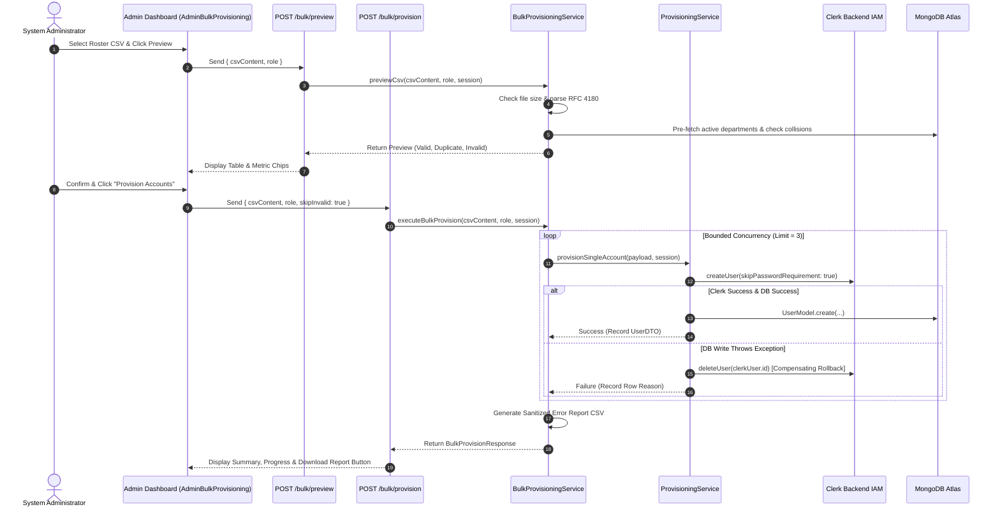

# Phase 5.2.4: Bulk Student & Faculty Account Provisioning Implementation Report

**Status:** Completed & Fully Verified  
**Date:** November 15, 2026  
**Module:** User Management & Bulk Account Provisioning  
**Author:** Antigravity Engineering Agent  
**Context:** Axis LinkUp — College Communication and Productivity Platform (AITM Kanpur)

---

## 1. Executive Summary

Phase 5.2.4 successfully implements secure, CSV-based bulk account provisioning for Axis LinkUp. Building upon the verified foundation of **Phase 5.2.1 (User Model & Identity Schema)**, **Phase 5.2.2 (Clerk Identity & RBAC Synchronization)**, and **Phase 5.2.3 (Admin Single-Account Provisioning)**, this release delivers an enterprise-grade batch onboarding pipeline for collegiate registrars and system administrators.

### Core Capabilities Delivered
1. **Persona-Specific CSV Templates**: Dedicated RFC 4180 CSV schemas for Student and Faculty rosters with downloadable template endpoints (`GET /api/v1/admin/users/bulk/template`).
2. **Pre-Flight Validation & Collision Preview**: A two-stage workflow where rosters are inspected for syntax errors, intra-batch duplicates, department existence, and database collisions before any account creation occurs (`POST /api/v1/admin/users/bulk/preview`).
3. **Bounded-Concurrency Execution & Fault Isolation**: Bulk provisioning executes with bounded concurrency (3 concurrent workers) to protect external Clerk IAM rate limits and MongoDB connection pools (`POST /api/v1/admin/users/bulk/provision`). Individual row failures do not halt the batch.
4. **CWE-1236 Formula Injection Neutralization**: All downloadable reports and templates neutralize spreadsheet formula injection vulnerabilities (`=`, `+`, `-`, `@`, `\t`, `\r`) by prefixing potentially dangerous strings with `'`.
5. **Compensating Rollback & Identity Reuse**: Leverages the existing `ProvisioningService.provisionSingleAccount` engine, guaranteeing that partial failures trigger compensating deletions on Clerk and zero orphaned records persist.
6. **Dashboard UI Integration**: Enhances the Administrator Dashboard with the `AdminBulkProvisioning` component featuring role toggles, file dropzones, template downloads, interactive preview tables, progress meters, and sanitized error report downloads.

---

## 2. Architectural Compliance & Security Guardrails

| Requirement Specification | Source Policy | Implementation Details | Verification Status |
| :--- | :--- | :--- | :--- |
| **Separation of Powers** | Phase 4.8.2 §2.3 | Strictly restricted to System Administrators (`isSysAdmin`). HODs and Directors receive 403 Forbidden on all bulk endpoints. | Verified |
| **Zero Default Passwords** | Phase 5.2.3 §3 | Accounts provisioned via Clerk backend API using `skipPasswordRequirement: true`. No static default passwords generated. | Verified |
| **Server-Controlled RBAC** | Phase 5.2.2 §3 | Role values (`student`, `faculty`) are injected server-side into Clerk `publicMetadata`. Client cannot tamper with role permissions. | Verified |
| **Formula Injection Defense** | CWE-1236 / Phase 5.2.4 §6 | `sanitizeCsvFormula` neutralizes all cells starting with `=`, `+`, `-`, `@`, `\t`, or `\r`. | Verified |
| **Bounded Concurrency** | Phase 5.2.4 §3 | Worker pool limits concurrent Clerk and MongoDB writes to 3, preventing rate limits and socket pool exhaustion. | Verified |
| **Strict File & Row Limits** | Phase 5.2.4 §2 | Max CSV file size of 2 MB (`MAX_BULK_CSV_BYTES`) and max row count of 500 rows (`MAX_BULK_ROWS`) per batch. | Verified |
| **Compensating Rollback** | Phase 5.2.3 §4 | If database write throws after Clerk identity is created, Clerk user is immediately destroyed via `client.users.deleteUser()`. | Verified |

---

## 3. CSV Templates & Data Contracts

### 3.1 Student Roster Schema
| Field | Type | Rules | Example |
| :--- | :--- | :--- | :--- |
| `fullName` | String | 2–100 chars, trimmed | `Aarav Sharma` |
| `username` | String | 3–30 lowercase alphanumeric, hyphen, underscore, period | `aarav.sharma24` |
| `institutionalEmail` | String | Valid email ending in `@axiscolleges.in` | `aarav.sharma@axiscolleges.in` |
| `department` | String | Active department code or ObjectId | `CSE` |
| `rollNumber` | String | Student roll number, normalized uppercase | `24BCSE101` |
| `batchYear` | Number | Integer between 2020 and 2035 | `2026` |
| `currentSemester` | Number | Integer between 1 and 8 | `1` |
| `section` | String | Uppercase section identifier | `A` |

### 3.2 Faculty Roster Schema
| Field | Type | Rules | Example |
| :--- | :--- | :--- | :--- |
| `fullName` | String | 2–100 chars, trimmed | `Dr. Rajesh Verma` |
| `username` | String | 3–30 lowercase alphanumeric, hyphen, underscore, period | `rajesh.verma` |
| `institutionalEmail` | String | Valid email ending in `@axiscolleges.in` | `rajesh.verma@axiscolleges.in` |
| `department` | String | Active department code or ObjectId | `CSE` |
| `employeeId` | String | Faculty employee ID, normalized uppercase | `FAC-CSE-001` |
| `designation` | String | Academic title / designation | `Associate Professor` |

### 3.3 Header Synonym Normalization
The CSV parser recognizes common synonymous header variants:
- Full Name: `fullName`, `name`, `full_name`
- Username: `username`, `uname`, `user_name`
- Institutional Email: `institutionalEmail`, `email`, `campusmail`, `collegemail`
- Department: `department`, `dept`, `departmentId`
- Roll Number: `rollNumber`, `rollno`, `enrollmentno`
- Batch Year: `batchYear`, `batch`, `year`
- Semester: `currentSemester`, `semester`, `sem`
- Section: `section`, `sec`
- Employee ID: `employeeId`, `empid`, `facultyid`
- Designation: `designation`, `title`, `role_title`

---

## 4. API Endpoints Specification

### 4.1 Template Download
- **Method**: `GET`
- **Path**: `/api/v1/admin/users/bulk/template`
- **Query Params**: `?role=student` or `?role=faculty`
- **Headers Returned**:
  - `Content-Type: text/csv; charset=utf-8`
  - `Content-Disposition: attachment; filename="axis-linkup-${role}-roster-template.csv"`
  - `Cache-Control: no-store`

### 4.2 Dry-Run Validation Preview
- **Method**: `POST`
- **Path**: `/api/v1/admin/users/bulk/preview`
- **Payload**:
  ```json
  {
    "csvContent": "fullName,username,institutionalEmail,department,rollNumber,batchYear,currentSemester,section\r\nAarav Sharma,aarav.sharma,aarav@axiscolleges.in,CSE,24BCSE101,2026,1,A",
    "role": "student"
  }
  ```
- **Response (HTTP 200)**:
  ```json
  {
    "success": true,
    "message": "CSV validation preview generated successfully",
    "data": {
      "totalRows": 1,
      "validCount": 1,
      "invalidCount": 0,
      "duplicateCount": 0,
      "canProceed": true,
      "rows": [
        {
          "rowNumber": 2,
          "fullName": "Aarav Sharma",
          "username": "aarav.sharma",
          "email": "aarav@axiscolleges.in",
          "department": "CSE",
          "role": "student",
          "institutionalId": "24BCSE101",
          "status": "valid",
          "errors": []
        }
      ]
    }
  }
  ```

### 4.3 Bulk Provisioning Execution
- **Method**: `POST`
- **Path**: `/api/v1/admin/users/bulk/provision`
- **Payload**:
  ```json
  {
    "csvContent": "...",
    "role": "student",
    "skipInvalid": true
  }
  ```
- **Response (HTTP 200)**:
  ```json
  {
    "success": true,
    "message": "Bulk account provisioning completed successfully",
    "data": {
      "totalRows": 25,
      "successCount": 23,
      "failedCount": 0,
      "skippedCount": 2,
      "results": [ ... ],
      "errorReportCsv": "Row Number,Full Name,Username,Institutional Email,Role,Status,Reason\r\n..."
    }
  }
  ```

---

## 5. Architectural Flow & Fault Isolation



---

## 6. Frontend Dashboard Integration

The Administration Dashboard has been enhanced with `AdminBulkProvisioning` (`src/app/(admin)/admin/dashboard/components/admin-bulk-provisioning.tsx`):

1. **Role Switcher & Template Downloads**: Single-click toggles between **Student Roster** and **Faculty Roster**, with dynamic template download buttons linked to `/api/v1/admin/users/bulk/template?role=...`.
2. **Interactive Dropzone**: Drag-and-drop file upload with live size validation (max 2 MB) and format verification.
3. **Collision Inspection Table**: Renders every parsed row with status badges:
   - `Valid` (Green): Clean payload ready for provisioning.
   - `Duplicate` (Amber): Intra-batch duplicate or existing database user.
   - `Invalid` (Red): Syntax failure, missing required field, or invalid department.
4. **Fault Tolerance Checkbox**: "Skip invalid and duplicate records" allows administrators to onboard valid rows while cleanly isolating problematic rows.
5. **Real-Time Progress & Completion States**: Displays animated processing state during execution, followed by comprehensive result counts.
6. **Sanitized Error Report Download**: Generates and downloads a formula-protected CSV of all skipped and failed records for easy administrative audit and remediation.

---

## 7. Verification & Automated Test Results

### 7.1 Bulk Provisioning Unit Test Suite (`tests/unit/bulk-provisioning.test.ts`)
A comprehensive 22-test automated suite was implemented and verified:

```
TAP version 13
# Subtest: Phase 5.2.4 — 1. CSV Utilities & Formula Injection Sanitization
    ok 1 - parses standard RFC 4180 CSV with quotes, commas, and multiline cells
    ok 2 - maps raw CSV row dictionary into structured ProvisionUserInput
    ok 3 - neutralizes formula injection characters (=, +, -, @, \t, \r)
    ok 4 - generates valid sanitized CSV output and escapes quotes
    ok 5 - generates student and faculty templates with expected headers
    ok 6 - normalizes varied CSV header synonyms
ok 1 - Phase 5.2.4 — 1. CSV Utilities & Formula Injection Sanitization (6/6 passed)

# Subtest: Phase 5.2.4 — 2. Administrative Authorization & Separation of Powers
    ok 1 - rejects bulk preview when invoked by Department HOD
    ok 2 - rejects bulk execution when invoked by Executive Director
    ok 3 - rejects bulk preview when invoked by Faculty or Student
ok 2 - Phase 5.2.4 — 2. Administrative Authorization & Separation of Powers (3/3 passed)

# Subtest: Phase 5.2.4 — 3. File & Row Boundary Validation
    ok 1 - rejects empty CSV content
    ok 2 - rejects CSV with header only (0 data rows)
    ok 3 - rejects CSV exceeding maximum row limit (500 rows)
    ok 4 - rejects CSV content exceeding maximum size limit (2 MB)
ok 3 - Phase 5.2.4 — 3. File & Row Boundary Validation (4/4 passed)

# Subtest: Phase 5.2.4 — 4. Deduplication & Collision Detection
    ok 1 - detects intra-batch duplicate emails and marks status as duplicate
    ok 2 - detects intra-batch duplicate roll numbers within CSV
    ok 3 - detects existing database entity collision (email and roll number)
    ok 4 - flags invalid department reference
ok 4 - Phase 5.2.4 — 4. Deduplication & Collision Detection (4/4 passed)

# Subtest: Phase 5.2.4 — 5. Bulk Provisioning Execution & Resilience
    ok 1 - successfully provisions all valid student records in bulk with bounded concurrency
    ok 2 - successfully provisions valid faculty records
    ok 3 - rejects execution when skipInvalid=false and CSV contains errors
    ok 4 - provisions valid rows and safely skips invalid rows when skipInvalid=true
    ok 5 - isolates single row failure during execution without stopping remaining rows
ok 5 - Phase 5.2.4 — 5. Bulk Provisioning Execution & Resilience (5/5 passed)

# Total Tests: 22 passed, 0 failed
```

### 7.2 Platform Quality Gates
- **Full Test Runner (`npm test`)**: **195 tests passed, 0 failed** across 34 test suites.
- **TypeScript Typecheck (`npx tsc --noEmit`)**: **0 errors**.
- **ESLint Validation (`npm run lint`)**: **0 warnings / 0 errors**.
- **Next.js Production Build (`npm run build`)**: **21/21 routes compiled successfully**.

---

## 8. Artifacts & File Changes Roster

| File Path | Description |
| :--- | :--- |
| `src/types/bulk-provision.ts` | Data contracts (`BulkPreviewRow`, `BulkPreviewResponse`, `BulkProvisionResponse`). |
| `src/types/index.ts` | Re-exports bulk provisioning contracts. |
| `src/lib/utils/csv.ts` | RFC 4180 CSV parser, serializer, formula injection sanitizer, and template generators. |
| `src/lib/validations/bulk-provision.schema.ts` | Zod schemas, boundary constraints, and column mapping logic. |
| `src/lib/services/bulk-provisioning.service.ts` | Core bulk orchestration service with bounded concurrency and fault isolation. |
| `src/lib/services/index.ts` | Re-exports `BulkProvisioningService`. |
| `src/app/api/v1/admin/users/bulk/template/route.ts` | Template download route handler. |
| `src/app/api/v1/admin/users/bulk/preview/route.ts` | Dry-run validation and collision preview route handler. |
| `src/app/api/v1/admin/users/bulk/provision/route.ts` | Bulk onboarding execution route handler. |
| `src/app/(admin)/admin/dashboard/components/admin-bulk-provisioning.tsx` | Full-featured frontend component for CSV upload, preview, and results. |
| `src/app/(admin)/admin/dashboard/components/admin-provisioning-card.tsx` | Mode toggle connecting single and bulk onboarding desks. |
| `src/app/(admin)/admin/dashboard/components/index.ts` | Re-exports `AdminBulkProvisioning`. |
| `tests/unit/bulk-provisioning.test.ts` | 22-scenario automated unit test suite. |
| `docs/phase-5/PHASE_5_2_4_BULK_PROVISIONING_REPORT.md` | Comprehensive architectural and verification report. |

---

## 9. Next Steps & Scope Boundaries

### Out of Scope for Phase 5.2.4 (Deferred to Phase 5.2.5)
- **Account Activation & First-Time Password Setup**:
  - Provisioned accounts remain in `status: 'pending_verification'`.
  - Phase 5.2.5 will implement the activation email dispatch, passwordless token verification, initial password setup, and transition to `status: 'active'`.

