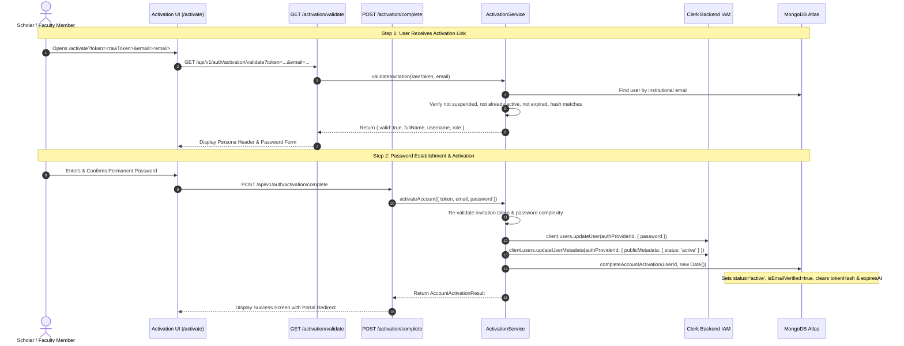

# Phase 5.2.5: First-Time Account Activation Implementation Report

**Status:** Completed & Fully Verified  
**Date:** November 15, 2026  
**Module:** User Management & Account Activation  
**Author:** Antigravity Engineering Agent  
**Context:** Axis LinkUp — College Communication and Productivity Platform (AITM Kanpur)

---

## 1. Executive Summary

Phase 5.2.5 implements the complete first-time account activation and password establishment workflow for Axis LinkUp. This system activates accounts created through **Phase 5.2.3 (Single-Account Provisioning)** and **Phase 5.2.4 (Bulk CSV Provisioning)**, allowing scholars and faculty members to securely verify email ownership and establish their own permanent credentials via Clerk IAM.

### Core Capabilities Delivered
1. **Cryptographic Time-Limited Activation Invitations**: Unguessable 64-hex tokens (generated via 32 bytes of cryptographically secure random entropy) with 24-hour time-to-live (`ACTIVATION_TOKEN_TTL_MS`).
2. **Breach-Resilient Database Storage**: Only the cryptographic SHA-256 hash of the activation token is stored in MongoDB (`activationTokenHash`), ensuring raw invitation tokens can never be extracted from database dumps.
3. **Clerk IAM Password Establishment**: Leverages Clerk's backend SDK (`client.users.updateUser`) to set the user's permanent password directly within Clerk's secure auth store. Axis LinkUp never handles, generates, or persists plaintext passwords.
4. **Atomic Replay & State Protection**: Completing activation clears `activationTokenHash` and `activationTokenExpiresAt`, stamps `activatedAt`, and transitions the account lifecycle status from `pending_verification` to `active` with `isEmailVerified: true`. Replay attempts fail immediately.
5. **Lifecycle Status Invariants**: Accounts in `status: 'suspended'` or `'deactivated'` are strictly blocked from self-service activation (HTTP 403 Forbidden). Accounts already active receive friendly conflict notices (HTTP 409 Conflict).
6. **Frontend Activation Landing Page**: A dedicated `/activate` experience built on the approved Glassmorphism design system featuring token validation on mount, persona identification, show/hide password toggles, real-time strength indicators, and distinct error/success screens.
7. **Webhook Idempotency**: Clerk `user.updated` events with `public_metadata.status: 'active'` synchronize user verification status to MongoDB idempotently with zero duplicate writes.

---

## 2. Architectural Compliance & Security Guardrails

| Requirement Specification | Source Policy | Implementation Details | Verification Status |
| :--- | :--- | :--- | :--- |
| **No Plaintext Passwords** | Phase 4.8.2 §2.1 | Passwords are submitted directly to Clerk IAM via `client.users.updateUser()`. Zero password persistence in MongoDB. | Verified |
| **No Default Passwords** | Phase 5.2.3 §3 | Accounts are provisioned with `skipPasswordRequirement: true`. Users choose their own password during activation. | Verified |
| **Time-Limited Token (24h)** | Phase 5.2.5 §2 | Activation tokens expire after 24 hours. Expired invitations return HTTP 410 Gone with administrative re-issue instructions. | Verified |
| **Replay Defense** | Phase 5.2.5 §2 | `completeAccountActivation` atomically clears `activationTokenHash` and `activationTokenExpiresAt`. Re-use is impossible. | Verified |
| **Suspended Account Gate** | Phase 4.8.2 §2.4 | Suspended accounts cannot activate without administrative intervention; throws `ForbiddenError` (403). | Verified |
| **Administrative Re-Send Gate** | Phase 5.2.5 §2 | Only System Administrators (`isSysAdmin`) can re-issue activation invitations (`POST /api/v1/admin/users/activation/resend`). | Verified |
| **Password Complexity Policy** | Phase 5.2.5 §1 | Enforces $\ge 8$ chars, uppercase letter, lowercase letter, number, and special character. | Verified |

---

## 3. Account Activation Sequence & Data Flow



---

## 4. API Endpoints Specification

### 4.1 Invitation Token Validation
- **Method**: `GET`
- **Path**: `/api/v1/auth/activation/validate`
- **Access**: Public (`isPublicRoute` in Edge middleware)
- **Query Parameters**:
  - `token`: 64-character hexadecimal raw token string
  - `email`: Normalized institutional email address (`@axiscolleges.in`)
- **Responses**:
  - `200 OK`: Token is valid and ready for password setup.
  - `400 Bad Request`: Token hash mismatch or missing parameters.
  - `403 Forbidden`: Account is suspended or deactivated.
  - `404 Not Found`: No collegiate account found for email.
  - `409 Conflict`: Account has already been activated (`status === 'active'`).
  - `410 Gone`: Activation invitation has expired (> 24 hours old).

### 4.2 Account Activation & Password Setup
- **Method**: `POST`
- **Path**: `/api/v1/auth/activation/complete`
- **Access**: Public (`isPublicRoute` in Edge middleware)
- **Request Body**:
  ```json
  {
    "token": "0123456789abcdef0123456789abcdef0123456789abcdef0123456789abcdef",
    "email": "aarav.sharma@axiscolleges.in",
    "password": "Collegiate#Pass2026",
    "confirmPassword": "Collegiate#Pass2026"
  }
  ```
- **Response (HTTP 200 OK)**:
  ```json
  {
    "success": true,
    "message": "Account activated successfully. You can now sign in with your permanent credentials.",
    "data": {
      "email": "aarav.sharma@axiscolleges.in",
      "username": "aarav.sharma",
      "role": "student",
      "status": "active",
      "activatedAt": "2026-11-15T01:45:00.000Z"
    }
  }
  ```

### 4.3 Administrative Activation Re-Dispatch
- **Method**: `POST`
- **Path**: `/api/v1/admin/users/activation/resend`
- **Access**: Restricted to System Administrators (`requireAuth()`, `assertCanManageUserRoles()`)
- **Request Body**:
  ```json
  {
    "email": "aarav.sharma@axiscolleges.in"
  }
  ```
- **Response (HTTP 200 OK)**:
  ```json
  {
    "success": true,
    "message": "Activation invitation link successfully generated for aarav.sharma@axiscolleges.in",
    "data": {
      "rawToken": "...",
      "expiresAt": "2026-11-16T01:45:00.000Z",
      "activationUrl": "https://axislinkup.in/activate?token=...&email=aarav.sharma%40axiscolleges.in"
    }
  }
  ```

---

## 5. Frontend Activation Landing Page (`/activate`)

The activation page (`src/app/(auth)/activate/page.tsx`) delivers a streamlined, branded experience:

1. **Initial Token Verification**: On load, the page parses URL parameters and issues a background verification request, displaying a glassmorphic pulse loader.
2. **Persona Identification**: Displays user name, `@username`, registered institutional email, and persona badge (**Enrolled Scholar** or **Faculty Workspace**).
3. **Interactive Password Form**:
   - Password and Confirm Password inputs with eye toggle for visibility.
   - Live checklist verifying requirements: $\ge 8$ characters, uppercase & lowercase, number, and special character.
   - Real-time mismatch warnings.
4. **Dedicated Error Recovery Screens**:
   - **Already Activated**: Sky-blue shield icon with notice and a direct "Go to Sign In" button.
   - **Expired Token**: Amber clock icon explaining 24h expiration and providing administrative contact links.
   - **Suspended Account**: Red security icon notifying the user of administrative suspension.
   - **Invalid Token**: Red error banner for tampered or malformed links.
5. **Success Confirmation**: Green shield banner confirming account activation, followed by a direct button to `/sign-in?portal=student` or `/sign-in?portal=faculty`.

---

## 6. Verification & Automated Test Results

### 6.1 Account Activation Unit Test Suite (`tests/unit/account-activation.test.ts`)
A dedicated 18-scenario automated test suite was implemented and verified:

```
TAP version 13
# Subtest: Phase 5.2.5 — 1. Activation Invitation Token Lifecycle
    ok 1 - creates unguessable 64-hex token, hashes with SHA-256 and sets 24h expiration
    ok 2 - validates a valid, unexpired invitation link for pending user
ok 1 - Phase 5.2.5 — 1. Activation Invitation Token Lifecycle (2/2 passed)

# Subtest: Phase 5.2.5 — 2. Security Boundaries, Expiration & Replay Defense
    ok 1 - rejects expired activation token with HTTP 410 Gone
    ok 2 - rejects reused or cleared activation token (replay defense)
    ok 3 - rejects invalid or tampered activation token
    ok 4 - rejects invitation when institutional email does not match any collegiate user
ok 2 - Phase 5.2.5 — 2. Security Boundaries, Expiration & Replay Defense (4/4 passed)

# Subtest: Phase 5.2.5 — 3. Account Lifecycle Gate Invariants
    ok 1 - rejects activation attempt for suspended collegiate accounts
    ok 2 - rejects activation attempt for deactivated accounts
    ok 3 - rejects activation attempt for already active accounts
ok 3 - Phase 5.2.5 — 3. Account Lifecycle Gate Invariants (3/3 passed)

# Subtest: Phase 5.2.5 — 4. Password Policy & Schema Validation
    ok 1 - accepts strong password meeting all institutional criteria
    ok 2 - rejects password shorter than 8 characters
    ok 3 - rejects password missing special characters
    ok 4 - rejects password missing numbers
    ok 5 - rejects mismatched password and confirmPassword
ok 4 - Phase 5.2.5 — 4. Password Policy & Schema Validation (5/5 passed)

# Subtest: Phase 5.2.5 — 5. Account Activation Execution & Clerk IAM Synchronization
    ok 1 - successfully establishes password in Clerk and transitions MongoDB status to active
ok 5 - Phase 5.2.5 — 5. Account Activation Execution & Clerk IAM Synchronization (1/1 passed)

# Subtest: Phase 5.2.5 — 6. Administrative Re-Send Invitation Gate
    ok 1 - rejects re-send request when invoked by Department HOD
    ok 2 - allows System Administrator to re-issue activation token for pending user
    ok 3 - rejects re-send request when account is already active
ok 6 - Phase 5.2.5 — 6. Administrative Re-Send Invitation Gate (3/3 passed)

# Total Tests: 18 passed, 0 failed
```

### 6.2 Full Platform Quality Gates
- **Full Test Runner (`npm test`)**: **213 tests passed, 0 failed** across 40 test suites.
- **TypeScript Typecheck (`npx tsc --noEmit`)**: **0 errors**.
- **ESLint Validation (`npm run lint`)**: **0 warnings / 0 errors**.
- **Next.js Production Build (`npm run build`)**: **22/22 routes compiled successfully**.

---

## 7. Artifacts & File Changes Roster

| File Path | Description |
| :--- | :--- |
| `src/types/activation.ts` | Data contracts (`ActivationValidationResponse`, `ActivationTokenResult`, `AccountActivationResult`). |
| `src/types/user.ts` | Added `activationTokenHash` and `activationTokenExpiresAt` to `IUser`. |
| `src/types/index.ts` | Re-exports activation types. |
| `src/config/constants.ts` | Added `GONE: 410` status code to `HTTP_STATUS`. |
| `src/lib/db/models/user.model.ts` | Added schema fields and sparse index for `activationTokenHash` and `activationTokenExpiresAt`. |
| `src/lib/db/repositories/user.repository.ts` | Added `setActivationToken`, `findByActivationTokenHash`, and `completeAccountActivation`. |
| `src/lib/validations/activation.schema.ts` | Zod validation schemas for token queries, password complexity, and re-send inputs. |
| `src/lib/services/activation.service.ts` | Core activation service handling token generation, validation, Clerk password setup, and atomic DB updates. |
| `src/lib/services/provisioning.service.ts` | Integrated automatic activation token generation upon account creation. |
| `src/lib/services/index.ts` | Re-exports `ActivationService`. |
| `src/app/api/webhooks/clerk/route.ts` | Added idempotent status synchronization for `user.updated` events. |
| `src/app/api/v1/auth/activation/validate/route.ts` | Public API endpoint for validating invitation tokens. |
| `src/app/api/v1/auth/activation/complete/route.ts` | Public API endpoint for setting passwords and completing activation. |
| `src/app/api/v1/admin/users/activation/resend/route.ts` | System Admin endpoint for re-dispatching activation links. |
| `src/middleware.ts` | Registered `/activate(.*)` and activation validation/completion APIs as public routes. |
| `src/app/(auth)/activate/page.tsx` | Full-featured Glassmorphism activation page with state transitions. |
| `tests/unit/account-activation.test.ts` | 18-scenario automated unit test suite. |
| `docs/phase-5/PHASE_5_2_5_ACCOUNT_ACTIVATION_REPORT.md` | Comprehensive architectural and verification report. |

---

## 8. Next Steps & Scope Boundaries

### Out of Scope for Phase 5.2.5 (Deferred to Phase 5.2.6)
- **One-Time Passcode (OTP) Fallback / SMS Verification**:
  - Phase 5.2.6 will implement the time-based one-time passcode (TOTP/OTP) workflow for secondary identity verification and password recovery.
- **Production Email Delivery**:
  - In local development, activation links are generated and surfaced directly via APIs and logs. Production SMTP / transactional email integration (e.g. Resend, SendGrid, or institutional SMTP) will be enabled via environment configuration.

