# Axis LinkUp — Phase 5.2.8: Frontend Integration & Account Lifecycle Verification Report

**Author:** Axis LinkUp Engineering Team  
**Date:** November 15, 2026  
**Status:** Completed & Fully Verified  
**Target Platform:** Axis Institute of Technology & Management (AITM), Kanpur  

---

## 1. Executive Summary

Phase 5.2.8 represents the culmination of **Phase 5.2: User Model, Clerk Identity, Account Provisioning, Activation, and Recovery**. Acting as a Senior Full-Stack Engineer and QA Architect, the engineering team has audited, connected, and verified the end-to-end authentication, identity provisioning, and account lifecycle architecture across the Next.js App Router frontend, edge middleware, REST API handlers, domain service layer, MongoDB Mongoose repositories, and Clerk IAM integration.

Every user journey has been verified against the approved **Phase 4.8 Design System** (collegiate deep navy `#0B192C`, crimson `#990000`, amber `#FFB200`, and glassmorphic elevated containers) and tested across **6 distinct collegiate personas**.

### Key Architectural Achievements:
1. **Zero-Trust RBAC Enforcement:** Strictly enforced administrative boundaries — only authorized `sys_admin` personas possess account provisioning privileges, while Department HODs and Institute Directors are prohibited from global account generation or privilege elevation.
2. **Dual-Identifier Universal Ingress:** Scholars, faculty, and administrators can sign in and initiate recovery using either their institutional email (`username@axiscolleges.in`) or unique normalized institutional username.
3. **Resilient Account Provisioning:** Supported both single-account UI provisioning and transactional bulk CSV provisioning with comprehensive Zod pre-validation, row-level error reporting, and Clerk/MongoDB rollback compensation.
4. **Hardened Multi-Step Account Activation:** Newly provisioned accounts are invited via cryptographically random 64-hex SHA-256 tokens and self-establish credentials via email OTP verification and Clerk IAM password setup.
5. **Anti-Enumeration Password Recovery:** Password recovery requests return a uniform generic notice regardless of identifier validity or account suspension status, neutralizing hostile user enumeration.
6. **Automated Session Revocation:** Changing or resetting passwords immediately queries Clerk IAM and terminates all active sessions across all devices.
7. **Edge Interception for Suspended Accounts:** Suspended scholars or faculty are blocked from accessing protected routes; web pages redirect to `/account-suspended` while API requests receive an RFC-compliant HTTP 403 `ACCOUNT_SUSPENDED` JSON envelope.

---

## 2. Comprehensive Audit of the 10 User Journeys

| # | User Journey | Frontend Component / Route | Target API Endpoint / Route Handler | Domain Services & IAM | Guard / Invariant | Status |
| :-: | :--- | :--- | :--- | :--- | :--- | :-: |
| **1** | **Role Selection** | `src/components/auth/role-selector.tsx`<br>`src/app/(auth)/sign-in/[[...sign-in]]/page.tsx` | N/A (Client-side role door navigation) | Next.js Navigation | Maps role parameters: `student`, `faculty`, `administration` | **Verified** |
| **2** | **Username / Email Login** | `src/components/auth/role-login-form.tsx`<br>`src/app/(auth)/sign-in/[[...sign-in]]/page.tsx` | Clerk IAM Sign-In Flow | Clerk Frontend SDK & Backend Webhook Sync | Dual-identifier resolution with zero secondary password store | **Verified** |
| **3** | **Admin Single-Account Provisioning** | `src/app/(admin)/admin/dashboard/components/admin-provisioning-card.tsx` | `POST /api/v1/admin/users/provision` | `ProvisioningService.provisionUser()` | `assertCanManageUserRoles()`, enforces `sys_admin` check | **Verified** |
| **4** | **Admin Bulk CSV Provisioning** | `src/app/(admin)/admin/dashboard/components/admin-bulk-provisioning.tsx` | `POST /api/v1/admin/users/bulk/preview`<br>`POST /api/v1/admin/users/bulk/provision`<br>`GET /api/v1/admin/users/bulk/template` | `BulkProvisioningService`, `ProvisioningService` | Pre-validation preview, 500-row cap, atomic row rollback | **Verified** |
| **5** | **First-Time Account Activation** | `src/app/(auth)/activate/page.tsx` | `POST /api/v1/auth/activation/validate`<br>`POST /api/v1/auth/activation/complete` | `ActivationService`, Clerk IAM | 24-hr token expiration, single-use SHA-256 token hashing | **Verified** |
| **6** | **Email OTP Verification** | `src/components/auth/otp-input.tsx` (Embedded in Activation & Recovery) | `POST /api/v1/auth/otp/request`<br>`POST /api/v1/auth/otp/verify`<br>`POST /api/v1/auth/otp/resend` | `OtpService`, `OtpRepository` | 5-min expiration, 60s resend cooldown, 5 brute-force attempt limit | **Verified** |
| **7** | **Forgot Password Ingress** | `src/app/(auth)/forgot-password/page.tsx`<br>`src/components/auth/role-login-form.tsx` | `POST /api/v1/auth/password-recovery/request` | `PasswordRecoveryService.requestRecovery()` | Constant-response generic notice; zero enumeration | **Verified** |
| **8** | **OTP Verification for Recovery** | `src/app/(auth)/forgot-password/page.tsx` (Step 2) | `POST /api/v1/auth/otp/verify` (`purpose='password_recovery'`) | `OtpService.verifyOtp()` | Issues 15-min HMAC-SHA256 `verificationProofToken` | **Verified** |
| **9** | **Password Reset & Re-Auth** | `src/app/(auth)/forgot-password/page.tsx` (Step 3 & 4) | `POST /api/v1/auth/password-recovery/reset` | `PasswordRecoveryService.resetPassword()`, Clerk IAM | Proof signature check, proof consumption, session revocation | **Verified** |
| **10** | **Suspended Account Restriction** | `src/app/(auth)/account-suspended/page.tsx`<br>`src/middleware.ts` | Edge Middleware Interception (Pages & APIs) | Clerk Session Token + MongoDB User Status | Redirects UI to `/account-suspended`; APIs return 403 JSON | **Verified** |

---

## 3. Collegiate Persona Verification Matrix

Six collegiate personas were exercised across all security gates and account lifecycle workflows:

| Persona | Role / Sub-Role | Identifier | Scope & Capabilities | Enforced Boundary Outcome |
| :--- | :--- | :--- | :--- | :--- |
| **Dr. Vivek Shukla** | `super_admin`<br>(`sys_admin`) | `admin.shukla@axiscolleges.in`<br>(`admin.shukla`) | Global collegiate administrator; manages system configuration and provisioning. | Provisioning authorized. Can generate single and bulk student/faculty accounts. |
| **Prof. Rajesh Verma** | `admin`<br>(`hod`) | `hod.cse@axiscolleges.in`<br>(`hod.cse`) | Head of Department (Computer Science & Engineering); manages departmental assets. | Provisioning **blocked** (`HTTP 403 ForbiddenError`). Restricted to departmental oversight. |
| **Dr. Amitabh Saxena** | `super_admin`<br>(`director`) | `director@axiscolleges.in`<br>(`director.saxena`) | Institutional Director; executive oversight and analytical dashboards. | Provisioning **blocked** (`HTTP 403 ForbiddenError`). Account management reserved for `sys_admin`. |
| **Dr. Sunita Rao** | `faculty` | `sunita.rao@axiscolleges.in`<br>(`sunita.rao`) | Assistant Professor (CSE); manages courses, attendance, notices. | Can log in, activate account, reset password; cannot access administration APIs. |
| **Aarav Sharma** | `student` | `aarav.sharma@axiscolleges.in`<br>(`aarav.sharma`) | Undergrad Scholar (CSE 3rd Sem); accesses portal, groups, complaints. | Can log in, complete self-activation, verify email OTP, reset password. |
| **Rohan Gupta** | `student`<br>(`suspended`) | `rohan.gupta@axiscolleges.in`<br>(`rohan.gupta`) | Suspended scholar due to disciplinary or administrative hold. | All protected route access intercepted; recovery returns generic notice without OTP; APIs return 403. |

---

## 4. Architectural Data Flow & Verification Pipeline

```mermaid
sequenceDiagram
    autonumber
    actor Admin as Sys Admin (Vivek Shukla)
    actor Student as Scholar (Aarav Sharma)
    participant UI as Axis LinkUp Frontend
    participant Mid as Edge Middleware
    participant API as App Router APIs
    participant Svc as Domain Services
    participant DB as MongoDB Atlas
    participant Clerk as Clerk IAM SDK

    %% Journey 3 & 4: Provisioning
    rect rgb(15, 23, 42)
        Note over Admin, Clerk: 1. Provisioning Lifecycle (Phase 5.2.3 / 5.2.4)
        Admin->>UI: Enter student details or upload CSV
        UI->>API: POST /api/v1/admin/users/provision
        API->>Svc: ProvisioningService.provisionUser()
        Svc->>Svc: assertCanManageUserRoles(adminSession)
        Svc->>Clerk: client.users.createUser(email, username)
        Svc->>DB: User.create({ status: 'pending_verification' })
        Svc-->>UI: 201 Created (User DTO)
    end

    %% Journey 5 & 6: First-Time Activation
    rect rgb(30, 41, 59)
        Note over Student, Clerk: 2. First-Time Activation Lifecycle (Phase 5.2.5 / 5.2.6)
        Student->>UI: Visit /activate?token=...&email=...
        UI->>API: POST /api/v1/auth/activation/validate
        API->>Svc: ActivationService.validateInvitationToken()
        Svc-->>UI: Token valid, request Email OTP
        Student->>UI: Submit 6-digit Email OTP
        UI->>API: POST /api/v1/auth/otp/verify
        API->>Svc: OtpService.verifyOtp()
        Svc-->>UI: OTP verified, issue verificationProofToken
        Student->>UI: Submit new password + proofToken
        UI->>API: POST /api/v1/auth/activation/complete
        API->>Clerk: client.users.updateUser(password)
        API->>DB: User.updateOne({ status: 'active', isEmailVerified: true })
        API-->>UI: 200 OK (Account Activated)
    end

    %% Journey 7, 8 & 9: Password Recovery
    rect rgb(15, 23, 42)
        Note over Student, Clerk: 3. Password Recovery Lifecycle (Phase 5.2.7)
        Student->>UI: /forgot-password -> Enter username/email
        UI->>API: POST /api/v1/auth/password-recovery/request
        API->>Svc: PasswordRecoveryService.requestRecovery()
        Note over Svc: Anti-Enumeration: generic notice returned
        Svc->>Svc: OtpService.requestOtp(purpose='password_recovery')
        Student->>UI: Enter OTP -> Receive verificationProofToken
        Student->>UI: Submit new password + proofToken
        UI->>API: POST /api/v1/auth/password-recovery/reset
        API->>Clerk: client.users.updateUser(password)
        API->>Clerk: client.sessions.revokeSession() [All active sessions]
        API->>DB: Otp.updateOne({ isProofConsumed: true })
        API-->>UI: 200 OK -> Redirect to /sign-in
    end

    %% Journey 10: Suspended Account
    rect rgb(30, 41, 59)
        Note over Student, Mid: 4. Suspended Account Ingress Gate
        Student->>Mid: Navigate to /student/dashboard
        Mid->>DB: Check session status === 'suspended'
        Mid-->>Student: 307 Redirect to /account-suspended
        Student->>Mid: Call /api/v1/users/me
        Mid-->>Student: 403 Forbidden { code: 'ACCOUNT_SUSPENDED' }
    end
```



---

## 5. Security Audit Findings & Fixes Applied

During the comprehensive audit in Phase 5.2.8, the following three architectural security vectors were identified and remediated:

### 5.1 Account Status Enumeration in Password Recovery
- **Issue:** Previously, `PasswordRecoveryService.requestRecovery()` threw an explicit `ForbiddenError` (HTTP 403) with a message indicating the account was suspended or deactivated. While descriptive, this allowed an unauthenticated attacker to probe whether an institutional email or username existed and discern its disciplinary status.
- **Remediation:** Updated `PasswordRecoveryService.requestRecovery()` to return the standard `GENERIC_REQUEST_NOTICE` without disclosing account existence or status, and suppressed OTP email dispatch for non-active accounts. This preserves strict zero-trust anti-enumeration defense.
- **Affected File:** `src/lib/services/password-recovery.service.ts`

### 5.2 Edge Middleware Ingress for Suspended API Calls
- **Issue:** In `src/middleware.ts`, when a user with `status === 'suspended'` made an API request (e.g. `/api/v1/...`), the middleware issued an HTTP 307 redirect to `/account-suspended`. For programmatic REST consumers and frontend fetch handlers, receiving an HTML redirect instead of an HTTP 403 JSON envelope broke error-handling contracts.
- **Remediation:** Added explicit route inspection in `src/middleware.ts`. For all paths beginning with `/api/`, the middleware now directly intercepts suspended requests and returns an RFC 7807/standard collegiate JSON response:
  ```json
  {
    "status": 403,
    "error": {
      "code": "ACCOUNT_SUSPENDED",
      "message": "Your collegiate account has been suspended. Please contact the Office of Academic Affairs or Systems Administration."
    }
  }
  ```
- **Affected File:** `src/middleware.ts`

### 5.3 RBAC Administrative Hierarchy Enforcement
- **Issue:** Phase 5.2.1 established administrative sub-roles (`sys_admin`, `hod`, `director`). Under institutional governance, only `sys_admin` is authorized to provision accounts and perform bulk imports.
- **Verification:** Verified that `canManageUserRoles()` in `src/lib/auth/rbac.ts` enforces `session.role === 'super_admin' && session.adminSubRole === 'sys_admin'`. Tested that HODs and Directors attempting to provision accounts receive HTTP 403 `ForbiddenError`, pre-empting horizontal or vertical privilege escalation.
- **Affected Files:** `src/lib/auth/rbac.ts`, `src/lib/services/provisioning.service.ts`, `src/lib/services/bulk-provisioning.service.ts`

---

## 6. Comprehensive Verification Results

### 6.1 TypeScript Strict Compilation (`npx tsc --noEmit`)
- **Status:** **PASS (0 Errors)**
- **Verification:** Executed strict TypeScript compile across all App Router routes, components, lib services, repositories, and test fixtures.

### 6.2 ESLint Code Quality (`npm run lint`)
- **Status:** **PASS (0 Warnings, 0 Errors)**
- **Verification:** Verified code formatting, import order, React hook dependencies, and strict type constraints across the entire codebase.

### 6.3 Next.js Production Build (`npm run build`)
- **Status:** **PASS (Exit code 0)**
- **Verification:** Successfully compiled and optimized all 23 static and dynamic routes:
  - Prerendered Static Content: `/`, `/account-suspended`, `/activate`, `/forgot-password`, `/pending-approval`, `/unauthorized`, `/ui-preview`
  - Dynamic App Router APIs:
    - `/api/v1/admin/users/provision`
    - `/api/v1/admin/users/bulk/preview`
    - `/api/v1/admin/users/bulk/provision`
    - `/api/v1/admin/users/bulk/template`
    - `/api/v1/admin/users/activation/resend`
    - `/api/v1/auth/activation/validate`
    - `/api/v1/auth/activation/complete`
    - `/api/v1/auth/otp/request`
    - `/api/v1/auth/otp/verify`
    - `/api/v1/auth/otp/resend`
    - `/api/v1/auth/password-recovery/request`
    - `/api/v1/auth/password-recovery/reset`
    - `/api/webhooks/clerk`
  - Shared First Load JS: 103 kB.
  - Edge Middleware: 93.3 kB.

### 6.4 Automated Test Suite Execution (`npm test`)
- **Status:** **PASS (258 / 258 Tests, 92 Suites, 0 Failures)**
- **Duration:** 27.1 seconds
- **Key Test Suites Covering Phase 5.2:**
  - `tests/unit/account-lifecycle-integration.test.ts` (12 integration tests across all 6 personas and 10 journeys)
  - `tests/unit/password-recovery.test.ts` (15 unit tests)
  - `tests/unit/email-otp.test.ts` (20 unit tests)
  - `tests/unit/account-activation.test.ts` (19 unit tests)
  - `tests/unit/bulk-provisioning.test.ts` (28 unit tests)
  - `tests/unit/provisioning.test.ts` (22 unit tests)
  - `tests/unit/clerk-identity-integration.test.ts` (14 unit tests)
  - `tests/unit/user-model.test.ts` (24 unit tests)

---

## 7. Operational & Manual Configuration Checklist

The following items have been fully tested with mock infrastructure and require runtime environment secrets during deployment to staging and production:

1. **Clerk Dashboard Configuration:**
   - [x] Enable username sign-in alongside institutional email under **User & Authentication > Email, Phone, and Username**.
   - [x] Ensure Password Setup is enabled for user authentication.
   - [ ] Configure the production Clerk Webhook endpoint (`https://axislinkup.axiscolleges.in/api/webhooks/clerk`) subscribed to `user.created`, `user.updated`, and `user.deleted`.
   - [ ] Set `CLERK_WEBHOOK_SECRET` in `.env.production`.

2. **Email Delivery Provider (SMTP / Resend):**
   - [x] Abstracted via `EmailService` with fallback to console logging in development and test environments.
   - [ ] Provision production SMTP credentials or Resend API key (`RESEND_API_KEY`) for high-deliverability transactional OTP and invitation dispatch to `@axiscolleges.in` mailboxes.

3. **MongoDB Production Indexes:**
   - [x] `UserSchema.index({ username: 1 }, { unique: true, sparse: true })`
   - [x] `UserSchema.index({ email: 1 }, { unique: true })`
   - [x] `OtpSchema.index({ expiresAt: 1 }, { expireAfterSeconds: 0 })` (TTL automated index)
   - [x] `OtpSchema.index({ proofTokenHash: 1 }, { sparse: true })`

---

## 8. Final Sign-off & Recommendations

With the successful completion of **Phase 5.2.8**, the complete Phase 5.2 milestone (**User Model, Clerk Identity, Account Provisioning, Activation, and Recovery**) is formally complete, robustly tested, and fully aligned with institutional requirements.

The architecture is prepared for **Phase 5.3: Core Profile Management & Academic Entity Synchronization**.

