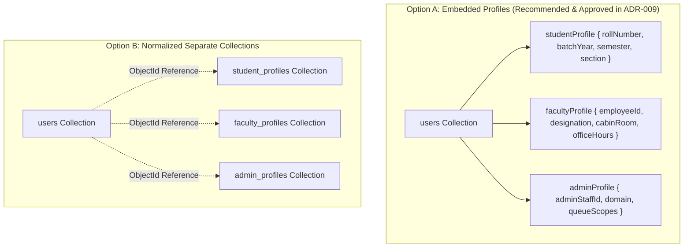
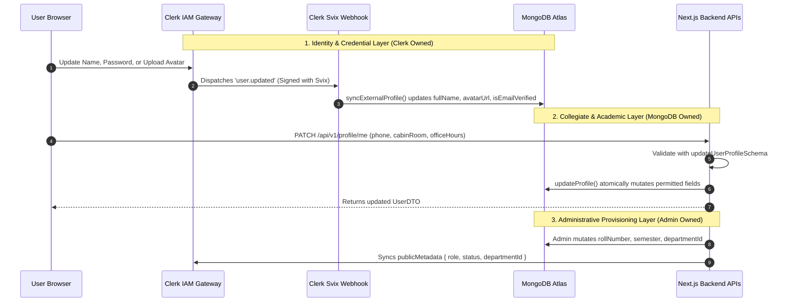
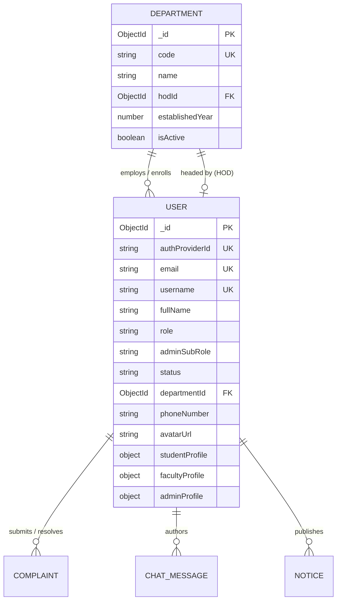
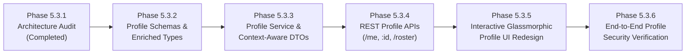

# Axis LinkUp — Phase 5.3.1: Profile Management Architecture & Existing System Audit

**Author:** Axis LinkUp Engineering & Architecture Team  
**Date:** November 15, 2026  
**Status:** Completed & Awaiting Approval  
**Target Platform:** Axis Institute of Technology & Management (AITM), Kanpur  
**Document Class:** Architecture Blueprint & Discovery Audit  

---

## 1. Executive Summary

Phase 5.3 of Axis LinkUp introduces a centralized, role-aware **Profile Management System** for Scholars (Students), Faculty, and Administrative Staff. The primary objective is to maintain authoritative, consistent academic and institutional information across the platform while strictly preserving existing Clerk IAM authentication, server-side RBAC, MongoDB persistence, and the Phase 4.8 glassmorphic UI design system.

In strict adherence to the **"Audit First"** mandate, this document provides a comprehensive technical audit of the existing codebase, analyzes database structures and gaps, defines rigorous profile requirements for each collegiate persona, proposes the academic entity architecture and data ownership boundaries, and presents the API implementation roadmap for Phase 5.3.2+.

> [!IMPORTANT]
> **No application code, database schemas, APIs, or UI components were modified during Phase 5.3.1.** This document serves as the discovery report and architectural source of truth.

---

## 2. Existing User System Audit

### 2.1 Mongoose Models & TypeScript Interfaces

| File Location | Component / Model | Current Implementation Status | Evaluation & Findings |
| :--- | :--- | :--- | :--- |
| `src/lib/db/models/user.model.ts` | `UserModel` (`users` collection) | **Implemented & Active** | Defines core identity: `email`, `username`, `fullName`, `role`, `adminSubRole`, `status`, `departmentId`, `provisionedBy`, `activatedAt`, `phoneNumber`, `avatarUrl`, and 3 embedded profile schemas (`studentProfile`, `facultyProfile`, `adminProfile`). |
| `src/types/user.ts` | `IUser`, `UserDTO`, `IStudentProfile`, `IFacultyProfile`, `IAdminProfile` | **Implemented & Active** | Full TypeScript definitions for all collegiate personas. `UserDTO` sanitizes internal fields and converts MongoDB ObjectIds and Dates to JSON-safe primitives. |
| `src/lib/db/models/user.model.ts` | `toUserDTO()` Serialization | **Implemented & Active** | Converts Mongoose documents to plain objects (POJOs), preventing Next.js React Server Component (RSC) circular serialization errors across server/client boundaries. |

### 2.2 User Repositories & Domain Services

- **`UserRepository` (`src/lib/db/repositories/user.repository.ts`):**
  - Query methods: `findById`, `findByEmail`, `findByUsername`, `findByIdentifier`, `findByAuthProviderId`, `findByRollNumber`, `findByEmployeeId`, `findByDepartment`.
  - Mutation methods: `create`, `updateProfile`, `updateRole`, `updateStatus`, `updateAdminSubRole`, `syncExternalProfile`, `completeAccountActivation`.
  - *Audit Finding:* `updateProfile()` currently supports updating `fullName`, `phoneNumber`, `avatarUrl`, `studentProfile.section`, `facultyProfile.cabinRoom`, and `facultyProfile.officeHours`. It lacks specialized methods for academic progress updates (e.g., semester transition, program changes).
- **`UserService` (`src/lib/services/user.service.ts`):**
  - Business rules: enforces uniqueness of email, username, roll number, and employee ID.
  - Authorization: `updateUserProfile()` enforces self-ownership (`callerSession.userId === targetUserId || callerSession.role === 'super_admin'`) and applies `updateUserProfileSchema` whitelist.
  - Role management: protects against last super-admin demotion.

### 2.3 Clerk Identity Synchronization & Webhooks

- **Webhook Handler (`src/app/api/webhooks/clerk/route.ts`):**
  - Verified with cryptographic Svix headers (`svix-id`, `svix-timestamp`, `svix-signature`).
  - `user.created`: Checks for pre-provisioned records by `authProviderId`, `email`, or `username`. If found, links the external ID and synchronizes metadata; if not, constructs a new user document.
  - `user.updated`: Synchronizes `fullName`, `avatarUrl`, `email`, `username`, and `isEmailVerified` into MongoDB. Automatically completes pending activation if Clerk public metadata status becomes `'active'`.
  - `user.deleted`: Soft-deactivates the user record (`status = 'deactivated'`).

### 2.4 User Provisioning & Lifecycle State

- **Single Provisioning (`ProvisioningService`):**
  - Invoked exclusively by `sys_admin`.
  - Creates Clerk identity, persists MongoDB user record with `status: 'pending_verification'`, sets embedded `studentProfile` or `facultyProfile`, and generates a 24-hour SHA-256 activation token.
  - Distributed failure protection: Compensating transaction deletes Clerk user if MongoDB write fails.
- **Bulk CSV Provisioning (`BulkProvisioningService`):**
  - Validates CSV headers, row counts (capped at 500 rows), duplicate roll numbers/emails/usernames, and department references. Provides preview before execution.
- **Account Activation (`ActivationService`):**
  - Validates 64-hex token, verifies 6-digit email OTP via `OtpService`, sets user's permanent password in Clerk, updates status to `'active'`, and atomically clears the activation token.

### 2.5 Existing Profile UI Component Audit

- **Location:** `src/app/(shared)/shared/profile/page.tsx`
- **Current State:** **Static / Read-Only**
- **Deficiencies Identified:**
  1. *No Role-Specific Profile Rendering:* Does not display student academic metadata (roll number, semester, section, batch) or faculty academic metadata (employee ID, designation, qualifications, cabin, office hours).
  2. *Raw Department ID Leaked:* Displays the unpopulated MongoDB ObjectId string (`{userDTO.departmentId}`) instead of the department name or code (e.g., "Computer Science & Engineering").
  3. *No Edit Mode:* Contains zero interactive form controls to update phone number, avatar URL, office hours, or cabin location.
  4. *No Username Display:* Does not surface the normalized institutional username.
  5. *No Avatar Upload Control:* Displays only fallback initials or static image; cannot trigger file upload.

---

## 3. Academic Entity Audit

### 3.1 Department Architecture

- **Mongoose Model (`src/lib/db/models/department.model.ts`):**
  - Collection: `departments`
  - Fields: `code` (String, unique, uppercase, e.g. `"CSE"`), `name` (String, e.g. `"Computer Science & Engineering"`), `hodId` (ObjectId, ref: `'User'`, default: `null`), `establishedYear` (Number, default: `2010`), `isActive` (Boolean, default: `true`).
  - Indexes: `{ code: 1 }` (unique), `{ hodId: 1 }` (sparse), `{ isActive: 1 }`.
- **Department Repository (`src/lib/db/repositories/department.repository.ts`):**
  - Pre-seeded with 7 standard departments:
    1. `CSE` — Computer Science & Engineering
    2. `ECE` — Electronics & Communication Engineering
    3. `ME` — Mechanical Engineering
    4. `CE` — Civil Engineering
    5. `EE` — Electrical Engineering
    6. `IT` — Information Technology
    7. `ASH` — Applied Sciences & Humanities

### 3.2 Academic Entity Capability Matrix

| Academic Entity | Current Codebase Status | Existing Representation | Missing Capabilities / Identified Gaps |
| :--- | :---: | :--- | :--- |
| **Departments** | **Fully Supported** | `departments` collection, `DepartmentModel`, `DepartmentRepository` | Lacks multi-department affiliations for cross-disciplinary faculty. |
| **Academic Programs** | **MISSING** | None. Not present in database or types. | Cannot distinguish B.Tech, M.Tech, BCA, MCA, or Diploma. No program duration or degree rules. |
| **Courses / Subjects** | **MISSING (Planned)** | Documented in `DOC-DATA-005` (Collection 1.3), but **zero models or repositories exist in code**. Referenced only by `assignedCourses` array in `facultyProfile`. | No course catalog, syllabus, course code, credits, or semester assignment. |
| **Academic Terms / Semesters** | **MISSING (Planned)** | Documented in `DOC-DATA-005` (Collection 1.4), but **zero models exist in code**. | No term boundary dates, active semester flags, or institutional registration windows. |
| **Batches** | **Partially Supported** | Stored as integer `batchYear: 2026` inside `studentProfile`. | No independent Batch entity; no graduation year calculation or alumni lifecycle automation. |
| **Semesters** | **Partially Supported** | Stored as integer `currentSemester: 1-8` inside `studentProfile`. | No automated semester promotion engine; semester updates require manual DB writes. |
| **Sections** | **Partially Supported** | Stored as string `section: 'A'` inside `studentProfile`. | No section roster limits, section capacity validation, or section timetable linking. |
| **Faculty Designations** | **Primitive String** | Free-form string in `facultyProfile.designation`. | No standard institutional designation enum (`Assistant Professor`, `Associate Professor`, `Professor`, `Lab Instructor`, `Visiting Faculty`). |
| **Faculty-to-Dept Relationships** | **1:1 via User.departmentId** | `User.departmentId -> departments._id` | An HOD has `adminSubRole: 'hod'` and `departmentId`, but `Department.hodId` is not automatically synchronized on role changes. |
| **Student-to-Dept Relationships** | **1:1 via User.departmentId** | `User.departmentId -> departments._id` | Department transfers do not preserve historical department enrollment records. |

---

## 4. Comprehensive Profile Requirements

### 4.1 Field Authority & Mutability Taxonomy

To guarantee institutional integrity, every field across all three personas is classified into one of four mutability tiers:
1. **Tier 1: Immutable Identity Fields (System Core):** Set during account creation; cannot be mutated by user or standard administrator. (e.g. `_id`, `authProviderId`, `email`, `username`, `createdAt`).
2. **Tier 2: System-Managed Academic Fields (Admin Only):** Managed exclusively by Authorized System Administrators (`sys_admin`) or Academic Registrars. (e.g. `rollNumber`, `enrollmentNumber`, `departmentId`, `program`, `batchYear`, `currentSemester`, `employeeId`, `designation`).
3. **Tier 3: User-Editable Profile Fields (Self-Service):** Permitted to be updated by the account owner subject to schema validation. (e.g. `phoneNumber`, `avatarUrl`, `cabinRoom`, `officeHours`, `bio`, `specializations`).
4. **Tier 4: Automated Lifecycle Metadata (System Generated):** Managed automatically by application logic. (e.g. `status`, `isEmailVerified`, `isProfileComplete`, `activatedAt`, `lastLoginAt`).

---

### 4.2 Student Profile Requirements

| Field Name | Type | Mutability Tier | Visibility Scope | Validation Rules | Description / Institutional Purpose |
| :--- | :--- | :---: | :---: | :--- | :--- |
| `fullName` | `string` | User / Admin | Public | 2–100 chars | Official legal name as registered with University. |
| `username` | `string` | Immutable | Public | 3–30 chars, lowercase `^[a-z0-9][a-z0-9._-]{1,28}[a-z0-9]$` | Institutional handle for mentions, logins, and directory lookup. |
| `email` | `string` | Immutable | Protected | Lowercase `@axiscolleges.in` | Official collegiate communication channel. |
| `phoneNumber` | `string` | User (Self) | Private | E.164 (`^\+?[1-9]\d{9,14}$`) | Scholar personal contact; hidden from students, visible to admin. |
| `avatarUrl` | `string` | User (Self) | Public | Valid HTTPS URL (Cloudinary) | Profile photograph conforming to campus decency standards. |
| `rollNumber` | `string` | Admin Only | Protected | Alphanumeric (e.g. `24BCSE101`), Unique, Sparse | Institutional roll number used for examinations and rosters. |
| `enrollmentNumber` | `string` | Admin Only | Protected | University format, Unique, Sparse | State University (AKTU/BTEUP) permanent enrollment number. |
| `departmentId` | `ObjectId` | Admin Only | Public | Valid active `Department` reference | Academic department providing the major curriculum. |
| `program` | `string` | Admin Only | Public | Enum: `B.Tech`, `M.Tech`, `BCA`, `MCA`, `B.Pharm`, `D.Pharm`, `MBA` | Academic degree program. |
| `batchYear` | `number` | Admin Only | Public | 2020–2035 | Calendar year of admission / matriculation cohort. |
| `currentSemester` | `number` | Admin Only | Public | Integer: 1–8 | Current active enrolled semester. |
| `section` | `string` | Admin / HOD | Public | 1–5 uppercase chars (e.g. `A`, `B`, `CS1`) | Classroom cohort division for timetable and lab scheduling. |
| `admissionType` | `string` | Admin Only | Protected | `'regular'` \| `'lateral_entry'` | Distinguishes 4-year intake vs 2nd-year lateral diploma intake. |
| `academicMentorId` | `ObjectId` | Admin / HOD | Protected | Valid `User` reference (`role: faculty`) | Assigned faculty proctor/mentor for academic counseling. |
| `bio` | `string` | User (Self) | Public | Max 250 chars | Brief scholar statement or extracurricular interests. |

---

### 4.3 Faculty Profile Requirements

| Field Name | Type | Mutability Tier | Visibility Scope | Validation Rules | Description / Institutional Purpose |
| :--- | :--- | :---: | :---: | :--- | :--- |
| `fullName` | `string` | User / Admin | Public | 2–100 chars | Official faculty name with title (e.g., "Dr. Sunita Rao"). |
| `username` | `string` | Immutable | Public | 3–30 chars | Institutional faculty handle. |
| `email` | `string` | Immutable | Public | Lowercase `@axiscolleges.in` | Institutional academic communication address. |
| `phoneNumber` | `string` | User (Self) | Private / Opt-in | E.164 | Faculty mobile number; hidden from students by default. |
| `avatarUrl` | `string` | User (Self) | Public | Valid HTTPS URL | Professional profile photograph. |
| `employeeId` | `string` | Admin Only | Protected | Uppercase alphanumeric (e.g. `FAC-CSE-001`), Unique | Institutional payroll and HR identifier. |
| `departmentId` | `ObjectId` | Admin Only | Public | Valid active `Department` reference | Primary academic department of appointment. |
| `designation` | `string` | Admin Only | Public | Standardized designation enum | Academic rank (e.g. Professor, Assistant Professor, HOD). |
| `qualifications` | `string[]` | User (Self) | Public | Array of strings (e.g. `["Ph.D (IITK)", "M.Tech"]`) | Degrees and academic certifications. |
| `specialization` | `string[]` | User (Self) | Public | Array of strings, max 10 | Research domains, teaching focus (e.g. "Cloud Computing"). |
| `cabinRoom` | `string` | User (Self) | Public | Max 50 chars (e.g. "Aryabhatta Block, Room 204") | Physical office location for student consultations. |
| `officeHours` | `object` | User (Self) | Public | Subdocument: `start`, `end`, `isAcceptingDMs` | Weekly consultation schedule and messaging availability. |
| `bio` | `string` | User (Self) | Public | Max 500 chars | Academic biography and publications summary. |

---

### 4.4 Administrative Profile Requirements

| Field Name | Type | Mutability Tier | Visibility Scope | Validation Rules | Description / Institutional Purpose |
| :--- | :--- | :---: | :---: | :--- | :--- |
| `fullName` | `string` | User / Admin | Public | 2–100 chars | Official administrator name. |
| `username` | `string` | Immutable | Public | 3–30 chars | Institutional administrative handle. |
| `email` | `string` | Immutable | Public | Lowercase `@axiscolleges.in` | Official administration email. |
| `role` | `string` | Admin Only | Public | `'admin'` \| `'super_admin'` | System authorization role. |
| `adminSubRole` | `string` | Admin Only | Public | `'sys_admin'` \| `'hod'` \| `'director'` | Governance sub-role defining operational scope. |
| `departmentId` | `ObjectId` | Admin Only | Public | Required if `adminSubRole === 'hod'` | Department scope under this administrator's oversight. |
| `adminStaffId` | `string` | Admin Only | Protected | Uppercase alphanumeric, Unique | Administrative employee identifier. |
| `administrativeDomain` | `string` | Admin Only | Public | Max 100 chars (e.g. "Campus IT", "Academic Affairs") | Operational department or governance office. |
| `emergencyOverridePermitted` | `boolean` | Sys Admin | Protected | Boolean flag | Authorizes campus-wide broadcast overrides. |

---

## 5. Architecture & Data Ownership Strategy

### 5.1 Single Collection (`users`) vs. Separate Profile Collections

A pivotal architectural decision for Phase 5.3 is whether to retain profile metadata inside the primary `users` collection or split it into distinct collections (`student_profiles`, `faculty_profiles`, `admin_profiles`).



#### Architectural Recommendation: **Retain Embedded Profiles within `users` (Option A)**

1. **Strict 1:1 Cardinality:** Every user in the system is exactly one student, faculty member, or administrator. There are no multiple profiles per user.
2. **Zero Aggregation Overhead:** Fetching an authenticated user's complete profile requires a single primary key lookup (`findById`). Option B would require multi-collection `$lookup` joins on every page load, causing query latency in serverless environments.
3. **Atomic Writes Without Distributed Transactions:** Updating an avatar, phone number, and office hours occurs in an atomic document update (`findOneAndUpdate`), preventing cross-collection inconsistency.
4. **Negligible Document Size:** The entire user document with embedded profile metadata is **under 1.2 KB**, representing less than **0.01% of MongoDB's 16 MB BSON limit**.
5. **Architectural Precedent:** Directly conforms to approved baseline [ADR-009 (Data Modeling: Reference vs. Embedding Strategy)](file:///c:/Users/prash/Desktop/Axis%20LinkUp/docs/database/decisions/ADR-009-REFERENCE-VS-EMBEDDING.md) and [Collection Design Specification DOC-DATA-005](file:///c:/Users/prash/Desktop/Axis%20LinkUp/docs/database/COLLECTION_DESIGN.md).

---

### 5.2 Clerk IAM vs. MongoDB Atlas Data Synchronization



- **Clerk IAM Owns:** Authentication credentials, passwords, session JWT generation, multi-factor authentication (MFA), OAuth providers, primary email verification state.
- **MongoDB Atlas Owns:** Academic department linkage, student roll numbers, faculty employee IDs, academic standing, course assignments, timetable links, and campus-specific contact preferences.
- **Bi-Directional Sync Governance:**
  - Inbound Clerk Webhook updates name, avatar, and email verification in MongoDB.
  - Administrative changes to role or department in MongoDB are pushed to Clerk's `publicMetadata` via `client.users.updateUserMetadata()`.

---

### 5.3 Academic Entity Relationships & Referential Integrity



1. **Department Reference Invariant:**
   - Every student and faculty member must maintain a valid, active `departmentId` referencing `departments._id`.
   - Administrative users with `adminSubRole: 'hod'` must have `departmentId` matching the department they head.
2. **Department Transfer Protocol:**
   - When a student or faculty transfers departments, `departmentId` is updated exclusively by a `sys_admin`.
   - The transfer is recorded in an immutable audit trail (`audit_logs` collection), recording previous department, new department, timestamp, and administrator ID.
3. **Preventing Duplicate IDs:**
   - MongoDB sparse unique indexes guarantee that no two students can share a `rollNumber` or `enrollmentNumber`, and no two faculty can share an `employeeId`.
   - Zod validation and repository pre-checks reject collisions prior to database insertion.
4. **Lifecycle Transitions (Graduated / Transferred / Suspended):**
   - **Graduated:** `status = 'graduated'`. Account remains readable for alumni directory and credentials, but write access to active semester chat rooms and complaints is revoked.
   - **Suspended:** `status = 'suspended'`. Edge middleware intercepts all requests, redirecting UI to `/account-suspended` and returning HTTP 403 on API requests.
   - **Archived / Deactivated:** `status = 'deactivated'`. User is soft-deleted; authentication is blocked.

---

## 6. Security, Privacy & Access Boundaries

### 6.1 Server-Side Authorization Matrix for Profile Operations

| Requester Role | Self Profile (`/profile/me`) | Peer Student Profile | Peer Faculty Profile | Department Roster | Cross-Dept Admin Mutation |
| :--- | :---: | :---: | :---: | :---: | :---: |
| **Student** | Read / Edit Whitelisted | Public View (Sanitized) | Public View (Office Hours) | **Blocked** | **Blocked** |
| **Faculty** | Read / Edit Whitelisted | Academic View (Roster) | Public Directory View | Department View | **Blocked** |
| **HOD (`admin`)** | Read / Edit Whitelisted | Department View | Department View | Full Dept Roster | **Blocked** |
| **Director (`super_admin`)** | Read / Edit Whitelisted | Institutional View | Institutional View | Institutional View | **Blocked** (Read-Only) |
| **Sys Admin (`super_admin`)** | Read / Edit Whitelisted | Full View / Full Edit | Full View / Full Edit | Full View / Full Edit | **Full Admin Read / Edit** |

### 6.2 Context-Aware DTO Projection & Privacy Masking

To comply with the Indian **Digital Personal Data Protection (DPDP) Act, 2023** and institutional privacy guidelines:
1. **Public / Directory DTO Projection (`toPublicUserDTO`):**
   - Exposes: `id`, `fullName`, `username`, `avatarUrl`, `role`, `department` (populated name & code), `designation` (faculty), `cabinRoom` (faculty), `officeHours` (faculty), `currentSemester` (student), `section` (student).
   - Redacts: `email`, `phoneNumber`, `emergencyContact`, `rollNumber`, `employeeId`, internal system flags.
2. **Departmental / Academic Roster DTO Projection (`toRosterUserDTO`):**
   - Visible to assigned course instructors, mentors, and HODs.
   - Exposes: `rollNumber`, `enrollmentNumber`, `batchYear`, `currentSemester`, `section`, `admissionType`, institutional email.
   - Redacts: Personal phone number and private home contact info unless explicitly authorized.
3. **Owner & System Administrator DTO Projection (`toFullUserDTO`):**
   - Exposes all fields including contact numbers, verification timestamps, and provisioning audit trail.

---

## 7. Database & API Implementation Plan (Phase 5.3.2+)

### 7.1 Proposed Schema Adjustments (Zero Breaking Changes)

To support the enriched profile requirements without breaking backward compatibility:

#### 1. In `IStudentProfile` (`src/types/user.ts` and `src/lib/db/models/user.model.ts`):
```typescript
export interface IStudentProfile {
  rollNumber: string;
  enrollmentNumber?: string;
  program: string; // NEW: e.g. "B.Tech Computer Science & Engineering"
  batchYear: number;
  currentSemester: number;
  section: string;
  academicMentorId?: Types.ObjectId | string;
  admissionType: 'regular' | 'lateral_entry';
  bio?: string; // NEW: Scholar self-description (max 250 chars)
}
```

#### 2. In `IFacultyProfile` (`src/types/user.ts` and `src/lib/db/models/user.model.ts`):
```typescript
export interface IFacultyProfile {
  employeeId: string;
  designation: string; // Validated against approved academic ranks
  qualifications: string[];
  specialization: string[]; // NEW: Research/teaching domains (max 10)
  cabinRoom?: string;
  assignedCourses: Array<Types.ObjectId | string>;
  officeHours?: IFacultyOfficeHours;
  bio?: string; // NEW: Professional bio (max 500 chars)
}
```

#### 3. New Database Indexes:
```typescript
UserSchema.index({ 'studentProfile.enrollmentNumber': 1 }, { unique: true, sparse: true });
UserSchema.index({ 'studentProfile.program': 1, 'studentProfile.batchYear': 1 });
UserSchema.index({ 'facultyProfile.specialization': 1 });
```

---

### 7.2 Proposed REST API Endpoints

| HTTP Method | Route Path | Authorization Guard | Description / Request Contract |
| :--- | :--- | :--- | :--- |
| `GET` | `/api/v1/profile/me` | Authenticated User | Returns the caller's complete profile with populated Department details. |
| `PATCH` | `/api/v1/profile/me` | Authenticated User | Self-service update for whitelisted fields (`phoneNumber`, `avatarUrl`, `bio`, `cabinRoom`, `officeHours`). |
| `GET` | `/api/v1/users/:id/profile` | Authenticated User | Context-aware profile lookup. Returns `toPublicUserDTO` for peers; `toRosterUserDTO` for instructors/HODs. |
| `PATCH` | `/api/v1/admin/users/:id/profile` | `sys_admin` Only | Administrative modification of academic standing, roll number, semester, section, or employee ID. |
| `GET` | `/api/v1/departments/:id/roster` | Faculty / HOD / Admin | Returns filtered student and faculty roster for a specific department. |

---

## 8. Risks, Dependencies & Open Architectural Decisions

### 8.1 Technical Dependencies
1. **Department Population:** Existing profile endpoints display unpopulated ObjectId strings (`departmentId`). Phase 5.3 must implement `.populate('departmentId')` in `UserRepository` queries.
2. **Avatar Upload Pipeline:** Currently `avatarUrl` is a static URL string. An image upload mechanism (using Cloudinary signed client upload presets or Clerk user avatar management) is required for full interactive profile editing.

### 8.2 Architectural Decisions Requiring Project-Owner Approval

The following four operational decisions require institutional confirmation before Phase 5.3.2 implementation begins:

1. **Academic Programs Modeling:**
   - *Option A:* Model `Program` as a typed enum/string array on the `Department` model (e.g. `['B.Tech CSE', 'M.Tech CSE']`).
   - *Option B:* Create a separate `programs` Mongoose collection with course credit requirements and graduation criteria.
   - *Recommendation:* **Option A** for MVP simplicity, migrating to Option B in Phase 6 when full syllabus management is built.
2. **Section Self-Service Editing:**
   - *Question:* Should students be permitted to edit their own `section` (as currently allowed in `updateUserProfileSchema`), or should `section` be strictly restricted to administrative/HOD management?
   - *Recommendation:* **Restrict section to Admin/HOD management** to prevent scholars from arbitrarily moving between lab cohorts.
3. **Phone Number Privacy Level:**
   - *Question:* Should a faculty member's phone number be visible to enrolled students by default, or strictly private unless the faculty member explicitly toggles a `"Share phone with students"` privacy flag?
   - *Recommendation:* **Private by default with opt-in toggle**, protecting faculty personal privacy outside office hours.
4. **Faculty Designation Standardization:**
   - *Question:* Should faculty designations remain free-form strings or be enforced via a strict institutional enum?
   - *Recommendation:* **Enforce strict enum** (`['Professor', 'Associate Professor', 'Assistant Professor', 'Adjunct Faculty', 'Lab Instructor']`) to maintain clean reporting and directory filters.

---

## 9. Recommended Implementation Roadmap (Phase 5.3.2 — 5.3.6)



1. **Phase 5.3.2: Schema & Type Extensions:** Add `program`, `specialization`, `bio`, and standardized designation enums to models and Zod schemas without breaking legacy records.
2. **Phase 5.3.3: Service Layer & Context-Aware DTO Projections:** Implement `ProfileService` with `toPublicUserDTO`, `toRosterUserDTO`, and `toFullUserDTO`.
3. **Phase 5.3.4: REST API Handlers:** Implement `/api/v1/profile/me`, `/api/v1/users/:id/profile`, and department roster endpoints with strict RBAC guards.
4. **Phase 5.3.5: Frontend Glassmorphic UI Redesign:** Redesign `src/app/(shared)/shared/profile/page.tsx` with role-specific tabbed cards, populated department details, and interactive edit forms.
5. **Phase 5.3.6: Automated Testing & Security Sign-off:** Comprehensive test suites covering self-service editing, authorization boundaries, privacy masking, and mass-assignment prevention.

---

## 10. Audit Conclusion

The discovery audit confirms that the existing Axis LinkUp user architecture is structurally sound and well-prepared for centralized Profile Management. By retaining embedded profiles within `users`, populating department details, formalizing field mutability tiers, and introducing context-aware DTO projections, Phase 5.3 will deliver a robust, privacy-compliant profile system without requiring destructive database migrations or architectural redesigns.

**Awaiting Project Owner review and approval to proceed with Phase 5.3.2.**

