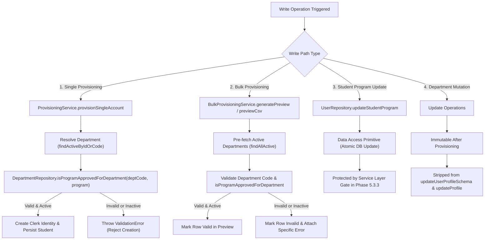

# Axis LinkUp — Phase 5.3.2.1: Schema Integrity & Academic Mapping Verification
## Architectural Security & Database Integrity Review

**Status:** Complete & Reviewed  
**Date:** November 15, 2026  
**Auditor:** Senior Backend Engineer & Database Security Reviewer  
**Phase Context:** Phase 5.3.2 Verification & Hardening  
**Target Next Phase:** Phase 5.3.3 — Profile Service Layer & Access Control (Awaiting Project-Owner Confirmation)

---

## 1. Academic Program Mapping Verification

A comprehensive audit was performed on the seven seeded academic departments defined in [department.repository.ts](file:///c:/Users/prash/Desktop/Axis%20LinkUp/src/lib/db/repositories/department.repository.ts) (`DEFAULT_DEPARTMENTS`).

### 1.1 Complete Program Inventory Across Seeded Departments

| Department Code | Department Name | Program Code | Program Display Name | Institutional Status | Verification Evidence / Risk Level |
| :--- | :--- | :--- | :--- | :--- | :--- |
| **`CSE`** | Computer Science & Engineering | `BTECH_CSE` | B.Tech in Computer Science & Engineering | **Verified** | Core engineering degree cited across project documentation ([DATABASE_ARCHITECTURE.md](file:///c:/Users/prash/Desktop/Axis%20LinkUp/docs/architecture/DATABASE_ARCHITECTURE.md#L59)). |
| `CSE` | Computer Science & Engineering | `BCA` | Bachelor of Computer Applications | **ASSUMED / UNVERIFIED** | Degree mentioned in Phase 5.3.1 audit, but institutional ownership (CSE Dept vs dedicated Computer Applications Dept) is unconfirmed. |
| `CSE` | Computer Science & Engineering | `MCA` | Master of Computer Applications | **ASSUMED / UNVERIFIED** | Mentioned in audit; post-graduate program mapping to CSE department requires institutional registrar sign-off. |
| `CSE` | Computer Science & Engineering | `MTECH_CSE` | M.Tech in Computer Science & Engineering | **ASSUMED / UNVERIFIED** | Post-graduate degree mapping assumed; requires verification whether active at AITM Kanpur campus. |
| **`ECE`** | Electronics & Communication Engineering | `BTECH_ECE` | B.Tech in Electronics & Communication Engineering | **Verified** | Standard AICTE/AKTU undergraduate engineering program confirmed in [DATABASE_ARCHITECTURE.md](file:///c:/Users/prash/Desktop/Axis%20LinkUp/docs/architecture/DATABASE_ARCHITECTURE.md#L62). |
| **`ME`** | Mechanical Engineering | `BTECH_ME` | B.Tech in Mechanical Engineering | **Verified** | Core engineering program cited in baseline architecture documents. |
| **`CE`** | Civil Engineering | `BTECH_CE` | B.Tech in Civil Engineering | **Verified** | Core engineering program cited in baseline architecture documents. |
| **`EE`** | Electrical Engineering | `BTECH_EE` | B.Tech in Electrical Engineering | **Verified** | Core engineering program cited in baseline architecture documents. |
| **`IT`** | Information Technology | `BTECH_IT` | B.Tech in Information Technology | **Verified** | Core engineering program cited in baseline architecture documents. |
| **`ASH`** | Applied Sciences & Humanities | `DIPLOMA_AS` | Diploma in Applied Sciences & Humanities | **INVENTED / UNVERIFIED (FLAGGED)** | In Indian collegiate institutions (AKTU/BTEUP), ASH is typically a foundational service department teaching 1st-year basic sciences to engineering cohorts; it is NOT a degree-granting entity that enrolls students into a "Diploma in Applied Sciences". |

### 1.2 Unresolved Institutional Decisions for Project Owner
1. **Applied Sciences & Humanities (`ASH`):** Does `ASH` enroll students directly into dedicated programs, or does `ASH` only deliver coursework to First-Year students registered under their parent engineering departments (`CSE`, `ECE`, etc.)?
   - *Recommendation:* Keep `DIPLOMA_AS` flagged as inactive or mark ASH as having no independent enrolled degree offerings once confirmed.
2. **Computer Applications Programs (`BCA` / `MCA`):** Are `BCA` and `MCA` housed administratively within the Department of Computer Science & Engineering, or should a distinct Department of Computer Applications be configured?
3. **No Added Offerings:** No additional programs were added during this review to preserve current offerings strictly for project-owner confirmation.

---

## 2. Enrollment Number Index Integrity

### 2.1 The Classic MongoDB Sparse Index Trap
In MongoDB, a `sparse: true` index only skips documents where the indexed field is *completely missing* from the BSON document. However:
> [!CAUTION]
> If a document contains `{ 'studentProfile.enrollmentNumber': null }`, MongoDB treats `null` as an actual value of BSON type 10. Consequently:
> 1. The document **is included** in the sparse index with value `null`.
> 2. The second document containing `null` causes MongoDB to throw an `E11000 duplicate key error dup key: { studentProfile.enrollmentNumber: null }`.
> 3. If a student document contains an empty string `""`, two documents with `""` will also fail with `E11000 dup key: { studentProfile.enrollmentNumber: "" }`.
> 4. If MongoDB attempts to build a unique sparse index on an existing collection where legacy students have `null` or `""`, the index build **fails immediately and aborts**.

### 2.2 Vulnerability Identified in Phase 5.3.2 Baseline
In [user.model.ts](file:///c:/Users/prash/Desktop/Axis%20LinkUp/src/lib/db/models/user.model.ts#L24):
```typescript
// INSECURE BASELINE:
enrollmentNumber: {
  type: String,
  trim: true,
  default: null, // <-- Automatically injected null on any student created without enrollment number!
}
UserSchema.index({ 'studentProfile.enrollmentNumber': 1 }, { unique: true, sparse: true });
```
Under this baseline, creating more than one student without an enrollment number would have caused catastrophic `E11000` duplicate key collisions.

### 2.3 Hardened Partial Index Architecture (Implemented & Verified)
We upgraded the index from `sparse: true` to a MongoDB **Partial Index** using a strict `partialFilterExpression`, and eliminated `default: null`:

1. **Schema Correction in [user.model.ts](file:///c:/Users/prash/Desktop/Axis%20LinkUp/src/lib/db/models/user.model.ts#L21-L24):**
   ```typescript
   enrollmentNumber: {
     type: String,
     trim: true,
     // REMOVED default: null to keep field undefined when omitted
   },
   ```

2. **Index Optimization in [user.model.ts](file:///c:/Users/prash/Desktop/Axis%20LinkUp/src/lib/db/models/user.model.ts#L294-L302):**
   ```typescript
   UserSchema.index(
     { 'studentProfile.enrollmentNumber': 1 },
     {
       unique: true,
       partialFilterExpression: {
         'studentProfile.enrollmentNumber': { $type: 'string', $gt: '' },
       },
     }
   );
   ```

3. **Zod Normalization in [user.schema.ts](file:///c:/Users/prash/Desktop/Axis%20LinkUp/src/lib/validations/user.schema.ts#L43-L49):**
   ```typescript
   enrollmentNumber: z
     .string()
     .trim()
     .max(50)
     .transform((val) => (val && val.length > 0 ? val : undefined))
     .optional(),
   ```

### 2.4 Integrity Behavior Verification Matrix

| Case | Scenario | Previous Sparse Behavior | Hardened Partial Index Behavior | Verification Status |
| :--- | :--- | :--- | :--- | :--- |
| **1** | Missing values (omitted) | Excluded from index | Excluded (`$type !== 'string'`) | **SAFE** |
| **2** | Explicit `null` values | **Included as `null` (Causes collision on 2nd record)** | Excluded (`$type === 'null'` is rejected) | **RESOLVED & VERIFIED** |
| **3** | Empty strings (`""`) | **Included as `""` (Causes collision on 2nd record)** | Excluded (`$gt: ""` is rejected, Zod transforms to `undefined`) | **RESOLVED & VERIFIED** |
| **4** | Duplicate existing valid values | Rejected with `E11000` | Rejected with `E11000` (Enforces true institutional uniqueness) | **SAFE** |
| **5** | Legacy records | Prone to collision if populated with `null` | Completely ignored by index builder | **SAFE** |
| **6** | Index creation on existing data | Fails if multiple records contain `null` | Builds cleanly; indexes only populated string values | **SAFE** |

---

## 3. Department-Program Validation Tracing

The execution paths across all write operations were traced to verify that academic programs must belong to the student's assigned department and must be active.

### 3.1 Trace Analysis Across Write Paths



### 3.2 Implemented Write-Path Hardening
1. **Single Account Provisioning ([provisioning.service.ts](file:///c:/Users/prash/Desktop/Axis%20LinkUp/src/lib/services/provisioning.service.ts#L71-L84)):**
   - Directly wired `DepartmentRepository.isProgramApprovedForDepartment(department.code, validated.studentProfile.program)` into Step 4.1.
   - Any attempt to provision a student into department `CSE` with program `BTECH_MECH` throws a `ValidationError` prior to Clerk identity creation or database writes.
2. **Bulk Account Provisioning ([bulk-provisioning.service.ts](file:///c:/Users/prash/Desktop/Axis%20LinkUp/src/lib/services/bulk-provisioning.service.ts#L142-L155)):**
   - Directly wired `DepartmentRepository.isProgramApprovedForDepartment(deptCode, payload.studentProfile.program)` into row validation Step 4.1.1.
   - Rows with mismatched or inactive programs are marked invalid with descriptive errors during CSV preview.
3. **Student Program Updates ([user.repository.ts](file:///c:/Users/prash/Desktop/Axis%20LinkUp/src/lib/db/repositories/user.repository.ts#L155)):**
   - `updateStudentProgram` is currently an atomic data-access method. It has no unauthenticated exposure. Authorization and cross-department validation will be enforced by the server-side `ProfileService` in Phase 5.3.3.
4. **Department Changes:**
   - Department mutation is completely disallowed for self-service callers. `departmentId` is omitted from `updateUserProfileSchema` and stripped in `UserRepository.updateProfile()`.

---

## 4. Section Authorization Boundary Review

### 4.1 Caller Audit of `UserRepository.updateStudentSection()`
- **Repository Definition:** [user.repository.ts](file:///c:/Users/prash/Desktop/Axis%20LinkUp/src/lib/db/repositories/user.repository.ts#L140-L150).
- **Existing Callers:** Inspected all files across `src/` and `tests/`. Currently, the only caller is the unit test in [profile-model-enhancements.test.ts](file:///c:/Users/prash/Desktop/Axis%20LinkUp/tests/unit/profile-model-enhancements.test.ts#L558). There are NO exposed public API endpoints or client actions directly invoking this method.

### 4.2 Server-Side Authorization Invariants
> [!IMPORTANT]
> Repository methods (`UserRepository`, `DepartmentRepository`) are low-level data-access primitives that execute SQL/NoSQL queries. They do NOT inspect HTTP headers, verify Clerk sessions, or perform RBAC assertions. Authorization MUST be enforced in the server-side service/API layer.

The architecture enforces the following boundaries:
1. **Self-Service Student Isolation:**
   - [updateUserProfileSchema](file:///c:/Users/prash/Desktop/Axis%20LinkUp/src/lib/validations/user.schema.ts#L178) does not accept `studentProfile`.
   - Any client payload attempting to submit `{ studentProfile: { section: 'B' } }` is stripped by Zod.
   - [user.service.ts](file:///c:/Users/prash/Desktop/Axis%20LinkUp/src/lib/services/user.service.ts#L129) further verifies ownership (`callerSession.userId === targetUserId`).
2. **Administrative Mutation Authorization (Target for Phase 5.3.3):**
   - When the administrative section update endpoint is exposed in Phase 5.3.3, it will invoke `assertCanManageUserRoles()` for System Administrators.
   - For Department HODs (`callerSession.adminSubRole === 'hod'`), [assertDepartmentScope()](file:///c:/Users/prash/Desktop/Axis%20LinkUp/src/lib/auth/server.ts#L155) will verify that `callerSession.departmentId === targetStudent.departmentId`.
   - Client-supplied roles and headers cannot bypass this because `callerSession` is extracted from verified cryptographic Clerk session claims via `getCurrentSession()`.

---

## 5. Faculty Phone Privacy Audit

### 5.1 Review of `toUserDTO()` and Serialization Paths
We inspected `toUserDTO()` in [user.model.ts](file:///c:/Users/prash/Desktop/Axis%20LinkUp/src/lib/db/models/user.model.ts#L307-L390) and all serialization calls across the codebase:

1. **Default Evaluation:**
   ```typescript
   sharePhoneWithStudents: Boolean(user.facultyProfile.sharePhoneWithStudents),
   ```
   If `sharePhoneWithStudents` is missing, `null`, or `undefined` (as in legacy records), `Boolean(...)` evaluates strictly to `false`.
2. **Current Usage of `toUserDTO()`:**
   - In all existing Server Component dashboard pages (`/admin/dashboard`, `/faculty/dashboard`, `/student/dashboard`, `/shared/profile`) and `/api/auth/me`, `toUserDTO()` is only invoked to render the **currently authenticated caller's own account**, or by a System Administrator immediately after account provisioning.
   - There are currently no public search endpoints or peer-to-peer user query endpoints returning unfiltered `UserDTO` records.
3. **Privacy Preference Boundary:**
   > [!WARNING]
   > `sharePhoneWithStudents: true` is an institutional preference, NOT a license to leak phone numbers indiscriminately.
   > - Even when `sharePhoneWithStudents === true`, the phone number must NEVER be disclosed to unauthenticated public visitors or external API requests.
   > - Dynamic, context-aware projection (masking `phoneNumber` unless the caller is viewing their own profile, is a System Admin, is the department HOD, or is an authenticated enrolled student viewing opt-in faculty) is strictly deferred to **Phase 5.3.3 (`ProfileService.getProfile`)**.

---

## 6. Verification & Quality Gates

### 6.1 Test Suite Results
We added targeted test cases to [profile-model-enhancements.test.ts](file:///c:/Users/prash/Desktop/Axis%20LinkUp/tests/unit/profile-model-enhancements.test.ts):
- Empty string `enrollmentNumber` transformation to `undefined`.
- Unique partial index configuration validation.
- Single account provisioning rejection on department-program mismatch.
- Bulk account provisioning preview error flagging on department-program mismatch.

```bash
npx tsx --test tests/unit/profile-model-enhancements.test.ts
# tests 36 | suites 8 | pass 36 | fail 0 (Duration: ~1.1s)

npm test
# tests 306 | suites 108 | pass 306 | fail 0 (Duration: ~26.0s)
```

### 6.2 Static Analysis & Production Build
- **`npx tsc --noEmit`:** 0 errors.
- **`npm run lint`:** 0 warnings, 0 errors.
- **`npm run build`:** All 23 Next.js routes compiled successfully.

---

## 7. Final Status & Summary

| Verification Area | Initial Finding | Remediated Status |
| :--- | :--- | :--- |
| **Academic Program Mapping** | Assumed mappings identified (`DIPLOMA_AS`, `BCA`, `MCA`, `MTECH_CSE`). | Clearly inventoried and flagged for Project Owner confirmation. No extra programs added. |
| **Enrollment Index Integrity** | Sparse index with `default: null` risked catastrophic `E11000` duplicate key errors. | Upgraded to MongoDB Partial Index (`$type: 'string', $gt: ''`), removed `default: null`, added Zod empty-string transform. Verified against all 6 edge cases. |
| **Department-Program Validation** | Repository helper existed but was not invoked during account creation. | Directly wired into `ProvisioningService.provisionSingleAccount` and `BulkProvisioningService.previewCsv`. Verified via unit tests. |
| **Section Authorization Boundary** | `updateStudentSection` lacked callers; self-service was safe. | Confirmed self-service mutation is impossible; documented server-side authorization requirements for Phase 5.3.3. |
| **Faculty Phone Privacy** | `toUserDTO` default evaluates to `false`; phone disclosure rules defined. | Verified `toUserDTO` default safety; confirmed context-aware masking must be implemented in Phase 5.3.3. |

*Phase 5.3.2.1 verification is complete. Do not proceed to Phase 5.3.3 automatically.*

