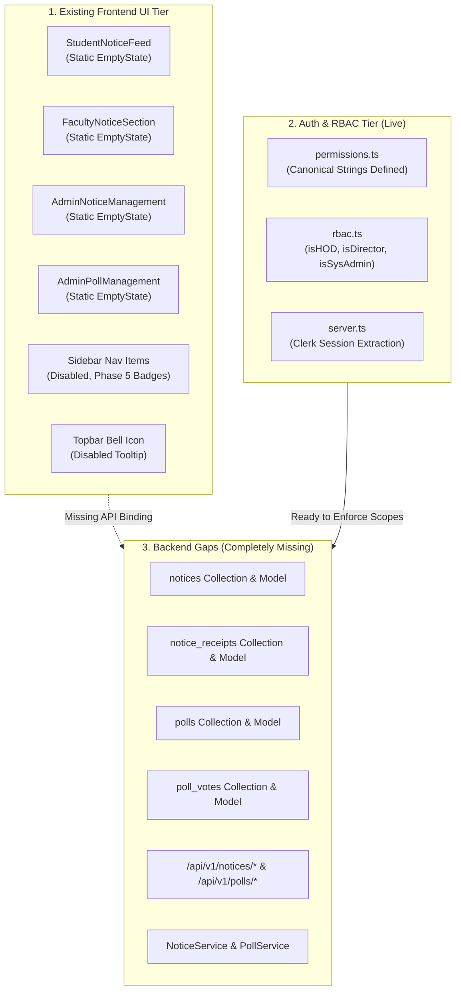
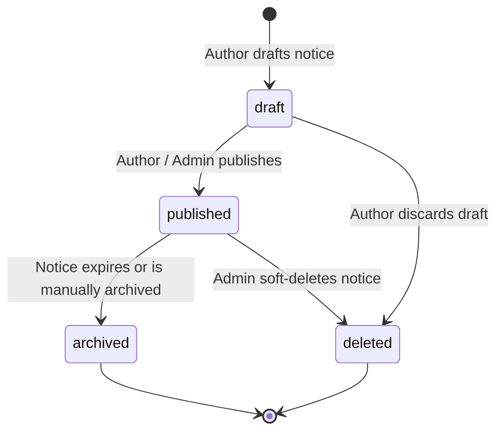
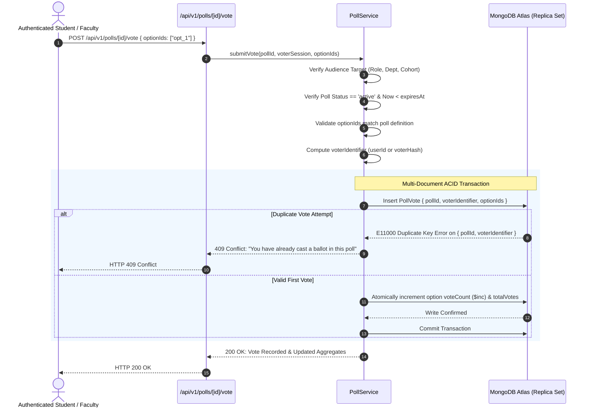
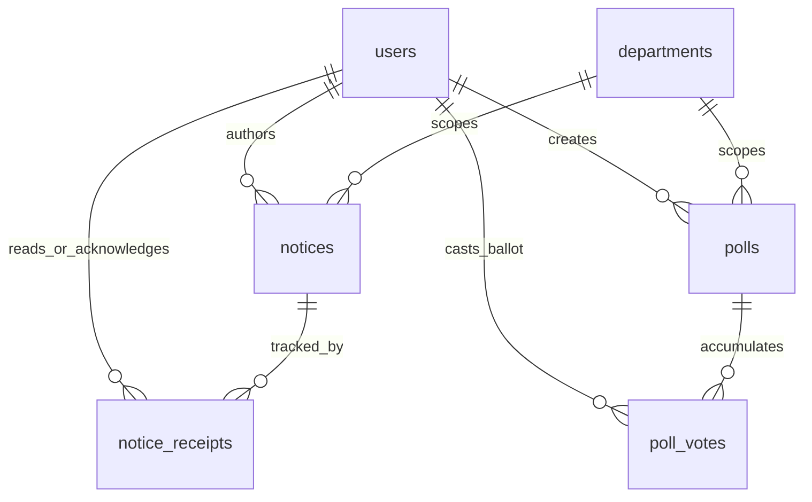
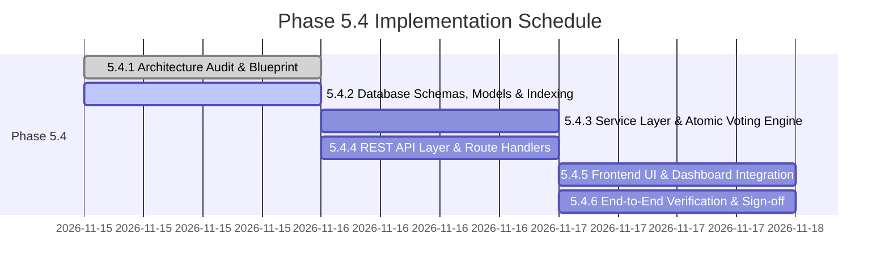

# Axis LinkUp — Phase 5.4.1: Notices & Polls Architecture Audit

**Document ID:** DOC-PHASE-5.4.1-AUDIT  
**Author:** Axis LinkUp Software Architecture & Security Team  
**Date:** November 15, 2026  
**Status:** Architecture Specification & Discovery Completed  
**Target Platform:** Axis Institute of Technology & Management (AITM), Kanpur  
**Subsystem:** Collegiate Notices (MOD-07) & Campus Polling (MOD-09)  

---

## 1. Executive Summary

Phase 5.4.1 initiates the **Academic Communication Subsystem** of Axis LinkUp, focusing on **Notices & Bulletins (MOD-07)** and **Campus Polls & Democratic Feedback (MOD-09)**. Following the successful completion and formal security sign-off of Phase 5.3 (Profile Management), this audit evaluates the current state of the Axis LinkUp codebase, identifies existing architectural assets and functional gaps, and articulates a comprehensive blueprint for data persistence, server-side RBAC, REST API endpoints, user experience workflows, and security controls.

### Core Audit Findings
1. **Frontend UI State:** Dashboard sections for notices (`StudentNoticeFeed`, `FacultyNoticeSection`, `AdminNoticeManagement`) and polls (`AdminPollManagement`) exist as visual placeholders rendering static empty states. Navigation items in `MASTER_NAVIGATION_ITEMS` (`student-notices`, `faculty-notices`, `faculty-polls`, `admin-notices`) are configured with `disabled: true` and `badge: "Phase 5"`. The topbar notification bell is a non-functional tooltip placeholder.
2. **Backend Data Layer State:** Neither MongoDB collections, Mongoose models, repository classes, nor service layers exist for notices, notice read receipts, polls, or poll votes.
3. **API Layer State:** Zero route handlers exist under `/api/v1/notices` or `/api/v1/polls`.
4. **RBAC Foundations:** The permission registry (`src/lib/auth/permissions.ts`) defines canonical permission strings for notices (`notices:read`, `notices:publish_course`, `notices:publish_college`, `notices:broadcast_urgent`) and polls (`polls:create_course`, `polls:vote`, `polls:view_results`). However, fine-grained sub-role scoping (differentiating Director from System Administrator, and constraining HODs to their assigned department) is not yet implemented for these domains.

This document establishes the architecture for Phases 5.4.2 through 5.4.6. **No application code, database collections, mock data, or dependencies are introduced during this audit phase.**

---

## 2. Existing Implementation Audit

An in-depth inspection of the active Axis LinkUp repository reveals the following component inventory across frontend, backend, security, and testing tiers:



### 2.1 Component-by-Component Status Matrix

| Component / Layer | Location | Current State | Audit Findings & Deficiencies |
| :--- | :--- | :---: | :--- |
| **Student Notice Feed** | `src/app/(student)/student/dashboard/components/notice-feed.tsx` | **Mock / Empty State** | Renders static `EmptyState` ("No Active Announcements"). Zero data fetching, zero API binding, zero pagination. |
| **Faculty Notice Section** | `src/app/(faculty)/faculty/dashboard/components/notice-section.tsx` | **Mock / Empty State** | Renders static `EmptyState` ("No Circulars Dispatched Today") with a static `AUTH-ACTIVE` badge for course broadcasts. |
| **Admin Notice Management** | `src/app/(admin)/admin/dashboard/components/notice-management.tsx` | **Mock / Empty State** | Displays static explanation cards on department broadcast vs. emergency siren. No notice creation form, editor, or publishing controls. |
| **Admin Poll Management** | `src/app/(admin)/admin/dashboard/components/poll-management.tsx` | **Mock / Empty State** | Displays static `EmptyState` ("No Active Campus Polls") and text descriptions of polling scopes. No ballot authoring or voting tally. |
| **Student / Faculty Poll UI** | Not Present | **Missing** | Neither the student dashboard nor the faculty cockpit contains poll voting or polling widget components. |
| **Sidebar Navigation** | `src/config/navigation.ts` | **Configured (Disabled)** | `student-notices`, `faculty-notices`, `faculty-polls`, and `admin-notices` exist in registry with `disabled: true` and `badge: "Phase 5"`. |
| **Header Notification Bell** | `src/components/navigation/topbar.tsx` | **Placeholder** | Static bell icon with red unread indicator; clicking shows tooltip: *"Notification delivery is planned for Phase 5 implementation."* |
| **Global Search Trigger** | `src/components/navigation/topbar.tsx` | **Placeholder** | `⌘K` trigger displays tooltip: *"Campus-wide search is planned for Phase 5 implementation."* |
| **Mongoose Models** | `src/lib/db/models/` | **Missing** | Only `user.model.ts`, `department.model.ts`, and `otp.model.ts` exist. No `notice.model.ts`, `poll.model.ts`, or vote models. |
| **Repositories** | `src/lib/db/repositories/` | **Missing** | Only `user.repository.ts`, `department.repository.ts`, and `otp.repository.ts` exist. |
| **Application Services** | `src/lib/services/` | **Missing** | No `notice.service.ts` or `poll.service.ts`. |
| **REST API Routes** | `src/app/api/v1/` | **Missing** | Zero route handlers exist under `/api/v1/notices` or `/api/v1/polls`. |
| **RBAC Matrix** | `src/lib/auth/permissions.ts` | **Partially Implemented** | Base permissions (`notices:read`, `notices:publish_course`, `polls:vote`, etc.) exist. Fine-grained sub-role logic for HOD/Director is unmapped. |
| **Test Infrastructure** | `tests/unit/` | **Ready** | Node.js native test runner (`npx tsx --test`) with 396 passing tests. Zero notice or poll test suites exist. |

---

## 3. Notices Module Architecture (MOD-07)

The Notices module is the authoritative collegiate broadcast system for AITM Kanpur. It handles administrative circulars, examination timetables, fee schedules, departmental notices, and urgent safety alerts.

### 3.1 Functional Requirements & Invariants

1. **Notice State Machine:**
   - `draft`: Author-only visibility. Editable. Not published to feeds.
   - `published`: Broadcast to targeted audience. Generates read receipt stubs upon user view. Read-only for content (modifications tracked via audit logs).
   - `archived`: Read-only historical record. Searchable via historical archive filter. Hidden from active dashboard feeds.
   - `deleted`: Soft-deleted (`isDeleted: true`). Excluded from all standard queries.
2. **Priority Taxonomy:**
   - `normal`: Standard collegiate circulars and routine memos.
   - `important`: Highlighted with amber badge; surfaced at top of standard feeds.
   - `urgent`: High-priority alert banner; pinned to top of feeds; generates urgent notification event.
3. **Category Taxonomy:**
   - `academic`: Class timetables, syllabus updates, academic calendar changes.
   - `examination`: Mid-term/end-semester schedules, seating plans, admit cards.
   - `fee_accounts`: Fee submission deadlines, scholarship disbursements, accounts notices.
   - `event_cultural`: Annual fest, tech symposiums, seminars, guest lectures.
   - `placement`: Campus recruitment drives, internship opportunities, pre-placement talks.
   - `administrative`: Holiday notices, office circulars, general administration.
   - `emergency`: Critical campus-wide alerts (weather closures, security directives).
4. **Target Audience Dimensions:**
   - `institution_wide`: All verified students, faculty, and administrative staff across all colleges.
   - `department_specific`: Bound to one or more `departmentId` references.
   - `role_specific`: Targeted to specific roles (e.g., `['student']` or `['faculty']`).
   - `cohort_specific`: Optional filters for `program` (e.g. `BTECH_CSE`), `batchYear` (e.g. `2022`), `currentSemester` (e.g. `6`), or `section` (e.g. `'A'`).
5. **Read Receipt Tracking & Unread Counter:**
   - Every user view on `GET /api/v1/notices/[id]` atomically upserts a `NoticeReceipt` record.
   - Receipts record `readAt` timestamp and optional `acknowledgedAt` timestamp (for notices with `requiresAcknowledgment: true`).
   - An optimized unread counter endpoint calculates active unread notices targeted to the caller's identity.



---

## 4. Polls & Voting Module Architecture (MOD-09)

The Polls module delivers an interactive, tamper-proof sentiment and decision-making system. It enables faculty to conduct classroom feedback and allows administrators and HODs to initiate student council, curriculum, or facility satisfaction surveys.

### 4.1 Functional Requirements & Invariants

1. **Poll State Machine:**
   - `draft`: Creator-only visibility. Options and targeting can be freely modified.
   - `active`: Open for voting. Options, question text, and targeting become **strictly immutable**.
   - `closed`: Voting disabled. Reached either automatically via `expiresAt` deadline or manually closed by creator/admin. Final tallies computed.
   - `archived`: Read-only historical survey record.
   - `deleted`: Soft-deleted (`isDeleted: true`).
2. **Voting Mechanisms & Integrity:**
   - **Single-Choice (`single`):** Voter selects exactly one option.
   - **Multiple-Choice (`multiple`):** Voter selects up to `maxSelections` options (validated server-side).
   - **One-Vote-Per-Identity:** Strictly enforced via compound unique database constraint and atomic transaction. A user can NEVER vote twice in the same poll.
   - **Vote Immutability:** Once cast, votes cannot be retracted or altered. (Documented in Section 11 as an open policy decision).
3. **Voter Anonymity & Privacy Protocol:**
   - In democratic student polls (`isAnonymous: true`), student candor must be protected against faculty retribution.
   - The user's direct `ObjectId` is NOT stored in the vote document. Instead, a pseudonymous hash is derived:
     $$\text{voterHash} = \text{HMAC-SHA256}(\text{userId} + \text{pollId}, \text{APP\_SECRET})$$
   - This cryptographic design guarantees strict duplicate prevention via unique index `{ pollId: 1, voterHash: 1 }` without exposing which student voted for which option.
4. **Results Visibility Policies:**
   - `always`: Live aggregate tallies visible to all eligible participants before and after voting.
   - `after_vote`: Aggregate tallies masked until the voter submits their own ballot.
   - `after_close`: Aggregate tallies masked until the poll's `expiresAt` deadline passes or it is manually closed.
   - `creator_only`: Results restricted exclusively to the poll creator and authorized administrators (e.g. for administrative appraisals).



---

## 5. Proposed Database Architecture

To maintain document locality, prevent unbounded document growth, and guarantee transactional integrity, the system utilizes **four dedicated collections**:



### 5.1 Collection: `notices`

Stores official collegiate circulars, departmental bulletins, and campus alerts.

```typescript
// Proposed Schema Interface: src/types/notice.ts
export type NoticePriority = 'normal' | 'important' | 'urgent';
export type NoticeCategory =
  | 'academic'
  | 'examination'
  | 'fee_accounts'
  | 'event_cultural'
  | 'placement'
  | 'administrative'
  | 'emergency';
export type NoticeStatus = 'draft' | 'published' | 'archived';

export interface INoticeAttachment {
  name: string;
  url: string;
  sizeBytes: number;
  mimeType: string;
}

export interface INoticeTargetScope {
  scopeType: 'institution_wide' | 'department' | 'role_specific' | 'cohort';
  departmentIds?: Types.ObjectId[]; // Empty = all departments
  roles?: ('student' | 'faculty' | 'admin')[]; // Empty = all roles
  programs?: string[]; // e.g. ['BTECH_CSE', 'BTECH_IT']
  batchYears?: number[]; // e.g. [2021, 2022]
  semesters?: number[]; // e.g. [4, 6]
  sections?: string[]; // e.g. ['A', 'B']
}

export interface INoticeAuthorSnapshot {
  name: string;
  role: string;
  adminSubRole?: string | null;
  departmentName?: string | null;
  departmentCode?: string | null;
}

export interface INotice {
  _id: Types.ObjectId;
  title: string;
  contentMarkdown: string;
  summary?: string;
  category: NoticeCategory;
  priority: NoticePriority;
  status: NoticeStatus;
  targetScope: INoticeTargetScope;
  authorId: Types.ObjectId;
  authorSnapshot: INoticeAuthorSnapshot;
  attachments: INoticeAttachment[];
  isPinned: boolean;
  requiresAcknowledgment: boolean;
  publishedAt?: Date;
  expiresAt?: Date;
  readCount: number;
  acknowledgmentCount: number;
  isDeleted: boolean;
  deletedAt?: Date;
  deletedById?: Types.ObjectId;
  createdAt: Date;
  updatedAt: Date;
}
```

#### Required Indexes for `notices`
1. `{ "targetScope.scopeType": 1, status: 1, isDeleted: 1, isPinned: -1, publishedAt: -1 }` (Primary feed index).
2. `{ "targetScope.departmentIds": 1, status: 1, isDeleted: 1, publishedAt: -1 }` (Department-filtered feed).
3. `{ authorId: 1, status: 1, createdAt: -1 }` (Author manage notices desk).
4. `{ title: "text", contentMarkdown: "text" }` (Full-text keyword search).
5. `{ expiresAt: 1 }` (Scheduled archival and expiration query).

---

### 5.2 Collection: `notice_receipts`

Tracks individual user impressions and statutory acknowledgments. Kept separate from `notices` to avoid document size explosion (a single collegiate notice may be read by thousands of students).

```typescript
// Proposed Schema Interface: src/types/notice-receipt.ts
export interface INoticeReceipt {
  _id: Types.ObjectId;
  noticeId: Types.ObjectId;
  userId: Types.ObjectId;
  readAt: Date;
  acknowledgedAt?: Date;
  ipAddress?: string;
  userAgent?: string;
  createdAt: Date;
}
```

#### Required Indexes for `notice_receipts`
1. `{ noticeId: 1, userId: 1 }` — **Unique Compound Index**. Prevents duplicate receipts and accelerates status check.
2. `{ userId: 1, noticeId: 1 }` — Reverse lookup for computing caller's unread notices.
3. `{ noticeId: 1, acknowledgedAt: 1 }` — Analytics index for acknowledgment rate calculations.

---

### 5.3 Collection: `polls`

Stores poll questions, embedded option tallies, audience targeting, and lifecycle parameters.

```typescript
// Proposed Schema Interface: src/types/poll.ts
export type PollType = 'single' | 'multiple';
export type PollStatus = 'draft' | 'active' | 'closed' | 'archived';
export type PollResultsVisibility = 'always' | 'after_vote' | 'after_close' | 'creator_only';

export interface IPollOption {
  _id: Types.ObjectId;
  text: string;
  voteCount: number; // Increment atomically via $inc
}

export interface IPollTargetScope {
  scopeType: 'institution_wide' | 'department' | 'role_specific' | 'cohort';
  departmentIds?: Types.ObjectId[];
  roles?: ('student' | 'faculty' | 'admin')[];
  programs?: string[];
  batchYears?: number[];
  sections?: string[];
}

export interface IPoll {
  _id: Types.ObjectId;
  question: string;
  description?: string;
  type: PollType;
  maxSelections: number; // 1 for 'single', 2..N for 'multiple'
  options: IPollOption[]; // 2 to 10 bounded options
  isAnonymous: boolean;
  resultsVisibility: PollResultsVisibility;
  status: PollStatus;
  targetScope: IPollTargetScope;
  creatorId: Types.ObjectId;
  creatorSnapshot: {
    name: string;
    role: string;
    departmentCode?: string | null;
  };
  totalVotes: number; // Total distinct voters who participated
  publishedAt?: Date;
  expiresAt?: Date; // Optional deadline
  closedAt?: Date;
  closedById?: Types.ObjectId;
  isDeleted: boolean;
  deletedAt?: Date;
  createdAt: Date;
  updatedAt: Date;
}
```

#### Required Indexes for `polls`
1. `{ status: 1, isDeleted: 1, expiresAt: 1, createdAt: -1 }` (Active poll feed index).
2. `{ "targetScope.departmentIds": 1, status: 1, isDeleted: 1 }` (Department poll feed).
3. `{ creatorId: 1, createdAt: -1 }` (Creator management index).

---

### 5.4 Collection: `poll_votes`

Records cast ballots and enforces single-vote integrity. Option counts in the parent `Poll` document are updated atomically in sync with ballot insertion.

```typescript
// Proposed Schema Interface: src/types/poll-vote.ts
export interface IPollVote {
  _id: Types.ObjectId;
  pollId: Types.ObjectId;
  voterIdentifier: string; // If isAnonymous: HMAC-SHA256(userId + pollId); Else: userId.toString()
  selectedOptionIds: Types.ObjectId[]; // Bounded to maxSelections
  votedAt: Date;
  createdAt: Date;
}
```

#### Required Indexes for `poll_votes`
1. `{ pollId: 1, voterIdentifier: 1 }` — **Unique Compound Index**. The core database-level gate preventing duplicate ballots.
2. `{ pollId: 1, votedAt: -1 }` — Timeline audit index for poll administrators.

---

## 6. Server-Side RBAC & Authorization Architecture

Axis LinkUp strictly enforces the principle of least privilege. Ingress requests to `/api/v1/notices` and `/api/v1/polls` must be evaluated against server-side session credentials extracted by `getServerSession()` (`session.role`, `session.adminSubRole`, `session.departmentId`). **Client-supplied headers or body fields are never trusted for authorization.**

### 6.1 Role Capability Matrix

```mermaid
flowchart TD
    subgraph Roles["Collegiate Roles"]
        STU["Student"]
        FAC["Faculty Member"]
        HOD["Department HOD (admin / hod)"]
        DIR["Executive Director (super_admin / director)"]
        SYS["System Admin (super_admin / sys_admin)"]
    end

    subgraph Notice_Permissions["Notice Publishing Scopes"]
        N_Read["Read Targeted Notices"]
        N_Course["Publish Course / Section Notices"]
        N_Dept["Publish Official Department Circulars"]
        N_College["Publish College-Wide Bulletins"]
        N_Urgent["Broadcast Emergency Alerts"]
    end

    subgraph Poll_Permissions["Poll Creation & Voting Scopes"]
        P_Vote["Vote on Targeted Polls"]
        P_Course["Create Classroom / Section Polls"]
        P_Dept["Create Department Surveys"]
        P_College["Create Campus-Wide Surveys"]
    end

    STU --> N_Read
    STU --> P_Vote

    FAC --> N_Read
    FAC --> N_Course
    FAC --> P_Vote
    FAC --> P_Course

    HOD --> N_Read
    HOD --> N_Dept
    HOD --> P_Vote
    HOD --> P_Dept

    DIR --> N_Read
    DIR --> N_College
    DIR --> P_Vote
    DIR --> P_College

    SYS --> N_Read
    SYS --> N_College
    SYS --> N_Urgent
    SYS --> P_Vote
    SYS --> P_College
```



### 6.2 Granular Permissions Matrix by Persona

| Operation / Endpoint | Student | Faculty | Department HOD | Institute Director | System Admin |
| :--- | :---: | :---: | :---: | :---: | :---: |
| **Read Notice Feed** (`GET /notices`) | Scoped (Targeted) | Scoped (Targeted) | Scoped (Targeted + Dept) | All (Institutional) | All (Global) |
| **Read Notice Detail** (`GET /notices/[id]`) | If Targeted | If Targeted | If Targeted / Own Dept | Unrestricted | Unrestricted |
| **Create Course Notice** (`POST /notices`) | **DENIED** | **ALLOWED** (Assigned) | **ALLOWED** (Own Dept) | **ALLOWED** | **ALLOWED** |
| **Create Dept Notice** (`POST /notices`) | **DENIED** | **DENIED** (Unless Coord) | **ALLOWED** (Own Dept) | **ALLOWED** | **ALLOWED** |
| **Create College-Wide Notice** (`POST /notices`) | **DENIED** | **DENIED** | **DENIED** | **ALLOWED** | **ALLOWED** |
| **Broadcast Urgent Notice** (`priority: urgent`) | **DENIED** | **DENIED** | **DENIED** | **ALLOWED** | **ALLOWED** |
| **Edit Notice** (`PATCH /notices/[id]`) | **DENIED** | Own Drafts Only | Own Dept Drafts | Directorate Notices | Any Notice |
| **Publish Notice** (`POST /notices/[id]/publish`) | **DENIED** | Own Permitted | Own Dept | Directorate Scope | Global Scope |
| **Archive / Delete Notice** | **DENIED** | Own Drafts Only | Own Dept | Directorate Scope | Global Scope |
| **Inspect Read Receipts** | **DENIED** | Own Notices Only | Own Dept Notices | All Notices | All Notices |
| **Read Poll Feed** (`GET /polls`) | Scoped (Targeted) | Scoped (Targeted) | Scoped (Targeted + Dept) | All (Institutional) | All (Global) |
| **Create Course Poll** (`POST /polls`) | **DENIED** | **ALLOWED** (Assigned) | **ALLOWED** (Own Dept) | **ALLOWED** | **ALLOWED** |
| **Create Dept Survey** (`POST /polls`) | **DENIED** | **DENIED** | **ALLOWED** (Own Dept) | **ALLOWED** | **ALLOWED** |
| **Create Campus-Wide Poll** (`POST /polls`) | **DENIED** | **DENIED** | **DENIED** | **ALLOWED** | **ALLOWED** |
| **Cast Ballot** (`POST /polls/[id]/vote`) | If Targeted (1x) | If Targeted (1x) | If Targeted (1x) | If Targeted (1x) | If Targeted (1x) |
| **Close Poll Early** (`POST /polls/[id]/close`) | **DENIED** | Own Polls Only | Own Dept Polls | Campus Polls | Any Poll |
| **View Poll Results** (`GET /polls/[id]/results`) | Per Poll Policy | Per Poll Policy | Per Poll Policy | Full Visibility | Full Visibility |

### 6.3 Separation of Director vs. System Administrator
- **Director (`super_admin` + `director`):** Possesses institutional executive and academic oversight. Can issue college-wide circulars, directorate notices, and campus-wide surveys. Cannot delete technical audit trails or perform IAM role provisioning.
- **System Administrator (`super_admin` + `sys_admin`):** Possesses platform governance authority. Can moderate, emergency-archive, or purge inappropriate content across all departments, and manage global emergency alerts.

---

## 7. Proposed REST API Architecture

All endpoints adhere strictly to the established Axis LinkUp API conventions: route grouping under `/api/v1/`, strict JSON envelopes (`{ success, data, error, timestamp }`), Zod request validation, and comprehensive error mapping.

### 7.1 Notices Endpoints

```
GET    /api/v1/notices                 Fetch personalized, paginated notice feed
POST   /api/v1/notices                 Create notice (draft or published)
GET    /api/v1/notices/[id]            Get notice details & record read receipt
PATCH  /api/v1/notices/[id]            Update notice content (drafts or author edits)
POST   /api/v1/notices/[id]/publish    Publish a draft notice
POST   /api/v1/notices/[id]/archive    Archive an active notice
DELETE /api/v1/notices/[id]            Soft-delete notice
POST   /api/v1/notices/[id]/receipt    Acknowledge statutory notice
GET    /api/v1/notices/[id]/receipts   Inspect read receipts (author / admin)
GET    /api/v1/notices/unread-count    Get caller's unread notice counter
```

#### Query Parameters for `GET /api/v1/notices`
- `category`: Filter by category (e.g. `examination`, `academic`).
- `priority`: Filter by priority (`normal`, `important`, `urgent`).
- `status`: Filter by status (`published`, `draft`, `archived`) — non-authors restricted to `published`.
- `search`: Keyword query matching title or markdown body.
- `departmentId`: Department filter (restricted to caller scope for non-admins).
- `cursor`: NextCursor pagination token.
- `limit`: Page size (default 20, max 100).

---

### 7.2 Polls Endpoints

```
GET    /api/v1/polls                   Fetch targeted active & completed polls feed
POST   /api/v1/polls                   Create new poll (draft or active)
GET    /api/v1/polls/[id]              Get poll details & caller voting eligibility
POST   /api/v1/polls/[id]/vote         Cast ballot (single or multi-choice)
GET    /api/v1/polls/[id]/results      Fetch vote tallies (governed by visibility policy)
POST   /api/v1/polls/[id]/close        Manually close active poll (creator / admin)
POST   /api/v1/polls/[id]/archive      Archive completed poll
DELETE /api/v1/polls/[id]              Soft-delete poll
```

#### Payload for `POST /api/v1/polls/[id]/vote`
```json
{
  "selectedOptionIds": ["6730a005f8b1a2001a000001"]
}
```

---

## 8. Frontend UI & Dashboard Integration Blueprint

To fulfill the requirements without introducing duplicate pages or breaking the approved Phase 4.8 design system, the Notices and Polls UI will integrate into existing layouts:

### 8.1 Dashboard Feed Enhancements
1. **Student Dashboard (`/student/dashboard`):**
   - Upgrade `StudentNoticeFeed` from static empty state to a live query component.
   - Render unread notice badge, priority badges (`Urgent`, `Important`), and markdown modal preview.
   - Introduce `StudentActivePollWidget` below notices, enabling one-click voting directly on the dashboard.
2. **Faculty Cockpit (`/faculty/dashboard`):**
   - Upgrade `FacultyNoticeSection` to display departmental bulletins and course notices.
   - Add "Create Announcement" dialog trigger.
   - Add classroom poll creator shortcut widget.
3. **Administrator Console (`/admin/dashboard`):**
   - Upgrade `AdminNoticeManagement` to include a full notice authoring workbench, drafting desk, and category filter.
   - Upgrade `AdminPollManagement` to render active department polls, live vote progress bars, and manual closure triggers.
4. **Header Topbar (`src/components/navigation/topbar.tsx`):**
   - Connect the topbar `Bell` icon to `GET /api/v1/notices/unread-count`.
   - Render unread badge count (e.g. `3`) and popover feed preview linking to full notice view.

---

## 9. Performance, Indexing & Scalability Considerations

1. **High-Volume Polling Concurrency:**
   - Voting surges (e.g., 500 students voting simultaneously on a class schedule poll) must not cause lock contention.
   - MongoDB multi-document ACID transactions with atomic `$inc` on `options.$.voteCount` ensure zero tally skew without table-level locking.
2. **Read Receipts Explosion Defense:**
   - 10,000 students reading a campus bulletin generates 10,000 receipt documents.
   - Separating `notice_receipts` prevents document bloat.
   - The unique compound index `{ noticeId: 1, userId: 1 }` guarantees sub-millisecond receipt checks via MongoDB index-only B-tree scans (`IXSCAN`).
3. **Feed Query Optimization:**
   - The notice feed utilizes compound index `{ "targetScope.scopeType": 1, status: 1, isDeleted: 1, isPinned: -1, publishedAt: -1 }`.
   - Covered queries ensure instantaneous dashboard rendering.
4. **Markdown Content Sanitization:**
   - All notice and poll descriptions allow markdown formatting.
   - Content must be sanitized server-side or rendered via sanitized React markdown components to prevent Cross-Site Scripting (XSS).

---

## 10. Phase 5.4 Implementation Roadmap



- **Phase 5.4.1 (Current):** Notices & Polls Architecture Audit, gap analysis, and system blueprint.
- **Phase 5.4.2:** Database schemas, TypeScript interfaces, Mongoose models, compound unique indexes, and Zod validation schemas (`notice.model.ts`, `poll.model.ts`, `poll-vote.model.ts`, `notice-receipt.model.ts`).
- **Phase 5.4.3:** Centralized `NoticeService` and `PollService`, atomic ballot transaction engine, voter HMAC hashing, and context-aware scoping.
- **Phase 5.4.4:** REST API routes (`/api/v1/notices/*`, `/api/v1/polls/*`), authentication guards, query parsers, and API error handling.
- **Phase 5.4.5:** Frontend UI integration, live dashboard feeds, interactive ballot widgets, authoring dialogs, and topbar unread indicators.
- **Phase 5.4.6:** End-to-end verification, concurrency race condition testing, security audit, and formal Phase 5.4 sign-off.

---

## 11. Unresolved Institutional Policy Decisions

The following policy decisions require project-owner confirmation before or during Phase 5.4.2 implementation:

### Decision 1: Faculty Notice Publishing Scope
- **Option A (Strict Governance - Recommended):** Regular faculty can ONLY publish course-specific notices targeted to their enrolled sections/courses. Department-wide bulletins require HOD authorization.
- **Option B (Open Faculty Broadcast):** Any faculty member can publish department-wide notices directly to all students in their department without HOD approval.

### Decision 2: Student Vote Modification
- **Option A (Immutable Ballot - Recommended):** Once a student submits their ballot, the vote is permanent and cannot be modified or withdrawn.
- **Option B (Retractable Ballot):** A student can alter their option selection as long as the poll remains in the `active` state before its closing deadline.

### Decision 3: Student-Initiated Polling
- **Option A (Staff Only - Recommended):** Only Faculty, HODs, Directors, and System Administrators can author campus polls. Students are strictly voters.
- **Option B (Student Senate Workflow):** Authorized Student Representatives can draft polls, which require HOD or Dean approval before broadcasting.

### Decision 4: Expired Notice Retention vs. Archival
- **Option A (Indefinite Archive - Recommended):** Expired notices transition to `status: 'archived'` and remain searchable in the historical college archive indefinitely.
- **Option B (Automatic TTL Purge):** Expired notices are automatically hard-deleted from MongoDB after 90 days via a MongoDB TTL index.

### Decision 5: Mandatory Notice Acknowledgment
- **Option A (Supported with Tracking):** Authors can toggle `requiresAcknowledgment: true` on critical notices (e.g. Anti-Ragging undertakings, Examination Rules). Students must click an "Acknowledge" button, recording `acknowledgedAt` and IP address for compliance audits.
- **Option B (Informational Only):** Notices record simple `readAt` impressions only; no formal acknowledgment step.

---

## 12. Verification & Audit Sign-off

The architectural audit for **Phase 5.4.1 (Notices & Polls Architecture Audit)** has been thoroughly conducted and documented. All existing repository components, layouts, navigation trees, and RBAC utilities have been mapped without modifying application code or introducing mock data.

The project is positioned to begin **Phase 5.4.2 (Database Schemas, Models & Indexing)** upon project-owner review and policy approval.

