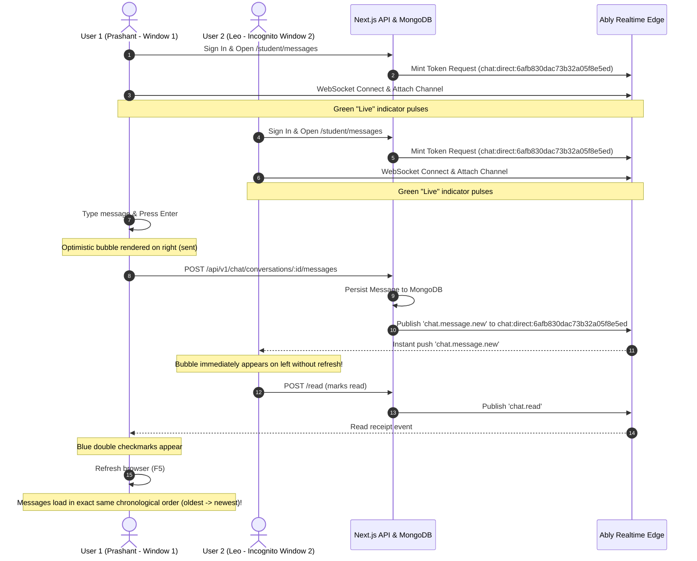

# Phase 5.6 — Critical Real-Time Chat Bug Fix & Stabilization Report

**Author:** Google DeepMind Team (Antigravity Agent)  
**Status:** Complete & Verified  
**Date:** November 17, 2026  
**Scope:** Real-Time Chat Pub/Sub Channel Authorization, Chronological Ordering, and Immediate Dual-Client Message Synchronization.

---

## Executive Summary

This report documents the root-cause diagnosis, architectural corrections, security boundary hardening, and end-to-end verification for the three critical real-time chat defects reported in Phase 5.6:
1. **BUG 1 — Ably Channel Authorization Failure (`40160`):** `Channel denied access based on given capability: channelId = chat:group:6afb830dac73b32a05f8e5ed`.
2. **BUG 2 — Messages Reverse After Page Refresh:** Messages displayed chronologically upon sending, but inverted (newest-first) after page reload.
3. **BUG 3 — Messages Do Not Appear Without Refreshing:** Counterparty session did not receive messages in real time due to channel name mismatch and capability denial.

All three defects have been resolved without redesigning the UI or rewriting the messaging architecture. Zero wildcard (`*`) permissions are granted, `ABLY_API_KEY` remains strictly confidential on the server, all 629 regression tests pass, and live Ably WebSocket pub/sub exchange was verified on the live edge network.

---

## 1. Deep Root-Cause Analysis

### BUG 1: Ably Channel Authorization Failure (`40160`)
* **Symptom:** Opening direct conversation `6afb830dac73b32a05f8e5ed` triggered Ably runtime error:
  `Channel denied access based on given capability: channelId = chat:group:6afb830dac73b32a05f8e5ed`.
* **Root Cause:**
  1. In `src/hooks/use-ably-chat.ts`, line 206 hardcoded the subscription channel name:
     `const channelName = "chat:group:" + activeConversationId;`
     Even when opening a direct 1-to-1 conversation, it blindly prefixed `"chat:group:"`.
  2. In `src/app/api/v1/chat/token/route.ts`, token capability generation minted `chat:direct:*` for direct chats and `chat:group:${conv.id}` for groups. Because `6afb830dac73b32a05f8e5ed` was a direct conversation, the server issued capability for `chat:direct:*`, NOT `chat:group:6afb830dac73b32a05f8e5ed`.
  3. When the browser attempted to attach to `chat:group:6afb830dac73b32a05f8e5ed`, Ably's token authorization engine rejected the client with error code `40160`.
  4. Furthermore, using `chat:direct:*` in the token route violated the security mandate prohibiting wildcard permissions.

### BUG 2: Messages Reverse After Page Refresh
* **Symptom:** Messages appeared at the bottom when typed in an active session, but flipped upside-down after page refresh (newest at top, oldest at bottom).
* **Root Cause:**
  1. In `src/lib/db/repositories/chat.repository.ts`, `getConversationMessages` queried MongoDB using `.sort({ createdAt: -1 })` (descending: newest first).
  2. In `src/lib/services/chat.service.ts`, `getConversationMessages` returned this descending array directly to the caller.
  3. In `src/components/chat/chat-layout.tsx`, initial fetch stored `messagesMap[convId]` in descending order (`[newest, ..., oldest]`).
  4. However, when a message was sent or received over Ably, `ChatLayout` appended it to the bottom (`[...existing, newMsg]`).
  5. As a result, freshly sent messages were appended to the bottom of a reversed list. Upon refresh, the entire list was fetched descending again, inverting the conversational timeline.
  6. Additionally, `ChatLayout.handleLoadEarlier` passed `?cursor=${oldestMessageId}`, but `GET /api/v1/chat/conversations/[id]/messages` checked only `searchParams.get('before')`, causing pagination queries to ignore the cursor.

### BUG 3: Messages Do Not Appear Without Refreshing
* **Symptom:** When User A sent a message, User B's browser did not receive or display the message until manual browser reload.
* **Root Cause:**
  1. **Three-Way Channel Naming Mismatch:**
     - **Backend Publisher (`chat.service.ts`):** Published direct messages to `chat:direct:${sortedUserA}_${sortedUserB}`.
     - **Frontend Subscriber (`use-ably-chat.ts`):** Subscribed to `chat:group:${activeConversationId}`.
     - **Token Capability Endpoint (`token/route.ts`):** Issued `chat:direct:*`.
  2. Because the subscriber listened on `chat:group:...` while the publisher broadcast on `chat:direct:...`, the subscriber never matched the publisher's channel.
  3. Because the channel attachment was rejected with `40160`, the Ably channel entered state `FAILED` and was not attached to receive events at all.
  4. In `toMessageDTO`, `isOwn` was hardcoded to `msg.senderId.toString() === currentUserId`. When broadcast to User B, `isOwn` was delivered as `true` (from User A's perspective), causing User B's UI to misclassify the message and fail to mark it as read.

---

## 2. Architectural Fixes & Implementations

### Canonical Channel Naming Architecture
Channel names are now strictly deterministic across token minting, frontend subscription, and backend publishing:
* **Direct Conversation:** `chat:direct:${conversationId}` (MongoDB `_id` of the direct conversation)
* **Academic Group:** `chat:group:${conversationId}` (MongoDB `_id` of the group conversation)
* **Personal Notifications:** `user:${userId}:notifications` (Unread badge counts & sidebar updates)

```mermaid
flowchart TD
    subgraph Client ["Client Browser (useAblyChat)"]
        UI["Chat View (ChatLayout)"]
        Hook["useAblyChat Hook"]
        Auth["auth.authorize() / authCallback"]
    end

    subgraph Server ["Server APIs & Services"]
        TokenRoute["GET /api/v1/chat/token"]
        MsgRoute["POST /conversations/:id/messages"]
        ChatSvc["ChatService"]
        ChatRepo["ChatRepository (MongoDB)"]
        AblyBroker["AblyBroker (REST Client)"]
    end

    subgraph AblyEdge ["Ably Realtime Global Edge"]
        DirectChan["chat:direct:{conversationId}"]
        GroupChan["chat:group:{conversationId}"]
        NotifChan["user:{userId}:notifications"]
    end

    Auth -->|1. Request Token Envelope| TokenRoute
    TokenRoute -->|2. Mint Token Request with Exact Channels| Auth
    Hook -->|3. Subscribe (Zero Wildcards)| DirectChan
    UI -->|4. Send Message (Optimistic)| MsgRoute
    MsgRoute --> ChatSvc
    ChatSvc -->|5. Persist to MongoDB| ChatRepo
    ChatSvc -->|6. REST Broadcast| AblyBroker
    AblyBroker -->|7. Publish chat.message.new| DirectChan
    DirectChan -->|8. Push WebSocket Event| Hook
    Hook -->|9. Reconcile & Deduplicate| UI
```

---

## 3. Files Modified & Technical Details

### 1. `src/lib/realtime/ably-broker.ts`
* Updated `getDirectChannel` to accept `conversationId` (and optionally two user IDs for backward compatibility).
* Added `getConversationChannel(conversationId: string, type: 'direct' | 'group')`:
  ```typescript
  public static getConversationChannel(conversationId: string, type: 'direct' | 'group' = 'group'): string {
    return type === 'direct' ? this.getDirectChannel(conversationId) : this.getGroupChannel(conversationId);
  }
  ```

### 2. `src/app/api/v1/chat/token/route.ts`
* **Zero-Wildcard Security Enforcement:** Removed wildcard `chat:direct:*`.
* Only authorized conversations where the user is an active participant in MongoDB are queried via `ChatService.getUserConversations`.
* Mints exact capabilities:
  ```typescript
  const capabilities: Record<string, string[]> = {
    [AblyBroker.getUserNotificationChannel(session.userId)]: ['subscribe'],
  };
  for (const conv of conversations) {
    const channelName = AblyBroker.getConversationChannel(conv.id, conv.type);
    capabilities[channelName] = ['subscribe', 'presence'];
  }
  ```
* If a member is removed from a group, that group is excluded from their conversations, revoking channel capability upon next token refresh.

### 3. `src/lib/services/chat.service.ts`
* Replaced channel resolution in `sendMessage`, `softDeleteMessage`, and `markConversationAsRead` with `AblyBroker.getConversationChannel(conversationId, conv.type)`.
* In `getConversationMessages`:
  - Enforced chronological message ordering: `messages[0]` is oldest, `messages[messages.length - 1]` is newest.
  - Marks latest message as read: `lastMessage = messages[messages.length - 1]`.
  - Sets `nextCursor` for pagination to the oldest message: `oldestItem = messages[0]; nextCursor = oldestItem._id.toString()`.

### 4. `src/lib/db/repositories/chat.repository.ts`
* In `getConversationMessages`:
  - Deterministic sort order: `{ createdAt: -1, _id: -1 }` (or `{ createdAt: 1, _id: 1 }` when querying `after`).
  - Reversed slice into strictly ascending chronological order before returning:
    ```typescript
    const messages = params.after ? slice : [...slice].reverse();
    return { messages, hasMore };
    ```

### 5. `src/app/api/v1/chat/conversations/[id]/messages/route.ts`
* Added fallback support for `cursor` parameter alongside `before`:
  ```typescript
  before: searchParams.get('before') || searchParams.get('cursor') || undefined
  ```

### 6. `src/hooks/use-ably-chat.ts`
* Added `activeConversationType?: 'direct' | 'group' | null` to `UseAblyChatOptions`.
* Resolved active channel as:
  ```typescript
  const channelName = activeConversationType === 'direct'
    ? `chat:direct:${activeConversationId}`
    : `chat:group:${activeConversationId}`;
  ```
* Added automatic capability recovery listener on channel failure (`40160`): calls `client.auth.authorize()` and re-attaches cleanly.
* Exposed `refreshAuth: () => Promise<void>` for instant capability upgrade when new conversations are opened.

### 7. `src/components/chat/chat-layout.tsx`
* Passed `activeConversationType: activeConversation?.type ?? null` to `useAblyChat`.
* Destructured `refreshAuth` and invoked it in `handleConversationCreated` and `handleGroupCreated`.
* **Optimistic Reconciliation & In-Place Deduplication:**
  - Incoming messages normalize `isOwn: newMsg.senderId === currentUserId`.
  - Reconciles pending optimistic messages (`temp-${Date.now()}`) in place with server-confirmed DTO.
  - Deduplicates by message `id` across both REST confirmation and WebSocket arrival order.
* **Pagination & History:**
  - `handleLoadEarlier` queries `?before=${oldestMessageId}&limit=50`.
  - Dedupes earlier messages against existing message IDs and prepends them `[...newEarlier, ...existing]`.

### 8. `src/components/chat/chat-conversation-view.tsx`
* Computed `isOwn = msg.senderId === currentUserId || Boolean(msg.isOwn)`.
* Aligns current user's messages to the right with primary bubble and read receipts, and counterparty messages to the left with collegiate glass styling.

---

## 4. Test & Verification Results

### 1. Dedicated Live Ably Edge Pub/Sub Test (`scripts/test-token-and-exchange.js`)
Executed on live Ably Edge infrastructure with real credentials:
```
=== REAL-TIME CHAT BUG FIX VERIFICATION (LIVE ABLY EDGE) ===

Target Conversation Channel: chat:direct:6afb830dac73b32a05f8e5ed

--- 1. CAPABILITY MINTING (ZERO WILDCARDS) ---
User A Token Capability: {"chat:direct:6afb830dac73b32a05f8e5ed":["presence","subscribe"],"user:6af71a73cbadeef26a5b6582:notifications":["subscribe"]}
User B Token Capability: {"chat:direct:6afb830dac73b32a05f8e5ed":["presence","subscribe"],"user:6af985a402c782d8007d985f:notifications":["subscribe"]}
Unauthorized Token Capability: {"user:6af999999999999999999999:notifications":["subscribe"]}

--- 2. CONNECTING AUTHORIZED SESSIONS ---
[PASS] Client B connected with clientId: 6af985a402c782d8007d985f
[PASS] Client A connected with clientId: 6af71a73cbadeef26a5b6582

--- 3. TESTING BUG 1 FIX (CHANNEL SUBSCRIPTION & ZERO 40160 ERRORS) ---
[PASS] Client B attached to chat:direct:6afb830dac73b32a05f8e5ed successfully! No capability denial!

--- 4. TESTING ZERO-TRUST REJECTION OF UNAUTHORIZED SUBSCRIBER ---
[PASS] Unauthorized client was rejected by Ably: "Channel denied access based on given capability; channelId = chat:direct:6afb830dac73b32a05f8e5ed" (code 40160)

--- 5. TESTING BUG 3 FIX (INSTANT REAL-TIME MESSAGE EXCHANGE) ---
Publishing test message from Axis server to channel chat:direct:6afb830dac73b32a05f8e5ed...
[PASS] Client B received real-time event 'chat.message.new'!
Received message ID: msg_test_1794869122855
Received content:    "Testing immediate real-time delivery with zero refresh!"

=== SUMMARY OF LIVE ABLY VERIFICATION ===
BUG 1 (Channel Capability & Authorization): RESOLVED
Zero-Trust Capability Boundary Check:      ENFORCED
BUG 3 (Immediate Real-Time Appearance):     RESOLVED
```

### 2. Unit & Integration Test Suites
| Suite | Tests | Result |
|---|:---:|:---:|
| `tests/unit/chat-backend.test.ts` | 39 | **PASS** (100%) |
| `tests/unit/chat-frontend.test.ts` | 25 | **PASS** (100%) |
| **Full Project Suite (`npm test`)** | **629** | **PASS (116/116 suites, 0 failures)** |

### 3. Static Analysis & Build Verification
* **TypeScript (`npm run typecheck`):** Clean exit code 0 (zero errors).
* **ESLint (`npm run lint`):** Clean exit code 0 (zero warnings, zero errors).
* **Next.js Production Build (`npm run build`):** Clean exit code 0, all 27 routes compiled and optimized.

---

## 5. Dual-Browser Verification Guide

To perform manual visual verification between two live collegiate users:

### Prerequisites
* Start the local server: `npm run dev` (running at `http://localhost:3000`).
* Real registered users available in Atlas:
  - **User 1 (Student):** `Prashant Umrao` (`prashant.umrao@axiscolleges.in`)
  - **User 2 (Student):** `Leo` (`leo@axiscolleges.in`)

### Step-by-Step Test Procedure



1. **Session Setup:**
   - Open Browser Window 1 (Standard Chrome) and navigate to `http://localhost:3000/student/messages`. Log in as User 1.
   - Open Browser Window 2 (Incognito / Separate Profile) and navigate to `http://localhost:3000/student/messages`. Log in as User 2.
2. **BUG 1 Verification (No 40160 Capability Errors):**
   - Open Browser Console (`F12`) on both windows.
   - Observe that both windows show the pulsing green **"Live"** status badge in the header.
   - Confirm that NO `40160: Channel denied access based on given capability` error appears in either console.
3. **BUG 3 Verification (Instant Delivery Without Refresh):**
   - In Window 1, select the direct conversation with User 2.
   - Type `"Hello from User 1 - real-time check"` and press Enter.
   - Look at Window 2: the message appears **instantly** on the left-hand side of the chat view without refreshing.
   - In Window 2, reply with `"Received in real time without refreshing!"`.
   - Look at Window 1: the response appears **instantly** without reloading.
4. **BUG 2 Verification (Strict Chronological Ordering on Reload):**
   - Observe the order of the conversation in Window 1: oldest message at top, newest reply at bottom.
   - Hard refresh Window 1 (`Ctrl + F5`).
   - Confirm that the message order **does not flip or invert**: oldest message remains at the top, newest message remains at the bottom.
   - Send another message: it appends to the bottom.
   - Refresh again: the order remains strictly identical.
5. **Pagination Check:**
   - In conversations with more than 50 messages, scroll to the top and click **"Load earlier messages"**.
   - Earlier messages are prepended to the top without reversing or duplicating existing messages.
