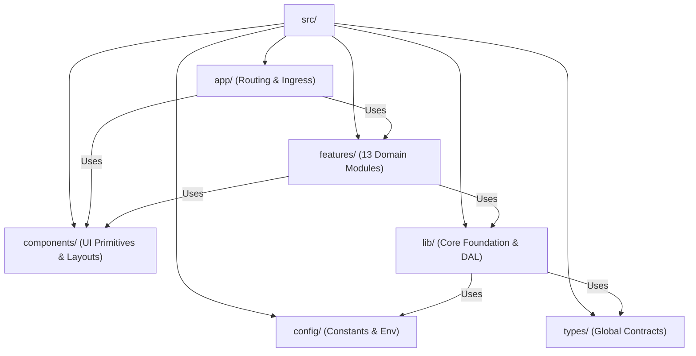
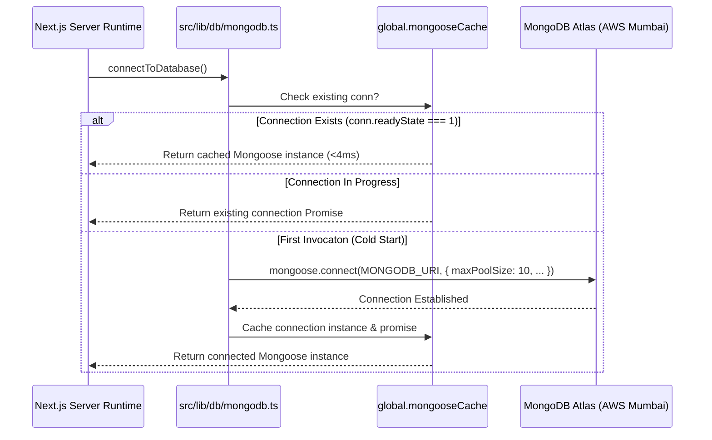

# Phase 2 — Technical Infrastructure Audit

> **Document ID:** DOC-PHASE2-AUDIT-001  
> **Status:** Authoritative Audit (Phase 2, Part 2.9)  
> **Institution:** Axis Institute of Technology & Management  
> **System:** Axis LinkUp Platform Infrastructure Baseline  
> **Last Updated:** November 2026  

---

## 1. System Technology Versions & Manifest Audit

| Technology Layer | Software / Package | Exact Installed Version | Status & Compatibility |
| :--- | :--- | :---: | :--- |
| **Runtime Environment** | Node.js | `v22.20.0` (LTS) | Native ESM support, high performance V8 engine |
| **Package Manager** | npm | `11.6.0` | Lockfile v3 integrity enforced (`package-lock.json`) |
| **Core Framework** | Next.js (App Router) | `15.5.29` | React Server Components, Server Actions enabled |
| **UI Library** | React & React DOM | `19.1.0` | Full React 19 concurrent features |
| **Programming Language**| TypeScript | `5.6.3` | Strict mode, noImplicitAny, noUncheckedIndexedAccess |
| **Styling Engine** | Tailwind CSS | `4.0.0` | PostCSS `@tailwindcss/postcss`, OKLCH design tokens |
| **Component Primitives** | shadcn/ui & Radix UI | `shadcn 4.23.0` / `radix-ui 1.8.1` | Radix Nova style preset, accessible WAI-ARIA |
| **Database ODM** | Mongoose | `9.12.1` | Cached connection pooling, MongoDB Driver 6+ |
| **Schema Validation** | Zod | `3.24.2` | Runtime parsing, fail-fast boot diagnostics |
| **Linter** | ESLint | `9.39.5` | ESLint 9 Flat Config (`eslint.config.mjs`) |
| **Code Formatter** | Prettier | `3.10.1` | Tailwind plugin, 2-space indentation |
| **Test Runner (Unit)** | tsx & Node Test Runner | `tsx 4.23.15` / `node:test` | Native TypeScript test execution |

---

## 2. Directory Architecture & Boundary Audit

The project implements the approved **Modular Monolith** architecture:

### 2.1 Route Groups (`src/app/`)
- `(auth)`: Isolated ingress layout for authentication flows.
- `(student)`: Mobile-first navigation workspace for student portals.
- `(faculty)`: Sidebar-driven productivity workspace for faculty workflows.
- `(admin)`: Tabular queue management for departmental administrators.
- `(super-admin)`: Security and emergency override telemetry console.
- `(shared)`: Cross-cutting public pages (campus directory, help desk).
- `api/`: External REST integrations and health checks (`/api/health/db`).
- `actions/`: Global shared Server Actions.

### 2.2 Feature Modules (`src/features/*`)
13 independent domain features scaffolded: `assignments`, `audit`, `auth`, `campus`, `communication`, `notices`, `notifications`, `polls`, `requests`, `resources`, `safety`, `timetable`, `users`. Each encapsulates its own components, hooks, services, and types behind a public `index.ts`.

### 2.3 Shared UI Primitives (`src/components/ui/`)
11 Tier-1 components: `button`, `input`, `label`, `card`, `badge`, `separator`, `skeleton`, `dialog`, `dropdown-menu`, `avatar`, `tooltip`.

---

## 3. Database Connection Architecture

- **Driver:** Mongoose `^9.12.1`.
- **Target Cluster:** AWS Mumbai (`ap-south-1`).
- **Connection Caching:** Global variable interface augmentation (`global.mongooseCache`) prevents connection exhaustion during Next.js serverless invocations and Fast Refresh in development.
- **Connection Pool:** Capped at `maxPoolSize: 10` for serverless lambdas.
- **Validation:** Direct ping via `GET /api/health/db` verified live connectivity.

---

## 4. Environment & Secrets Management Architecture

- **Loading Priority:** Standard Next.js loading hierarchy (`System` > `.env.local` > `.env`).
- **Validation Engine:** `src/config/env.ts` parses variables on boot via **Zod 3.24+**.
- **Client Security Proxy:** `serverEnv` is wrapped in a runtime `Proxy` that physically blocks reads if `typeof window !== 'undefined'`, raising a fatal `[Security Violation]` exception.
- **Client-Safe Variables:** Only variables prefixed with `NEXT_PUBLIC_*` (`NEXT_PUBLIC_APP_URL`, `NEXT_PUBLIC_APP_NAME`) are bundled into client code.
- **Git Protection:** `.env` and `.env.*` are excluded by `.gitignore`; only sanitized `.env.example` is version-controlled.

---

## 5. Shared Utility Inventory

1. `src/lib/utils/cn.ts`: Class name merger.
2. `src/lib/utils/format-date.ts`: `formatDate`, `formatDateTime`, `formatTime`, `formatRelativeTime`, `toISODateString`.
3. `src/lib/utils/format-number.ts`: `formatNumber`, `formatCurrency`, `formatPercentage`, `formatCompactNumber`.
4. `src/lib/utils/format-file-size.ts`: `formatFileSize`.
5. `src/lib/errors/app-error.ts`: `AppError` and 10 operational subclasses.
6. `src/lib/errors/error-codes.ts`: `ERROR_CODES` and `ERROR_CODE_TO_HTTP_STATUS`.
7. `src/lib/api/api-response.ts`: Next.js `NextResponse` helpers and Server Action payload builders.
8. `src/lib/api/api-error-handler.ts`: Error normalization and safe client envelope builders.
9. `src/lib/logging/logger.ts`: Production structured logger with recursive credential redaction.
10. `src/lib/validations/common-schemas.ts`: Reusable Zod schemas.
11. `src/config/constants.ts`: System constants (HTTP statuses, pagination, upload constraints, department codes).
12. `src/types/api.ts`: Master API response contracts.
13. `src/types/common.ts`: Reusable utility types.

---

## 6. Security Observations & Audit Verdict

- **Secrets in Code:** 0 occurrences.
- **Public Credential Leaks:** 0 occurrences.
- **Stack Trace Exposure:** 0 occurrences (all 5xx errors sanitized by `api-error-handler.ts`).
- **Audit Verdict:** The architecture strictly enforces zero-trust boundaries and meets all technical specifications for Phase 2.

