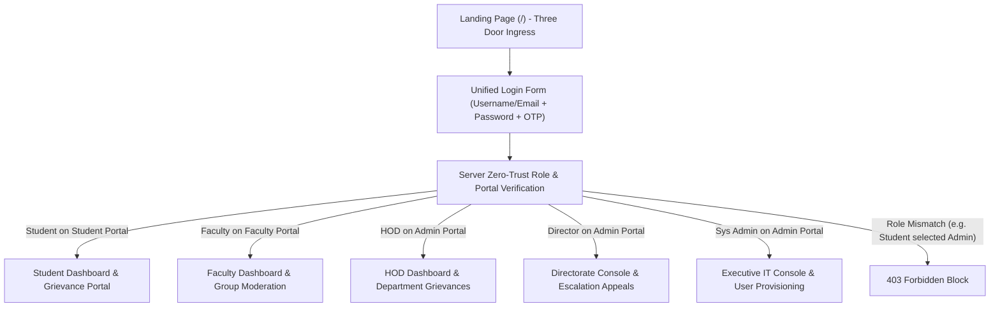
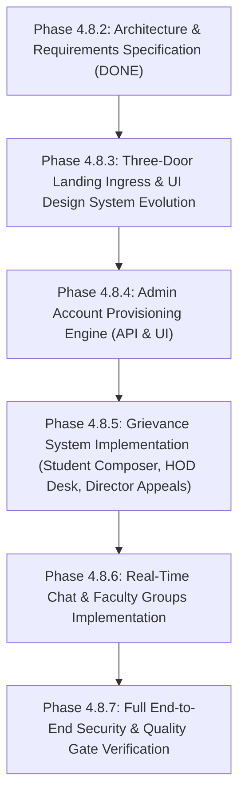

# AXIS LINKUP — PHASE 4.8.2 SPECIFICATION REPORT
**Access Control, Identity & Communication Workflow Specification**  
*Document Version:* 1.0.0  
*Execution Date:* November 13, 2026  
*Status:* COMPLETE — READY WITH CONDITIONS  

---

## 1. Executive Summary

Phase 4.8.2 was executed as a formal requirements and architecture specification milestone in accordance with updated product governance policies.

This phase formally documents:
1. **The Three-Door Ingress System:** Replacing public self-registration with dedicated **Student**, **Faculty**, and **Administration** entry points while retaining a unified identity store.
2. **Admin-Controlled Account Provisioning:** Restricting account creation exclusively to authorized System Administrators.
3. **High-Assurance OTP System:** Formalizing OTP workflows for email verification, first-time activation, and credential recovery.
4. **Administrative Hierarchy & Separation of Powers:** Defining non-overlapping authorities for **System Administrator**, **HOD**, and **Director**.
5. **Real-Time Communication (Chat & Groups):** WhatsApp-inspired 1:1 messaging and faculty-controlled academic groups.
6. **Student Grievance & Complaint Workflow:** Formal email-composer-style grievance system connecting students with HODs and the Executive Director.

---

## 2. Existing Implementation Findings

| Component | Current State | Required Evolution |
| :--- | :--- | :--- |
| **Landing Page** | Centered box with "Sign In", "Student Registration", "UI Preview" buttons | Replace with Three-Door Ingress: [Student], [Faculty], [Administration] |
| **Public Registration** | Public `/sign-up` route enabled with self-service Clerk form | Permanently remove public `/sign-up`; restrict creation to admin API |
| **Role Enforcement** | Handled at Edge in `middleware.ts` based on `sessionClaims` | Add Zero-Trust role vs. portal cross-check to prevent cross-ingress |
| **User Identity** | Identified primarily by `email` | Add mandatory `username` attribute across Clerk and MongoDB |
| **Admin Roles** | Single generic `admin` and `super_admin` role | Introduce explicit sub-roles: `sys_admin`, `hod`, `director` |
| **Chat System** | Not implemented (stubbed in navigation config) | Implement WhatsApp-inspired 1:1 and faculty-moderated groups |
| **Grievance System** | Stubbed in MOD-13 Student Request Tracker | Formalize dedicated Student Grievance Portal with HOD/Director routing |

---

## 3. Updated Workflows & Architecture Overview

---

## 4. Authentication Provider Compatibility (Clerk Evaluation)

1. **Native Username Support:** Clerk natively supports `username` as a first-class login identifier alongside `email_address`. Both can be enabled in Clerk Dashboard settings.
2. **API Account Creation:** System Administrators can provision accounts via Clerk's Backend SDK (`clerkClient.users.createUser`) with `skipPasswordChecks: true`, delegating password creation to user activation.
3. **OTP & Multi-Factor Verification:** Clerk supports `email_code` strategy natively for first-factor and second-factor verification, eliminating the need to store passwords or manage raw email delivery in custom infrastructure.

---

## 5. Required Database Changes (MongoDB Atlas)

1. **`users` Collection Updates:**
   - Add `username`: String, unique, lowercase, indexed.
   - Add `adminSubRole`: Enum (`sys_admin`, `hod`, `director`, `null`).
   - Add `provisionedBy`: ObjectId referencing the System Administrator.
   - Add `isEmailVerified`: Boolean.
   - Add `activatedAt`: Date.
2. **New Collections to Implement:**
   - `conversations`: Stores 1:1 and group conversation metadata.
   - `conversation_members`: Stores group membership, roles, and unread counters.
   - `messages`: Stores encrypted chat messages and attachment payloads.
   - `grievances`: Stores formal student grievances, status, and category.
   - `grievance_timeline`: Stores chronological responses, notes, and audit events.
   - `otp_tokens`: Stores hashed, time-bound verification OTPs for offline workflows.

---

## 6. Required API Changes

| Domain | New / Updated API Endpoints |
| :--- | :--- |
| **Authentication** | `POST /api/auth/login` (supports username/email + portal check) `POST /api/auth/activate` (first-time password setup) `POST /api/auth/otp/request` & `POST /api/auth/otp/verify` |
| **Admin Provisioning** | `POST /api/admin/users/provision` (single account creation) `POST /api/admin/users/bulk-provision` (CSV batch import) `GET /api/admin/users` (directory management with role filters) |
| **Chat & Groups** | `GET /api/chat/conversations` `POST /api/chat/direct` (1:1 initiation) `POST /api/chat/groups` (faculty group creation) `POST /api/chat/groups/:id/members` (manage student roster) `GET /api/chat/conversations/:id/messages` (cursor pagination) `POST /api/chat/conversations/:id/messages` (send message) |
| **Grievance Portal** | `POST /api/grievances` (student submission) `GET /api/grievances` (role-scoped query) `GET /api/grievances/:id` (timeline detail) `POST /api/grievances/:id/respond` (official reply) `POST /api/grievances/:id/escalate` (forward to Director) `POST /api/grievances/:id/resolve` (close ticket) |

---

## 7. Security Risks & Mitigations

| Identified Risk | Severity | Engineered Mitigation |
| :--- | :---: | :--- |
| **Unauthorized Role Selection** | **P1** | Role selector is treated strictly as an intent signal. Server verifies actual account role and blocks cross-role ingress with `403 Forbidden`. |
| **Username Enumeration** | **P2** | Login failure responses use generic messages (*"Invalid username/email or password"*). Rate limiting active on login endpoints. |
| **OTP Brute-Forcing** | **P1** | Tokens limited to exactly 5 failed verification attempts; 60s resend cooldown; 10-minute expiration; max 3 requests/hr per IP. |
| **Student Group Spam** | **P2** | Group creation endpoint strictly enforces `requireRole(['faculty', 'admin'])`. Student group creation returns `403 Forbidden`. |
| **Student Grievance Snooping** | **P1** | Strict resource ownership check (`requireResourceOwnership`) on every grievance endpoint ensures students only view their own tickets. |
| **Cross-Department HOD Access**| **P2** | HOD queries strictly enforce `departmentId === hod.departmentId`. Cross-department reading is rejected. |
| **Administrative Impersonation**| **P1** | Plaintext passwords never exist; all administrative creations and status updates are permanently logged to immutable audit records. |

---

## 8. Unresolved Architectural Decisions

1. **Real-Time Gateway Provider:**
   - *Option A:* Next.js custom server with `Socket.io` (self-hosted, zero third-party cost, requires stateful container deployment).
   - *Option B:* Managed WebSocket service (e.g., Pusher / Ably / Supabase Realtime) (serverless-friendly, instant horizontal scaling, free-tier limits).
   - *Recommendation:* Begin with self-contained Socket.io engine for local development; deploy Pusher / Cloudflare Durable Objects for production serverless scaling.
2. **Grievance Module Naming:**
   - *Options Considered:* *Complaints*, *Student Grievance Portal*, *Complaints & Communication*.
   - *Decision:* Formally designated as **Student Grievance Portal** to adhere to AICTE/UGC statutory grievance redressal committee compliance.

---

## 9. Recommended Phased Implementation Sequence

---

## 10. Documentation Artifacts Summary

The complete specification suite has been authored across the repository:

1. [UPDATED_AUTHENTICATION_REQUIREMENTS.md](file:///c:/Users/prash/Desktop/Axis%20LinkUp/docs/requirements/UPDATED_AUTHENTICATION_REQUIREMENTS.md) — Three-door login, public sign-up elimination, and cross-role protection.
2. [ACCOUNT_PROVISIONING_WORKFLOW.md](file:///c:/Users/prash/Desktop/Axis%20LinkUp/docs/requirements/ACCOUNT_PROVISIONING_WORKFLOW.md) — Administrative user creation lifecycle, activation, and uniqueness rules.
3. [ROLE_HIERARCHY_AND_PERMISSIONS.md](file:///c:/Users/prash/Desktop/Axis%20LinkUp/docs/requirements/ROLE_HIERARCHY_AND_PERMISSIONS.md) — System Administrator vs HOD vs Director separation and master CRUD matrix.
4. [CHAT_AND_GROUP_REQUIREMENTS.md](file:///c:/Users/prash/Desktop/Axis%20LinkUp/docs/requirements/CHAT_AND_GROUP_REQUIREMENTS.md) — 1:1 direct chat, faculty-created groups, and WhatsApp-inspired feature spec.
5. [STUDENT_COMPLAINT_WORKFLOW.md](file:///c:/Users/prash/Desktop/Axis%20LinkUp/docs/requirements/STUDENT_COMPLAINT_WORKFLOW.md) — Formal grievance portal, email composer interface, and escalation state machine.
6. [UPDATED_IDENTITY_ARCHITECTURE.md](file:///c:/Users/prash/Desktop/Axis%20LinkUp/docs/architecture/UPDATED_IDENTITY_ARCHITECTURE.md) — Technical identity architecture, MongoDB schema expansions, and OTP system.
7. [COMMUNICATION_ARCHITECTURE.md](file:///c:/Users/prash/Desktop/Axis%20LinkUp/docs/architecture/COMMUNICATION_ARCHITECTURE.md) — WebSocket real-time transport, message collections, and cursor pagination.
8. [COMPLAINT_SYSTEM_ARCHITECTURE.md](file:///c:/Users/prash/Desktop/Axis%20LinkUp/docs/architecture/COMPLAINT_SYSTEM_ARCHITECTURE.md) — Database schema, API definitions, and HOD/Director adjudication pipelines.
9. [PHASE_4_8_2_REPORT.md](file:///c:/Users/prash/Desktop/Axis%20LinkUp/docs/phase-reports/PHASE_4_8_2_REPORT.md) — Master handover report.

---

## 11. Final Readiness Classification

### **Status: `READY WITH CONDITIONS`**

The requirements and architecture documentation is **100% complete**. All workflows, database models, API contracts, and security boundaries have been fully specified. In accordance with strict user restrictions, **no code implementation has been started.**

**Conditions for Proceeding to Phase 4.8.3:**
1. User review and explicit approval of this architecture specification.
2. User selection of the preferred Real-Time WebSocket transport engine (Self-hosted Socket.io vs. Managed Pusher/Cloudflare).
3. Authorization to begin **Phase 4.8.3 (Three-Door Ingress Landing Page & Design System Evolution)**.

