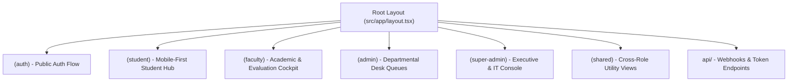
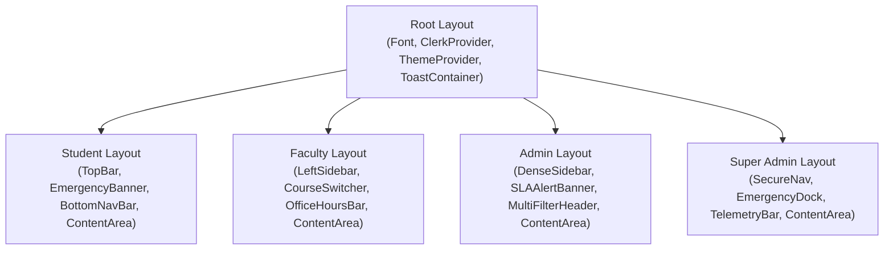

# Next.js App Router Structure & Route Layout Specification

> **Document ID:** DOC-STRUC-002  
> **Status:** Approved Baseline (Phase 1, Part 1.5)  
> **Institution:** Axis Institute of Technology & Management  
> **Routing Engine:** Next.js 15+ App Router  
> **Last Updated:** November 2026  

---

## 1. Route Group Taxonomy & Organizational Philosophy

Axis LinkUp organizes its public-facing and role-authenticated views into **Route Groups** (folders wrapped in parentheses). Route groups allow the application to isolate layouts, error boundaries, and loading states without modifying the URL path.



---

## 2. Exhaustive Route Tree (`src/app/`)

```
src/app/
├── (auth)/                                     # Public Authentication Flows
│   ├── layout.tsx                              # Clean, centered card layout with Axis Institute logo
│   ├── sign-in/[[...sign-in]]/page.tsx         # Clerk embedded sign-in view
│   ├── sign-up/[[...sign-up]]/page.tsx         # Onboarding & invitation acceptance
│   ├── forgot-password/page.tsx                # Password reset workflow
│   └── unauthorized/page.tsx                   # 403 Access Denied explanation view
│
├── (student)/                                  # Student Role Workspace (URL: /student/*)
│   ├── layout.tsx                              # Student layout: Bottom nav + mobile header + emergency banner
│   ├── loading.tsx                             # Student dashboard skeleton loader
│   ├── error.tsx                               # Student-scoped error boundary
│   ├── dashboard/page.tsx                      # MOD-03: Personalized daily agenda, notices, deadlines
│   ├── timetable/page.tsx                      # MOD-10: Weekly lecture timetable & examination schedule
│   ├── notices/
│   │   ├── page.tsx                            # MOD-07: Targeted bulletin feed with priority filters
│   │   └── [id]/page.tsx                       # Full notice detail with acknowledgment button
│   ├── requests/
│   │   ├── page.tsx                            # MOD-13: Active service request status cards
│   │   ├── new/page.tsx                        # Dynamic request submission form
│   │   └── [id]/page.tsx                       # Ticket detail timeline, remarks & certificate download
│   ├── chat/
│   │   ├── page.tsx                            # MOD-08: Channel list (enrolled courses & direct chats)
│   │   └── [channelId]/page.tsx                # Active real-time chat room view
│   ├── assignments/                            # Phase 2 (V2.0)
│   │   ├── page.tsx                            # MOD-11: Assignment list with countdown badges
│   │   └── [id]/page.tsx                       # Assignment brief, rubric, and upload dropzone
│   ├── notes/                                  # Phase 2 (V2.0)
│   │   ├── page.tsx                            # MOD-12: Unit-wise lecture notes repository
│   │   └── [courseId]/page.tsx                 # Subject-specific notes and presentations
│   └── passport/page.tsx                       # Phase 3 (V3.0): MOD-15 Skill & Achievement Passport
│
├── (faculty)/                                  # Faculty Role Workspace (URL: /faculty/*)
│   ├── layout.tsx                              # Faculty layout: Collapsible left sidebar + course switcher
│   ├── loading.tsx                             # Faculty workspace skeleton loader
│   ├── error.tsx                               # Faculty-scoped error boundary
│   ├── dashboard/page.tsx                      # MOD-04: Daily teaching schedule & grading queue summary
│   ├── schedule/page.tsx                       # MOD-10: Faculty weekly lecture schedule
│   ├── classes/
│   │   ├── page.tsx                            # Enrolled course sections directory
│   │   └── [courseId]/page.tsx                 # Class roster, student list, attendance links
│   ├── notices/
│   │   ├── page.tsx                            # Course announcements management
│   │   └── new/page.tsx                        # MOD-07: Course announcement composer modal/page
│   ├── assignments/                            # Phase 2 (V2.0)
│   │   ├── page.tsx                            # Assignment creator & active lists
│   │   ├── new/page.tsx                        # Create assignment form with deadline picker
│   │   └── [id]/grade/page.tsx                 # Student submission evaluation and scoring queue
│   ├── notes/                                  # Phase 2 (V2.0)
│   │   └── page.tsx                            # MOD-12: Upload and organize course study materials
│   └── verification/page.tsx                   # Phase 3 (V3.0): MOD-15 Student passport claims queue
│
├── (admin)/                                    # Departmental Administrator Workspace (URL: /admin/*)
│   ├── layout.tsx                              # Admin layout: High-density desktop sidebar + queue counters
│   ├── loading.tsx                             # Admin data table skeleton loader
│   ├── error.tsx                               # Admin-scoped error boundary
│   ├── dashboard/page.tsx                      # MOD-05: Departmental operational metrics & SLA tracker
│   ├── requests/
│   │   ├── page.tsx                            # MOD-13: Kanban / Filterable table of student requisitions
│   │   └── [id]/page.tsx                       # Ticket fulfillment, document generator, approval desk
│   ├── notices/
│   │   ├── page.tsx                            # Department notice desk & publishing queue
│   │   └── new/page.tsx                        # Department & college notice composer
│   ├── facilities/page.tsx                     # Phase 2 (V2.0): MOD-14 Room & Lab Finder manager
│   ├── calendar/page.tsx                       # MOD-10: Term calendar & institutional event scheduler
│   └── reports/page.tsx                        # MOD-18: Departmental SLA resolution & activity reports
│
├── (super-admin)/                              # Executive Leadership Workspace (URL: /super-admin/*)
│   ├── layout.tsx                              # Super Admin layout: High-security console + Emergency dock
│   ├── loading.tsx                             # System health telemetry skeleton
│   ├── error.tsx                               # Security error boundary
│   ├── dashboard/page.tsx                      # MOD-06: Executive telemetry, active sessions, system health
│   ├── users/
│   │   ├── page.tsx                            # MOD-01: Campus user directory with search/filters
│   │   ├── import/page.tsx                     # Bulk CSV user provisioning wizard
│   │   └── [id]/page.tsx                       # User detail, role modification, suspension controls
│   ├── roles/page.tsx                          # MOD-02: RBAC permissions matrix viewer
│   ├── emergency/page.tsx                      # MOD-16: Campus Emergency Mode trigger & broadcast console
│   └── audit-logs/page.tsx                     # MOD-19: Immutable compliance & security audit log browser
│
├── (shared)/                                   # Cross-Role Shared Views
│   ├── profile/page.tsx                        # User profile, password, notification preferences
│   └── emergency/view/page.tsx                 # Public read-only emergency alert broadcast view
│
├── api/                                        # Route Handlers (Reserved for webhooks & integrations)
│   ├── health/route.ts                         # System health check endpoint for monitoring
│   ├── webhooks/
│   │   ├── clerk/route.ts                      # Clerk user sync webhook (Svix signature verified)
│   │   └── cloudinary/route.ts                 # Cloudinary upload completion webhook
│   ├── realtime/
│   │   └── token/route.ts                      # Ably capability token minting endpoint
│   └── storage/
│       └── signature/route.ts                  # Cloudinary signed upload preset generator
│
├── global-error.tsx                            # Root-level catch-all React error boundary
├── layout.tsx                                  # Root HTML layout (Fonts, Providers, Toasters)
├── not-found.tsx                               # Global 404 Not Found page
└── page.tsx                                    # Root landing page (Auto-redirects to user's role dashboard)
```

---

## 3. Nested Layouts & Role-Specific Shells



### 3.1 Student Shell (`(student)/layout.tsx`)
- Optimized for mobile viewports (360px–480px).
- Bottom navigation bar fixed to viewport base (`h-16`).
- Top bar contains Axis Institute emblem, notification bell badge, and an omnipresent emergency alert banner (when active).

### 3.2 Faculty Shell (`(faculty)/layout.tsx`)
- Optimized for laptops (1280px+) and landscape tablets.
- Collapsible left sidebar providing rapid switching between teaching schedules and grading queues.
- Course context dropdown allows instant switching between assigned course sections.

### 3.3 Admin Shell (`(admin)/layout.tsx`)
- Desktop-dense interface featuring high-contrast queues.
- Persistent sidebar counter displaying pending tickets approaching SLA limits.

### 3.4 Super Admin Shell (`(super-admin)/layout.tsx`)
- High-security console requiring active MFA.
- Prominent persistent dock showing live campus status and the Master Emergency Override switch.

---

## 4. Loading States & Error Boundaries

### 4.1 Loading Skeletons (`loading.tsx`)
Every major route group defines a dedicated `loading.tsx` component that renders an accessible skeleton screen matching the layout shape of that view. This prevents layout shift (CLS = 0) and delivers immediate visual feedback.

### 4.2 Granular Error Boundaries (`error.tsx`)
- Every route group contains an isolated `error.tsx` file.
- If a server error occurs inside the student notices feed, only the notices widget crashes and shows a retry button; the student layout and bottom navigation bar remain completely intact and operational.
- `global-error.tsx` catches fatal root layout exceptions, rendering a fallback recovery screen.

---

## 5. Protected Route Organization (Edge Middleware)

All route access is strictly enforced by Next.js Edge Middleware (`src/middleware.ts`) prior to any serverless function execution:

| Route Pattern | Required Role Claim (`token.publicMetadata.role`) | Unauthorized Behavior |
| :--- | :--- | :--- |
| `/` (Root) | Authenticated | Redirects to `/{role}/dashboard` |
| `/student/*` | `'student'` | Redirects to user's assigned dashboard or 403 |
| `/faculty/*` | `'faculty'` | Redirects to user's assigned dashboard or 403 |
| `/admin/*` | `'admin'` or `'super_admin'` | Redirects to 403 Access Denied |
| `/super-admin/*` | `'super_admin'` | Redirects to 403 Access Denied |
| `/api/webhooks/*` | Public | Signature-verified via cryptographic headers |
| `/api/realtime/*` | Authenticated | Rejects with 401 if unauthenticated |

