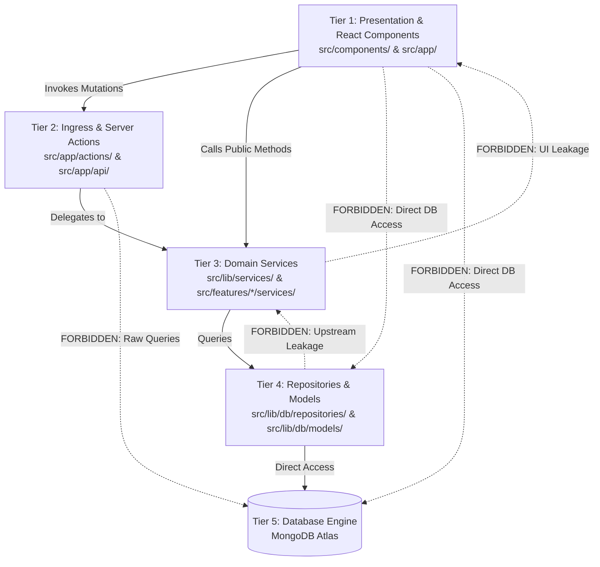

# Architectural Dependency Rules & Import Boundaries

> **Document ID:** DOC-STRUC-008  
> **Status:** Approved Baseline (Phase 1, Part 1.5)  
> **Institution:** Axis Institute of Technology & Management  
> **Enforcement Mechanism:** ESLint 9+ Boundaries Plugin & Strict Module Auditing  
> **Last Updated:** November 2026  

---

## 1. Direction of Dependency & Layered Constraints

To prevent spaghetti code, circular references, and privilege leakage, Axis LinkUp enforces a **Strict Unidirectional Flow of Dependencies**:



---

## 2. Permitted & Forbidden Import Matrix

| Target Directory (Consumer) | Permitted to Import From | STRICTLY FORBIDDEN to Import From |
| :--- | :--- | :--- |
| **`src/components/ui/`** | External UI libraries (Radix, clsx, tailwind-merge) | Any feature code, domain services, Mongoose models, Server Actions. |
| **`src/components/shared/`** | `src/components/ui/`, `src/lib/utils/`, `src/types/` | Features, Mongoose models, repositories, database clients. |
| **`src/components/layouts/`** | `src/components/ui/`, `src/components/shared/`, `src/types/` | Mongoose models, private feature internals, raw database queries. |
| **`src/features/*/components/`** | `src/components/ui/`, `src/components/shared/`, own feature internals, `@/features/*/` (public API only) | Mongoose models, repositories, database client (`src/lib/db/*`). |
| **`src/features/*/services/`** | `src/lib/db/repositories/`, `src/lib/validations/`, `src/lib/integrations/`, `src/types/` | React components (`*.tsx`), React hooks, Next.js request/response (`NextRequest`, `cookies()`). |
| **`src/app/actions/`** | Feature services (`src/features/*/services/`), `src/lib/auth/guards.ts`, `src/lib/validations/` | Direct Mongoose models (`*.model.ts`), direct repository writes without service layer. |
| **`src/app/api/`** | External webhooks, `src/lib/integrations/`, `src/lib/services/` | Direct database mutations bypassing domain service validation. |
| **`src/lib/db/repositories/`** | `src/lib/db/models/`, `src/lib/db/client.ts`, `src/types/` | React components, UI hooks, Server Actions, feature UI code. |
| **`src/lib/db/models/`** | `mongoose`, `src/types/database.ts` | Services, components, actions, or route handlers. |

---

## 3. Explicit Prohibitions & Architectural Anti-Patterns

### PROHIB-01: Zero Direct Database Access in Presentation Components
- Presentation components (`src/components/*` and `src/app/**/page.tsx`) **must never** import Mongoose models (`*.model.ts`) or execute raw queries (`find()`, `updateOne()`).
- All data retrieval in Server Components must pass through repository/service methods, and all mutations must pass through Server Actions.

### PROHIB-02: Zero Server Secrets in Client Components
- Client Components marked with `"use client"` **must never** import server-only packages:
  - `@clerk/backend`
  - `mongoose`
  - `cloudinary` (backend SDK)
  - `resend`
  - `svix`
- Any import of these libraries in client bundles causes immediate build termination.

### PROHIB-03: Zero Circular Dependencies Between Features
- Feature A cannot import from Feature B if Feature B imports from Feature A.
- Cross-feature communication must be brokered through global shared domain services located in `src/lib/services/`.

### PROHIB-04: Zero HTTP/Web Awareness in Domain Services
- Domain Services (`src/lib/services/*`) must be pure TypeScript classes. They must **never** import:
  - `NextRequest` or `NextResponse`
  - `cookies()` or `headers()` from `next/headers`
- Services accept plain DTOs and context objects (`{ userId, role, departmentId }`), making them 100% testable in Vitest without mocking the HTTP stack.

---

## 4. Mechanical Enforcement via ESLint Flat Config (`eslint.config.mjs`)

These architectural rules are enforced automatically in CI/CD using ESLint boundaries:

```javascript
// eslint.config.mjs (Architectural Boundary Rules)
import boundaries from 'eslint-plugin-boundaries';

export default [
  {
    plugins: { boundaries },
    settings: {
      'boundaries/elements': [
        { type: 'ui', pattern: 'src/components/ui/*' },
        { type: 'shared-components', pattern: 'src/components/shared/*' },
        { type: 'feature-components', pattern: 'src/features/*/components/*' },
        { type: 'services', pattern: 'src/lib/services/*' },
        { type: 'repositories', pattern: 'src/lib/db/repositories/*' },
        { type: 'models', pattern: 'src/lib/db/models/*' },
        { type: 'actions', pattern: 'src/app/actions/*' },
      ],
    },
    rules: {
      'boundaries/element-types': [
        'error',
        {
          default: 'disallow',
          rules: [
            // UI Components can only import UI and Shared
            { from: 'ui', allow: ['ui'] },
            { from: 'shared-components', allow: ['ui', 'shared-components'] },
            { from: 'feature-components', allow: ['ui', 'shared-components'] },
            // Actions can import Services and Guards
            { from: 'actions', allow: ['services'] },
            // Services can import Repositories
            { from: 'services', allow: ['repositories'] },
            // Repositories can import Models
            { from: 'repositories', allow: ['models'] },
          ],
        },
      ],
      'no-restricted-imports': [
        'error',
        {
          paths: [
            {
              name: 'mongoose',
              importNames: ['model', 'models', 'Schema'],
              message: 'Direct Mongoose access is restricted to src/lib/db/models/.',
            },
          ],
        },
      ],
    },
  },
];
```

