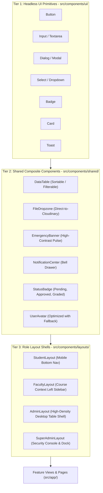

# Shared Component Architecture & Design System

> **Document ID:** DOC-STRUC-005  
> **Status:** Approved Baseline (Phase 1, Part 1.5)  
> **Institution:** Axis Institute of Technology & Management  
> **Component Philosophy:** shadcn/ui Headless Primitives + Atomic Composition  
> **Location:** `src/components/`  
> **Last Updated:** November 2026  

---

## 1. Component Hierarchy & Atomic Design

Axis LinkUp organizes its presentation layer into three distinct architectural tiers:



---

## 2. Directory Layout (`src/components/`)

```
src/components/
├── ui/                                         # Tier 1: Base UI Primitives (shadcn/ui / Radix)
│   ├── button.tsx                              # Accessible button with loading spinner state
│   ├── input.tsx                               # Form text/number input
│   ├── textarea.tsx                            # Multi-line text field with auto-resize
│   ├── dialog.tsx                              # Modal dialog overlay (Radix Dialog)
│   ├── dropdown-menu.tsx                       # Context menus & user action menus
│   ├── select.tsx                              # Accessible select dropdown (Radix Select)
│   ├── table.tsx                               # Responsive HTML table elements
│   ├── badge.tsx                               # Visual status & priority pill badges
│   ├── card.tsx                                # Bounded card container (header, content, footer)
│   ├── toast.tsx                               # Toast notification primitive
│   ├── tabs.tsx                                # Tabbed workspace container
│   ├── skeleton.tsx                            # Animated loading placeholder
│   └── tooltip.tsx                             # Hover explanation tooltips
│
├── shared/                                     # Tier 2: Domain-Agnostic Composite Components
│   ├── data-table/                             # Generic Data Table Engine
│   │   ├── data-table.tsx                      # Table container with pagination & column sorting
│   │   ├── data-table-pagination.tsx           # Page switcher & rows-per-page selector
│   │   ├── data-table-toolbar.tsx              # Multi-filter search input & column toggle
│   │   └── data-table-column-header.tsx        # Sort indicator headers
│   ├── file-upload-dropzone.tsx                # Drag-and-drop uploader with Cloudinary signed presets
│   ├── emergency-banner.tsx                    # Campus-wide pulsating emergency broadcast banner
│   ├── notification-center.tsx                 # Notification bell with unread badge & popover drawer
│   ├── status-badge.tsx                        # Standardized status chips (Submitted, Under Review, Graded)
│   ├── user-avatar.tsx                         # Avatar with initials fallback & Cloudinary optimization
│   ├── empty-state.tsx                         # Friendly illustrations for empty feeds or lists
│   └── confirm-dialog.tsx                      # Two-step destructive action confirmation modal
│
└── layouts/                                    # Tier 3: Role-Specific Layout Shells
    ├── student-layout.tsx                      # Mobile-first shell: fixed bottom nav + header
    ├── faculty-layout.tsx                      # Productivity shell: collapsible sidebar + course dropdown
    ├── admin-layout.tsx                        # Operations shell: high-density desktop sidebar
    ├── super-admin-layout.tsx                  # Security shell: executive telemetry + emergency trigger dock
    ├── bottom-nav-bar.tsx                      # Mobile bottom navigation bar for students
    ├── collapsible-sidebar.tsx                 # Left-hand navigation sidebar for faculty
    └── top-app-bar.tsx                         # Universal top bar with institution logo & profile dropdown
```

---

## 3. Detailed Specifications for Core Shared Components

### 3.1 Generic Data Table (`src/components/shared/data-table/`)
- **Purpose:** Standardizes tabular data presentation across the Admin Request Queue (MOD-13), User Directory (MOD-01), Audit Log Browser (MOD-19), and Faculty Grading Queue (MOD-11).
- **Features:**
  - Client-side and server-side pagination modes.
  - Multi-column text search and categorical faceted filters.
  - Accessible column sorting indicators with keyboard triggers.
  - Empty state fallback when filters return zero rows.

### 3.2 File Upload Dropzone (`file-upload-dropzone.tsx`)
- **Purpose:** Unified file dropzone used for student assignment submissions, faculty lecture notes, and administrative proof attachments.
- **Features:**
  - Client-side pre-validation: validates file extension, MIME type, and size ceiling (e.g. max 25MB for assignments).
  - Fetches signed upload presets from `/api/storage/signature`.
  - Streams binary payload directly to Cloudinary edge nodes, rendering upload progress percentage bar.
  - Rejects executable files (`.exe`, `.bat`, `.sh`) with user-friendly error banners.

### 3.3 Emergency Alert Banner (`emergency-banner.tsx`)
- **Purpose:** Omnipresent alert banner rendered at the topmost coordinate of all viewports when Emergency Mode is active.
- **Visual Design:** Full-width, high-contrast red background (`bg-red-600 dark:bg-red-700`), bold white typography, pulsating siren icon (`lucide-react: AlertTriangle`), and an unmistakable "View Directives" button that opens the full Emergency Modal.

### 3.4 Reusable Form Controls Pattern
All form components pair `react-hook-form` with `zod` validation schemas via `@hookform/resolvers/zod`:

```typescript
// Standard Pattern: src/components/ui/form.tsx wrapper
<Form {...form}>
  <form onSubmit={form.handleSubmit(onSubmit)} className="space-y-4">
    <FormField
      control={form.control}
      name="title"
      render={({ field }) => (
        <FormItem>
          <FormLabel>Notice Title</FormLabel>
          <FormControl>
            <Input placeholder="Enter notice headline..." {...field} />
          </FormControl>
          <FormMessage />
        </FormItem>
      )}
    />
    <Button type="submit" disabled={isSubmitting}>
      {isSubmitting ? <Spinner /> : 'Publish Notice'}
    </Button>
  </form>
</Form>
```

---

## 4. Cross-Role Component Reuse Strategy

Shared components are designed to adapt dynamically based on user role context without duplicating markup:

| Shared Component | Student Context | Faculty Context | Admin Context |
| :--- | :--- | :--- | :--- |
| `StatusBadge` | Renders ticket status chips (`"Under Review"`, `"Approved"`). | Renders submission status chips (`"Submitted"`, `"Graded"`). | Renders SLA status chips (`"Approaching Breach"`, `"Breached"`). |
| `DataTable` | Not used (mobile cards preferred). | Compact table for class rosters and submission lists. | High-density table with multi-filter search and CSV export. |
| `FileDropzone` | Single file upload for assignment submission. | Multi-file upload for lecture slides and lab manuals. | Single document upload for signed certificate PDF issuance. |
| `UserAvatar` | Small 32x32 round avatar in mobile header. | 40x40 avatar with designation badge in class list. | 40x40 avatar with administrative role chip in sidebar. |

