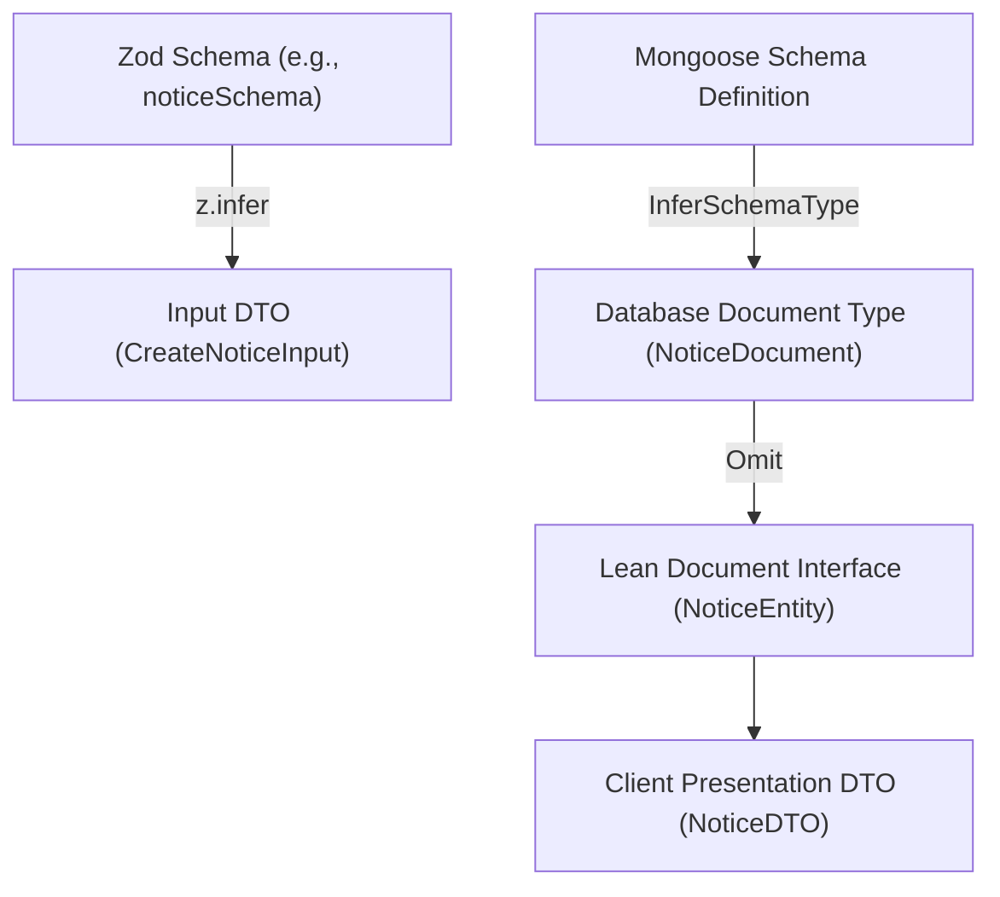

# TypeScript Architecture & Type Organization

> **Document ID:** DOC-STRUC-006  
> **Status:** Approved Baseline (Phase 1, Part 1.5)  
> **Institution:** Axis Institute of Technology & Management  
> **Compiler Configuration:** TypeScript 5+ Strict Mode  
> **Last Updated:** November 2026  

---

## 1. Type Architecture & Single Source of Truth

To eliminate type duplication and runtime synchronization bugs, Axis LinkUp enforces a **Single Source of Truth** pattern:



1. **Input Payloads & Mutations:** Defined first as Zod validation schemas (`src/lib/validations/` or `src/features/*/schemas/`). TypeScript types are inferred dynamically via `z.infer<typeof Schema>`.
2. **Database Documents:** Schemas defined in Mongoose; document types are derived using Mongoose’s `InferSchemaType`.
3. **Client DTOs:** Pure plain-object interfaces stripping internal Mongoose metadata (`__v`) and transforming `_id` to string `id`.

---

## 2. Directory Layout for Types (`src/types/`)

```
src/types/
├── api.ts                              # Standard API envelopes & pagination DTOs
├── auth.ts                             # User session claims, role types & JWT payloads
├── common.ts                           # Generic utilities: ID, Timestamps, Nullable, DeepPartial
├── enums.ts                            # Institutional TypeScript enums & const assertions
└── database.ts                         # Mongoose base document types & lean entity helpers
```

---

## 3. Core Shared Type Definitions

### 3.1 Global Enums & Constants (`src/types/enums.ts`)
```typescript
// Role Taxonomy
export const UserRole = {
  STUDENT: 'student',
  FACULTY: 'faculty',
  ADMIN: 'admin',
  SUPER_ADMIN: 'super_admin',
} as const;
export type UserRole = (typeof UserRole)[keyof typeof UserRole];

// Account State Lifecycle
export const UserStatus = {
  INVITED: 'invited',
  ACTIVE: 'active',
  SUSPENDED: 'suspended',
  ARCHIVED: 'archived',
} as const;
export type UserStatus = (typeof UserStatus)[keyof typeof UserStatus];

// Notice Priority
export const NoticePriority = {
  NORMAL: 'normal',
  IMPORTANT: 'important',
  URGENT: 'urgent',
} as const;
export type NoticePriority = (typeof NoticePriority)[keyof typeof NoticePriority];

// Service Request Status
export const RequestStatus = {
  SUBMITTED: 'submitted',
  UNDER_REVIEW: 'under_review',
  APPROVED: 'approved',
  REJECTED: 'rejected',
  CLOSED: 'closed',
} as const;
export type RequestStatus = (typeof RequestStatus)[keyof typeof RequestStatus];
```

### 3.2 Standard API Envelope & Pagination (`src/types/api.ts`)
```typescript
// Standard API Response Envelope
export type ApiResponse<T> =
  | {
      success: true;
      data: T;
      error: null;
      timestamp: string;
    }
  | {
      success: false;
      data: null;
      error: {
        code: string;
        message: string;
        details?: unknown;
      };
      timestamp: string;
    };

// Pagination Metadata Envelope
export interface PaginatedResult<T> {
  items: T[];
  pagination: {
    totalItems: number;
    pageSize: number;
    currentPage?: number;
    nextCursor?: string | null;
    hasMore: boolean;
  };
}
```

### 3.3 Authenticated User Session (`src/types/auth.ts`)
```typescript
import type { UserRole } from './enums';

export interface UserSession {
  id: string; // MongoDB User ObjectId as hex string
  clerkId: string; // Clerk identifier (user_2...)
  email: string;
  fullName: string;
  role: UserRole;
  departmentId: string | null;
  batchYear?: number | null;
  section?: string | null;
}
```

---

## 4. Feature-Specific DTOs Pattern

Feature-specific types reside inside their respective feature folders (`src/features/*/types/`):

```typescript
// Example: src/features/notices/types/notice.types.ts
import type { z } from 'zod';
import type { createNoticeSchema, noticeQuerySchema } from '../schemas/notice.schema';
import type { NoticePriority } from '@/types/enums';

// 1. Inferred Input DTO from Zod Schema (Single Source of Truth)
export type CreateNoticeInput = z.infer<typeof createNoticeSchema>;
export type NoticeQueryParams = z.infer<typeof noticeQuerySchema>;

// 2. Client-Facing Output DTO
export interface NoticeDTO {
  id: string;
  title: string;
  contentMarkdown: string;
  author: {
    id: string;
    name: string;
    role: string;
    departmentCode: string;
  };
  priority: NoticePriority;
  targetScope: {
    scopeType: 'all' | 'department' | 'year' | 'section';
    departmentId?: string | null;
    batchYear?: number | null;
    section?: string | null;
  };
  attachments: Array<{
    name: string;
    url: string;
    sizeBytes: number;
    mimeType: string;
  }>;
  isPinned: boolean;
  requiresAcknowledgment: boolean;
  expiresAt: string; // ISO 8601 string
  createdAt: string;
}
```

---

## 5. Path Aliases & Import Guidelines

The `tsconfig.json` paths mapping must be utilized exclusively:

```json
{
  "compilerOptions": {
    "baseUrl": ".",
    "paths": {
      "@/*": ["./src/*"]
    }
  }
}
```

### Standard Import Hierarchy:
```typescript
// 1. External Third-Party Packages
import React from 'react';
import { z } from 'zod';

// 2. Global Lib, Auth & Utils
import { requireAuth } from '@/lib/auth/guards';
import { cn } from '@/lib/utils/cn';

// 3. UI Primitives & Shared Components
import { Button } from '@/components/ui/button';
import { StatusBadge } from '@/components/shared/status-badge';

// 4. Feature Public APIs
import { NoticeCard } from '@/features/notices';

// 5. Types (Explicit type imports)
import type { NoticeDTO } from '@/features/notices';
import type { ApiResponse } from '@/types/api';
```

