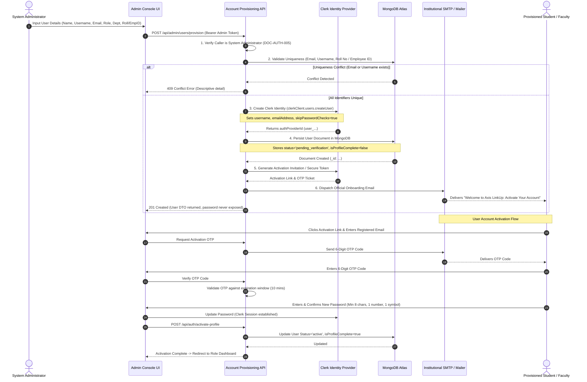

# AXIS LINKUP — ADMIN-CONTROLLED ACCOUNT PROVISIONING WORKFLOW
**Document ID:** DOC-REQ-002-REV2  
**Status:** Approved for Architecture & Workflow Specification (Phase 4.8.2)  
**Institution:** Axis Institute of Technology & Management (AITM), Kanpur  
**Last Updated:** November 13, 2026  

---

## 1. Objective & Purpose

This document specifies the administrative provisioning workflow that completely replaces public self-registration. In Axis LinkUp, all user identities (students, instructional faculty, HODs, and administrators) are created and managed by authorized **System Administrators**.

Ordinary students and faculty members have zero access to account creation surfaces.

---

## 2. Master Account Information Schema

When provisioning a new collegiate account, the administrator must supply the following mandatory data attributes:

| Field Name | Type | Constraints / Validation | Example Value |
| :--- | :--- | :--- | :--- |
| **Full Name** | `string` | 2–80 chars, alphabetical with spaces/periods | `Aarav Sharma` |
| **Unique Username** | `string` | 3–30 chars, lowercase alphanumeric, periods/underscores, strictly unique | `aarav.sharma` |
| **Institutional Email** | `string` | Must match institutional domain (`@axiscolleges.in`), strictly unique | `aarav.sharma@axiscolleges.in` |
| **Assigned Role** | `enum` | One of: `student`, `faculty`, `admin`, `super_admin` | `student` |
| **Department** | `string` | Valid department code (`CSE`, `ECE`, `ME`, `CE`, `EE`, `IT`, `ASH`) | `CSE` |
| **Student Roll Number** | `string` | Mandatory if role is `student`. Format: `YY[DEPT]NNN` | `24BCSE104` |
| **Faculty Employee ID** | `string` | Mandatory if role is `faculty` or `admin`. Format: `FAC-[DEPT]-NNN` | `FAC-CSE-042` |
| **Account Status** | `enum` | Initial: `pending_verification` (or `invited`). Transitioned upon activation | `pending_verification` |
| **Email Verification** | `boolean`| Initial: `false`. Transitioned to `true` upon OTP verification | `false` |

---

## 3. Account Provisioning Lifecycle & Sequence



---

## 4. Step-by-Step Provisioning Workflow Details

### Step 1: Administrator Data Entry
The System Administrator accesses the **Account Provisioning Desk** in the Executive Console (`/admin/dashboard` or `/super-admin/dashboard`). The form requires full identity, academic credentials, and institutional identifiers.

### Step 2: System Uniqueness Validation
Before contacting external services, the API executes parallel compound checks against MongoDB:
```ts
const [existingEmail, existingUsername, existingRoll] = await Promise.all([
  UserRepository.findByEmail(validated.email),
  UserRepository.findByUsername(validated.username),
  validated.studentProfile?.rollNumber
    ? UserRepository.findByRollNumber(validated.studentProfile.rollNumber)
    : null,
]);
```
If any attribute is duplicate, the request is aborted with `409 Conflict`.

### Step 3: Identity Provider Creation (Clerk API)
The system invokes the Clerk Server SDK:
```ts
const clerkUser = await clerkClient.users.createUser({
  emailAddress: [validated.email],
  username: validated.username,
  firstName: firstName,
  lastName: lastName,
  publicMetadata: {
    role: validated.role,
    status: 'pending_verification',
    departmentId: validated.departmentId,
  },
  skipPasswordChecks: true, // User sets password during activation
});
```

### Step 4: MongoDB Atlas Persistence
The authoritative user profile is written to MongoDB Atlas with `authProviderId: clerkUser.id`, `status: 'pending_verification'`, and `isProfileComplete: false`.

### Step 5 & 6: Activation Email Generation
The system dispatches an institutional invitation containing:
- Welcome message from Axis Institute of Technology & Management.
- Assigned unique username.
- Single-use, time-bound activation link (valid for 48 hours).

### Step 7 & 8: OTP Verification & Password Setup
The user opens the activation link, verifies their identity using a 6-digit email OTP, and establishes a secure personal password conforming to NIST SP 800-63B standards.

### Step 9: Account Promotion to Active Status
Upon successful password establishment:
- Clerk marks the user's email as verified.
- The Clerk webhook (`user.updated`) or activation API updates MongoDB `status: 'active'`.
- The user is redirected to the appropriate portal for login.

---

## 5. Security & Isolation Safeguards

1. **Zero Plaintext Password Exposure:**
   - Administrators **never** choose or see user passwords.
   - The provisioning API payload contains no password fields.
   - MongoDB never receives or stores passwords.
2. **Server-Side Authorization Gate:**
   - The provisioning endpoint (`/api/admin/users/provision`) is guarded by `requireRole('super_admin')`.
   - Normal students, faculty, and unauthorized departmental administrators receive `403 Forbidden`.
3. **Immutable Audit Logging:**
   - Every provisioned account generates an immutable audit record:
     `ADMIN_USER_PROVISIONED(adminId, targetEmail, targetRole, department, timestamp, ipAddress)`.
4. **Rate Limiting & Abuse Prevention:**
   - Administrator provisioning endpoints are capped at 50 requests per minute per IP to prevent bulk automated account stuffing.

