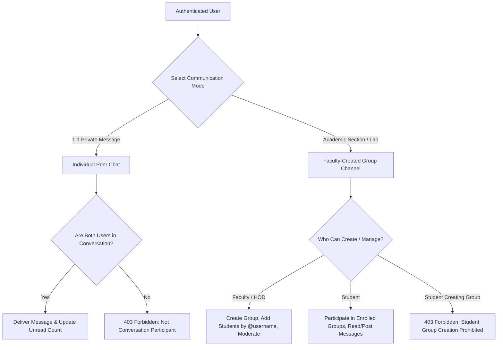

# AXIS LINKUP — CHAT & GROUP COMMUNICATION REQUIREMENTS
**Document ID:** DOC-REQ-008-REV2  
**Status:** Approved for Architecture & Workflow Specification (Phase 4.8.2)  
**Institution:** Axis Institute of Technology & Management (AITM), Kanpur  
**Last Updated:** November 13, 2026  

---

## 1. Executive Vision & Communication Model

Axis LinkUp establishes an internal, secure, audited messaging ecosystem inspired by modern communication platforms (e.g., WhatsApp Web) tailored strictly to collegiate academic life. 

### Key Design Tenets:
1. **Username-Based Identity:** Users interact and discover colleagues using their unique institutional usernames (e.g., `@aarav.sharma`, `@dr.verma`), eliminating the exposure of personal mobile phone numbers.
2. **Faculty-Governed Groups:** Group creation is **restricted to instructional faculty and HODs**. Students cannot create public or unmonitored group channels.
3. **End-to-End Authorization:** Every message delivery, history query, and attachment download is authenticated against conversation participation records.
4. **Light-Blue Glassmorphic UI:** Conforms to the approved visual benchmark (Reference 1) featuring frosted sidebar conversation lists, translucent message bubbles, and smooth pill controls.

---

## 2. Communication Modes



---

## 3. Individual Chat (1:1 Direct Messaging)

### 3.1 Features & Workflow
- **Initiation:** An authenticated user initiates a 1:1 conversation by searching for a peer using their exact `@username` or institutional email.
- **Privacy & Isolation:**
  - A 1:1 conversation is instantiated with exactly two participants.
  - Only the two designated participants hold authorization to read messages or post replies.
  - Direct message visibility is strictly prohibited for external users, other students, and non-super-admin staff.
- **Faculty Availability Safeguard:**
  - Faculty members can toggle an `isAcceptingDMs` preference or set office hours.
  - When disabled, student attempts to send new 1:1 messages display a polite institutional banner: *"Dr. Verma is currently offline. Office hours resume Monday at 10:00 AM."*

---

## 4. Faculty-Created Group Communication

### 4.1 Group Creation & Management Rules
- **Eligibility:** Strictly restricted to users holding the `faculty` or `admin` (HOD) role.
- **Creation Flow:**
  1. Faculty clicks `Create Academic Group`.
  2. Faculty defines: Group Title (e.g., `CS-301: Data Structures Lab Batch A`), Subject Code, Description, and Optional Group Avatar.
  3. Faculty enters student usernames (`@username`) or bulk imports roster roll numbers.
  4. System validates that all entered usernames exist in MongoDB.
  5. System generates the group and binds enrolled students as `member`.
  6. The group appears immediately in the student's conversation sidebar.

### 4.2 Group Member Roles & Capabilities

| Capability | Group Creator (Faculty) | Student Member | External Student |
| :--- | :---: | :---: | :---: |
| **Send Messages / Attachments** | ALLOW | ALLOW | DENY (403) |
| **Add / Remove Students** | ALLOW | DENY (403) | DENY (403) |
| **Edit Group Name / Avatar** | ALLOW | DENY (403) | DENY (403) |
| **Delete Inappropriate Messages** | ALLOW (Any msg) | ALLOW (Own msg only) | DENY (403) |
| **Archive / Close Group** | ALLOW | DENY (403) | DENY (403) |
| **Leave Group** | ALLOW (Designate successor) | ALLOW (Self-remove) | N/A |

---

## 5. Data Models & Relational Architecture

### 5.1 Conversation / Channel Model (`conversations`)
```typescript
interface IConversation {
  _id: Types.ObjectId;
  type: 'direct' | 'group';
  title?: string; // Mandatory for 'group'
  description?: string;
  avatarUrl?: string;
  creatorId: Types.ObjectId; // User who initiated/created
  departmentId?: Types.ObjectId; // Scoped for academic groups
  courseId?: string; // Course/Subject Code
  isArchived: boolean;
  lastMessageAt: Date;
  lastMessageSnippet?: string;
  createdAt: Date;
  updatedAt: Date;
}
```

### 5.2 Conversation Member Model (`conversation_members`)
```typescript
interface IConversationMember {
  _id: Types.ObjectId;
  conversationId: Types.ObjectId;
  userId: Types.ObjectId;
  username: string; // Cached for quick search
  role: 'owner' | 'moderator' | 'member';
  joinedAt: Date;
  lastReadMessageId?: Types.ObjectId;
  unreadCount: number;
  isMuted: boolean;
}
```

### 5.3 Message Model (`messages`)
```typescript
interface IMessage {
  _id: Types.ObjectId;
  conversationId: Types.ObjectId;
  senderId: Types.ObjectId;
  senderUsername: string;
  senderFullName: string;
  senderRole: UserRole;
  content: string; // Max 4,000 characters
  attachments: Array<{
    fileUrl: string;
    fileName: string;
    fileSize: number;
    mimeType: string;
  }>;
  status: 'sent' | 'delivered' | 'read';
  isDeleted: boolean;
  deletedAt?: Date;
  createdAt: Date;
  updatedAt: Date;
}
```

---

## 6. Functional Message Specifications

### 6.1 Pagination (Cursor-Based)
To support smooth scrolling without memory bloat:
- Messages are queried backwards from the oldest loaded message ID:
  `GET /api/chat/conversations/:id/messages?cursor=<messageId>&limit=30`
- Results return a slice of 30 messages with `nextCursor` and `hasMore`.

### 6.2 Delivery & Read Receipts
- **Sent (`✓`):** Persisted to MongoDB Atlas.
- **Delivered (`✓✓` gray):** Delivered to recipient's active client session or notification queue.
- **Read (`✓✓` blue):** Viewed by recipient in the active chat window.

### 6.3 Attachment Handling & Limits
- **Approved File Types:** PDF, DOCX, PPTX, JPEG, PNG, WEBP, ZIP.
- **Maximum File Size:** 10 MB per document; 5 MB per image.
- **Security:** Uploaded via presigned S3/Cloud storage URLs with SHA-256 hash validation. Executables (`.exe`, `.sh`, `.bat`, `.js`) are strictly rejected.

---

## 7. Real-Time Architecture Overview

- **Primary Transport:** WebSocket connection via Next.js custom server or managed real-time gateway (e.g., Socket.io, Pusher, or Supabase Realtime).
- **Fallback Transport:** HTTP Server-Sent Events (SSE) with short-interval long-polling fallback for constrained institutional Wi-Fi networks.
- **Message Dispatch Flow:**
  Client emits `send_message` $\rightarrow$ Server validates session & membership $\rightarrow$ Persists to MongoDB $\rightarrow$ Broadcasts payload to active room sockets $\rightarrow$ Recipient clients append message smoothly with sound/bubble animation.

