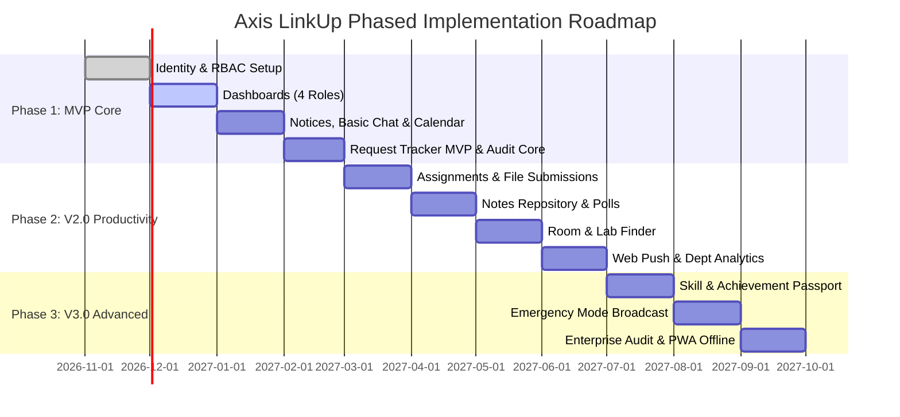

# Development Roadmap & Release Strategy

> **Document ID:** DOC-REQ-005  
> **Status:** Draft for Review (Phase 1, Part 1.1)  
> **Institution:** Axis Institute of Technology & Management  
> **Phases Covered:** Phase 1 (MVP) &rarr; Phase 2 (Version 2.0) &rarr; Phase 3 (Version 3.0 / Advanced)  

---

## 1. Release Strategy & Milestone Framework

To ensure rapid time-to-value, minimize deployment risks, and maintain stability across Axis Institute of Technology & Management, the development of Axis LinkUp is divided into three phased releases:



---

## 2. Release Categorization

### 2.1 Phase 1: Minimum Viable Product (MVP) — Essential First Release
**Primary Objective:** Deliver a rock-solid, production-ready core that establishes institutional identity, unifies official announcements, enables essential request handling, and replaces fragmented WhatsApp groups for formal communications.

**Included in MVP:**
- **MOD-01:** Authentication & User Management (Email/Password, CSV Bulk Roster Import, Password Reset).
- **MOD-02:** Role-Based Access Control (Strict route guards for 4 roles: Student, Faculty, Admin, Super Admin).
- **MOD-03:** Student Dashboard (Today's schedule, unread notices, active requests).
- **MOD-04:** Faculty Dashboard (Daily teaching slots, pending actions, course notices).
- **MOD-05:** Admin Dashboard (Request queue, notice publishing desk).
- **MOD-06:** Super Admin Dashboard (System status, user management, audit stream).
- **MOD-07:** College Notices (Targeted notices by dept/year, priority tags, pinning, basic read receipts).
- **MOD-08 (MVP Scope):** Real-Time Chat (Automated course channels and essential peer/faculty messaging).
- **MOD-10:** Academic Calendar (Master term schedule, departmental events, lecture timetables).
- **MOD-13 (MVP Scope):** Student Request Tracker (Top 5 common requests: Bonafide, Leave, ID Replacement, Lab Access, General Inquiry).
- **MOD-17 (MVP Scope):** Notifications (In-app bell notification center + transactional emails for requests/notices).
- **MOD-19 (MVP Scope):** Audit Logs (Append-only logging for auth, role changes, and notice actions).

### 2.2 Phase 2: Version 2.0 — Academic & Campus Productivity
**Primary Objective:** Deepen academic delivery workflows, streamline assignment evaluation, organize study resources, and digitize campus space utilization.

**Included in Version 2.0:**
- **MOD-09:** Polls & Voting (Course comprehension polls, campus student surveys, live result charts).
- **MOD-11:** Assignments and Submissions (Deadline enforcement, file uploads, late submissions handling, grading and rubric scores).
- **MOD-12:** Notes and Study Materials (Categorized unit-wise syllabus/lecture notes, search & download counters).
- **MOD-14:** Room and Lab Finder (Building directory, real-time timetable occupancy lookup, faculty reservation requests).
- **MOD-17 (Expanded):** Web Push Notifications for desktop and mobile browsers.
- **MOD-18 (Phase 2 Scope):** Departmental Analytics & Reports (Notice reach, request resolution SLA turnaround, assignment submission timeliness).

### 2.3 Phase 3: Version 3.0 — Advanced Campus Ecosystem & Enterprise Intelligence
**Primary Objective:** Empower student career progression, provide fail-safe campus safety overrides, deliver institutional accreditation reporting, and enable offline-first mobile experiences.

**Included in Advanced / Version 3.0:**
- **MOD-15:** Skill and Achievement Passport (Faculty-verified student achievements, hackathon wins, public recruiter portfolio link, accreditation reports).
- **MOD-16:** Emergency Mode (Master campus override banner, instant WebSocket blast, mandatory acknowledgment tracking).
- **MOD-18 (Complete):** Advanced Institutional Intelligence (Cross-department comparative analytics, NAAC/NIRF data export).
- **MOD-19 (Advanced):** Cryptographic Tamper-Detection for Audit Logs & Automated Retention Archiving.
- **PWA Offline Mode:** Service worker caching for timetable, downloaded notes, and offline read access.

---

## 3. Comprehensive Feature Traceability Matrix

| Module Code & Name | Sub-Feature / Capability | MVP (Phase 1) | V2.0 (Phase 2) | V3.0 (Advanced) |
| :--- | :--- | :---: | :---: | :---: |
| **MOD-01** Auth & User Mgmt | Email/Password Auth & Session Cookies | **Yes** | — | — |
| | CSV Bulk User Provisioning | **Yes** | — | — |
| | Password Reset & Email Verification | **Yes** | — | — |
| | Admin/Super Admin MFA (TOTP) | **Yes** | — | — |
| | Campus LDAP / Google Workspace SSO | — | Recommendation | Advanced |
| **MOD-02** RBAC | 4 Fixed Roles & Route Middleware | **Yes** | — | — |
| | Departmental & Section Scoping | **Yes** | — | — |
| | Dynamic Role Context Switching (e.g. HOD) | — | **Yes** | — |
| **MOD-03** Student Dashboard | Schedule, Notices, Deadlines, Requests | **Yes** | — | — |
| | Customizable Widgets & Dark Mode | — | **Yes** | — |
| **MOD-04** Faculty Dashboard | Teaching Schedule, Notice Composer | **Yes** | — | — |
| | Grading Queue & Quick Marks Entry | — | **Yes** | — |
| **MOD-05** Admin Dashboard | Request Queue & Notice Desk | **Yes** | — | — |
| | SLA Escalation Warnings & Room Overview | — | **Yes** | — |
| **MOD-06** Super Admin Dashboard | System Metrics, User Management | **Yes** | — | — |
| | Emergency Override Control Center | — | — | **Yes** |
| **MOD-07** College Notices | Department/Year Scoping, Priority Tags | **Yes** | — | — |
| | Pinned Notices & Expiry Scheduling | **Yes** | — | — |
| | Mandatory Acknowledgment Tracking | — | **Yes** | — |
| **MOD-08** Real-Time Chat | Course Channels & Basic Direct Messages | **Yes** | — | — |
| | Office Hours Restriction for Faculty | — | **Yes** | — |
| | Message Moderation & Reporting Flag | — | **Yes** | — |
| **MOD-09** Polls & Voting | Course & Campus Single/Multi-Choice Polls| — | **Yes** | — |
| | Anonymous Voting & Real-Time Charts | — | **Yes** | — |
| **MOD-10** Academic Calendar | College Events, Holidays & Section Timetable| **Yes** | — | — |
| | .ICS Calendar Subscription Feeds | — | **Yes** | — |
| | Automated Timetable Clash Detection | — | **Yes** | — |
| **MOD-11** Assignments | Deadline Enforcement & PDF Submissions | — | **Yes** | — |
| | Late Submission Penalty Configuration | — | **Yes** | — |
| | Online Marks & Private Feedback Comments | — | **Yes** | — |
| **MOD-12** Notes & Materials | Unit-wise Notes Upload & Downloads | — | **Yes** | — |
| | Keyword Search & Student Bookmarking | — | **Yes** | — |
| **MOD-13** Request Tracker | Top 5 Request Types (Bonafide, Leave, etc.)| **Yes** | — | — |
| | Status Pipeline (Submitted &rarr; Resolved) | **Yes** | — | — |
| | Dynamic Form Builder for New Request Types| — | **Yes** | — |
| | Automated PDF Certificate Generation (QR) | — | — | **Yes** |
| **MOD-14** Room & Lab Finder | Building & Room Spec Directory | — | **Yes** | — |
| | Live Timetable-Based Occupancy Status | — | **Yes** | — |
| | Online Lab Booking & Approval Workflow | — | **Yes** | — |
| **MOD-15** Skill Passport | Student Milestone Claim & Proof Upload | — | — | **Yes** |
| | Faculty Endorsement Verification Pipeline | — | — | **Yes** |
| | Public Recruiter Profile & QR Link | — | — | **Yes** |
| | NAAC / NIRF Accreditation Data Export | — | — | **Yes** |
| **MOD-16** Emergency Mode | Master Emergency Trigger & Modal Takeover| — | — | **Yes** |
| | Real-Time Multi-Channel Push & SMS Hooks | — | — | **Yes** |
| | Live Acknowledgment Confirmation Tracker | — | — | **Yes** |
| **MOD-17** Notifications | In-App Bell Center & Toast Alerts | **Yes** | — | — |
| | Transactional Email Dispatch (SMTP) | **Yes** | — | — |
| | Browser Web Push API Integration | — | **Yes** | — |
| **MOD-18** Analytics & Reports| Basic Notice Views & Request Counts | — | **Yes** | — |
| | Institutional SLA & Space Utilization | — | **Yes** | — |
| | Predictive Retention & Accreditation Engine| — | — | **Yes** |
| **MOD-19** Audit Logs | Auth, Role Change & Delete Logs | **Yes** | — | — |
| | Scoped Admin Audit Viewer | — | **Yes** | — |
| | Cryptographic Hash Verification & Archiving| — | — | **Yes** |

---

## 4. Dependencies & Critical Path Analysis

The critical path for initial development is strictly linear through identity and authorization before horizontal module expansion can commence:

```
[MOD-01 Auth Engine] 
       ↓
[MOD-02 RBAC Guards & Middleware]
       ↓
[Core Database Schema & Shared Layouts]
       ↓
[MOD-03/04/05/06 Role Dashboards & MOD-07 Notices]
       ↓
[MOD-10 Timetable & MOD-13 Request Tracker MVP]
       ↓
[Phase 1 Deployment & User Acceptance Testing]
```

**Key Takeaways:**
1. No student or faculty features can be built until **MOD-01** (Authentication) and **MOD-02** (RBAC) provide verified session tokens.
2. **MOD-14** (Room Finder) has a hard runtime dependency on **MOD-10** (Timetable slots) to determine real-time occupancy.
3. **MOD-16** (Emergency Mode) depends on the WebSocket foundation deployed in **MOD-08** (Chat).

---

## 5. Milestone Exit Gates & Sign-Off Criteria

### Gate 1: MVP Production Readiness (Milestone 1)
- [ ] 100% of P0 functional test cases pass across Student, Faculty, Admin, and Super Admin roles.
- [ ] Security audit confirms zero authorization bypasses between student and admin routes.
- [ ] Bulk CSV import successfully provisions 500+ test student accounts in under 30 seconds.
- [ ] Response latency on notice feeds and dashboards is `<= 200ms` under 500 concurrent virtual users.

### Gate 2: Version 2.0 Readiness (Milestone 2)
- [ ] Assignment submission engine handles 50 concurrent 25MB PDF uploads without socket drops or server crashes.
- [ ] Room Finder accurately detects occupied vs vacant classrooms against live timetable data.
- [ ] Administrative request resolution workflow reduces simulated turnaround time by >50% compared to paper logs.

### Gate 3: Version 3.0 Enterprise Readiness (Milestone 3)
- [ ] Emergency Mode broadcast achieves client screen takeover across simulated 5,000 active sessions within 3 seconds.
- [ ] Skill Passport verification hashes and public QR verification links operate securely without leaking internal PII.
- [ ] Audit logs pass tamper-resistance checks with automated database-level write-only enforcement.

